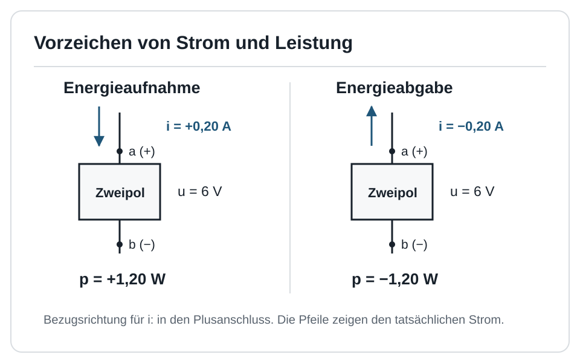

# M1-L1 – Ladung, Strom, Spannung und Leistung {#L1}

**Kursbereich:** M1 – Bachelor: Lineare elektrische Netze und Schaltungstheorie

**Niveau:** Bachelor · Einstieg

**Vorwissen:** Elementare Bruchrechnung, Zehnerpotenzen und das Umrechnen von Einheiten. Die Steigung einer Geraden findest du in [Schulmathematik M1-L8](index.html?course=school_mathematics&module=M1&lesson=L8&syslang=de&doclang=de&theme=light).

**Lernziel:** Ladung, Strom, Spannung, Leistung und Energie auseinanderhalten, ihre Einheiten ineinander umrechnen und an einem Zweipol entscheiden, in welche Richtung Energie übertragen wird.

## Zwei Messwerte, eine Frage {#S1}

Ein simuliertes Gerät zeigt an seinen Anschlüssen $6\,\mathrm{V}$ und $0{,}20\,\mathrm{A}$. Nimmt das Gerät Energie auf? Die Zahlen allein beantworten die Frage erst, wenn klar ist, **welcher Anschluss das höhere elektrische Potenzial hat** und **in welche Richtung der Strom gezählt wird**. Dieselbe gemessene Spannung kann an einer Quelle vorliegen, die Energie liefert, und an einem Verbraucher, der Energie aufnimmt.

Diese erste Lektion führt die Größen und ihre Vorzeichen an einem **Zweipol** ein, einem Bauteil oder System mit genau zwei betrachteten Anschlüssen. In der nächsten Lektion erhält der Zweipol mit dem Widerstand ein konkretes Bauteilgesetz.

## Ladung und Strom {#S2}

Die elektrische Ladung $q$ wird in Coulomb ($\mathrm{C}$) angegeben. Die Elementarladung $e$ ist der positive Betrag der Ladung eines Elektrons. Ein Elektron trägt die Ladung $-e$. Der genaue Zahlenwert ist im Internationalen Einheitensystem festgelegt:

$$
e=1{,}602\,176\,634\cdot 10^{-19}\,\mathrm{C}.
$$

Stell dir eine gedachte Schnittfläche im Leiter vor. Du wählst zuerst eine positive Richtung. Die Größe $q_{\mathrm{tr}}(t)$ bezeichnet die seit einem Referenzzeitpunkt **netto in dieser Richtung übertragene** Ladung. Der über ein Zeitintervall gemittelte und der momentane Strom sind dann

$$
\overline{i}=\frac{\Delta q_{\mathrm{tr}}}{\Delta t},
\qquad
i(t)=\frac{\mathrm d q_{\mathrm{tr}}}{\mathrm dt}.
$$

Ein Ampere entspricht einem Coulomb pro Sekunde. Fließen netto $0{,}40\,\mathrm C$ in $2{,}0\,\mathrm s$ in positiver Zählrichtung, beträgt der mittlere Strom $0{,}20\,\mathrm A$. Ein negatives Ergebnis repräsentiert Ladungstransport entgegen der festgelegten konventionellen Stromrichtung. In einem metallischen Leiter bewegen sich die negativ geladenen Elektronen im Mittel entgegengesetzt zum konventionellen Strom.

### Strom und gespeicherte Ladung

Strom beschreibt Transport über eine Grenze. Die Ladung in einem Volumen ist eine andere Größe. Treten beispielsweise $2\,\mathrm{mA}$ in eine betrachtete Region ein und $2\,\mathrm{mA}$ aus, ändert sich die dort eingeschlossene Nettoladung dadurch nicht. Das ist die Idee hinter der Knotenregel in [M1-L3](M1-L3.md).

## Spannung ist eine Differenz {#S3}

Die Spannung $u_{ab}$ zählt von Anschluss $a$ gegen Anschluss $b$. Im hier verwendeten elektrostatischen beziehungsweise konzentrierten Netzwerkmodell gilt für die Potenziale $v_a$ und $v_b$

$$
u_{ab}=v_a-v_b.
$$

Ein Volt entspricht einem Joule pro Coulomb. Ist $u_{ab}=6\,\mathrm V$, ist das Potenzial von $a$ um $6\,\mathrm V$ höher als das von $b$. Wird eine positive Ladung $q$ von $b$ nach $a$ bewegt, ändert sich ihre potenzielle Energie um $\Delta E_{\mathrm{pot}}=q\,u_{ab}$. Wird dieselbe Ladung in Gegenrichtung bewegt, kehrt sich das Vorzeichen um. Ein Bezugsknoten kann als $0\,\mathrm V$ gewählt werden, ohne dass sich eine Spannungsdifferenz verändert.

Im Schaltbild kennzeichnen $+$ und $-$ die **gewählte Bezugsorientierung**. Die Rechnung kann einen negativen Wert ergeben. Aus $v_a=2\,\mathrm V$ und $v_b=5\,\mathrm V$ folgen $u_{ab}=-3\,\mathrm V$ und $u_{ba}=+3\,\mathrm V$.

## Leistung und Energie {#S4}

Die Leistung beschreibt die Energieübertragung pro Zeit. Verwenden wir die **passive Vorzeichenkonvention**, zeigt der positive Strompfeil in den Anschluss, der bei der gewählten Spannung mit $+$ markiert ist. Dann gelten für die aufgenommene Leistung $p$ und die im Intervall netto aufgenommene Energie $E$:

$$
p(t)=u(t)\,i(t),
\qquad
E_{[t_1,t_2]}=\int_{t_1}^{t_2}p(t)\,\mathrm dt.
$$

Positive Leistung bedeutet Aufnahme, negative Leistung Abgabe. Die Regel gilt auch, wenn das eingesetzte $u$ oder $i$ negativ ist. Die Einheit stimmt, denn $\mathrm{V}\,\mathrm{A}=(\mathrm{J}/\mathrm C)(\mathrm C/\mathrm s)=\mathrm W$. Für konstanten Strom und konstante Spannung ist $E=p\,\Delta t$. Eine Wattsekunde ist ein Joule, eine Wattstunde sind $3\,600$ Joule.

{alt="Zwei Zweipole mit gleicher Spannung und gleichem Strombetrag. Links tritt der Strom am Pluspol ein und Leistung wird aufgenommen. Rechts tritt der Strom am Pluspol aus und Leistung wird abgegeben."}

Beim rechten Zweipol zeigt der Strompfeil die tatsächliche Richtung. Bezogen auf die passive Konvention ist sein Stromwert negativ. Man kann auch einen aus dem Plusanschluss gerichteten Bezugspfeil wählen. In dieser Konvention lautet die Formel für die aufgenommene Leistung $p=-ui$. Beide Darstellungen führen zur selben Energiebilanz.

## Beispiel: Ein Modellgerät überträgt Energie {#S5}

Zwischen $a$ und $b$ liegen konstant $6\,\mathrm V$. Bezug ist $u_{ab}$, und der Strom tritt mit $0{,}20\,\mathrm A$ in Anschluss $a$ ein. Das Modellgerät nimmt damit $1{,}20\,\mathrm W$ auf. In einer Minute werden

$$
E=1{,}20\,\mathrm W\cdot 60\,\mathrm s=72\,\mathrm J
$$

auf den Zweipol übertragen. Bei demselben Strombetrag verlassen in dieser Zeit $12\,\mathrm C$ Nettoladung den einen und treten am anderen Anschluss ein. Das Gerät speichert deshalb nicht zwangsläufig $12\,\mathrm C$ Ladung. Aus $E>0$ folgt zunächst nur die Nettoenergieaufnahme. Was intern mit der Energie geschieht, entscheidet das Bauteilmodell.

## Selbstkontrolle {#S6}

1. In $250\,\mathrm{ms}$ werden netto $15\,\mathrm{mC}$ in positiver Stromrichtung übertragen. Berechne den mittleren Strom.
2. Bei $u_{ab}=+9\,\mathrm V$ fließen $0{,}30\,\mathrm A$ aus $a$ heraus. Bestimme die aufgenommene Leistung bei passiver Konvention und die nach $20\,\mathrm s$ netto übertragene Energie.
3. Ein Verbraucher nimmt in der ersten Sekunde $3\,\mathrm W$ und in der zweiten Sekunde $1\,\mathrm W$ auf. Wie viel Energie nimmt er insgesamt auf, und wie groß ist die mittlere Leistung?

### Lösungen

1. $\overline i=0{,}015\,\mathrm C/0{,}250\,\mathrm s=0{,}060\,\mathrm A$, also $60\,\mathrm{mA}$.
2. Der Strom ist bezüglich des Eintritts an $a$ negativ. Es folgen $p=9\,\mathrm V\cdot(-0{,}30\,\mathrm A)=-2{,}7\,\mathrm W$ und $E=-54\,\mathrm J$. Der Zweipol gibt netto $54\,\mathrm J$ ab.
3. $E=3\,\mathrm J+1\,\mathrm J=4\,\mathrm J$. Die mittlere Leistung beträgt $4\,\mathrm J/2\,\mathrm s=2\,\mathrm W$.

## Modellgrenzen und nächster Schritt {#S7}

Das Modell behandelt Anschlüsse und Verbindungen konzentriert. Es beschreibt zunächst weder räumliche Feldverteilungen noch Ausbreitungszeiten entlang einer Leitung. Für die kommenden Beispiele zählen deshalb klar definierte Anschlussgrößen, die Bezugsrichtung und die Bilanz über die Modellgrenze.

**Weiterlesen:** [M1-L2 – Widerstand, Ohmsches Gesetz und einfache Netze](M1-L2.md) ordnet Spannung und Strom durch ein Bauteilgesetz ein.

## Quellen {#S8}

- [BIPM – SI Brochure, 9. Auflage](https://www.bipm.org/en/publications/si-brochure) · Kapitel 2, Definition des Ampere und abgeleitete SI-Einheiten. · Zuletzt abgerufen: 2026-11-25
- [OpenStax, University Physics Volume 2, § 9.1 – Electrical Current](https://openstax.org/books/university-physics-volume-2/pages/9-1-electrical-current) · Gemeinsame Belegstelle: Stromdefinition und Leistungsbezug. · Zuletzt abgerufen: 2026-11-25
- [OpenStax, University Physics Volume 2, § 9.5 – Electrical Energy and Power](https://openstax.org/books/university-physics-volume-2/pages/9-5-electrical-energy-and-power) · Gemeinsame Belegstelle: Stromdefinition und Leistungsbezug. · Zuletzt abgerufen: 2026-11-25
- [MIT OpenCourseWare, 6.002 – Circuits and Electronics, Lecture Notes](https://ocw.mit.edu/courses/6-002-circuits-and-electronics-spring-2007/pages/lecture-notes/) · Veranstaltung zu konzentrierter Modellierung und elementarer Schaltungsanalyse, Lektionen 1–2 im Vorlesungsskript. · Zuletzt abgerufen: 2026-11-25
