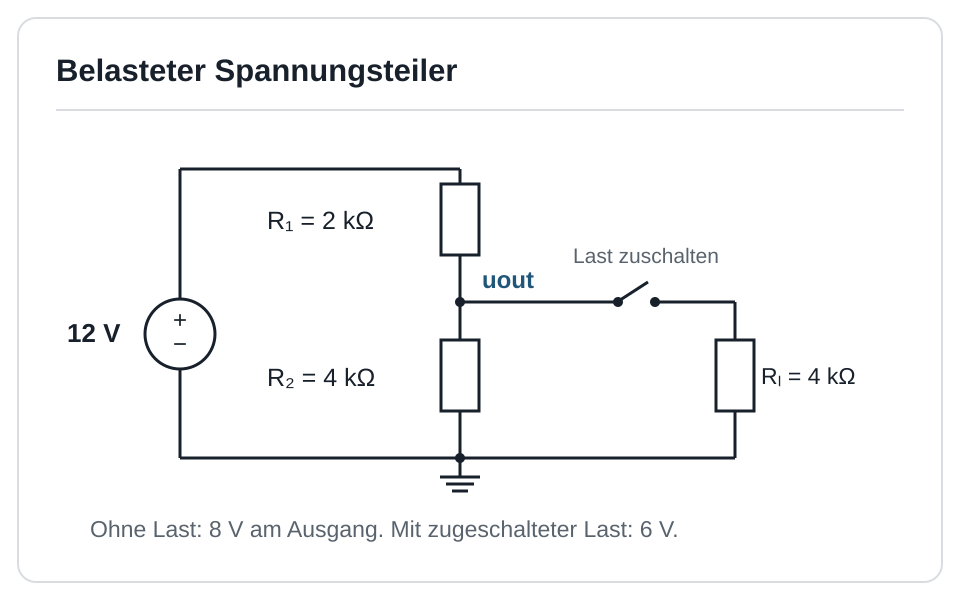

# M1-L2 – Widerstand, Ohmsches Gesetz und einfache Netze {#L2}

**Kursbereich:** M1 – Bachelor: Lineare elektrische Netze und Schaltungstheorie

**Niveau:** Bachelor · Einstieg

**Vorwissen:** [M1-L1](M1-L1.md), besonders Spannung, Leistungsrichtung und Einheiten.

**Lernziel:** Aus dem linearen Widerstandsmodell Ströme, Spannungen und Leistungen berechnen, Reihen- und Parallelschaltung erkennen und das Verhalten eines belasteten Spannungsteilers erklären.

## Gleiche Quelle, andere Spannung am Ausgang {#S1}

Zwei Widerstände werden an eine ideale Spannungsquelle angeschlossen. Am gemeinsamen Knoten kann ein definierter Teil der Quellenspannung abgenommen werden. Schließt du an diesem Knoten ein weiteres Gerät an, kann sich die Ausgangsspannung ändern. Diese Änderung ist **Belastung**. Um sie zu berechnen, brauchst du nur ein Bauteilgesetz und die Information, welche Widerstände über dieselben Knoten verbunden sind.

## Ohmscher Widerstand und Materialmodell {#S2}

Für einen linearen, zeitlich konstanten ohmschen Widerstand gilt bei passiver Vorzeichenkonvention

$$
u=R\,i,
\qquad
[R]=\Omega=\frac{\mathrm V}{\mathrm A}.
$$

$R>0$ ist die Steigung einer Darstellung von $u$ über $i$. Zeichnest du umgekehrt $i$ über $u$, ist die Steigung der Leitwert $G=1/R$ in Siemens ($\mathrm S$). Beides beschreibt dieselbe Kennlinie. Die Widerstandsleistung ist für beide Stromrichtungen nichtnegativ:

$$
p=ui=R i^2=\frac{u^2}{R}.
$$

Für einen geraden, homogenen Leiter mit gleichförmigem Querschnitt $A$ und Länge $\ell$ ist $R=\rho\ell/A$ ein einfaches Materialmodell. Die spezifische Resistivität $\rho$ hat die Einheit $\Omega\,\mathrm m$. Temperatur, Kontakte und ungleichförmige Geometrie können dieses Modell ändern. Eine Diode oder ein stark erwärmter Draht wird durch eine einzige, überall gleiche Kennliniensteigung nur unzureichend beschrieben.

## Reihe und Parallel {#S3}

In einer Reihe fließt derselbe Strom durch alle Elemente, wenn der gemeinsame Knoten keine weitere Verbindung hat. Die Teilspannungen addieren sich bei konsistenter Richtung. Mit $u_k=R_k i$ folgt

$$
R_{\mathrm{Reihe}}=\sum_k R_k.
$$

Parallel verbunden sind Elemente, deren Anschlüsse am gleichen Knotenpaar liegen. An ihnen liegt dieselbe Spannung an, und die Zweigströme addieren sich. Aus $i_k=u/R_k$ folgt

$$
\frac{1}{R_{\parallel}}=\sum_k\frac{1}{R_k},
\qquad
R_1\parallel R_2=\frac{R_1R_2}{R_1+R_2}.
$$

Für zwei endliche positive Widerstände ist $R_{\parallel}$ kleiner als jeder Einzelwiderstand. Diese Eigenschaft ist ein schneller Test gegen Rechen- und Zuordnungsfehler. Die geometrische Lage der Symbole im Schaltbild entscheidet nicht über die Verbindungsart. Entscheidend sind die elektrischen Knoten.

## Durchgerechnet: Belasteter Spannungsteiler {#S4}

Eine ideale Quelle liefert $u_\mathrm{in}=12\,\mathrm V$. Der obere Widerstand beträgt $R_1=2\,\mathrm{k}\Omega$, der untere $R_2=4\,\mathrm{k}\Omega$. Wir messen $u_\mathrm{out}$ am Zwischenknoten relativ zum Bezugsknoten.

{alt="Spannungsteiler mit zwölf Volt Eingang, zwei Kiloohm oben und vier Kiloohm unten. Ein schaltbarer Lastwiderstand von vier Kiloohm liegt parallel zum unteren Widerstand."}

**Unbelastet.** In der Reihe fließen $12\,\mathrm V/(6\,\mathrm{k}\Omega)=2\,\mathrm{mA}$. Am unteren Widerstand liegen deshalb $8\,\mathrm V$ an. Allgemein ist $u_\mathrm{out}=u_\mathrm{in}R_2/(R_1+R_2)$, solange der Ausgang keinen weiteren Einspeise- oder Lastzweig besitzt.

**Belastet mit $R_L=4\,\mathrm{k}\Omega$.** $R_L$ liegt parallel zu $R_2$. Ihr Ersatzwiderstand beträgt $2\,\mathrm{k}\Omega$. Der Quelle erscheint nun eine Reihe von $2\,\mathrm{k}\Omega+2\,\mathrm{k}\Omega$. Der Quellenstrom beträgt $3\,\mathrm{mA}$, der Ausgang sinkt auf $6\,\mathrm V$. In $R_2$ und $R_L$ fließen jeweils $1{,}5\,\mathrm{mA}$.

| Element | Spannung im Betrag | Strom im Betrag | Aufgenommene Leistung |
| --- | ---: | ---: | ---: |
| Oberer Widerstand $R_1$ | $6\,\mathrm V$ | $3\,\mathrm{mA}$ | $18\,\mathrm{mW}$ |
| Unterer Widerstand $R_2$ | $6\,\mathrm V$ | $1{,}5\,\mathrm{mA}$ | $9\,\mathrm{mW}$ |
| Last $R_L$ | $6\,\mathrm V$ | $1{,}5\,\mathrm{mA}$ | $9\,\mathrm{mW}$ |

Die ideale Quelle gibt $12\,\mathrm V\cdot3\,\mathrm{mA}=36\,\mathrm{mW}$ ab. Die drei Widerstände nehmen zusammen dieselbe Leistung auf. Im Grenzfall $R_L\to\infty$ ergibt sich wieder der unbelastete Ausgang. Für $R_L\to0$ sinkt $u_\mathrm{out}$ gegen null. Der Eingangsstrom bleibt in diesem idealisierten Beispiel durch $R_1$ begrenzt.

## Selbstkontrolle {#S5}

1. Zwei Widerstände $300\,\Omega$ und $600\,\Omega$ sind parallel an $6\,\mathrm V$ angeschlossen. Berechne Ersatzwiderstand, Zweigströme und Gesamtdissipation.
2. Ein unbelasteter Teiler mit $R_1=R_2=10\,\mathrm{k}\Omega$ hängt an $10\,\mathrm V$. Ein Messgerät wird als Eingangswiderstand $100\,\mathrm{k}\Omega$ modelliert. Welche Spannung zeigt das Modell, und wie groß ist die Abweichung vom unbelasteten Sollwert?
3. Zwei Widerstände teilen einen Knoten, an dem zusätzlich eine Stromquelle angeschlossen ist. Genügt der gemeinsame Knoten für eine Reihenschaltung?

### Lösungen

1. $R_\parallel=200\,\Omega$. Die Zweigströme betragen $20\,\mathrm{mA}$ und $10\,\mathrm{mA}$. Bei $30\,\mathrm{mA}$ Gesamtstrom beträgt die Leistung $0{,}18\,\mathrm W$.
2. Der untere Ersatzwiderstand ist $(100/11)\,\mathrm{k}\Omega\approx9{,}091\,\mathrm{k}\Omega$. Die Spannung ist $100/21\,\mathrm V\approx4{,}762\,\mathrm V$. Die Abweichung beträgt etwa $-0{,}238\,\mathrm V$ oder $-4{,}76\,\%$ bezogen auf $5\,\mathrm V$.
3. Nein. Der dritte Zweig lässt am Knoten unterschiedliche Ströme in den beiden Widerständen zu. Allein aus dem gemeinsamen Knoten folgt keine garantierte Stromgleichheit.

## Modellgrenzen und nächster Schritt {#S6}

Die Rechnung nutzt ideale Leitungen, eine ideale Spannungsquelle und lineare, zeitlich konstante Widerstände. Eine reale Messung kann durch Temperatur, Toleranzen, Quellimpedanz und zusätzliche elektrische Effekte vom Modell abweichen. Der belastete Teiler zeigt bereits im idealen Modell, weshalb der Eingang des nächsten Geräts zur Schaltung gehört.

**Weiterlesen:** [M1-L3 – Kirchhoff-Regeln und systematische Netzwerkanalyse](M1-L3.md) behandelt Netze, die sich nicht durch bloßes Zusammenfassen von Reihen- und Parallelschaltungen lösen lassen.

## Quellen {#S7}

- [OpenStax, University Physics Volume 2, § 9.3 – Resistivity and Resistance](https://openstax.org/books/university-physics-volume-2/pages/9-3-resistivity-and-resistance) · Gemeinsame Belegstelle: Widerstandsmodell und Netzwerkreduktion. · Zuletzt abgerufen: 2026-11-25
- [OpenStax, University Physics Volume 2, § 9.4 – Ohm’s Law](https://openstax.org/books/university-physics-volume-2/pages/9-4-ohms-law) · Abschnitt 9.4 – Gemeinsame Belegstelle: Widerstandsmodell und Netzwerkreduktion. · Zuletzt abgerufen: 2026-11-25
- [OpenStax, University Physics Volume 2, § 10.2 – Resistors in Series and Parallel](https://openstax.org/books/university-physics-volume-2/pages/10-2-resistors-in-series-and-parallel) · Abschnitt 10.2 – Gemeinsame Belegstelle: Widerstandsmodell und Netzwerkreduktion. · Zuletzt abgerufen: 2026-11-25
- [MIT OpenCourseWare, 6.002 – Circuits and Electronics, Lecture Notes](https://ocw.mit.edu/courses/6-002-circuits-and-electronics-spring-2007/pages/lecture-notes/) · Lektion 2 im Vorlesungsskript. · Zuletzt abgerufen: 2026-11-25
