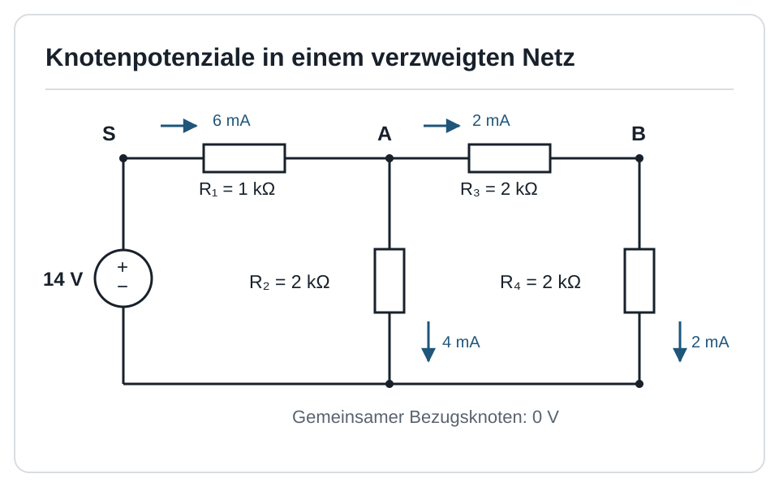

# M1-L3 – Kirchhoff-Regeln und systematische Netzwerkanalyse {#L3}

**Kursbereich:** M1 – Bachelor: Lineare elektrische Netze und Schaltungstheorie

**Niveau:** Bachelor

**Vorwissen:** [Ladung, Strom, Spannung und Leistung](M1-L1.md) und [Widerstand, Ohmsches Gesetz und einfache Netze](M1-L2.md). Beim Gleichungslösen hilft die [Lektion zu linearen Gleichungssystemen](index.html?course=school_mathematics&module=M1&lesson=L9&syslang=de&doclang=de&theme=light).

**Lernziel:** Vorzeichen für Ströme und Spannungen festlegen, ein Netz mit zwei unbekannten Knotenpotenzialen berechnen und das Ergebnis über Maschen und die Leistungsbilanz prüfen.

## Wie kommt man von der Schaltung zur Gleichung? {#S1}

Zwei Widerstände lassen sich nur dann direkt als Reihenschaltung zusammenfassen, wenn durch beide derselbe Strom fließt. Sobald an ihrem Verbindungspunkt ein weiterer Zweig abzweigt, muss man diese Bedingung erst prüfen. Die Kirchhoff-Regeln liefern ein Verfahren, das auch bei mehreren Verzweigungen funktioniert. Man beschreibt die Verbindungen durch Knoten- und Maschengleichungen und ergänzt die Kennbeziehungen der Bauelemente.

Ein **Knoten** umfasst alle durch ideale Leitungen unmittelbar verbundenen Punkte. Ein **Zweig** verbindet zwei Knoten über ein Bauelement oder eine Kette ohne weitere Abzweigung. Ein **geschlossener Umlauf** führt über Zweige zum Ausgangspunkt zurück. In einer eben gezeichneten Schaltung heißen die geschlossenen Umläufe, die keinen weiteren Umlauf einschließen, Maschen.

## Knotenregel und Maschenregel {#S2}

**Knotenregel (KCL).** An einem idealen Knoten ohne eigene Ladungsspeicherung ist die algebraische Stromsumme null. Wählt man aus dem Knoten heraus gerichtete Ströme als positiv, gehen die in den Knoten hinein gerichteten mit negativem Vorzeichen ein. Am nächsten Knoten kann derselbe Zweigstrom mit dem anderen Vorzeichen erscheinen.

$$
\sum_k I_k = 0
$$

**Maschenregel (KVL).** Beim Umlauf addiert man die Potenzialänderungen. Ein Schritt von $-$ nach $+$ über einem Bauelement trägt $+U$ bei, der umgekehrte Schritt $-U$. Weil Ausgangs- und Endpunkt zusammenfallen, gilt

$$
\sum_k \Delta V_k = 0.
$$

Ein Referenzknoten erhält $V_0=0$. Die Spannung $U_{ab}=V_a-V_b$ und der angenommene Strom $I_{ab}$ beziehen sich auf dasselbe geordnete Knotenpaar. Für einen Widerstand von $a$ nach $b$ ist $I_{ab}=(V_a-V_b)/R$. Ein negatives Ergebnis zeigt, dass der tatsächliche konventionelle Strom entgegengesetzt zum gewählten Pfeil fließt.

## Knotenpotenzialverfahren am Zweiknotennetz {#S3}

Eine ideale Quelle hält $V_S=14\,\mathrm{V}$ gegenüber $0$. Zwischen $S$ und $A$ liegt $R_1=1\,\mathrm{k\Omega}$. Zwischen $A$ und $0$ liegt $R_2=2\,\mathrm{k\Omega}$, zwischen $A$ und $B$ liegt $R_3=2\,\mathrm{k\Omega}$ und zwischen $B$ und $0$ liegt $R_4=2\,\mathrm{k\Omega}$. Beide unbekannten Potenziale werden gegen denselben Bezugsknoten angegeben.

{alt="Knotennetz mit einer 14-V-Quelle, zwei unbekannten Knoten und vier Widerständen. Die beschrifteten Pfeile zeigen die vier berechneten Zweigströme."}

1. Schreibe für jeden unbekannten Knoten die Summe der abfließenden Ströme auf.
2. Ersetze Widerstandsströme durch Potenzialdifferenz geteilt durch Widerstand.
3. Löse das Gleichungssystem und berechne die Zweigströme aus den Potenzialen.

$$
\begin{aligned}
A:\quad
\frac{V_A-14\,\mathrm{V}}{1\,\mathrm{k\Omega}}+
\frac{V_A}{2\,\mathrm{k\Omega}}+
\frac{V_A-V_B}{2\,\mathrm{k\Omega}}&=0,\\
B:\quad
\frac{V_B-V_A}{2\,\mathrm{k\Omega}}+
\frac{V_B}{2\,\mathrm{k\Omega}}&=0.
\end{aligned}
$$

Nach Multiplikation mit $2\,\mathrm{k\Omega}$ erhält man $4V_A-V_B=28\,\mathrm V$ und $2V_B=V_A$. Damit ist $V_A=8\,\mathrm V$ und $V_B=4\,\mathrm V$.

| Zweig und positive Bezugsrichtung | Strom | Aufgenommene Leistung |
| --- | ---: | ---: |
| $R_1$, $S\to A$ | $6\,\mathrm{mA}$ | $36\,\mathrm{mW}$ |
| $R_2$, $A\to 0$ | $4\,\mathrm{mA}$ | $32\,\mathrm{mW}$ |
| $R_3$, $A\to B$ | $2\,\mathrm{mA}$ | $8\,\mathrm{mW}$ |
| $R_4$, $B\to 0$ | $2\,\mathrm{mA}$ | $8\,\mathrm{mW}$ |

**Maschenprobe.** Auf $0\to S\to A\to 0$ ändern sich die Potenziale um $(+14-6-8)\,\mathrm V=0$. Auf $0\to A\to B\to 0$ ergeben sich $(+8-4-4)\,\mathrm V=0$.

**Leistungsprobe.** Für jeden Widerstand gilt $P=I^2R$. Die Quelle liefert $14\,\mathrm V\cdot6\,\mathrm{mA}=84\,\mathrm{mW}$. Ihr Strom tritt an der positiven Klemme aus. In der Vorzeichenkonvention für aufgenommene Leistung zählt sie daher mit $-84\,\mathrm{mW}$. Zusammen mit den Widerständen ergibt sich $-84+36+32+8+8=0$ in Milliwatt.

### Zweiter Rechenweg: Maschenströme

Wähle zwei Maschenströme $j_1$ und $j_2$ im Uhrzeigersinn. $j_1$ läuft links durch Quelle und $R_1$, $j_2$ rechts durch $R_3$ und $R_4$. Am gemeinsamen Zweig $R_2$ zählt von $A$ zur Referenz die Differenz $j_1-j_2$. Die Maschenregel liefert

$$
\begin{aligned}
(3\,\mathrm{k}\Omega)j_1-(2\,\mathrm{k}\Omega)j_2&=14\,\mathrm V,\\
-(2\,\mathrm{k}\Omega)j_1+(6\,\mathrm{k}\Omega)j_2&=0.
\end{aligned}
$$

Die zweite Gleichung ergibt $j_2=j_1/3$. Einsetzen liefert $j_1=6\,\mathrm{mA}$ und $j_2=2\,\mathrm{mA}$. Durch $R_2$ fließen wieder $4\,\mathrm{mA}$. Für dieses Netz liefern beide Ansätze zwei Gleichungen. Welche Methode kürzer ist, hängt davon ab, wie viele Knoten- oder Maschenvariablen man ansetzen muss.

## Ideale Spannungsquelle zwischen zwei unbekannten Knoten {#S4}

Der Strom durch eine ideale Spannungsquelle folgt nicht aus ihrer bekannten Spannung. Liegt die Quelle zwischen zwei unbekannten Knoten, kann man beide gemeinsam als **Superknoten** behandeln. Die Strombilanz betrachtet nur die Zweige, die seine Grenze kreuzen. Der unbekannte Quellenstrom fließt innerhalb der Grenze und fällt aus der gemeinsamen Bilanz heraus. Die zweite Gleichung ist die vorgegebene Spannungsdifferenz zwischen den beiden Knoten. Der Quellenstrom kann anschließend aus der Knotenregel an einem der Einzelknoten berechnet werden.

## Selbstkontrolle {#S5}

### Aufgaben

1. $R_4$ wird aus dem Zweiknotennetz entfernt. Wie ändern sich $I_{AB}$, $V_A$ und $V_B$?
2. Eine ideale Stromquelle speist $4\,\mathrm{mA}$ in $A$ ein. $A$ und $B$ sind über $2\,\mathrm{k\Omega}$ beziehungsweise $4\,\mathrm{k\Omega}$ mit dem Bezugsknoten verbunden. Eine ideale Spannungsquelle legt $V_A-V_B=2\,\mathrm V$ fest. Berechne $V_A$, $V_B$ und den Quellenstrom in Richtung $A\to B$.

### Lösungen

1. An $B$ ist nur noch ein Zweig angeschlossen. Die Knotenregel verlangt $I_{AB}=0$, folglich $V_B=V_A$. $R_1$ und $R_2$ bilden den verbleibenden Spannungsteiler. Damit liegen beide Knoten bei $14\,\mathrm V\cdot 2/3\approx9{,}33\,\mathrm V$.
2. Für den Superknoten gilt $V_A/(2\,\mathrm{k\Omega})+V_B/(4\,\mathrm{k\Omega})=4\,\mathrm{mA}$. Daraus folgt $2V_A+V_B=16\,\mathrm V$. Zusammen mit der Spannungsbedingung erhält man $V_A=6\,\mathrm V$ und $V_B=4\,\mathrm V$. Von den eingespeisten $4\,\mathrm{mA}$ fließen $3\,\mathrm{mA}$ über den Widerstand von $A$ zur Referenz. Die übrige $1\,\mathrm{mA}$ fließt durch die Spannungsquelle von $A$ nach $B$.

## Gültigkeitsbereich und Ausblick {#S6}

Das Modell behandelt Leitungen als ideale Verbindungen und konzentriert Spannungsabfälle und Speicherwirkungen in Bauelementen. Bei relevanter Knotenkapazität kann man den Speicherstrom als eigenen Zweig modellieren. Bei zeitabhängigem magnetischem Fluss durch eine Leitungsschleife muss man die Induktionswirkung berücksichtigen, etwa als induzierte Spannung in einem geeigneten Zweigmodell. Bei räumlich ausgedehnten Netzen und schnellen Signalen können zusätzlich Leitungslaufzeiten wichtig werden.

**Weiterlesen:** [Ersatzschaltungen und Leistungsanpassung](M1-L4.md) nutzt dieselben Gleichungen, um ein Netz an zwei Klemmen durch ein einfacheres Modell zu beschreiben.

## Quellen {#S7}

- [MIT OpenCourseWare, 6.002 Circuits and Electronics, Vorlesung 2](https://ocw.mit.edu/courses/6-002-circuits-and-electronics-spring-2007/resources/lecture-2/) · systematische Schaltungsanalyse · Zuletzt abgerufen: 2026-11-25
- [OpenStax, University Physics Volume 2, § 10.3](https://openstax.org/books/university-physics-volume-2/pages/10-3-kirchhoffs-rules) · Abschnitt 10.3 – Knotenregel, Maschenregel und Leistungsbilanz · Zuletzt abgerufen: 2026-11-25
