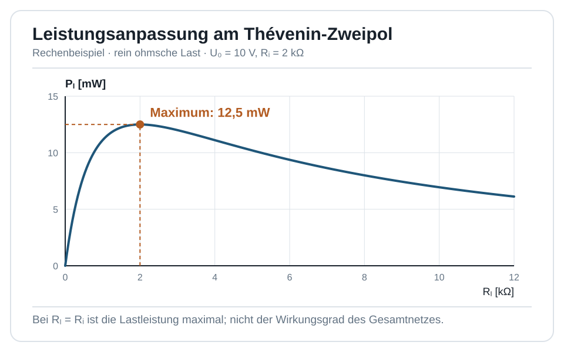

# M1-L4 – Ersatzschaltungen und Leistungsanpassung {#L4}

**Kursbereich:** M1 – Bachelor: Lineare elektrische Netze und Schaltungstheorie

**Niveau:** Bachelor

**Vorwissen:** [Kirchhoff-Regeln und systematische Netzwerkanalyse](M1-L3.md), Spannungsteiler und elektrische Leistung.

**Lernziel:** Ein lineares Zweipolnetz als Thévenin- oder Norton-Quelle beschreiben, seinen Innenwiderstand auch bei vorhandenen gesteuerten Quellen bestimmen und den Lastwiderstand für maximale Lastleistung berechnen.

## Was bleibt von einem Netz an seinen Klemmen sichtbar? {#S1}

Ein Sensor kann sich an zwei Ausgangsklemmen anders verhalten, sobald ein nachgeschaltetes Gerät Strom zieht. Die Leerlaufspannung beschreibt nur den Fall mit offenem Ausgang. Für die belastete Spannung ist auch entscheidend, wie stark sie mit zunehmendem Laststrom abfällt.

Für die folgenden Gleichstrommodelle sei $U=V_a-V_b$. Der Laststrom $I_L$ verlässt das Netz an Klemme $a$ und fließt durch die Last von $a$ nach $b$. An einem linearen Zweipol mit endlichem Innenwiderstand beschreibt die Kennlinie

$$
U=U_0-R_\mathrm{i} I_L
$$

die Klemmenwerte. $U_0$ ist die Leerlaufspannung, und $-R_\mathrm{i}$ ist die Steigung der Kennlinie in dieser Vorzeichenkonvention. Die **Thévenin-Ersatzschaltung** besteht aus einer idealen Spannungsquelle $U_0$ in Reihe mit $R_\mathrm{i}$. Für endliches $R_\mathrm{i}\ne 0$ entspricht ihr die **Norton-Ersatzschaltung** mit $R_\mathrm{i}$ parallel zu einer idealen Stromquelle $I_\mathrm{N}=U_0/R_\mathrm{i}$. Deren Bezugsrichtung im Ersatznetz zeigt von $b$ nach $a$. Der externe Kurzschlussstrom hat in der gewählten Lastrichtung den Wert $I_L=I_\mathrm{N}$.

## Quellenbeiträge, Innenwiderstand und Testquelle {#S2}

Bei **Superposition** berechnet man den Beitrag jeder unabhängigen Quelle und addiert die resultierenden Spannungen oder Ströme mit ihren Vorzeichen. Je Teilschaltung bleiben die betrachtete Quelle und alle gesteuerten Quellen aktiv. Alle anderen unabhängigen Quellen werden auf null gesetzt. Eine ideale Spannungsquelle mit $0\,\mathrm V$ entspricht einer Verbindung, eine ideale Stromquelle mit $0\,\mathrm A$ einer Unterbrechung. Bauteile und Innenwiderstände der ursprünglichen Schaltung bleiben vorhanden.

Leistungen werden erst aus den zusammengesetzten Strömen und Spannungen berechnet. Schon am Widerstand sieht man, warum sich Teilbeiträge zur Leistung im Allgemeinen nicht addieren lassen. In $R(I_1+I_2)^2$ steckt zusätzlich der Kreuzterm $2RI_1I_2$.

Für $R_\mathrm{i}$ nimmt man die Last ab und setzt alle unabhängigen Quellen auf null. Besteht das verbleibende Netz aus Widerständen, lässt es sich häufig durch Reihen- und Parallelschaltungen auswerten. Gesteuerte Quellen bleiben auch bei diesem Schritt aktiv. Dann kann man eine Testspannung $U_\mathrm{T}=V_a-V_b$ anlegen und den von der Testquelle in $a$ eingespeisten Strom $I_\mathrm{T}$ berechnen. Mit diesem **ins Netz hinein** gerichteten Bezugsstrom gilt $R_\mathrm{i}=U_\mathrm{T}/I_\mathrm{T}$, sofern der Quotient bestimmt ist.

## Ein Spannungsteiler versorgt eine Last {#S3}

Eine ideale Quelle mit $15\,\mathrm V$ speist über $R_1=3\,\mathrm{k\Omega}$ die Ausgangsklemme $a$. Der Widerstand $R_2=6\,\mathrm{k\Omega}$ verbindet $a$ mit der Referenzklemme $b$. Die Last liegt ebenfalls zwischen $a$ und $b$.

1. **Leerlauf.** Bei abgenommener Last ergibt der Spannungsteiler $U_0=15\,\mathrm V\cdot 6/(3+6)=10\,\mathrm V$.
2. **Innenwiderstand.** Nach Nullsetzen der idealen Spannungsquelle liegen $R_1$ und $R_2$ aus Sicht von $a$ parallel. Das ergibt $R_\mathrm{i}=2\,\mathrm{k\Omega}$.
3. **Norton-Strom.** Aus $U_0/R_\mathrm{i}$ folgen $5\,\mathrm{mA}$. Als Probe liefert das ursprüngliche Modell bei $U=0$ über $R_1$ denselben Strom, während durch $R_2$ kein Strom fließt.
4. **Belastung.** Mit $R_L=2\,\mathrm{k\Omega}$ erhält man $I_L=\frac{10\,\mathrm V}{(2+2)\,\mathrm{k\Omega}}=2{,}5\,\mathrm{mA}$, $U=5\,\mathrm V$ und $P_L=12{,}5\,\mathrm{mW}$. Im ursprünglichen Netz wird $R_2$ durch $R_L$ auf $1{,}5\,\mathrm{k\Omega}$ parallel belastet. Die Teilerrechnung liefert ebenfalls $5\,\mathrm V$.

## Maximale Lastleistung und Wirkungsgrad {#S4}

Für $R_\mathrm{i}>0$, $R_L>0$ und $U_0\ne 0$ gilt

$$
P_L=I_L^2R_L
=\frac{U_0^2R_L}{(R_\mathrm{i}+R_L)^2}
=\frac{U_0^2}{4R_\mathrm{i}+(R_\mathrm{i}-R_L)^2/R_L}.
$$

Der Nenner ist genau bei $R_L=R_\mathrm{i}$ am kleinsten. Beim Beispiel beträgt die maximale Lastleistung damit $\frac{(10\,\mathrm V)^2}{4\cdot2\,\mathrm{k\Omega}}=12{,}5\,\mathrm{mW}$.

Im Thévenin-Ersatzmodell dissipieren bei Anpassung beide Widerstände die gleiche Leistung. Der Anteil der Last an der Leistung der idealen Ersatzspannungsquelle beträgt dort $50\,\%$. Für den Wirkungsgrad des ursprünglichen Netzes muss man dessen innere Verluste berechnen. Bei $U=5\,\mathrm V$ liefert die ursprüngliche $15\,\mathrm V$-Quelle über $R_1$ einen Strom von $\tfrac{10}{3}\,\mathrm{mA}$, also insgesamt $50\,\mathrm{mW}$. In diesem Netz erreichen $12{,}5\,\mathrm{mW}$ die Last, entsprechend $25\,\%$.

{alt="Kurve der Lastleistung gegen den Lastwiderstand mit einem Maximum von 12,5 Milliwatt bei 2 Kiloohm."}

Die Kurve stellt die Lastleistungsformel für das durchgerechnete Beispiel dar. Für sehr kleine und sehr große Lastwiderstände fällt die Lastleistung ab; das Maximum liegt bei der Widerstandsanpassung.

## Selbstkontrolle {#S5}

### Aufgaben

1. Ergänze beim Spannungsteiler eine unabhängige ideale Stromquelle mit $1\,\mathrm{mA}$ von $b$ nach $a$. Die Last bleibt abgenommen. Berechne die neue Leerlaufspannung durch Superposition und gib den Innenwiderstand an.
2. Zwischen $a$ und $b$ liegen ein $2\,\mathrm{k\Omega}$-Widerstand, eine unabhängige Stromquelle von $3\,\mathrm{mA}$ von $b$ nach $a$ und eine gesteuerte Stromquelle parallel. Letztere führt von $a$ nach $b$ den Strom $G U$ mit $G=0{,}25\,\mathrm{mS}$. Bestimme den Innenwiderstand mit einer Testspannung von $4\,\mathrm V$ und berechne $U_0$.

### Lösungen

1. Die Spannungsquelle trägt $10\,\mathrm V$ bei. Für den Anteil der Stromquelle liegt der Nullwert der Spannungsquelle als Verbindung vor. In $R_1\parallel R_2=2\,\mathrm{k\Omega}$ erzeugt der eingespeiste Strom zusätzlich $2\,\mathrm V$. Die Summe ergibt $12\,\mathrm V$. Werden beide unabhängigen Quellen auf null gesetzt, bleibt $R_\mathrm{i}=2\,\mathrm{k\Omega}$.
2. Mit geöffneter unabhängiger Stromquelle fließen beim Test $2\,\mathrm{mA}$ durch den Widerstand und $1\,\mathrm{mA}$ durch die weiter aktive gesteuerte Quelle. Der Gesamtstrom ist $3\,\mathrm{mA}$, also $R_\mathrm{i}=\tfrac{4}{3}\,\mathrm{k\Omega}$. Im Leerlauf speist die unabhängige Quelle genau diese $3\,\mathrm{mA}$ ein, folglich ergibt sich $U_0=4\,\mathrm V$.

## Annahmen und Ausblick {#S6}

Die linearen Ersatzmodelle geben für zulässige Lasten die Klemmenwerte an. Aussagen über innere Bauteilbelastungen erfordern das ursprüngliche Netz. Bei Quellen mit Strombegrenzung oder anderen nichtlinearen Bauteilen gilt eine lineare Näherung nur in einem begründeten Arbeitsbereich. Die Kurzschlusswerte hier sind Ergebnisse idealisierter Schaltbildrechnungen. Die Bedingung für maximale Lastleistung in dieser Lektion setzt einen positiven reellen Innenwiderstand und eine rein ohmsche Last voraus.

**Weiterlesen:** [Kondensator, Spule und Einschwingvorgänge](M1-L5.md) ergänzt Bauelemente, die Energie zeitweilig speichern. Dort bestimmt der von den Speicherelementen aus sichtbare Ersatzwiderstand die Zeitkonstante mit.

## Quellen {#S7}

- [MIT OpenCourseWare, 6.002 Circuits and Electronics, Vorlesung 3](https://ocw.mit.edu/courses/6-002-circuits-and-electronics-spring-2007/resources/lecture-3/) · Superposition und Zweipol-Ersatzschaltungen · Zuletzt abgerufen: 2026-11-25
- [Cornell University – ECE/ENGRD 2100, Lecture 8 (PDF)](https://bpb-us-w2.wpmucdn.com/sites.coecis.cornell.edu/dist/4/81/files/2019/06/ECE2100-L8-notes.pdf) · Folien 9–10, Maximum Power Transfer: Leistungsanpassung und 50 % Wirkungsgrad am Leistungspunkt. · Zuletzt abgerufen: 2026-11-25
- [OpenStax, University Physics Volume 2, § 9.5](https://openstax.org/books/university-physics-volume-2/pages/9-5-electrical-energy-and-power) · elektrische Energie und Leistung bei ohmscher Last · Zuletzt abgerufen: 2026-11-25
