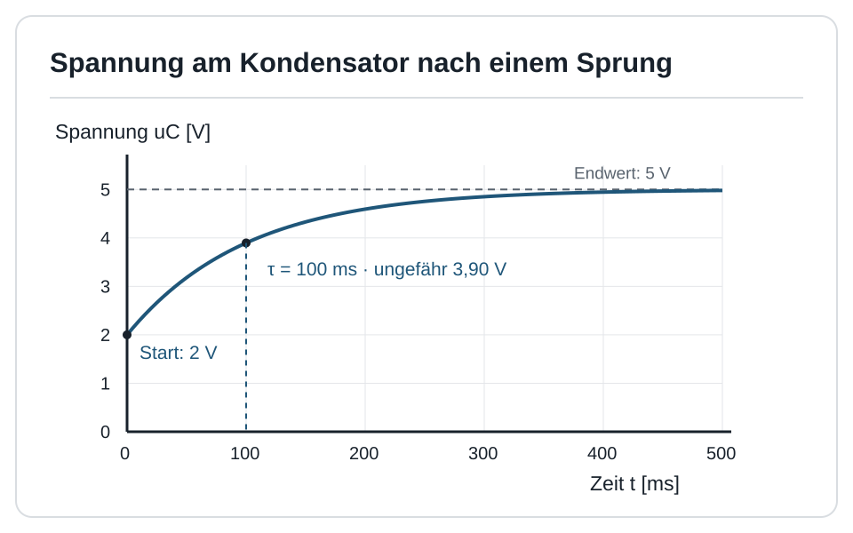

# M1-L5 – Kondensator, Spule und Einschwingvorgänge {#L5}

**Kursbereich:** M1 – Bachelor: Lineare elektrische Netze und Schaltungstheorie

**Niveau:** Bachelor

**Vorwissen:** [Kirchhoff-Regeln](M1-L3.md), [Ersatzschaltungen](M1-L4.md) und die Ableitung einer Exponentialfunktion.

**Lernziel:** Aus einer Schaltung erster Ordnung Anfangswert, Endwert und Zeitkonstante bestimmen und damit eine Sprungantwort berechnen.

## Eine Schaltung mit Gedächtnis {#S1}

Ein Sensorsignal springt von $2\,\mathrm{V}$ auf $5\,\mathrm{V}$. Hinter einem Widerstand und einem Kondensator erscheint dieselbe Änderung verzögert. Wie lange dauert es, bis der Ausgang in der Nähe des neuen Werts liegt? Dafür brauchen wir eine **Anfangsbedingung**. Sie beschreibt die Energie, die die Schaltung beim Umschalten bereits gespeichert hat.

Wir verwenden für jedes Bauteil die passive Vorzeichenkonvention. Der positive Strom tritt am Anschluss ein, an dem die positive Spannung gemessen wird. Für einen idealen Kondensator mit konstanter Kapazität $C$ und eine ideale Spule mit konstanter Induktivität $L$ gilt

$$
i_C(t)=C\frac{\mathrm d u_C}{\mathrm d t},\qquad
u_L(t)=L\frac{\mathrm d i_L}{\mathrm d t}.
$$

Die gespeicherte Energie beträgt $W_C=Cu_C^2/2$ bzw. $W_L=Li_L^2/2$. Bei endlichem Kondensatorstrom bleibt $u_C$ beim Umschalten stetig. Bei endlicher Spulenspannung bleibt $i_L$ stetig. Die jeweils andere Bauteilgröße kann springen. Ein Sprung der Speichervariablen würde im idealen Modell einen Strom- bzw. Spannungsimpuls voraussetzen.

## Die Sprungantwort eines RC-Kreises {#S2}

Eine Quelle mit der konstanten Spannung $U_s$ treibt ab $t=0$ einen Widerstand $R>0$ in Reihe mit einem Kondensator $C>0$. Schreibe die Maschengleichung und ersetze den Strom durch die Kondensatorgleichung. Damit ergibt sich

$$
U_s=Ri_C+u_C,\qquad
RC\frac{\mathrm d u_C}{\mathrm d t}+u_C=U_s.
$$

Der stationäre Endwert ist $u_\infty=U_s$, denn bei konstanter Kondensatorspannung fließt kein Strom mehr. Für die Abweichung $x=u_C-U_s$ gilt $\mathrm dx/\mathrm dt=-x/(RC)$. Aus $x(0^+)=u_C(0^-)-U_s$ folgt

$$
u_C(t)=U_s+\bigl(u_C(0^-)-U_s\bigr)\mathrm e^{-t/\tau},
\qquad \tau=RC,\quad t\ge0.
$$

Nach einer Zeitkonstante bleibt der Anteil $\mathrm e^{-1}\approx0{,}368$ der anfänglichen Abweichung übrig. Bei einer Ladekurve sind also rund $63{,}2\,\%$ **der Änderung** erreicht. Nach fünf Zeitkonstanten beträgt der Rest etwa $0{,}67\,\%$.

## Beispiel und Rechenexperiment {#S3}

Seien $R=1\,\mathrm{k}\Omega$, $C=100\,\mu\mathrm F$, $u_C(0^-)=2\,\mathrm V$ und $U_s=5\,\mathrm V$. Die Zeitkonstante ist $0{,}1\,\mathrm s$. Der erste Stromwert beträgt $(5-2)\,\mathrm V/(1\,\mathrm{k}\Omega)=3\,\mathrm{mA}$. Nach $100\,\mathrm{ms}$ ist $u_C=5\,\mathrm V-3\,\mathrm V/\mathrm e\approx3{,}896\,\mathrm V$. Die Kurve nähert sich $5\,\mathrm V$ von unten an.

{alt="RC-Ladekurve von 2 V gegen 5 V. Die Sprungantwort erreicht nach 100 ms ungefähr 3,90 V."}

Eine numerische Näherung verwendet in jedem Zeitschritt die Steigung am Anfang des Schritts. Das folgende Python-Programm vergleicht dieses **explizite Euler-Verfahren** mit der geschlossenen Lösung. Beide Zeitschrittweiten ergeben hier einen stabilen, monotonen Verlauf. Der kleinere Schritt liefert an den gezeigten Zeitpunkten die genauere Kurve.

```python
from math import exp

tau = 0.1
u_start = 2.0
u_final = 5.0

for dt in (0.01, 0.001):
    u = u_start
    sample_steps = {round(t / dt): t for t in (0.1, 0.3, 0.5)}
    for step in range(1, max(sample_steps) + 1):
        u += dt * (u_final - u) / tau
        if step in sample_steps:
            t = sample_steps[step]
            exact = u_final + (u_start - u_final) * exp(-t / tau)
            print(f"{dt:.3f} s | {t:.1f} s | {u:.6f} V | "
                  f"{exact:.6f} V | Fehler {abs(u - exact):.6f} V")
```

Bei $t=0{,}1\,\mathrm s$ liefert $\Delta t=10\,\mathrm{ms}$ etwa $3{,}953965\,\mathrm V$, mit $1\,\mathrm{ms}$ sind es $3{,}901903\,\mathrm V$. Der exakte Vergleichswert ist $3{,}896362\,\mathrm V$. Der Fehler entsteht, weil das Verfahren die fallende Steigung während eines Schritts konstant hält.

## Der RL-Kreis als Gegenstück {#S4}

In einem RL-Reihenkreis ist der Spulenstrom die Speichervariable. Für einen Quellensprung auf $U_s$ folgt aus $U_s=Ri_L+L\,\mathrm d i_L/\mathrm dt$

$$
i_L(t)=\frac{U_s}{R}
+\left(i_L(0^-)-\frac{U_s}{R}\right)\mathrm e^{-t/\tau},
\qquad \tau=\frac LR.
$$

Für $L=100\,\mathrm{mH}$ und $R=20\,\Omega$ ergibt sich $\tau=5\,\mathrm{ms}$. Steigt die Quelle bei anfänglich stromloser Spule auf $4\,\mathrm V$, nähert sich der Strom $200\,\mathrm{mA}$. Nach $5\,\mathrm{ms}$ fließen rund $126\,\mathrm{mA}$. Unmittelbar nach dem Sprung liegt die gesamte Quellenspannung an der Spule. Im stationären Modell liegt sie vollständig am Widerstand.

## Selbstkontrolle {#S5}

1. Ein Kondensator mit $47\,\mu\mathrm F$ entlädt sich von $4\,\mathrm V$ über $2{,}2\,\mathrm{k}\Omega$. Berechne den Zeitpunkt, an dem $2\,\mathrm V$ anliegen.
2. Durch eine Spule fließen $50\,\mathrm{mA}$, unmittelbar bevor der zuvor beschriebene RL-Kreis auf $4\,\mathrm V$ geschaltet wird. Wie groß sind Spulenspannung bei $t=0^+$ und Strom bei $t=\tau$?
3. Ein Messwert bei $t=\tau$ weicht noch um $36{,}8\,\%$ vom Endwert ab. Bezogen auf welche Größe gilt diese Aussage?

### Lösungen

1. $\tau=RC=103{,}4\,\mathrm{ms}$. Weil $u_C/U_0=1/2$ gilt, folgt $t=\tau\ln 2\approx71{,}7\,\mathrm{ms}$.
2. Der Strom bleibt bei $50\,\mathrm{mA}$. Daher ist $u_L(0^+)=4\,\mathrm V-20\,\Omega\cdot50\,\mathrm{mA}=3\,\mathrm V$. Danach folgt $i_L(\tau)=200\,\mathrm{mA}-150\,\mathrm{mA}/\mathrm e\approx145\,\mathrm{mA}$.
3. Die Bezugsgröße ist der Betrag der **anfänglichen Abweichung** $|u_C(0^+)-u_\infty|$ bzw. die entsprechende Stromabweichung.

## Gültigkeitsbereich und Weiterlernen {#S6}

Die Modelle erster Ordnung gelten bei genau einer unabhängigen Speichervariablen und einem konstanten linearen Netzwerk nach dem Schaltzeitpunkt. In einem größeren linearen Widerstandsnetz kann der wirksame Widerstand an den Anschlüssen des Speichers als Ersatzwiderstand berechnet werden. Sind mehrere unabhängige Speicher beteiligt, kann der Zeitverlauf mehrere Abklinganteile oder Schwingungen enthalten. Bauteiltoleranzen und Zusatzwiderstände verändern gemessene Zeitkonstanten.

Die [nächste Lektion](M1-L6.md) nutzt dieselben Bauteilgleichungen für sinusförmige Anregungen nach dem Einschwingen.

## Quellen {#S7}

- [OpenStax, University Physics Volume 2, § 10.5 – RC Circuits](https://openstax.org/books/university-physics-volume-2/pages/10-5-rc-circuits) · Abschnitt 10.5 – Laden, Entladen und RC-Zeitkonstante · Zuletzt abgerufen: 2026-11-25
- [OpenStax, University Physics Volume 2, § 14.4 – RL Circuits](https://openstax.org/books/university-physics-volume-2/pages/14-4-rl-circuits) · Abschnitt 14.4 – RL-Sprungantwort und Zeitkonstante · Zuletzt abgerufen: 2026-11-25
- [MIT OpenCourseWare, 6.002 Circuits and Electronics – Lecture Notes](https://ocw.mit.edu/courses/6-002-circuits-and-electronics-spring-2007/pages/lecture-notes/) · Lecture 12 zu Kondensatoren und Systemen erster Ordnung · Zuletzt abgerufen: 2026-11-25
