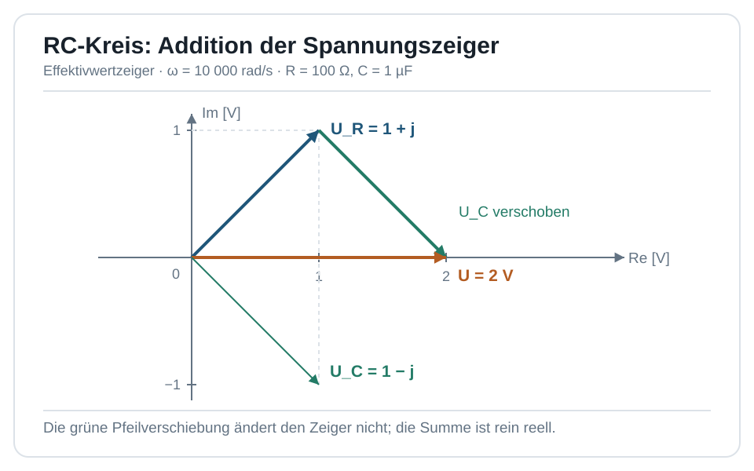

# M1-L6 – Sinusförmiger Wechselstrom und komplexe Impedanz {#L6}

**Kursbereich:** M1 – Bachelor: Lineare elektrische Netze und Schaltungstheorie

**Niveau:** Bachelor

**Vorwissen:** [Einschwingvorgänge](M1-L5.md), Sinus und Kosinus sowie Rechnen mit komplexen Zahlen. Bei Bedarf [komplexe Zahlen in der Universitätsmathematik wiederholen](index.html?course=university_mathematics&module=M2&lesson=L5&syslang=de&doclang=de&theme=light).

**Lernziel:** Eine sinusförmige Spannung als Effektivwertzeiger darstellen und Strom sowie Teilspannungen in einem linearen Wechselstromkreis berechnen.

## Vom Zeitverlauf zum Zeiger {#S1}

Ein Kondensator kann schnelle Spannungsänderungen anders übertragen als langsame. Beim RC-Kreis aus der [vorigen Lektion](M1-L5.md) haben wir dafür den Zeitverlauf nach einem Sprung untersucht. Nun bleibt die Quelle dauerhaft sinusförmig. In einem stabilen linearen Netzwerk klingt der Einfluss der Anfangsbedingungen ab. Übrig bleibt die erzwungene Antwort bei derselben Frequenz. Ihre Amplitude und Phase können sich von denen der Quelle unterscheiden.

Mit der Frequenz $f$ in Hertz und der Kreisfrequenz $\omega=2\pi f$ schreiben wir eine Spannung als

$$
u(t)=\sqrt{2}\,U_\mathrm{eff}\cos(\omega t+\varphi_u),
\qquad
\underline U=U_\mathrm{eff}\,\mathrm e^{\mathrm j\varphi_u},
\qquad
u(t)=\sqrt{2}\,\operatorname{Re}\!\left(\underline U\,\mathrm e^{\mathrm j\omega t}\right).
$$

Hier ist $\mathrm j^2=-1$. Der Zeiger $\underline U$ trägt den Effektivwert $U_\mathrm{eff}$ als Betrag und die Phase $\varphi_u$ als Winkel. Für den Strom verwenden wir $\underline I$ nach derselben Konvention. Der Scheitelwert eines Sinus beträgt $\sqrt{2}$ mal seinen Effektivwert, weil der Mittelwert von $\cos^2$ über eine Periode $1/2$ ist. In einer Rechnung teilen alle beteiligten Zeiger den Faktor $\mathrm e^{\mathrm j\omega t}$ und dieselbe Konvention für die Beträge.

Zur Umrechnung zwischen Winkel- und kartesischer Form gilt $A\mathrm e^{\mathrm j\varphi}=A\cos\varphi+\mathrm jA\sin\varphi$. Addition ist in kartesischer Form bequem. Bei der Division zweier Zeiger teilst du die Beträge und subtrahierst ihre Winkel.

## Impedanz von Widerstand, Spule und Kondensator {#S2}

Unter der passiven Vorzeichenkonvention tritt der positive Strom am positiven Spannungsanschluss ein. Für das Ableiten nach der Zeit multipliziert man den Zeiger mit $\mathrm j\omega$. Das folgt aus der Ableitung des gemeinsamen Exponentialfaktors. Die Bauteilgesetze werden so zu algebraischen Beziehungen der Form $\underline U=Z\underline I$. Die komplexe **Impedanz** $Z$ wird in Ohm angegeben, wie ein Widerstand.

| Bauteil | Zeitbereich | Impedanz für $\omega>0$ | Phasenlage der Spannung relativ zum Strom |
| --- | --- | --- | --- |
| Widerstand $R>0$ | $u=Ri$ | $Z_R=R$ | $0^\circ$ |
| Spule $L>0$ | $u=L\,\mathrm di/\mathrm dt$ | $Z_L=\mathrm j\omega L$ | $+90^\circ$ |
| Kondensator $C>0$ | $i=C\,\mathrm du/\mathrm dt$ | $Z_C=1/(\mathrm j\omega C)=-\mathrm j/(\omega C)$ | $-90^\circ$ |

Für $Z=R+\mathrm jX$ heißt $X$ **Reaktanz**. Ihr Vorzeichen zählt bei der Addition. In einer Reihenschaltung addieren sich die Impedanzen, da überall derselbe Strom fließt. Sind Zweige parallel geschaltet, addieren sich für endliche, von null verschiedene Impedanzen die Kehrwerte $Y=1/Z$, die **Admittanzen**. Das folgt aus gleicher Spannung und der Knotenregel. Die ursprünglichen Kirchhoff-Regeln gelten damit auch für beide komplexen Komponenten der Zeiger.

## Ein RC-Kreis bei seiner Grenzfrequenz {#S3}

Eine Quelle mit $\underline U=2\,\mathrm V$ speist einen Widerstand $R=100\,\Omega$ und einen Kondensator $C=1\,\mu\mathrm F$ in Reihe. Als Phasenreferenz hat der Quellzeiger den Winkel $0^\circ$. Bei $\omega=1/(RC)=10^4\,\mathrm{rad/s}$, also $f\approx1{,}59\,\mathrm{kHz}$, ist $Z_C=-\mathrm j100\,\Omega$. Damit erhalten wir

$$
Z=(100-\mathrm j100)\,\Omega,
\qquad
\underline I=\frac{2\,\mathrm V}{Z}=(10+\mathrm j10)\,\mathrm{mA}.
$$

Der Strom hat rund $14{,}14\,\mathrm{mA}$ Effektivwert und eilt der Quelle um $45^\circ$ voraus. Sein Zeitverlauf ist

$$
i(t)=20\,\mathrm{mA}\cos(10^4\,\mathrm{rad/s}\cdot t+45^\circ).
$$

Für die Teilspannungen ergibt sich $\underline U_R=(1+\mathrm j)\,\mathrm V$ und $\underline U_C=(1-\mathrm j)\,\mathrm V$. Ihre Summe ist $2\,\mathrm V$, obwohl beide Effektivwerte jeweils $\sqrt{2}\,\mathrm V$ betragen. Die Maschenregel gilt für Zeiger. Das getrennte Addieren ihrer Beträge würde die unterschiedlichen Phasen übergehen.

{alt="Zeigerdiagramm: Widerstandsspannung eins plus j Volt, Kondensatorspannung eins minus j Volt, Summe zwei Volt auf der reellen Achse."}

Die Kondensatorspannung ist zusätzlich parallel an die Spitze des Widerstandszeigers verschoben. Das veranschaulicht die Addition nach der Maschenregel; die beiden Imaginärteile heben sich auf.

## Selbstkontrolle {#S4}

1. An einer idealen Spule mit $L=20\,\mathrm{mH}$ und $\omega=500\,\mathrm{rad/s}$ liegt eine Spannung mit $1\,\mathrm V$ Effektivwert und Phase $0^\circ$. Wie lauten Betrag und Phase des Stroms?
2. Was passiert beim RC-Beispiel mit der Spannung am Kondensator, wenn $f$ gegen null geht? Und wenn $f$ sehr groß wird?
3. Rekonstruiere die Zeitfunktion für $\underline U=-\mathrm j3\,\mathrm V$ bei $\omega=1000\,\mathrm{rad/s}$.

### Lösungen

1. $Z_L=\mathrm j10\,\Omega$, somit $\underline I=-\mathrm j0{,}1\,\mathrm A$. Der Effektivwert ist $100\,\mathrm{mA}$. Die Phase des Stroms ist gegenüber der Spannung um $90^\circ$ verzögert.
2. Bei sehr kleinen Frequenzen ist $|Z_C|\gg R$. Der Kondensator übernimmt fast die gesamte Quellenspannung. Bei sehr hohen Frequenzen gilt $|Z_C|\ll R$. Die Kondensatorspannung nähert sich null. Daher wirkt der Ausgang am Kondensator als Tiefpass.
3. Der Betrag ist $3\,\mathrm V$, der Winkel $-90^\circ$. Daraus folgt $u(t)=3\sqrt{2}\,\mathrm V\cos(1000\,\mathrm{rad/s}\cdot t-90^\circ)$.

## Gültigkeitsbereich und Weiterlernen {#S5}

Zeiger bei einer festen Frequenz beschreiben den sinusförmigen stationären Zustand. Für den Einschaltvorgang brauchen wir weiterhin die Anfangsbedingungen und Zeitgleichungen. Mehrere Frequenzen lassen sich im linearen Netzwerk getrennt behandeln und im Zeitbereich überlagern. Bauformen und parasitäre Effekte begrenzen, wie weit die idealen Bauteilmodelle bei hohen Frequenzen tragen.

In der [nächsten Lektion](M1-L7.md) verwenden wir dieselben Effektivwertzeiger zur Berechnung von Wirkleistung, Blindleistung und Resonanz.

## Quellen {#S6}

- [MIT OpenCourseWare, 6.002 Circuits and Electronics – Lecture Notes](https://ocw.mit.edu/courses/6-002-circuits-and-electronics-spring-2007/pages/lecture-notes/) · Lectures 16–18 zu sinusförmigem stationärem Zustand, Impedanz und Filtern · Zuletzt abgerufen: 2026-11-25
- [OpenStax, University Physics Volume 2, § 15.2 – Simple AC Circuits](https://openstax.org/books/university-physics-volume-2/pages/15-2-simple-ac-circuits) · Abschnitt 15.2 – Einzelbauteile und Phasenlagen · Zuletzt abgerufen: 2026-11-25
- [OpenStax, University Physics Volume 2, § 15.3 – RLC Series Circuits with AC](https://openstax.org/books/university-physics-volume-2/pages/15-3-rlc-series-circuits-with-ac) · Abschnitt 15.3 – Impedanz und Phasenbeziehungen in RLC-Reihenschaltungen · Zuletzt abgerufen: 2026-11-25
