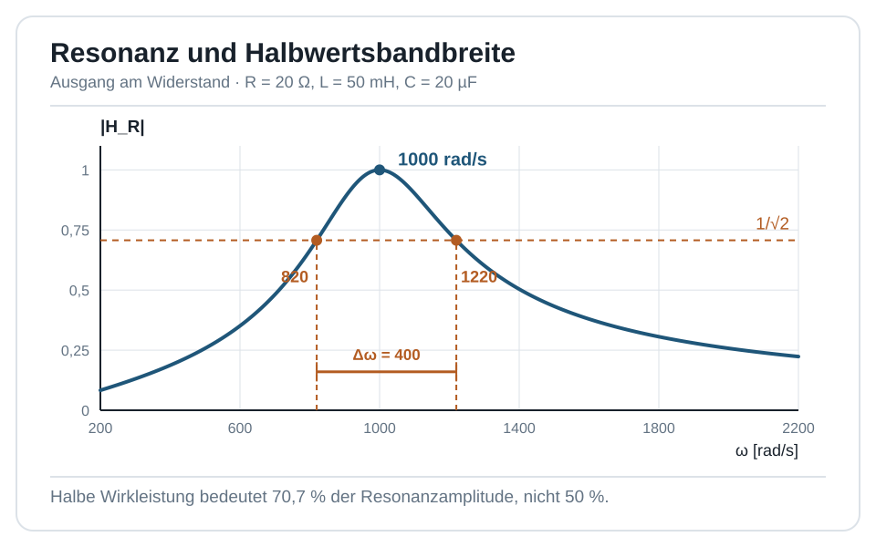

# M1-L7 – Wechselstromleistung, Frequenzgang und Resonanz {#L7}

**Kursbereich:** M1 – Bachelor: Lineare elektrische Netze und Schaltungstheorie

**Niveau:** Bachelor

**Vorwissen:** [Effektivwertzeiger und Impedanzen](M1-L6.md), [Einschwingvorgänge](M1-L5.md).

**Lernziel:** Wirk-, Blind- und Scheinleistung unterscheiden und an einem idealisierten RLC-Reihenkreis Resonanzfrequenz, Frequenzgang und Bandbreite bestimmen.

## Leistung im sinusförmigen Betrieb {#S1}

Momentan nimmt ein Bauteil die Leistung $p(t)=u(t)i(t)$ auf, wenn der Strom nach der passiven Vorzeichenkonvention definiert ist. Bei gleicher Kreisfrequenz schreiben wir Spannung und Strom mit ihren **Effektivwerten** $U$ und $I$ sowie den Phasen $\varphi_u$ und $\varphi_i$. Wir setzen $\varphi=\varphi_u-\varphi_i$. Die Produktformel für Kosinus ergibt

$$
p(t)=UI\cos\varphi
+UI\cos\!\left(2\omega t+\varphi_u+\varphi_i\right).
$$

Der zweite Anteil mittelt sich über eine Periode zu null. Für die **Wirkleistung** gilt daher $P=UI\cos\varphi$ in Watt. Induktivität und Kapazität können Energie zeitweise aufnehmen und wieder abgeben. Ihre Wirkleistung verschwindet im idealen Sinusbetrieb.

## Komplexe Leistung und Leistungsfaktor {#S2}

Die Effektivwertzeiger aus der vorigen Lektion bündeln Spannung, Strom und Phasendifferenz in

$$
\underline S=\underline U\,\underline I^{*}=P+\mathrm jQ,
\qquad P=UI\cos\varphi,\qquad Q=UI\sin\varphi.
$$

Der Stern bezeichnet die komplexe Konjugation des Stromzeigers. Sie kehrt seinen Phasenwinkel um, sodass im Produkt die Phasendifferenz steht. Die **Blindleistung** $Q$ wird in var angegeben. Bei passiver Orientierung ist sie für induktive Lasten positiv und für kapazitive negativ. Der Betrag $|\underline S|=UI$ ist die **Scheinleistung** in Voltampere. Im hier betrachteten Sinusbetrieb ist der Leistungsfaktor $P/|\underline S|=\cos\varphi$, sofern $UI>0$.

Eine Quelle mit $5\,\mathrm V$ Effektivwert speist eine Last mit $Z=(40+\mathrm j30)\,\Omega$. Es gilt $|Z|=50\,\Omega$ und $I=0{,}1\,\mathrm A$. Mithilfe von $\underline S=Z|\underline I|^2$ folgen $P=0{,}40\,\mathrm W$, $Q=0{,}30\,\mathrm{var}$ und $|\underline S|=0{,}50\,\mathrm{VA}$. Der Leistungsfaktor beträgt $0{,}8$.

## RLC-Reihenkreis und Frequenzgang {#S3}

Eine sinusförmige Quelle treibt $R$, $L$ und $C$ in Reihe. Wir betrachten den Ausgang **am Widerstand**. Mit $R,L,C>0$ gelten

$$
Z(\omega)=R+\mathrm j\left(\omega L-\frac{1}{\omega C}\right),
\qquad
H_R(\mathrm j\omega)=\frac{\underline U_R}{\underline U_\mathrm{in}}
=\frac{R}{Z(\omega)}.
$$

Der Betrag von $H_R$ beschreibt das Verhältnis der Effektivwerte. Sein Winkel beschreibt die Phasenverschiebung des Ausgangs. Bei sehr kleinen Frequenzen dominiert der Kondensator die Impedanz. Bei sehr großen dominiert die Spule. In beiden Grenzen geht die Ausgangsamplitude gegen null.

Bei $\omega_0=1/\sqrt{LC}$ heben sich die Reaktanzen auf. Der Eingang sieht dann $Z=R$, der Strom ist maximal, $|H_R|=1$ und Ein- und Ausgang sind in Phase. Die Phase des Ausgangs eilt unterhalb der Resonanz voraus und hinkt oberhalb hinterher. Die Spannungszeiger an $L$ und $C$ kompensieren sich in der Maschensumme. An den Einzelbauteilen können ihre Beträge erheblich sein.

Multipliziert man Zähler und Nenner von $H_R(\mathrm j\omega)$ mit $\mathrm j\omega/L$, wird die Struktur der Übertragungsfunktion sichtbar

$$
H_R(s)=\frac{(R/L)s}{s^2+(R/L)s+1/(LC)},
\qquad s=\mathrm j\omega\text{ für den Frequenzgang}.
$$

Der quadratische Nenner zeigt das **System zweiter Ordnung**. Die beiden unabhängigen Speichergrößen sind Kondensatorspannung und Spulenstrom. Der Widerstand dämpft die freie Bewegung. Die Resonanzfrequenz des erzwungenen Stroms bezeichnet einen Punkt des Frequenzgangs. Die Frequenz einer freien gedämpften Schwingung hängt zusätzlich von der Dämpfung ab und ist nur im schwingfähigen Fall definiert.

## Bandbreite am durchgerechneten Beispiel {#S4}

Die Quellspannung habe über alle betrachteten Frequenzen denselben Effektivwert. An den beiden Halbwertsfrequenzen sinkt die Wirkleistung am Widerstand auf die Hälfte ihres Resonanzwerts. Weil $P_R=I^2R$ gilt, bedeutet das $|H_R|=1/\sqrt{2}$ und damit

$$
\left|\omega L-\frac{1}{\omega C}\right|=R.
$$

Teilt man durch $L$ und löst die beiden quadratischen Gleichungen, erhält man die positiven Lösungen
$\omega_-=\sqrt{\omega_0^2+(R/(2L))^2}-R/(2L)$ und
$\omega_+=\sqrt{\omega_0^2+(R/(2L))^2}+R/(2L)$.
Die Bandbreite ist $\Delta\omega=\omega_+-\omega_-=R/L$. Ein größerer Widerstand verbreitert das Durchlassband dieses Modells.

Für $R=20\,\Omega$, $L=50\,\mathrm{mH}$ und $C=20\,\mu\mathrm F$ ist $\omega_0=1000\,\mathrm{rad/s}$ bzw. $f_0\approx159{,}2\,\mathrm{Hz}$. Mit $U=2\,\mathrm V$ beträgt der Resonanzstrom $0{,}1\,\mathrm A$ und die Wirkleistung $0{,}20\,\mathrm W$. Die Halbwertsfrequenzen liegen bei etwa $820$ und $1220\,\mathrm{rad/s}$. Beide ergeben $0{,}10\,\mathrm W$. Die Bandbreite beträgt $400\,\mathrm{rad/s}$ bzw. etwa $63{,}7\,\mathrm{Hz}$.

{alt="Betragsfrequenzgang mit Resonanz bei 1000 Radiant pro Sekunde und Halbwertsgrenzen bei etwa 820 und 1220 Radiant pro Sekunde."}

Der Frequenzgang macht die beiden Halbwertsbedingungen sichtbar. Die Bandbreite wird zwischen den beiden markierten Frequenzen gemessen; dabei ist die Eingangsspannung konstant.

## Selbstkontrolle {#S5}

1. Für die Last mit $Z=(40+\mathrm j30)\,\Omega$ werde das Vorzeichen der Reaktanz umgekehrt. Was ändert sich bei unveränderter Effektivspannung?
2. Berechne für das RLC-Beispiel den Betrag $|H_R|$ bei $\omega=2000\,\mathrm{rad/s}$ und bestimme das Vorzeichen der Phasenverschiebung.
3. Wie ändern sich Bandbreite und Resonanzstrom, wenn im Beispiel $R$ verdoppelt wird?

### Lösungen

1. $|Z|$, $I$, $P$, $|\underline S|$ und der Leistungsfaktor bleiben gleich. Die Last wird kapazitiv und $Q=-0{,}30\,\mathrm{var}$.
2. Die Spule trägt $100\,\Omega$ und der Kondensator $-25\,\Omega$ zur Reaktanz bei. $|H_R|=20/\sqrt{20^2+75^2}\approx0{,}258$. Die Ausgangsspannung folgt der Quelle zeitlich nach.
3. Die Bandbreite verdoppelt sich auf $800\,\mathrm{rad/s}$, der Resonanzstrom fällt auf $50\,\mathrm{mA}$. $L$ und $C$ bleiben gleich, daher bleibt $\omega_0$ unverändert.

## Gültigkeitsbereich und Weiterlernen {#S6}

Die Leistungsformeln verwenden sinusförmige Effektivwertzeiger bei **einer Frequenz**. Für verzerrte Verläufe sind etwa der zeitliche Mittelwert von $p(t)$ und die tatsächlichen Effektivwerte zu bestimmen. Der gezeigte Bandpass gilt für den Serienkreis mit Ausgang am Widerstand und ohne zusätzliche Belastung dieses Ausgangs. Andere Ausgangspunkte führen zu anderen Frequenzgängen. Verluste und parasitäre Effekte realer Bauteile verändern die idealisierte Kurve.

Im [Studienweg](pages/studienweg.md) findest du die weiteren Kursgebiete und ihre Voraussetzungen.

## Quellen {#S7}

- [MIT OpenCourseWare, 6.002 Circuits and Electronics – Lecture Notes](https://ocw.mit.edu/courses/6-002-circuits-and-electronics-spring-2007/pages/lecture-notes/) · Lectures 16–18 zu stationärem Sinusbetrieb, Impedanzen und Filtern · Zuletzt abgerufen: 2026-11-25
- [OpenStax, University Physics Volume 2, § 15.4 – Power in an AC Circuit](https://openstax.org/books/university-physics-volume-2/pages/15-4-power-in-an-ac-circuit) · Abschnitt 15.4 – mittlere Leistung und Leistungsfaktor · Zuletzt abgerufen: 2026-11-25
- [OpenStax, University Physics Volume 2, § 15.5 – Resonance in an AC Circuit](https://openstax.org/books/university-physics-volume-2/pages/15-5-resonance-in-an-ac-circuit) · Abschnitt 15.5 – Serienresonanz und Leistungskurve · Zuletzt abgerufen: 2026-11-25
