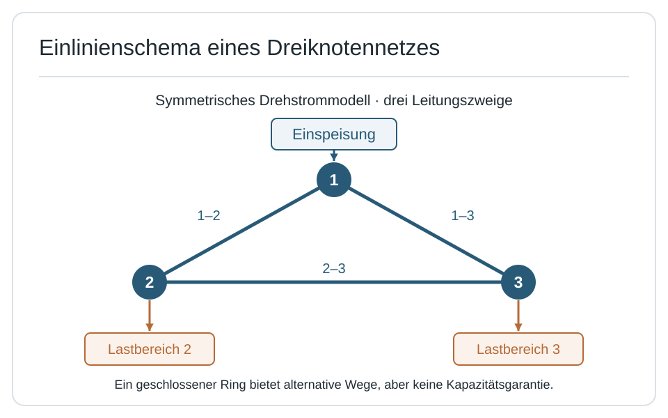

# M10-L1 – Netzstruktur und Betriebsmittel {#L1}

**Kursbereich:** M10 – Bachelor: Elektrische Energienetze

**Niveau:** Bachelor · Wahlbereich

**Vorwissen:** [Drehstrom](M7-L2.md), [Transformator](M7-L3.md), [Netze, Leitungen und Verluste](M7-L5.md).

**Lernziel:** Ein Einlinienschema in ein berechenbares Knoten-Zweig-Modell überführen und die Aufgaben der Betriebsmittel unterscheiden.

## Vom Verbundnetz zum Einlinienschema {#S1}

Ein Stromnetz verbindet Erzeuger, Speicher und Verbraucher über Leitungen und Transformatoren. Übertragungsnetze transportieren Leistung über größere Entfernungen; Verteilnetze stellen die Verbindungen zu regionalen und lokalen Anschlüssen her. Es gibt auch Erzeuger in Verteilnetzen. Deshalb beschreibt die Einteilung nicht zwingend die Richtung eines Leistungsflusses.

Ein Einlinienschema fasst die drei Leiter eines Drehstromsystems zu einer Verbindung zusammen. Für einen symmetrischen sinusförmigen Betrieb genügt ein Strangmodell mit komplexen Effektivwerten; Gesamtleistungen beziehen sich dagegen auf alle drei Phasen. Wir setzen die Leiterspannung $U_{LL}$ und den Leiterstrom $I$ voraus. Für symmetrische Lasten gilt

$$
|S|=\sqrt{3}U_{LL}I,\qquad P=|S|\cos\varphi,\qquad Q=|S|\sin\varphi.
$$

Ein Knoten fasst ideale elektrische Verbindungspunkte zusammen. Ein Zweig verbindet zwei Knoten über ein Betriebsmittel. Schaltzustände legen fest, welche Zweige tatsächlich leitend verbunden sind. Diese Unterscheidung ermöglicht es, aus demselben Netzplan mehrere Betriebszustände abzuleiten.

## Betriebsmittel und Ersatzmodelle {#S2}

| Betriebsmittel | Aufgabe | Modell für den stationären Betrieb |
| --- | --- | --- |
Einspeisung / Erzeuger | Leistung und Spannung bereitstellen | Referenz-, PV- oder PQ-Knoten |
| Freileitung oder Kabel | Leistung übertragen | Serienimpedanz und bei Bedarf Queradmittanzen |
| Transformator | Spannungsebene koppeln | Übersetzung, Streuimpedanz, ggf. Magnetisierung |
| Sammelschiene | Anschlüsse zusammenführen | gemeinsamer Knoten |
| Leistungsschalter | Betriebs- und Fehlerströme schalten | offene oder geschlossene Verbindung |
| Last | Wirk- und ggf. Blindleistung aufnehmen | konstante Leistung, Strom oder Impedanz |

Bei kurzen Leitungen darf man für eine erste Abschätzung die Queradmittanzen vernachlässigen. Das ist bei langen Leitungen und Kabeln mit erheblicher Kapazität nicht allgemein zulässig. Im späteren Modell benutzen wir nur die Serienimpedanzen $Z=R+jX$. Der Widerstand $R$ verursacht Wirkleistungsverluste, die Reaktanz $X$ beeinflusst insbesondere den Blindleistungsaustausch und die Spannungsänderung.

{alt="Ein Dreiknotennetz mit Einspeisung am Knoten 1, zwei Lastknoten und drei Leitungen."}

Das dargestellte Modell reduziert eine übergeordnete Einspeisung auf Knoten 1 und zwei Lastbereiche auf Knoten 2 und 3. Die drei Leitungen bilden einen geschlossenen Ring. Ein Lastfluss kann sich auf mehrere Wege verteilen. Die Leitung 2–3 kann auch nahezu unbelastet sein, obwohl sie für eine Ersatzversorgung relevant ist.

## Spannungsebene und Strombedarf {#S3}

Bei 10 MW Wirkleistung und einem induktiven Leistungsfaktor von 0,8 beträgt die Scheinleistung 12,5 MVA. Bei 20 kV ergibt sich $I=360{,}8\,\mathrm A$. Wird dieselbe Leistung ideal über eine 110-kV-Ebene transportiert, sind es nur $65{,}6\,\mathrm A$. Für hypothetisch gleiche Leiterwiderstände von 1 Ω je Phase folgt $P_V=3RI^2$: rund 390,6 kW statt 12,9 kW. Das ist ein Vergleich bei gleichen Widerständen, keine Auslegung realer Leitungen. Isolation, Querschnitt, Bauweise, Transformatorverluste und Blindleistung verändern die Gesamtbilanz.

## Topologie und Verfügbarkeit {#S4}

In einem radialen Netz existiert zwischen der Einspeisung und jeder Last genau ein Weg. Eine unterbrochene Leitung kann einen nachgeordneten Netzteil abtrennen. Ein Ring kann zusätzliche Wege bieten. Diese Redundanz sagt zunächst nur etwas über die Erreichbarkeit aus. Sie garantiert nicht, dass die verbliebenen Zweige den Strom tragen oder die Spannungen im vorgesehenen Bereich halten können.

Für eine Betriebsrechnung sind daher zusätzlich zu den Verbindungen die Impedanzen, Leistungsdaten, die Referenzspannung und die Grenzen erforderlich. Aus einem Einlinienschema allein kann man weder den Lastfluss noch eine Schutzeinstellung bestimmen. Schaltvorgänge und Arbeiten an realen Energienetzen sind nicht Gegenstand dieses Lernmodells.

## Übungen mit Lösungen {#S5}

1. Eine symmetrische Last nimmt 6 MW bei 10 kV und $\cos\varphi=0{,}9$ auf. Bestimme den Leiterstrom.  
   **Lösung** $I=6\cdot10^6/(\sqrt3\cdot10^4\cdot0{,}9)=384{,}9\,\mathrm A$.
2. Welche Lasten sind nach Unterbrechung von 1–3 im dargestellten Dreieck noch mit Knoten 1 verbunden?  
   **Lösung** Beide, über 1–2 bzw. 1–2–3. Zulässige Ströme und Spannungen müssen separat geprüft werden.
3. Warum kann ein kurzer Leitungszweig im Lastflussmodell als Serienimpedanz dargestellt werden, eine lange Kabelstrecke jedoch oft nicht?  
   **Lösung** Der kapazitive Ladestrom einer langen Strecke kann relevant werden; das reine Serienmodell lässt ihn vollständig aus.

**Weiterführend:** [Ersatzwerte, Bezugssysteme und Knotenmatrix](M10-L2.md)

## Quellen {#S6}

- [KIT – Elektrische Energienetze, Vorlesungsinhalte](https://www.ieh.kit.edu/2448_bee.php) · Inhaltsverzeichnis EEN, Punkt 1: Struktur der elektrischen Energieversorgung; Lehrplanabgleich. · Zuletzt abgerufen: 2026-11-25
- [IIT Kharagpur / NPTEL – Power System Analysis](https://onlinecourses-archive.nptel.ac.in/noc18_ee16/preview) · Course Layout, Woche 2–4: Leitungsparameter und Per-Unit-System; Vorlesungsinhalte nicht geprüft. · Zuletzt abgerufen: 2026-11-25
