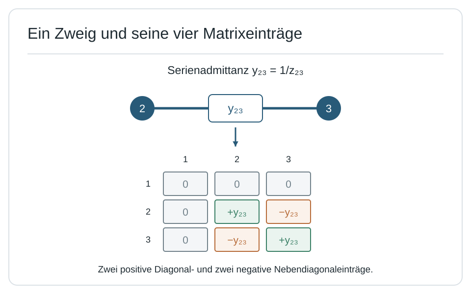

# M10-L2 – Ersatzwerte, Bezugssysteme und Knotenmatrix {#L2}

**Kursbereich:** M10 – Bachelor: Elektrische Energienetze

**Niveau:** Bachelor · Wahlbereich

**Vorwissen:** [Netzstruktur](M10-L1.md), [Komplexe Impedanz](M1-L6.md), [Lineare Gleichungssysteme](M2-L2.md).

**Lernziel:** Dreiphasige Bezugsgrößen konsistent festlegen und eine komplexe Knotenadmittanzmatrix aus den Leitungsdaten aufbauen.

## Per-Unit als dimensionsloses Bezugssystem {#S1}

Netze mit mehreren Spannungsebenen lassen sich mit bezogenen Größen vereinfachen. Wir wählen eine gemeinsame dreiphasige Basisleistung $S_B$ und für jede Spannungsebene eine Leiterspannung $U_B$. Daraus folgen

$$
I_B=\frac{S_B}{\sqrt3 U_B},\qquad Z_B=\frac{U_B^2}{S_B},\qquad Y_B=\frac1{Z_B}.
$$

Die Spannung des Strangmodells wird auf $U_B/\sqrt3$ bezogen, der Strom auf $I_B$. Für die komplexe Gesamtleistung gilt damit $s=v i^*$; der Faktor 3 ist bereits durch die Basiswahl berücksichtigt. Kleine Buchstaben bezeichnen hier dimensionslose Per-Unit-Größen (pu), der Stern bedeutet komplexe Konjugation. Physikalische Größen erhält man durch Multiplikation mit ihrer Basis.

Beispiel: $S_B=10\,\mathrm{MVA}$ und $U_B=20\,\mathrm{kV}$ ergeben $I_B=288{,}675\,\mathrm A$ und $Z_B=40\,\Omega$. Eine Leitung mit $Z=0{,}8+j2\,\Omega$ besitzt somit $z=0{,}02+j0{,}05$. Eine Spannung von 19,2 kV entspricht einem Betrag von 0,96 pu.

## Transformator und Basiswechsel {#S2}

Werden die Spannungsbasen beider Seiten im Verhältnis der idealen Nennübersetzung gewählt, hat der ideale Transformator im bezogenen Modell den Übersetzungsfaktor eins (ohne Phasenverschiebung). Seine Streuimpedanz bleibt erhalten. Abweichende Stufenstellung oder Phasenverschiebung müssen separat modelliert werden.

Eine bereits bezogene Impedanz wird auf eine andere Basis umgerechnet durch

$$
z_\mathrm{neu}=z_\mathrm{alt}\frac{S_{B,\mathrm{neu}}}{S_{B,\mathrm{alt}}}\left(\frac{U_{B,\mathrm{alt}}}{U_{B,\mathrm{neu}}}\right)^2.
$$

Beispiel: Ein Transformator mit einer Bemessung von 5 MVA besitzt eine Streureaktanz von 0,06 pu auf eigener Basis. Bei gleicher Spannungsbasis und 10 MVA Systembasis entspricht sie 0,12 pu. Der physikalische Impedanzwert ändert sich dabei nicht.

## Aufbau der Knotenadmittanzmatrix {#S3}

Wir verwenden das Dreiknotennetz aus [M10-L1](M10-L1.md) mit folgenden bezogenen Serienimpedanzen:

| Leitung | $z$ (pu) | $y=1/z$ (pu) |
| --- | --- | --- |
| 1–2 | 0,02 + j0,05 | 6,8966 − j17,2414 |
| 2–3 | 0,03 + j0,06 | 6,6667 − j13,3333 |
| 1–3 | 0,04 + j0,08 | 5 − j10 |

Der aus Knoten $k$ in einen Leitungszweig fließende Strom lautet $i_{km}=y_{km}(v_k-v_m)$. Wir zählen die resultierende Netzeinspeisung $i_k$ positiv in das Leitungsnetz hinein. Die Knotenregel liefert

$$
\begin{pmatrix}i_1\\i_2\\i_3\end{pmatrix}=
\underbrace{\begin{pmatrix}
y_{12}+y_{13}&-y_{12}&-y_{13}\\
-y_{12}&y_{12}+y_{23}&-y_{23}\\
-y_{13}&-y_{23}&y_{13}+y_{23}
\end{pmatrix}}_{Y}
\begin{pmatrix}v_1\\v_2\\v_3\end{pmatrix}.
$$

{alt="Die Leitung 2–3 trägt +y23 zu den Diagonalen 22 und 33 und −y23 zu den Nebendiagonalen 23 und 32 der Matrix bei."}

Jede Leitung ergänzt zwei Diagonaleinträge um $+y$ und zwei Nebendiagonaleinträge um $-y$. Ohne Queradmittanzen summieren sich die Zeilen auf null. Daraus folgt $Y\mathbf 1=0$: das gemeinsame additive Niveau aller komplexen Knotenpotentiale ist durch vorgegebene Zweigströme allein nicht bestimmt. In diesem Modell fixieren wir deshalb $v_1=1+j0$ und lösen bei bekannten Strömen nur für die verbleibenden Knoten.

## Von Stromvorgaben zu Leistungsvorgaben {#S4}

Die Knotenmatrix beschreibt das lineare Leitungsnetz. Lasten mit konstanter komplexer Leistung sind jedoch nicht linear: $i_k=(s_k/v_k)^*$. Ein negativer Leistungswert bezeichnet hier Nettoverbrauch. Wird der Spannungsbetrag kleiner, steigt bei gleicher Scheinleistung der Strombetrag. Daher ist eine iterative Lastflussrechnung erforderlich. Die Knotenmatrix bleibt bei unveränderter Topologie konstant; die Stromeinspeisungen werden aktualisiert.

Bei einer Leitungstrennung muss deren kompletter Beitrag aus $Y$ entfernt werden. Entsteht dadurch eine Insel ohne Referenzknoten, ist die reduzierte Gleichung dieses Modells nicht mehr regulär lösbar. Eine solche Insel braucht ein eigenes Versorgungsmodell; sie wird nicht durch eine numerische Nullspannung ersetzt.

## Übungen mit Lösungen {#S5}

1. Welche Basisimpedanz gilt bei 100 MVA und 110 kV?  
   **Lösung** $Z_B=(110\,\mathrm{kV})^2/(100\,\mathrm{MVA})=121\,\Omega$.
2. Bestimme $Y_{23}$ des Dreiknotennetzes.  
   **Lösung** $-y_{23}=-6{,}6667+j13{,}3333$ pu.
3. Welcher Matrixeintrag verändert sich bei einer zusätzlichen Queradmittanz $j0{,}02$ am Knoten 3?  
   **Lösung** Nur $Y_{33}$ erhöht sich um $j0{,}02$ pu; die Zeilensumme 3 ist dann nicht mehr null.

**Weiterführend:** [Stationärer Lastfluss](M10-L3.md)

## Quellen {#S6}

- [IIT Kharagpur / NPTEL – Power System Analysis](https://onlinecourses-archive.nptel.ac.in/noc18_ee16/preview) · Course Layout, Woche 5–6: Lastflussanalyse; Vorlesungsinhalte nicht geprüft. · Zuletzt abgerufen: 2026-11-25
- [MATPOWER – Network Equations](https://matpower.app/manual/matpower/NetworkEquations.html) · MATPOWER-Handbuch §3.6, Gl. (3.8), (3.17): Knotenadmittanz und AC-Leistungsbilanz. · Zuletzt abgerufen: 2026-11-25
