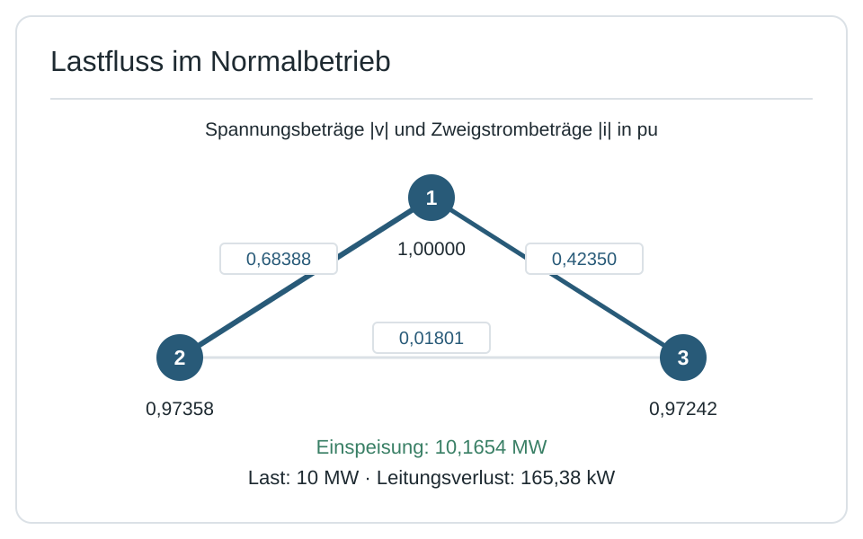

# M10-L3 – Stationärer Lastfluss {#L3}

**Kursbereich:** M10 – Bachelor: Elektrische Energienetze

**Niveau:** Bachelor · Wahlbereich

**Vorwissen:** [Knotenmatrix](M10-L2.md), [Wechselstromleistung](M1-L7.md).

**Lernziel:** Die Knotentypen eines AC-Lastflusses unterscheiden, die Leistungsbilanz formulieren und einen kleinen Lastfluss iterativ lösen.

## Knotentypen und Vorzeichen {#S1}

Im symmetrischen, stationären Wechselstrommodell gilt für jeden Knoten die komplexe Netzeinspeisung

$$
s_k=p_k+jq_k=v_k\left(\sum_mY_{km}v_m\right)^*.
$$

$p_k$ und $q_k$ sind hier Erzeugung minus Verbrauch. In der Regel werden zwei der vier Größen $p,q,|v|,\theta$ vorgegeben; die beiden übrigen ergeben sich aus dem Netz. Der Winkel $\theta$ bezieht sich auf einen gemeinsamen Referenzwinkel.

| Typ | Vorgegeben | Berechnet |
| --- | --- | --- |
| Referenzknoten (Slack) | $\lvert v\rvert,\theta$ | $p,q$ |
| PV-Knoten (spannungsgeführte Einspeisung) | $p,\lvert v\rvert$ | $q,\theta$ |
| PQ-Knoten | $p,q$ | $\lvert v\rvert,\theta$ |

PV steht hier für den Knotentyp und nicht für Photovoltaik. Bei Erreichen einer Blindleistungsgrenze kann ein PV-Knoten im Modell auf eine feste Blindleistung umgestellt werden. Die Spannung ist dann eine Ergebnisgröße. Der Slack-Knoten übernimmt rechnerisch die verbleibende Bilanz einschließlich Verlusten; das ist keine Aussage über unbegrenzte reale Erzeugungsleistung.

## Spannungsfall und Leistungsfluss {#S2}

Für eine Leitung ohne Queradmittanz ist $i_{km}=(v_k-v_m)/z_{km}$. Die Leistungen an beiden Enden werden jeweils in den Zweig hinein gezählt: $s_{km}=v_k i_{km}^*$ und $s_{mk}=v_m(-i_{km})^*$. Ihre Summe ist

$$
s_{km}+s_{mk}=z_{km}|i_{km}|^2.
$$

Der Realteil ist der Wirkleistungsverlust. Für kleine Spannungsänderungen und bei einem empfangsseitigen Verbrauch $p_L+jq_L$ lässt sich die Spannungsbetragsdifferenz näherungsweise als $(rp_L+xq_L)/|v_m|$ ausdrücken. Dies folgt aus $v_k=v_m+zi$ und der Projektion auf den empfangsseitigen Spannungszeiger. Eine induktive Last kann also auch bei gleichbleibender Wirkleistung den Spannungsabfall erhöhen.

## Rechenbeispiel mit zwei PQ-Knoten {#S3}

Nutze die Leitungen aus [M10-L2](M10-L2.md), $v_1=1+j0$, $s_2=-0{,}6-j0{,}25$ und $s_3=-0{,}4-j0{,}15$. Da Knoten 2 und 3 PQ-Knoten sind, können wir die reduzierte Matrix $Y_{LL}$ mit den Zeilen und Spalten 2, 3 benutzen. Der Spaltenvektor $Y_{L1}$ koppelt die Referenz ein. Aus $Y_{LL}v_L+Y_{L1}v_1=i_L$ folgt die Fixpunktiteration

$$
v_L^{(n+1)}=Y_{LL}^{-1}\left[\left(\frac{s_L}{v_L^{(n)}}\right)^*-Y_{L1}v_1\right].
$$

Die elementweise Division steht für die zwei getrennten PQ-Knoten. Starte mit $v_2=v_3=1+j0$. Bei jeder Iteration löst man ein lineares Gleichungssystem und prüft danach den komplexen Leistungsrest $\max_{k=2,3}|v_k(Yv)_k^*-s_k|$. Nicht die Änderung der Spannung allein entscheidet über den Abbruch.

| Knoten | Betrag (pu) | Winkel | $p$ (pu) | $q$ (pu) |
| --- | ---: | ---: | ---: | ---: |
| 1 | 1,00000 | 0° | 1,01654 | 0,43775 |
| 2 | 0,97358 | −1,490° | −0,60000 | −0,25000 |
| 3 | 0,97242 | −1,508° | −0,40000 | −0,15000 |

{alt="Berechnete Spannungsbeträge 1,00000, 0,97358 und 0,97242 pu sowie die Beträge der drei Zweigströme im Basisfall."}

Bei 10 MVA Basisleistung stehen 10,1654 MW Einspeisung 10 MW Last gegenüber. Der Verlust von rund 165,4 kW wird durch $\sum r|i|^2$ unabhängig kontrolliert. Der Blindleistungsbedarf der Leitungen beträgt rund 0,3775 Mvar. Die Leiterströme der Zweige 1–2, 2–3 und 1–3 betragen 0,68388, 0,01801 und 0,42350 pu. Die Lösung erreicht bei ungerundeten Daten nach sieben Iterationen einen Leistungsrest unter $10^{-10}$ pu.

## Grenzen der Lastflussrechnung {#S4}

Ein konvergierter Lastfluss ist eine mathematische Lösung der stationären Gleichungen. Er erfüllt nicht automatisch Strom-, Spannungs- oder Erzeugungsgrenzen. Je nach Netz und Belastung kann die einfache Fixpunktiteration langsam konvergieren oder scheitern. Das beweist nicht, dass keine Lösung existiert. Newton-Raphson-Verfahren verwenden stattdessen eine Jacobi-Matrix der Leistungsreste und lösen linearisierte Korrekturgleichungen. Auch sie benötigen sinnvolle Startwerte und eine Modellkontrolle.

Die Spannungswinkel des Beispielnetzes sind klein. Ein DC-Lastfluss kann unter zusätzlichen Annahmen (kleine Winkel, nahezu konstante Spannungsbeträge und vernachlässigbare Widerstände) einen vereinfachten Wirkfluss liefern. Er ersetzt hier jedoch nicht die AC-Rechnung, da Blindleistung, Spannungsfall und Verluste untersucht werden sollen.

## Übungen mit Lösungen {#S5}

1. Eine Last von 4 MW und ein lokaler Erzeuger von 3 MW befinden sich am selben Knoten. Die Last benötigt 1 Mvar, die Einspeisung liefert keine Blindleistung. Welche Knotendaten gelten bei 10 MVA Basis?  
   **Lösung** $s=-0{,}1-j0{,}1$ pu.
2. Bei $z=0{,}02+j0{,}05$ pu und $|i|=0{,}8$ pu: Bestimme die Wirkleistungsverluste bei 10 MVA Basis.  
   **Lösung** $0{,}02\cdot0{,}8^2\cdot10\,\mathrm{MW}=128\,\mathrm{kW}$.
3. Weshalb kann Knoten 1 nicht gleichzeitig mit unveränderlicher Einspeiseleistung und vorgegebener komplexer Spannung angesetzt werden?  
   **Lösung** Seine Leistungsabgabe muss die Differenz aus Last, übriger Einspeisung und Verlusten ausgleichen; eine zusätzliche feste Leistung würde das Gleichungssystem im Allgemeinen überbestimmen.

**Weiterführend:** [Netzfehler und Schutzprinzipien](M10-L4.md), [Reproduzierbare Lastflussrechnung](M10-L5.md).

## Quellen {#S6}

- [MATPOWER – AC Power Flow](https://matpower.app/manual/matpower/ACPowerFlow.html) · § 4.1: Referenz-, PV- und PQ-Knoten im AC-Lastfluss. · Zuletzt abgerufen: 2026-11-25
- [MATPOWER – Network Equations](https://matpower.app/manual/matpower/NetworkEquations.html) · MATPOWER-Handbuch §3.6, Gl. (3.8), (3.17): Knotenadmittanz und AC-Leistungsbilanz. · Zuletzt abgerufen: 2026-11-25
- [IIT Kharagpur / NPTEL – Power System Analysis](https://onlinecourses-archive.nptel.ac.in/noc18_ee16/preview) · Course Layout, Woche 5–8: Lastfluss und optimaler Netzbetrieb; Vorlesungsinhalte nicht geprüft. · Zuletzt abgerufen: 2026-11-25
