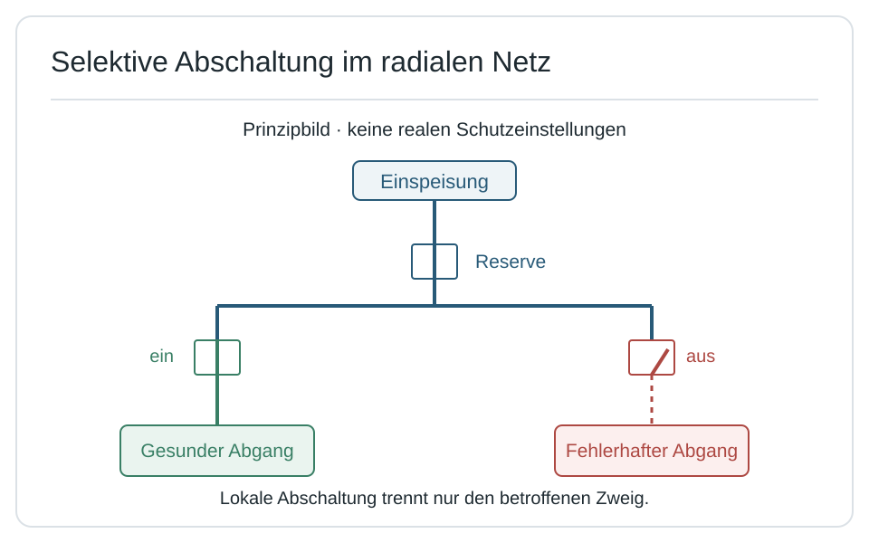

# M10-L4 – Netzfehler und Schutzprinzipien {#L4}

**Kursbereich:** M10 – Bachelor: Elektrische Energienetze

**Niveau:** Bachelor · Wahlbereich

**Vorwissen:** [Ersatzschaltungen](M1-L4.md), [Drehstrom](M7-L2.md), [Lastfluss](M10-L3.md).

**Lernziel:** Einen symmetrischen dreipoligen Kurzschluss im Ersatzmodell berechnen und die Aufgaben von Fehlererkennung, Abschaltung und Selektivität unterscheiden.

## Normalbetrieb und Fehlerbetrieb {#S1}

Ein Kurzschluss entsteht durch eine unerwünschte niederohmige Verbindung. Gegenüber dem Lastfluss verändern sich die Netzbedingungen stark. Ein dreipoliger symmetrischer Fehler kann mit einem einzelnen Strangersatznetz untersucht werden. Unsymmetrische Fehler (etwa einpolige Erdschlüsse) erfordern weitere Modelle, beispielsweise Mit-, Gegen- und Nullsystem mit der jeweiligen Sternpunktbehandlung. Diese werden hier nicht berechnet.

Im einfachen Fehlerstrommodell wird das speisende Netz vom Fehlerort aus durch eine Thévenin-Spannung $U_{\mathrm{Th}}$ und eine innere Impedanz $Z_{\mathrm{Th}}$ dargestellt. Die Spannung ist ein Effektivwertzeiger pro Strang, der Fehlerwiderstand bzw. die Fehlerimpedanz $Z_f$ wird pro Strang angesetzt. Dann gilt

$$
\underline I_f=\frac{\underline U_{\mathrm{Th}}}{Z_{\mathrm{Th}}+Z_f}.
$$

Für realistische Anfangskurzschlussströme sind geeignete Quellen- und Maschinenmodelle, Vorfehlerzustand und normbezogene Annahmen nötig. Im folgenden Rechenversuch ist eine fest vorgegebene ideale Quelle hinter einer konstanten Impedanz angenommen. Damit wird weder der Stoßkurzschlussstrom noch ein zeitabhängiger Abklingvorgang berechnet.

## Zahlenbeispiel am 20-kV-Netz {#S2}

Wähle $S_B=10\,\mathrm{MVA}$, $U_B=20\,\mathrm{kV}$, $v_\mathrm{Th}=1$ pu und $z_\mathrm{Th}=0{,}02+j0{,}10$ pu. Dies ist ein eigenständiges Fehlerbeispiel, keine Kurzschlussrechnung des idealen Slack-Modells aus M10-L3. Beim metallischen Fehler ($z_f=0$) gilt

$$
i_f=\frac1{0{,}02+j0{,}10}=1{,}9231-j9{,}6154,\qquad |i_f|=9{,}8058.
$$

Mit $I_B=288{,}675\,\mathrm A$ erhält man $|I_f|\approx2{,}831\,\mathrm{kA}$. Die konventionelle Kurzschluss-Scheinleistung bezogen auf die Nennspannung beträgt $\sqrt3 U_B|I_f|\approx98{,}06\,\mathrm{MVA}$. Sie ist nicht die am idealen Fehlerwiderstand umgesetzte Leistung: Bei $z_f=0$ ist die Fehlerspannung null. Wird ein reeller Fehlerwiderstand von 0,10 pu angenommen, sinkt $|i_f|$ auf $1/\sqrt{0{,}12^2+0{,}10^2}=6{,}4018$ pu (1,848 kA).

## Fehler erkennen und selektiv abschalten {#S3}

Ein Schutzsystem kombiniert Messgrößen, Entscheidungslogik und ein Schaltgerät. Überstromschutz reagiert auf erhöhte Ströme. Differentialschutz vergleicht die in eine definierte Zone hinein- und herausfließenden Ströme unter Beachtung der Mess- und Übersetzungsverhältnisse. Distanzschutz nutzt die scheinbare Impedanz aus Spannungs- und Strommessung als Hinweis auf die Fehlerlage. Die Funktion hängt vom Netztyp, der Quellenstruktur und den Messbedingungen ab.

{alt="Radiale Versorgung mit vorgelagertem Reserveschalter und zwei Abgängen, von denen nur der fehlerhafte durch seinen lokalen Schalter getrennt wird."}

Selektivität bedeutet, den betroffenen Bereich möglichst gezielt abzutrennen. In einer radialen Anordnung kann der nachgeordnete Schutz zuerst wirken; der übergeordnete dient als Reserve. Als rein konzeptionelles Beispiel sei die Abschaltzeit am nachgeordneten Gerät 0,15 s und am vorgelagerten Gerät 0,45 s. Die Zeitstaffel beträgt 0,30 s. Solche didaktischen Zahlen sind keine verwendbaren Schutzeinstellungen: tatsächliche Schutzkennlinien, Toleranzen, Schalterzeiten und Mindestfehlerströme müssen gemeinsam geprüft werden. In einem Ring mit beidseitiger Einspeisung genügt eine einfache Zeitstaffelung oft nicht.

## Grenzen und Sicherheitsfunktion {#S4}

Der maximale Fehlerstrom ist für die Beanspruchung von Betriebsmitteln wichtig. Der minimale Fehlerstrom ist dagegen relevant dafür, ob ein Schutz eine Störung überhaupt erkennt. Strombegrenzte Umrichter können weit weniger Fehlerstrom als klassische Synchronmaschinen liefern; die Fehlerantwort ist dann vom Regelungs- und Schutzkonzept abhängig. Eine Lastflussrechnung mit idealem Slack-Knoten bildet dieses Verhalten nicht ab.

Der Ausfall eines Leitungszweiges nach erfolgter Abschaltung ist ein neuer stationärer Netzfall. Der Fehler selbst und die Übergangsvorgänge während der Abschaltung sind andere Modellaufgaben. Aus dem einfachen Kurzschlussstrom lässt sich keine Freigabe für Arbeiten, keine Auswahl eines realen Schutzgeräts und keine normative Anlagenprüfung ableiten.

## Übungen mit Lösungen {#S5}

1. Halbiere im metallischen Fehlerbeispiel die gesamte Thévenin-Impedanz. Was passiert mit dem Strom?  
   **Lösung** Der Betrag verdoppelt sich bei unveränderter Quellenspannung auf rund 5,66 kA.
2. Warum ist ein geringerer Fehlerstrom nicht in jeder Hinsicht günstiger?  
   **Lösung** Er vermindert die Beanspruchung, kann aber unter der Ansprechschwelle eines Überstromschutzes liegen.
3. Welchen Netzbereich trennt der nachgeordnete Schalter im dargestellten radialen System ab?  
   **Lösung** Nur den fehlerhaften Abgang; der weitere Abgang bleibt bei erfolgreicher selektiver Abschaltung verbunden. Die Reserveabschaltung würde mehr Lasten trennen.

**Weiterführend:** [Netzplanung an einem Modellbeispiel](M10-L5.md)

## Quellen {#S6}

- [KIT – Elektrische Energienetze, Vorlesungsinhalte](https://www.ieh.kit.edu/2448_bee.php) · Inhaltsverzeichnis EEN, Punkt 5: Fehler in Netzen; Lehrplanabgleich. · Zuletzt abgerufen: 2026-11-25
- [IIT Kharagpur / NPTEL – Power System Analysis](https://onlinecourses-archive.nptel.ac.in/noc18_ee16/preview) · Course Layout, Woche 9–11: Kurzschluss und unsymmetrische Fehler; Vorlesungsinhalte nicht geprüft. · Zuletzt abgerufen: 2026-11-25
- [IIT Bombay / NPTEL – Power System Protection, Module 1 und 4–10](https://nptel.ac.in/courses/108101039) · Kursübersicht Power System Protection, IIT Bombay: thematische Einordnung; Lehrmaterial und Lehrplan nicht geprüft. · Zuletzt abgerufen: 2026-11-25
