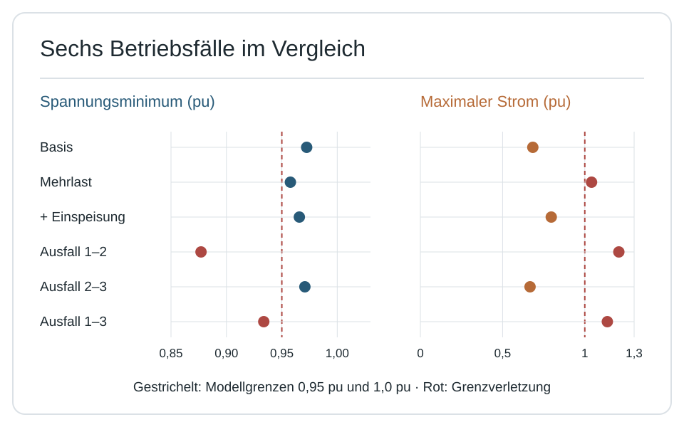

# M10-L5 – Netzplanung an einem Modellbeispiel {#L5}

**Kursbereich:** M10 – Bachelor: Elektrische Energienetze

**Niveau:** Bachelor · Wahlbereich

**Vorwissen:** [Knotenmatrix](M10-L2.md), [Lastfluss](M10-L3.md), [Netzfehler](M10-L4.md), [Rechenexperimente](M2-L7.md).

**Lernziel:** Ein Modellnetz bei Laständerung, lokaler Einspeisung und einzelnen Leitungsausfällen berechnen sowie anhand expliziter Betriebsgrenzen bewerten.

## Planungsfrage und Modellannahmen {#S1}

Das Dreiknotennetz aus den vorigen Lektionen soll die beiden Lastbereiche auch bei veränderter Nachfrage versorgen. Wir unterscheiden den Leistungsbedarf von der verfügbaren Netzkapazität. Ein höherer Laststrom kann thermische Grenzen überschreiten, eine ungünstige Impedanz kann schon vorher zu einer zu niedrigen Spannung führen.

Alle Größen sind auf 10 MVA und 20 kV bezogen. Als frei gewählte didaktische Anforderungen gelten $0{,}95\le |v_k|\le1{,}05$ pu und $|i_{km}|\le1{,}0$ pu (entsprechend 288,7 A). Das ist kein normatives Spannungsband oder realer Leitungsbemessungswert. Knoten 1 bleibt ideal auf 1 pu. Alle Leitungen besitzen nur Serienimpedanzen, die Lasten werden als konstante PQ-Knoten modelliert. Es gibt keine Stufenregler, keine Quellenbegrenzung und keine dynamischen Vorgänge.

| Zweig | Impedanz (pu) |
| --- | --- |
| 1–2 | 0,02 + j0,05 |
| 2–3 | 0,03 + j0,06 |
| 1–3 | 0,04 + j0,08 |

Die Ausgangslasten betragen 6 MW und 2,5 Mvar an Knoten 2 sowie 4 MW und 1,5 Mvar an Knoten 3. Der Mehrlastfall erhöht beide Lasten um 50 %. Ein zusätzlicher Erzeuger an Knoten 3 speist im Mehrlastfall 6 MW und 0 Mvar ein. Er ist im Modell eine feste PQ-Einspeisung; der Verbrauch am selben Knoten bleibt bestehen. Die drei Ausfallszenarien entfernen jeweils genau eine Leitung im ursprünglichen Basisbetrieb.

## Reproduzierbare Rechnung {#S2}

Die Fixpunktiteration aus [M10-L3](M10-L3.md) wird mit Python und NumPy umgesetzt. Nummern der Knoten werden im Code von null an gezählt. Die Leistungsbilanz und die Zweigströme werden bei jeder Variante aus der resultierenden Netzspannung berechnet; die Quellenleistung wird nicht vorgegeben.

```python
import numpy as np

lines = [(0, 1, .02+.05j), (1, 2, .03+.06j),
         (0, 2, .04+.08j)]

def solve(branches, s, tol=1e-10):
    Y = np.zeros((3, 3), dtype=complex)
    for a, b, z in branches:
        y = 1/z
        Y[a, a] += y
        Y[b, b] += y
        Y[a, b] -= y
        Y[b, a] -= y
    s = np.array(s, dtype=complex)
    v = np.ones(2, dtype=complex)
    for n in range(1, 501):
        if np.any(abs(v) < 1e-12):
            raise ValueError("Spannung nahe null")
        v = np.linalg.solve(Y[1:, 1:],
                            np.conj(s/v)-Y[1:, 0])
        V = np.r_[1+0j, v]
        S = V*np.conj(Y@V)
        err = max(abs(S[1:]-s))
        if err < tol:
            break
    else:
        raise ValueError("Keine Konvergenz")
    I = [abs((V[a]-V[b])/z) for a, b, z in branches]
    loss = sum(z.real*i*i for (_, _, z), i in zip(branches, I))
    assert abs(S.real.sum()-loss) < 1e-9
    return V, S, I, loss, n, err

base = [-.6-.25j, -.4-.15j]
heavy = [-.9-.375j, -.6-.225j]
cases = [("Basis", lines, base),
         ("Mehrlast", lines, heavy),
         ("Einspeisung", lines, [heavy[0], -.225j])]
for k, name in enumerate(["1-2", "2-3", "1-3"]):
    cases.append(("Ausfall " + name,
                  [z for i, z in enumerate(lines) if i != k], base))
for name, branches, s in cases:
    V, S, I, loss, n, err = solve(branches, s)
    ok = min(abs(V)) >= .95 and max(abs(V)) <= 1.05 and max(I) <= 1
    print(name, abs(V), max(I), loss*10000, n, err, ok)
```

Eine singuläre Matrix, etwa bei einer abgetrennten Insel ohne Referenz, führt zu einer Ausnahme. Für ein größeres Planungswerkzeug wäre vorab eine Prüfung der verbundenen Komponenten erforderlich. Das Beispiel umfasst ausschließlich zusammenhängende Netze. Der interne Leistungsrest begrenzt die numerische Abweichung, nicht den physikalischen Modellfehler.

## Auswertung der sechs Betriebsfälle {#S3}

Die Rechnung ergibt bei ungerundeten Eingaben folgende Werte. Die Verluste sind auf kW umgerechnet. Alle Lösungen erreichen einen komplexen Leistungsrest kleiner als $10^{-10}$ pu.

| Betriebsfall | $\lvert v_2\rvert$ (pu) | $\lvert v_3\rvert$ (pu) | $\max \lvert i\rvert$ (pu) | Verlust (kW) | Iter. | Grenzen |
| --- | ---: | ---: | ---: | ---: | ---: | --- |
| Basis | 0,97358 | 0,97242 | 0,68388 | 165,38 | 7 | erfüllt |
| Mehrlast | 0,95952 | 0,95773 | 1,04105 | 383,30 | 9 | Strom |
| Mehrlast + Einspeisung | 0,96581 | 0,97244 | 0,79600 | 188,40 | 8 | erfüllt |
| Ausfall 1–2 | 0,87709 | 0,91529 | 1,20710 | 747,60 | 13 | Spannung, Strom |
| Ausfall 2–3 | 0,97453 | 0,97080 | 0,66699 | 166,43 | 7 | erfüllt |
| Ausfall 1–3 | 0,95642 | 0,93370 | 1,13712 | 321,41 | 9 | Spannung, Strom |

{alt="Spannungsminimum und maximaler Leitungsstrom für sechs Last- und Ausfallszenarien gegenüber den frei gewählten Grenzwerten."}

Der Mehrlastfall hält das gewählte Spannungsband ein, überschreitet aber die Stromgrenze. Die lokale Einspeisung verbessert beide Größen, obwohl sie keine Blindleistung liefert. Das liegt an den veränderten Zweigströmen, nicht an einer fest geregelten Knotenspannung. Der Slack stellt in diesem Fall noch etwa 9,1884 MW bereit; die Netto-Wirkleistungslast beträgt 9 MW. Bei noch stärkerer Einspeisung können sich Leistungsrichtungen umkehren und Spannungen zu hoch werden.

## Redundanz und qualitative Robustheit {#S4}

Alle drei Einzelausfälle lassen beide Lastknoten mit der Referenz verbunden. Trotzdem erfüllen zwei Ausfallfälle die vorgegebenen Grenzen nicht. Der Ring ist daher topologisch redundant, aber in diesem Arbeitspunkt nicht ausreichend dimensioniert, um diese vereinfachte N-1-Prüfung zu bestehen. N-1 bezeichnet hier den Ausfall eines einzelnen Leitungszweigs mit unveränderten Lasten und ohne Gegenmaßnahmen; eine vollständige betriebliche Sicherheitsanalyse ist damit nicht gegeben.

Mögliche Planungsvarianten sind kleinere Leitungsimpedanzen, größerer zulässiger Strom durch geeignete Betriebsmittel, lokale Blindleistungsbereitstellung oder eine alternative Einspeisung. Jede Variante verändert das Modell auf eine andere Weise und sollte erst einzeln, dann zusammen getestet werden. Eine höhere Stromgrenze allein beseitigt keinen Spannungsbandverstoß. Eine neue Einspeisung verlangt zudem Betrachtung der Verfügbarkeit, Schutzfunktionen und anderer Betriebsfälle. Ein zeitabhängiges Erzeugungsprofil wird im geplanten Modul M11 behandelt.

Die Untersuchung quantifiziert stationäre Betriebsgrenzen, nicht transiente Stabilität, Schutzkoordination oder tatsächliche Ausfallwahrscheinlichkeiten. Eine reale Entscheidung benötigt Messdaten, Betriebsmitteldaten, weitere Last- und Erzeugungsszenarien und gültige technische Anforderungen.

## Übungen mit Lösungen {#S5}

1. Welche minimalen Spannungen treten in den Ausfallfällen 1–2 und 1–3 auf? Welche Zweige tragen den maximalen Strom?  
   **Lösung** 0,87709 pu an Knoten 2, maximaler Strom auf 1–3; 0,93370 pu an Knoten 3, maximaler Strom auf 1–2.
2. Der Mehrlastfall weist 1,04105 pu maximalen Strom auf. Wie viele Ampere sind das ungefähr?  
   **Lösung** $1{,}04105\cdot288{,}675\,\mathrm A=300{,}5\,\mathrm A$, also rund 11,9 A über der Modellgrenze.
3. Welche Aussage ändert sich, wenn nur das Spannungsband, nicht aber die Stromgrenze geprüft wird?  
   **Lösung** Der Mehrlastfall würde fälschlich als zulässig bewertet. Auch eine stationäre mathematische Lösung ohne Restfehler garantiert keine Einhaltung weiterer Betriebsanforderungen.
4. Führe den Basisfall mit einer strengeren Toleranz von $10^{-12}$ und vergleiche die Spannungswerte und Verluste.  
   **Lösung** Die ausgewiesenen gerundeten Werte bleiben unverändert. Die Restprüfung wird strenger; die Iterationszahl steigt. Eine solche Wiederholung untersucht nur den numerischen Fehler, nicht die Qualität der Eingabedaten.

**Weiterführend:** [Studienweg und weitere Wahlmodule](pages/studienweg.md#S3).

## Quellen {#S6}

- [KIT – Elektrische Energienetze, Vorlesungsinhalte](https://www.ieh.kit.edu/2448_bee.php) · Inhaltsverzeichnis EEN, Punkte 3 und 4: Netzberechnung und optimaler Leistungsfluss; Lehrplanabgleich. · Zuletzt abgerufen: 2026-11-25
- [MATPOWER – AC Power Flow](https://matpower.app/manual/matpower/ACPowerFlow.html) · Handbuch §4.1: AC-Leistungsbilanz und Knotentypen; Grenzen des gewöhnlichen Lastflusses, methodischer Teilaspekt. · Zuletzt abgerufen: 2026-11-25
- [MATPOWER – Standard AC OPF](https://matpower.app/manual/matpower/StandardACOPF.html) · § 6.1: Optimierungsvariablen, Kostenfunktion und Leistungsbilanz; weiterführend. · Zuletzt abgerufen: 2026-11-25
