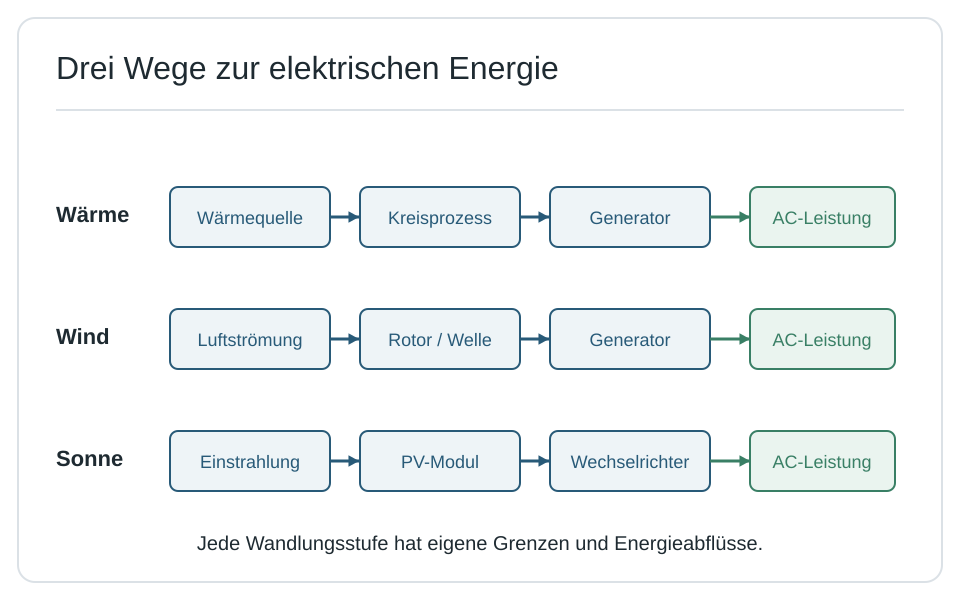

# M11-L1 – Umwandlungsketten und Leistungsprofile {#L1}

**Kursbereich:** M11 – Bachelor: Energieerzeugung und Speicherung

**Niveau:** Bachelor · Wahlbereich

**Vorwissen:** [Energiebilanzen](M2-L1.md), [Elektrische Energietechnik](M7-L1.md), [Netzstruktur](M10-L1.md).

**Lernziel:** Umwandlungsketten bilanzieren, Erzeugungsprofile integrieren und Energieertrag von verfügbarer Leistung unterscheiden.

## Systemgrenze und Energiebilanz {#S1}

Elektrische Energie ist keine Primärenergiequelle, sondern ein Energieträger. Ein Kraftwerk wandelt Energie aus einer Ressource um und stellt sie an einem definierten elektrischen Anschlusspunkt bereit. Wir ziehen die Systemgrenze um die gesamte Anlage einschließlich ihres Eigenbedarfs. Bei stationärem Betrieb gilt

$$
P_\mathrm{ein}=P_\mathrm{el,netto}+P_\mathrm{ab},\qquad \eta_\mathrm{netto}=\frac{P_\mathrm{el,netto}}{P_\mathrm{ein}}.
$$

$P_\mathrm{ab}$ umfasst alle sonstigen Energieabflüsse, einschließlich nutzbarer Wärme, falls vorhanden. Bei verändertem Energieinhalt im System kommt die zeitliche Ableitung der gespeicherten Energie hinzu. Ein Wirkungsgrad ist daher nur mit Angabe der Systemgrenze und der Betriebsbedingungen vergleichbar. Bei Wind und PV ist die einfallende Ressourcenleistung die Bezugsgröße; sie ist keine Brennstoffleistung.

{alt="Wärme, Wind und Sonnenstrahlung werden über verschiedene Wandlungsstufen in elektrische Leistung überführt."}

## Thermische Kraftwerke {#S2}

Bei einem Dampfkraftwerk erhitzt beispielsweise Verbrennung, Kernspaltung oder konzentrierte Sonnenstrahlung ein Arbeitsmedium. Dampf expandiert in der Turbine, der Generator wandelt Wellenleistung in elektrische Leistung um. Kondensation und Pumpen schließen den Kreisprozess. Der theoretische Carnot-Wirkungsgrad $1-T_\mathrm{kalt}/T_\mathrm{heiß}$ gibt eine obere Grenze für eine reversible Wärmekraftmaschine zwischen zwei Wärmereservoirs an; Temperaturen müssen in Kelvin eingesetzt werden. Er ist kein Modell des tatsächlichen Dampfkraftwerks.

Beispiel: Bei 100 MW zugeführter Wärmeleistung, 40 % thermisch-mechanischem Wirkungsgrad des Kreisprozesses, 97 % Generatorwirkungsgrad und 2 MW elektrischem Eigenbedarf ergeben sich 38,8 MW Brutto- und 36,8 MW Nettoleistung. Bei unverändertem Betrieb über 6 h sind das 220,8 MWh elektrische Nettoenergie. In praktischen Modellen hängen Wirkungsgrad, Eigenbedarf, Mindestlast und zulässige Leistungsänderung vom Betriebspunkt ab. Kraft-Wärme-Kopplung nutzt einen Teil der sonst abgeführten Wärme, ohne damit die elektrische Effizienz gleichzusetzen.

## Wind, Wasserkraft und Photovoltaik {#S3}

Durch eine senkrecht angeströmte Rotorfläche $A$ fließt pro Sekunde die Luftmasse $\rho A v$. Mit der spezifischen kinetischen Energie $v^2/2$ ergibt sich

$$
P_\mathrm{Wind}=\frac12\rho A v^3,\qquad P_\mathrm{el}=\eta_\mathrm{Antrieb} c_P P_\mathrm{Wind}.
$$

$c_P$ bezeichnet den aerodynamischen Leistungsbeiwert. Für die ideale freistehende Aktuatorscheibe beträgt die Betz-Grenze 16/27; reale Rotoren liegen darunter. Bei $A=100\,\mathrm{m^2}$, $\rho=1{,}225\,\mathrm{kg/m^3}$, $v=8\,\mathrm{m/s}$, $c_P=0{,}4$ und $\eta_\mathrm{Antrieb}=0{,}9$ erhält man etwa 11,29 kW. Die kubische Beziehung gilt in diesem Modell nur bei konstanten Beiwerten, nicht oberhalb der Nennleistung oder bei Abschaltung. Ein realistisches Anlagenmodell verwendet eine Leistungskennlinie einschließlich Einschalt-, Nenn- und Abschaltbereich.

Wasserkraft nutzt einen Volumenstrom $Q$ bei einer Fallhöhe $H$: $P_\mathrm{el}=\eta\rho_\mathrm{Wasser}gQH$. Photovoltaik wandelt Licht direkt in elektrische Gleichstromleistung um. Ein Wechselrichter koppelt die Anlage an ein Wechselstromnetz. Die zugehörigen Kennlinien folgen in [M11-L2](M11-L2.md).

## Profile, Arbeit und Residuallast {#S4}

Die Energie ist das Zeitintegral der Leistung. Für stückweise konstante Intervalle gilt

$$
E=\int_0^T P(t)\,\mathrm dt=\sum_k P_k\Delta t_k,\qquad f_\mathrm{Auslastung}=\frac{E}{P_\mathrm{Nenn}T}.
$$

Ein frei gewählter Vierstundenversuch mit 4 kW Nennleistung:

| Stunde | Erzeugung (kW) | Last (kW) | Residuallast (kW) |
| --- | ---: | ---: | ---: |
| 1 | 0 | 2 | 2 |
| 2 | 4 | 1 | −3 |
| 3 | 3 | 2 | −1 |
| 4 | 1 | 3 | 2 |

Erzeugung und Last betragen jeweils 8 kWh, die Auslastung der Erzeugungsanlage ist 50 %. Trotzdem fehlen in zwei Intervallen insgesamt 4 kWh, während 4 kWh Überschuss entstehen. Direkt genutzt werden nur 4 kWh. Restbedarf und Überschuss sind zeitlich zu bilanzieren; das Jahres- oder Tagesmittel allein genügt nicht. Ein idealer Speicher mit 4 kWh könnte beide Überschussstunden aufnehmen, aber die erste Stunde nur versorgen, wenn passende Anfangsenergie verfügbar ist. Für eine laufende Versorgung müssen außerdem Leistung, Regelbarkeit und Netzgrenzen beachtet werden.

## Übungen mit Lösungen {#S5}

1. Ein Generator liefert 12 MW über 3 h und 4 MW über weitere 2 h. Bestimme Energie und mittlere Leistung.  
   **Lösung** 44 MWh und 8,8 MW.
2. Wie ändert sich die Windleistung bei einer Erhöhung von 6 auf 9 m/s unter konstanten Beiwerten?  
   **Lösung** Faktor $(9/6)^3=3{,}375$; Begrenzungen wurden nicht berücksichtigt.
3. Warum lässt sich die mittlere Windleistung nicht allgemein aus der mittleren Windgeschwindigkeit berechnen?  
   **Lösung** Wegen der Nichtlinearität gilt im Allgemeinen $\overline{v^3}\ne\overline v^3$. Die Häufigkeitsverteilung und Leistungskennlinie sind notwendig.

**Weiterführend:** [Photovoltaik und Leistungskennlinien](M11-L2.md)

## Quellen {#S6}

- [U.S. DOE – Concentrating Solar-Thermal Power: Power Cycles](https://www.energy.gov/cmei/systems/concentrating-solar-thermal-power-csp-power-cycles) · Abschnitt What are Power Cycles?: thermische Umwandlung in elektrische Energie. · Zuletzt abgerufen: 2026-11-25
- [U.S. DOE – Small Wind Guidebook](https://www.energy.gov/cmei/systems/windexchange/small-wind-guidebook) · Small Wind Guidebook, Abschnitte Introduction und How Do Wind Turbines Work?: Umwandlung von Windenergie; Kleinwindanlagen als Anwendungsbeispiel. · Zuletzt abgerufen: 2026-11-25
- [U.S. DOE – Solar Photovoltaic Technology Basics](https://www.energy.gov/cmei/systems/solar-photovoltaic-technology-basics) · Abschnitt What Is Photovoltaic Technology?: Licht-Strom-Umwandlung und Modulstruktur. · Zuletzt abgerufen: 2026-11-25
