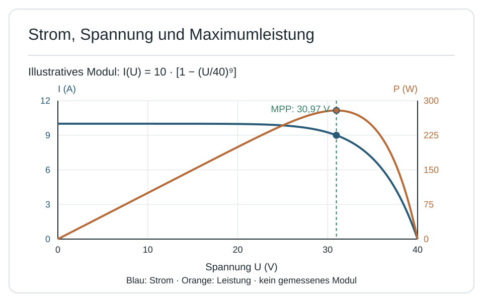

# M11-L2 – Photovoltaik und Leistungskennlinien {#L2}

**Kursbereich:** M11 – Bachelor: Energieerzeugung und Speicherung

**Niveau:** Bachelor · Wahlbereich

**Vorwissen:** [Halbleiter](M3-L1.md), [Leistung](M1-L1.md), [Umwandlungsketten](M11-L1.md), [DC/DC-Wandler](M9-L3.md).

**Lernziel:** Strom-Spannungs-Kennlinien interpretieren und ein vereinfachtes PV-Leistungsprofil einschließlich Temperatur und Wechselrichtergrenze bestimmen.

## Photoelektrische Umwandlung {#S1}

Absorbierte Photonen können im Halbleiter Elektron-Loch-Paare erzeugen. Die Struktur der Solarzelle begünstigt die Ladungstrennung; an den Kontakten kann bei geschlossenem äußeren Stromkreis elektrische Leistung abgegeben werden. Anders als bei einer ohmschen Spannungsquelle hängt der Ausgangsstrom nicht linear von der Klemmenspannung ab. Strom und Spannung werden hier im Erzeugerzählpfeilsystem positiv angegeben.

Ein verbreitetes stationäres Ein-Dioden-Modell verwendet den Photostrom $I_\mathrm{ph}$, den Diodensättigungsstrom $I_0$, den Serienwiderstand $R_s$ und den Parallelwiderstand $R_\mathrm{sh}$:

$$
I=I_\mathrm{ph}-I_0\left[\exp\left(\frac{U+IR_s}{nN_sV_T}\right)-1\right]-\frac{U+IR_s}{R_\mathrm{sh}},\qquad V_T=\frac{k_BT}{q}.
$$

$N_s$ ist die Zahl identischer in Reihe geschalteter Zellen, $n$ der Diodenidealitätsfaktor; $T$ ist die absolute Zelltemperatur. Die Gleichung ist bei $R_s\ne0$ implizit in $I$. Ihre Parameter sind für ein konkretes Modul zu bestimmen. Das Modell beschreibt keine beliebige Teilverschattung ohne Erweiterung um Zellgruppen und Bypassdioden.

## Kennlinie und Maximum Power Point {#S2}

Bei Kurzschluss gilt $U=0$ und $I=I_\mathrm{sc}$, im Leerlauf gilt $I=0$ und $U=U_\mathrm{oc}$. In beiden Punkten ist $P=UI=0$. Im dazwischenliegenden Maximum (MPP) gilt bei einer differenzierbaren Kennlinie

$$
\frac{\mathrm dP}{\mathrm dU}=I+U\frac{\mathrm dI}{\mathrm dU}=0.
$$

{alt="Schematische I-U- und daraus berechnete P-U-Kennlinie mit gemeinsamem Maximumleistungspunkt."}

Zur Illustration verwenden wir die ausdrücklich nicht als Diodenmodell verstandene Näherung $I(U)=10[1-(U/40)^9]$ A für $0\le U\le40$ V. Differenzieren ergibt $1-10(U/40)^9=0$; der MPP liegt bei $U=40\cdot0{,}1^{1/9}\approx30{,}97$ V, $I=9$ A und $P\approx278{,}7$ W. Der Füllfaktor ist $P_\mathrm{mp}/(U_\mathrm{oc}I_\mathrm{sc})\approx0{,}697$. Ein MPPT-Regler (Maximum Power Point Tracking) sucht über einen Wandler einen günstigen Betriebspunkt. Bei Teilverschattung können mehrere lokale Maxima auftreten, sodass ein einfaches Suchverfahren nicht zwingend das globale Maximum findet.

## Von Strahlung und Temperatur zur AC-Leistung {#S3}

Die Referenzleistung $P_\mathrm{STC}$ gilt unter Standard-Testbedingungen (1000 W/m² Einstrahlung in Modulebene, 25 °C Zelltemperatur, definiertes Referenzspektrum). Als vereinfachte, an PVWatts angelehnte lineare Näherung nutzen wir

$$
P_\mathrm{DC}=\max\left(0,P_\mathrm{STC}\frac{G}{1000\,\mathrm{W/m^2}}[1+\gamma(T_c-25\,{}^\circ\mathrm C)]\right),
$$

mit Einstrahlung $G$, Zelltemperatur $T_c$ und Temperaturkoeffizient $\gamma$. Dies ist kein vollständiges PVWatts-Modell; insbesondere werden Schwachlichtverhalten, spektrale und optische Verluste sowie Temperaturdynamik ausgelassen. Mit festem Wechselrichterwirkungsgrad und Leistungsgrenze folgt

$$
P_\mathrm{AC}=\min(P_\mathrm{AC,max},\eta_\mathrm{WR} P_\mathrm{DC}).
$$

Für 6 kWp, $\gamma=-0{,}004\,\mathrm{K^{-1}}$, $G=800\,\mathrm{W/m^2}$ und $T_c=45\,{}^\circ\mathrm C$ erhält man 4,416 kW DC und bei 96 % Wandlerwirkungsgrad rund 4,239 kW AC. Bei 1000 W/m² und 25 °C wären es 5,76 kW vor Leistungsbegrenzung; bei einem 5-kW-Wechselrichter gehen im vereinfachten Modell 0,76 kW mögliche AC-Leistung durch Clipping verloren. Dieser Unterschied ist nicht mit der Verlustwärme im Wechselrichter gleichzusetzen.

## Ein kleines Einstrahlungsprofil {#S4}

| Größe | Stunde 1 | Stunde 2 | Stunde 3 |
| --- | ---: | ---: | ---: |
| Einstrahlung (W/m²) | 400 | 800 | 1000 |
| Zelltemperatur (°C) | 30 | 45 | 50 |
| DC-Leistung (kW) | 2,352 | 4,416 | 5,400 |
| AC-Leistung (kW) | 2,258 | 4,239 | 5,000 |

Die drei einstündigen Intervalle liefern zusammen rund 11,497 kWh am AC-Anschlusspunkt. Reale Einstrahlungswerte beziehen sich auf die geneigte Modulebene; horizontale Wetterdaten müssen geometrisch umgerechnet werden. Zelltemperatur ist nicht gleich Lufttemperatur. Die Addition der Modul-Nennleistungen sagt ohne diese Informationen wenig über den Ertrag eines konkreten Tages aus.

## Übungen mit Lösungen {#S5}

1. 12 identische 400-Wp-Module in Reihe, bei STC jeweils 32 V und 12,5 A am MPP. Bestimme Stringspannung, -strom und Leistung.  
   **Lösung** 384 V, 12,5 A und 4,8 kW. Das ist ein Rechenmodell, keine Auslegungsfreigabe.
2. Eine Anlage mit 6 kWp arbeitet bei 1000 W/m² und 60 °C; $\gamma=-0{,}004\,\mathrm{K^{-1}}$. Bestimme die DC-Leistung.  
   **Lösung** $6(1-0{,}004\cdot35)=5{,}16$ kW.
3. Warum ersetzt ein MPP-Regler keinen sicheren Anlagenbetrieb?  
   **Lösung** Die Leistungsoptimierung berücksichtigt nicht automatisch Kalt-Leerlaufspannung, Stromgrenzen, Isolation, Lichtbogenschutz oder Netzanforderungen. Diese müssen separat ausgelegt werden.

**Weiterführend:** [Speichertechnologien im Vergleich](M11-L3.md)

## Quellen {#S6}

- [U.S. DOE – Solar Photovoltaic Technology Basics](https://www.energy.gov/cmei/systems/solar-photovoltaic-technology-basics) · Abschnitt What Is Photovoltaic Technology?: Zellen, Module und Arrays; Teilaspekt. · Zuletzt abgerufen: 2026-11-25
- [Sandia PVPMC – PVWatts](https://pvpmc.sandia.gov/modeling-guide/2-dc-module-iv/point-value-models/pvwatts/) · Abschnitt PVWatts, Gleichung für Einstrahlung >125 W/m²: MPP-Leistung und Temperaturkoeffizient; Gültigkeitsgrenzen beachten. · Zuletzt abgerufen: 2026-11-25
- [Sandia PVPMC – Array Utilization / MPPT](https://pvpmc.sandia.gov/modeling-guide/3-dc-array-iv/array-utilization/) · Abschnitt Array Utilization: Maximum-Power-Point-Tracking und Einfluss von Einstrahlung und Zelltemperatur. · Zuletzt abgerufen: 2026-11-25
