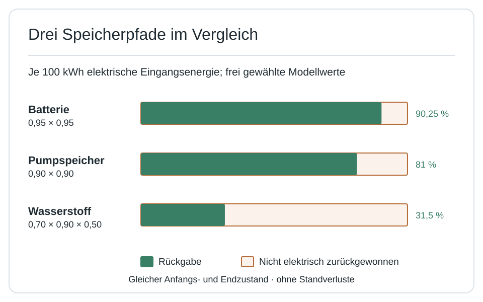

# M11-L3 – Speichertechnologien im Vergleich {#L3}

**Kursbereich:** M11 – Bachelor: Energieerzeugung und Speicherung

**Niveau:** Bachelor · Wahlbereich

**Vorwissen:** [Energiebilanzen](M2-L1.md), [Umwandlungsketten](M11-L1.md).

**Lernziel:** Speicher anhand nutzbarer Energie, Leistung, Wirkungsgrad und Speicherdauer vergleichen und die Systemgrenzen explizit nennen.

## Energie, Leistung und Speicherdauer {#S1}

Speicher verschieben Energie in der Zeit. Sie benötigen eine Quelle zum Laden und liefern wegen der Verluste weniger Energie zurück als sie zuvor aufgenommen haben. Die Nennenergie $E_N$ und die Lade- und Entladeleistungen $P_\mathrm{L,max}$ und $P_\mathrm{E,max}$ müssen getrennt angegeben werden. Bei ausgangsseitig nutzbarer Energie $E_\mathrm{nutz,out}$ ergibt sich die ideale Dauer bei konstanter maximaler Abgabeleistung zu $t_\mathrm{max}=E_\mathrm{nutz,out}/P_\mathrm{E,max}$. Die nutzbare Energie kann wegen Temperatur, Alterung oder einer Mindestreserve kleiner als der Nennwert sein.

Der elektrische Rundlaufwirkungsgrad ist

$$
\eta_\mathrm{RT}=\frac{E_\mathrm{ab,AC}}{E_\mathrm{zu,AC}}.
$$

Er ist für eine vollständige Lade-/Entladefolge mit gleichem Anfangs- und Endzustand definiert. Hilfsenergie und Standverluste müssen einbezogen werden, wenn sie innerhalb der betrachteten Grenze liegen. Ein hoher Wert allein bestimmt weder Wirtschaftlichkeit noch Eignung für lange Speicherzeiten.

## Elektrochemische Batterie {#S2}

Beim Laden laufen elektrochemische Umwandlungen an den Elektroden ab; beim Entladen wird elektrische Energie zurückgewonnen. In einem einfachen Modell mit nahezu konstanter mittlerer Klemmenspannung $U$ ist $E\approx UQ$. Eine 48-V-Batterie mit 200 Ah besitzt danach etwa 9,6 kWh nominelle Energie. Bei einem zulässigen Ladezustandsfenster von 10 bis 90 % sind davon 7,68 kWh intern nutzbar; bei 95 % Entladewirkungsgrad erreichen 7,296 kWh den AC-Anschluss. Bei 3 kW Abgabeleistung entspricht dies etwa 2,43 h. Spannung, Strom, Zelltemperaturen und Ladezustand begrenzen die reale Leistung; Zellüberwachung und Schutzsysteme bleiben unverzichtbar. Kapazität in Ah ist elektrische Ladung und keine Energieangabe ohne Spannung.

## Pumpspeicher {#S3}

Bei Überschuss wird Wasser in ein höher gelegenes Becken gepumpt. Die beim Entladen nutzbare potenzielle Energie beträgt vereinfacht $E=\rho VgH$. Mit 1000 m³ Wasser, 100 m Fallhöhe, 1000 kg/m³ und $g=9{,}81\,\mathrm{m/s^2}$ sind es 981 MJ oder 272,5 kWh mechanische Energie. Pumpwirkungsgrad 90 % und Turbinen-/Generatorwirkungsgrad 90 % ergeben zusammen 81 % Rundlaufwirkungsgrad ohne Standverluste. Zum Laden werden somit 302,78 kWh benötigt, bei der Entladung 245,25 kWh abgegeben. Bei veränderlicher Fallhöhe wäre über das verdrängte Volumen zu integrieren. Standort, Beckenvolumen, Wasserführung und Maschinenleistung, nicht nur der Wirkungsgrad, begrenzen die Anlage.

## Wasserstoff als chemischer Speicherpfad {#S4}

Ein Elektrolyseur wandelt elektrische Energie in chemische Energie des Wasserstoffs um. Verdichtung, Speicherung und Rückverstromung erfordern weitere Stufen. Mit dem unteren Heizwert (LHV) von rund 33,3 kWh/kg kann man die chemisch gespeicherte Energie abschätzen. Alle hier verwendeten Wirkungsgrade beziehen sich konsistent auf den LHV. Beispiel: 100 kWh elektrische Eingangsenergie, 70 % Elektrolysewirkungsgrad, 90 % effektiver Anteil nach Speicherung und Aufbereitung (hier als energiebilanzielles Stufenmodell) und 50 % Rückverstromungswirkungsgrad ergeben $100\cdot0{,}70\cdot0{,}90\cdot0{,}50=31{,}5$ kWh elektrische Rückgabe. Dies ist keine Behauptung über konkrete Anlagen. Ein detailliertes Modell führt den Strom für Verdichter separat, bilanziert Wasserstoffmasse und modelliert die druckabhängigen Verluste. Direkte industrielle Nutzung des Wasserstoffs hat eine andere Nutzenergie und ist nicht mit der elektrischen Rückverstromung gleichzusetzen.

{alt="Illustrative elektrische Energiebilanz bei jeweils 100 kWh Eingang und den gewählten Rundlaufwirkungsgraden."}

## Vergleich und Wahl der Systemgrenze {#S5}

| Technologie | Typische Aufgabe (qualitativ) | Speichergröße bestimmt durch | Leistung bestimmt durch |
| --- | --- | --- | --- |
| Batterie | schnelle Regelung, Stundenverschiebung | Zellen und nutzbares Ladefenster | Zellen, Umrichter, Kühlung |
| Pumpspeicher | mehrstündige bis längere Netzverschiebung | Beckenvolumen und Fallhöhe | Pumpen, Turbinen, Leitungen |
| Wasserstoff | längere Speicherung oder Stoffnutzung | Behälter/Kaverne und Betriebsdruck | Elektrolyse und Rückverstromung |

Vergleichswerte in der Grafik sind Modellannahmen (Batterie $0{,}95^2=90{,}25$ %, Pumpspeicher 81 %, Wasserstoff 31,5 %), keine Marktmittelwerte. Die EIA berichtete für US-Großspeicher im Jahr 2019 durchschnittliche monatliche Rundlaufwerte von 82 % für Batterien und 79 % für Pumpspeicher; diese historischen Betriebswerte sind nicht mit bestimmten Komponentenwirkungsgraden gleichzusetzen. Eine Auslegung berücksichtigt neben Wirkungsgrad, Standzeit und Leistung auch Zyklenzahl, Kosten, Platz, Sicherheit und Umweltwirkungen. Energiespeicher sind außerdem nicht automatisch ein Ersatz für alle Netz- und Frequenzregelungsfunktionen.

## Übungen mit Lösungen {#S6}

1. Ein Speicher liefert 40 kWh bei 10 kW. Wie lange?  
   **Lösung** 4 h bei konstantem Betrieb; die Angabe 40 kWh muss bereits ausgangsseitig nutzbar sein.
2. Wie viel elektrische Energie muss ein Speicher mit Rundlaufwirkungsgrad 80 % aufnehmen, um 100 kWh abzugeben?  
   **Lösung** 125 kWh unter gleichen Anfangs- und Endzuständen.
3. Warum können Wasserstoffspeicher trotz niedrigerer elektrischer Rückgewinnung für lange Zeiträume interessant sein?  
   **Lösung** Leistungstechnik und chemischer Speicherraum können unterschiedlich skaliert werden. Ob dies vorteilhaft ist, hängt unter anderem von Standort, Speicherverlusten, Kosten und Nutzungszweck ab.

**Weiterführend:** [Speichermodelle und Ladezustand](M11-L4.md)

## Quellen {#S7}

- [U.S. DOE – Pumped Storage Hydropower](https://www.energy.gov/cmei/water/pumped-storage-hydropower) · Abschnitt What is Pumped Storage Hydropower?: Lade- und Entladeprinzip. · Zuletzt abgerufen: 2026-11-25
- [U.S. DOE – Hydrogen Resources](https://www.energy.gov/cmei/fuels/hydrogen-resources) · Abschnitt Natural Gas and Other Fossil Fuels sowie Einleitung: Wasserstoff-Erzeugungspfade; Teilaspekt. · Zuletzt abgerufen: 2026-11-25
- [U.S. EIA – Utility-scale batteries and pumped storage (historische Betriebsdaten 2019)](https://www.eia.gov/todayinEnergy/detail.php?id=46756) · Artikel vom 12.02.2021, Abs. 1–2: monatlicher mittlerer Rundlaufwirkungsgrad US-Großspeicher 2019 (82 % Batterien, 79 % Pumpspeicher). · Zuletzt abgerufen: 2026-11-25 · Inhaltlich geprüft: 2026-11-25
