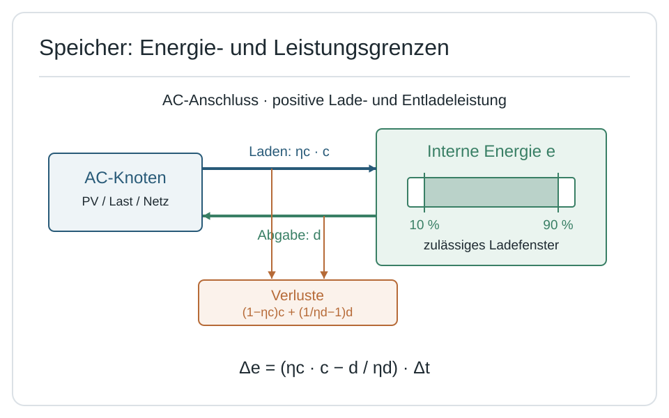

# M11-L4 – Speichermodelle und Ladezustand {#L4}

**Kursbereich:** M11 – Bachelor: Energieerzeugung und Speicherung

**Niveau:** Bachelor · Wahlbereich

**Vorwissen:** [Rechenexperimente](M2-L7.md), [Speichertechnologien](M11-L3.md).

**Lernziel:** Eine diskrete Speicherbilanz aufstellen, zulässige Lade- und Entladeleistung bestimmen und Verluste ohne Doppelzählung prüfen.

## Zustandsgröße und Vorzeichen {#S1}

Ein Batteriesystem wird als Energiespeicher mit konzentriertem Zustand $e(t)$ in kWh beschrieben. Der Zustand ist nicht die gesamte elektrochemische Dynamik. Für die Bilanz betrachten wir die AC-Anschlussleistung, einschließlich des vereinfachten Umrichters. Ladeleistung $c$ und Entladeleistung $d$ sind unabhängig voneinander nichtnegative Größen; die Nettoeinspeisung am AC-Knoten lautet $d-c$. Bei Nennenergie $E_N>0$ ist der dimensionslose Ladezustand $\mathrm{SOC}=e/E_N$. Ein Fenster von 10 bis 90 % bedeutet $e_\mathrm{min}=0{,}1E_N$, $e_\mathrm{max}=0{,}9E_N$.

Bei einem stückweise konstanten Profil und ohne Standverluste gilt

$$
e_{k+1}=e_k+\eta_c c_k\Delta t-\frac{d_k}{\eta_d}\Delta t.
$$

$\eta_c$ und $\eta_d$ sind im Intervall $(0,1]$ und beziehen sich auf den AC-Anschluss. Bei $\Delta t$ in Stunden und Leistungen in kW erhält man kWh. Die Entladung erfordert intern mehr Energie als am Anschluss ankommt. Wenn ein stündlicher Erhaltungsfaktor $r$ (0 bis 1) für Standverluste verwendet wird, ist eine mögliche diskrete Modellierung $e_{k+1}=r^{\Delta t/(1\,\mathrm h)}e_k+\eta_c c_k\Delta t-d_k\Delta t/\eta_d$; dabei werden die Standverluste auf den Anfangsbestand angewendet. Für kontinuierlich über das Intervall verteilte Verluste und Energieflüsse ist das exakte Differentialgleichungsmodell zu integrieren. Im folgenden Beispiel ist $r=1$.

{alt="Energiefluss am AC-Knoten mit Lade- und Entladewirkungsgrad, Ladezustandsfenster und Verlustpfaden."}

## Leistungsbegrenzung aus Energiegrenzen herleiten {#S2}

Für reines Laden ($d=0$) muss $e_{k+1}\le e_\mathrm{max}$ gelten, für reines Entladen ($c=0$) dagegen $e_{k+1}\ge e_\mathrm{min}$. Daraus erhält man bei $\Delta t>0$

$$
c\le\min\left(P_\mathrm{L,max},\frac{e_\mathrm{max}-e}{\eta_c\Delta t}\right),\qquad d\le\min\left(P_\mathrm{E,max},\frac{(e-e_\mathrm{min})\eta_d}{\Delta t}\right).
$$

Die Begrenzung erfolgt vor der Zustandsaktualisierung. Den Zustand erst nachträglich abzuschneiden würde die nicht aufgenommene oder nicht abgegebene Energie ohne Gegenbuchung verschwinden lassen. Bei Standverlusten muss die Grenze auf den nach Standverlust verbleibenden Zustand bezogen werden; falls die Mindestreserve dadurch unterschritten wird, braucht das Modell eine Erhaltungsstrategie oder eine explizite Verletzungsmeldung. Wir setzen im Folgenden einen zulässigen Anfangszustand voraus und erlauben nicht gleichzeitig Laden und Entladen ($cd=0$).

## Rechenbeispiel am Verbrauchsknoten {#S3}

Es gelten $E_N=10$ kWh, $e_\mathrm{min}=1$ kWh, $e_\mathrm{max}=9$ kWh, beide Leistungsgrenzen 3 kW und $\eta_c=\eta_d=0{,}95$. Anfangsenergie ist 6 kWh. Zunächst liegen für 2 h 4 kW Überschuss an. Die Leistung ist auf 3 kW begrenzt, die mittlere Ladeleistung zusätzlich wegen der freien Kapazität auf $3/(0{,}95\cdot2)=1{,}578947$ kW. Bei zeitlich konstantem Anschlussmodell können alternativ bis zum Erreichen der Grenze 3 kW geladen und danach null geladen werden. Die Energieaufnahme bleibt 3,157895 kWh, der Restüberschuss 4,842105 kWh. Der Endzustand beträgt 9 kWh.

Es folgt ein Defizit von 4 kW während 3 h. Energie- und Leistungsgrenzen ergeben eine mittlere Entladung von $\min(3,8\cdot0{,}95/3)=2{,}533333$ kW. Der Speicher liefert 7,6 kWh, 4,4 kWh müssen anderweitig bereitgestellt werden. Der Endzustand ist 1 kWh.

| Energiebuchung | Laden (kWh) | Entladen (kWh) |
| --- | ---: | ---: |
| AC-Energie | 3,157895 | 7,600000 |
| Änderung interner Energie | +3,000000 | −8,000000 |
| Verlust | 0,157895 | 0,400000 |

Die gesamte Verlustenergie ist 0,557895 kWh. Weil der Anfangsbestand 5 kWh höher als der Endbestand ist, ist der Vergleich von Ein- und Ausgangsenergie über diesen Zeitraum kein Rundlaufwirkungsgrad. Die korrekte Bilanz lautet $E_c-E_d=\Delta e+E_\mathrm{Verlust}$.

## Betriebsstrategie und Modellgrenzen {#S4}

Bei reinem Eigenverbrauch wird direkt verfügbare Erzeugung zuerst von der Last genutzt. Nur der verbleibende Überschuss lädt den Speicher, nur das verbleibende Defizit wird aus ihm gedeckt. Den Rest deckt das Netz bzw. eine andere Quelle. Eine vorausschauende Strategie könnte eine Mindestreserve für späteren Inselbetrieb vorsehen oder den Speicher bei dynamischen Tarifen anders betreiben. Die Energiebilanz ist dabei unverändert, nur die Wahl von $c$ und $d$ ändert sich. Ein elektrisches Ersatzschaltbild mit Innenwiderstand, Spannungsabhängigkeit und Alterung wäre nötig, um Zellströme oder thermische Effekte vorherzusagen. Für die Betriebsplanung in [M11-L5](M11-L5.md) genügt das konzentrierte Modell.

## Übungen mit Lösungen {#S5}

1. $e=8{,}5$ kWh, $e_\mathrm{max}=9$ kWh, $\eta_c=0{,}95$, $\Delta t=0{,}5$ h. Was begrenzt die mittlere Leistung?  
   **Lösung** Die Energiegrenze ergibt 1,05263 kW; zusätzlich gilt die Hardwaregrenze.
2. Bei $e=2$ kWh, $e_\mathrm{min}=1$ kWh und $\eta_d=0{,}95$ sind für eine Stunde 2 kW gefragt. Bestimme maximal abgegebene Energie bei ausreichender Leistung.  
   **Lösung** 0,95 kWh; 1,05 kWh bleiben ungedeckt.
3. Warum darf eine Simulation den Zustand nicht lediglich auf das zulässige Fenster zurücksetzen?  
   **Lösung** Überschrittene Energie muss als nicht aufgenommener Überschuss bzw. nicht gedeckter Bedarf bilanziert werden; andernfalls verletzt die Rechnung Energieerhaltung.

**Weiterführend:** [Fallstudie Stromversorgung mit Speicher](M11-L5.md)

## Quellen {#S6}

- [PyPSA – Storage: Energiebilanz und Speichergrenzen](https://docs.pypsa.org/latest/user-guide/optimization/storage/) · Abschnitt Storage Units, Gleichung StorageUnit-energy_balance: Ladezustandsbilanz. · Zuletzt abgerufen: 2026-11-25
- [U.S. EIA – Utility-scale batteries and pumped storage (historische Betriebsdaten 2019)](https://www.eia.gov/todayinEnergy/detail.php?id=46756) · Artikel vom 12.02.2021, Abs. 1–2: Definition und historische Betriebswerte des Rundlaufwirkungsgrads; kein Beleg für die konkrete Zustandsbilanz. · Zuletzt abgerufen: 2026-11-25
