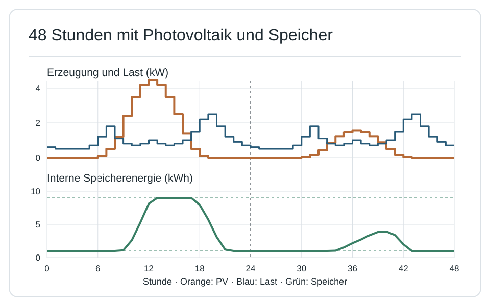

# M11-L5 – Fallstudie Stromversorgung mit Speicher {#L5}

**Kursbereich:** M11 – Bachelor: Energieerzeugung und Speicherung

**Niveau:** Bachelor · Wahlbereich

**Vorwissen:** [Photovoltaik](M11-L2.md), [Speichermodell](M11-L4.md), [Rechenexperimente](M2-L7.md).

**Lernziel:** Ein PV-Last-Speicher-System über 48 Stunden simulieren, Varianten vergleichbar bilanzieren und den Einfluss von Energie- und Leistungsgrenzen erklären.

## Modellfrage und Randbedingungen {#S1}

Ein netzgekoppelter Verbraucher soll den Anteil der selbst genutzten Solarenergie erhöhen. Wir untersuchen, wie sich Nennenergie und Lade-/Entladeleistung eines AC-gekoppelten Speichers auswirken. Die beiden Tage sind synthetisch, keine Wetter- oder Haushaltsmessung. Tag 1 ist sonnig, Tag 2 hat dieselbe Profilform mit 35 % der Erzeugungsleistung. An beiden Tagen gilt dieselbe Last. Die PV-Werte sind bereits AC-seitig, daher wird kein zusätzlicher Wechselrichterwirkungsgrad angesetzt. Verluste des Speichers sind in $\eta_c=\eta_d=0{,}95$ enthalten. Das Netz ist in beiden Richtungen unbegrenzt verfügbar. Standverbrauch, Alterung, Kosten, Blindleistung, Temperatur und Netzdynamik bleiben unberücksichtigt. Alle Speicher beginnen bei 10 % Ladezustand und dürfen bis 90 % geladen werden. Der Fall ohne Speicher hat $E_N=0$; ein prozentualer SOC ist dort nicht definiert.

Die Betriebsregel in jedem Intervall: Last direkt aus PV decken; Überschuss speichern bis zur Energie- oder Leistungsgrenze; Rest einspeisen. Bei Defizit aus dem Speicher versorgen; verbleibende Last aus dem Netz beziehen.

$$
P_\mathrm{direkt}=\min(P_\mathrm{PV},P_\mathrm{Last}),\qquad
P_\mathrm{Netzbezug}=P_\mathrm{Last}-P_\mathrm{direkt}-d,
$$

$$
P_\mathrm{Export}=P_\mathrm{PV}-P_\mathrm{direkt}-c.
$$

Die Grenzen aus M11-L4 bestimmen $c$ und $d$. Da nur Überschuss geladen wird, stammt alle abgegebene Energie oberhalb der Anfangsreserve in diesem Versuch aus PV. Wir definieren den bilanziellen Grad der Eigenversorgung $a=1-E_\mathrm{Netzbezug}/E_\mathrm{Last}$. Der PV-Eigenverbrauchsanteil $b=1-E_\mathrm{Export}/E_\mathrm{PV}$ zählt auch Speicherverluste sowie gegebenenfalls im Speicher verbleibende PV-Energie mit. Beide Kennzahlen sind deshalb unterschiedlich.

## Reproduzierbare Simulation {#S2}

Die Stundenwerte in kW stehen vollständig im folgenden Code. Er benötigt nur Python 3; die 15-Minuten-Variante wiederholt jeden Stundenwert viermal. Positive Leistungsgrößen vermeiden wechselnde Vorzeichen für Bezug und Einspeisung. In jedem Intervall wird die Speicherenergie aktualisiert, anschließend werden die Energiemengen summiert.

```python
load = [.6,.5,.5,.5,.5,.7,1.2,1.8,1.1,.8,.7,.8,1.0,.8,.7,.8,1.0,1.5,2.2,2.5,1.8,1.2,.9,.7]
solar = [0,0,0,0,0,0,.1,.5,1.2,2.4,3.5,4.2,4.5,4.2,3.5,2.5,1.4,.5,.1,0,0,0,0,0]
pv = solar + [0.35*p for p in solar]
load = load*2

def simulate(cap, limit, dt=1):
    eta_c = eta_d = .95
    lo, hi = .1*cap, .9*cap
    e = e0 = lo
    totals = dict(pv=0., load=0., direct=0., charge=0., discharge=0., grid=0., export=0., loss=0.)
    trace = [e]
    for g, l in zip(pv, load):
        for _ in range(round(1/dt)):
            direct = min(g,l)
            c = min(g-direct, limit, max(0.,(hi-e)/(eta_c*dt)))
            d = min(l-direct, limit, max(0.,(e-lo)*eta_d/dt))
            e += (eta_c*c-d/eta_d)*dt
            values = dict(pv=g, load=l, direct=direct, charge=c, discharge=d,
                          grid=l-direct-d, export=g-direct-c,
                          loss=(1-eta_c)*c+(1/eta_d-1)*d)
            for key, val in values.items():
                totals[key] += val*dt
            assert lo-1e-9 <= e <= hi+1e-9 and c*d < 1e-9
            trace.append(e)
    totals['delta'] = e-e0
    assert abs(totals['pv']+totals['grid']-totals['load']-totals['export']-totals['loss']-totals['delta']) < 1e-9
    return totals, trace

for cap, limit in [(0,0),(5,3),(10,3),(15,3),(10,1)]:
    s, trace = simulate(cap,limit)
    fine, _ = simulate(cap,limit,.25)
    assert all(abs(s[k]-fine[k]) < 1e-9 for k in s)
    print(cap,limit, {k:round(v,4) for k,v in s.items()}, round(100*(1-s['grid']/s['load']),2))
```

## Ergebnisse und Bilanzkontrolle {#S3}

In 48 Stunden fallen 49,60 kWh Last und 38,61 kWh PV-Erzeugung an. 15,83 kWh davon werden direkt genutzt. Die erste Nacht vor Sonnenaufgang kann kein Speicher aus bereits in diesem Versuch erzeugter PV versorgen. Die Rechnung endet in allen Varianten wieder bei der Anfangsenergie; damit sind die Fälle unmittelbar vergleichbar.

| Nennenergie (kWh) | Grenze (kW) | Netzbezug (kWh) | Export (kWh) | Verlust (kWh) | Eigenversorgung (%) |
| ---: | ---: | ---: | ---: | ---: | ---: |
| 0 | 0 | 33,77 | 22,78 | 0 | 31,92 |
| 5 | 3 | 27,19 | 15,49 | 0,71 | 45,18 |
| 10 | 3 | 23,39 | 11,28 | 1,12 | 52,84 |
| 15 | 3 | 19,59 | 7,07 | 1,53 | 60,50 |
| 10 | 1 | 24,22 | 12,20 | 1,03 | 51,17 |

{alt="Stundenwerte von PV-Erzeugung und Last sowie Ladezustand des 10-kWh-Speichers bei 3 kW Leistungsgrenze."}

Für 10 kWh / 3 kW ergibt die ungerundete Rechnung 11,5010526316 kWh Ladung und 10,3797 kWh Entladung; der tatsächliche Rundlaufwirkungsgrad ist 90,25 %. 27,3311 kWh PV-Energie bleiben hinter dem Netzanschluss (direkt genutzt oder in den Speicher geladen). Der entsprechende PV-Eigenverbrauchsanteil beträgt rund 70,79 %, der Grad der Eigenversorgung jedoch nur 52,84 %. Die doppelte Bilanzprüfung lautet

$$
E_\mathrm{PV}+E_\mathrm{Netzbezug}=E_\mathrm{Last}+E_\mathrm{Export}+E_\mathrm{Verlust}+\Delta e.
$$

Mit gerundeten Tabellenwerten: $38{,}61+23{,}39=49{,}60+11{,}28+1{,}12=62{,}00$ kWh. Die Rechnung prüft die Gleichung vor Rundung. Die Summe der Abgabe aus PV und Speicher an die Last ist $15{,}83+10{,}3797=26{,}2097$ kWh. Die 15-Minuten-Rechnung liefert in diesem stückweise konstanten Modell dieselben Energiesummen; das zeigt Konsistenz des Intervallmodells, beweist jedoch nicht die physikalische Gültigkeit des Stundenprofils.

## Interpretation und Erweiterung {#S4}

Der 15-kWh-Speicher erhöht im Beispiel die Eigenversorgung gegenüber 10 kWh, doch auch er erreicht keine vollständige Autarkie. Selbst ohne Export und Verluste fehlt bei gleichem Anfangs- und Endbestand mindestens die Differenz zwischen Verbrauch und Erzeugung: 10,99 kWh. Höhere Speicherkapazität allein kann diese Energielücke nicht schließen. Die 1-kW-Variante kann weniger Leistung in Überschuss- und Defizitstunden verschieben; trotz gleicher Nennenergie steigt der Netzbezug. Eine tatsächlich optimale Größe hängt von vielen längeren Profilen, Wetter, Nutzungsverhalten, Tarifen, Investitions- und Alterungskosten ab. Die Netzanschlussleistung und Inselbetriebsfähigkeit sind eigene Anforderungen, keine Folgen allein der hier errechneten Eigenversorgung.

Als Projektaufgabe: Ergänze eine Woche mit stark unterschiedlicher Erzeugung, führe einen Erhaltungsfaktor für Standverluste ein und untersuche eine Kapazitätsreihe. Wähle einen vergleichbaren Anfangs- und Endzustand oder bilanziere die Zustandsänderung ausdrücklich. Dokumentiere die Modellannahmen, Energiegrenzen und Kennzahlen nach [M8-L5](M8-L5.md). Die zeitliche Auflösung muss aus den tatsächlichen Leistungsprofilen begründet werden, nicht nur aus der Konvergenz bei wiederholten Stundenwerten.

## Übungen mit Lösungen {#S5}

1. Wie viel Netzbezug spart die 10-kWh-/3-kW-Variante im Vergleich ohne Speicher?  
   **Lösung** 10,3797 kWh; dies entspricht der abgegebenen Speicherenergie, da sich die direkte Nutzung nicht ändert.
2. Warum sinkt der Export um mehr Energie als der Bezug?  
   **Lösung** 11,5011 kWh werden geladen, aber nur 10,3797 kWh entladen. Die Differenz von 1,1214 kWh geht als Verlust ab.
3. Kann die Anlage mit 15 kWh Speicher autark betrieben werden, sofern der Netzanschluss entfällt?  
   **Lösung** Nein, bei den gewählten Profilen und gleichem Anfangs-/Endzustand fehlen grundsätzlich mindestens 10,99 kWh; außerdem sind Lade- und Entladeleistung begrenzt. Ohne Netz muss ungedeckte Last ausdrücklich als solche ausgewiesen werden.

**Weiterführend:** [Studienweg – weitere Module](pages/studienweg.md#S3)

## Quellen {#S6}

- [U.S. DOE – Solar Photovoltaic System Design Basics](https://www.energy.gov/cmei/systems/solar-photovoltaic-system-design-basics) · Solar Photovoltaic System Design Basics, Einleitung und Mounting Structures: Systemkomponenten und Erzeugungsbedingungen; weiterführend. · Zuletzt abgerufen: 2026-11-25
- [PyPSA – Storage: Energiebilanz und Speichergrenzen](https://docs.pypsa.org/latest/user-guide/optimization/storage/) · Abschnitt Storage Units, Gleichung StorageUnit-energy_balance: Speicherbilanz im Fallmodell. · Zuletzt abgerufen: 2026-11-25
- [Sandia PVPMC – PVWatts](https://pvpmc.sandia.gov/modeling-guide/2-dc-module-iv/point-value-models/pvwatts/) · Abschnitt PVWatts: Einstrahlung und Zelltemperatur als Eingänge eines PV-Leistungsmodells; weiterführend, nicht Ursprung der synthetischen AC-Profile. · Zuletzt abgerufen: 2026-11-25
