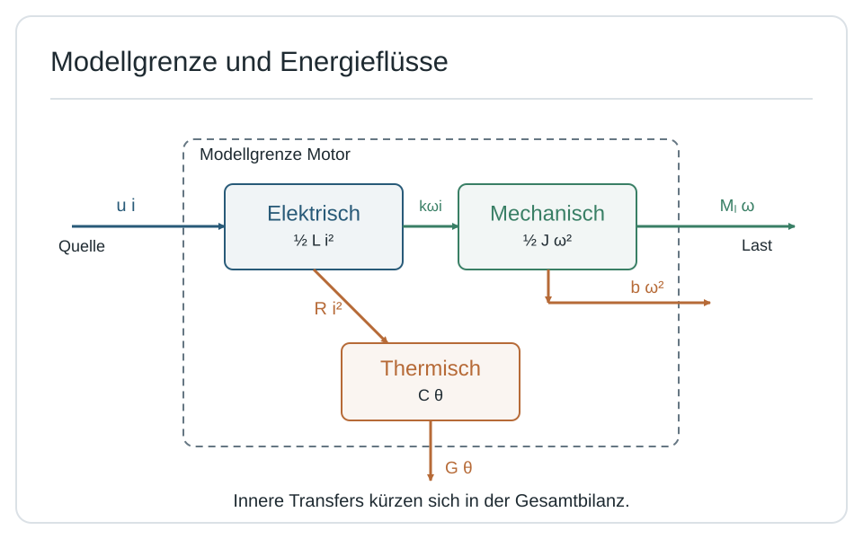

# M12-L1 – Modellgrenzen, Größen und physikalische Domänen {#L1}

**Kursbereich:** M12 – Bachelor: Modellierung und Simulation komplexer Systeme

**Niveau:** Bachelor · Wahlbereich

**Vorwissen:** [Physikalische Bilanzen](M2-L1.md), [Differentialgleichungen](M2-L3.md), [Systeme](M5-L1.md).

**Lernziel:** Ein physikalisches Mehrdomänensystem abgrenzen, Zustände und Schnittstellen identifizieren und eine konsistente Energiebilanz formulieren.

## Von der technischen Frage zur Modellgrenze {#S1}

Ein Modell ist eine zweckgebundene Abstraktion, keine vollständige Kopie eines Gegenstands. Für die Frage, welche Drehzahl ein Motor bei einer Last erreicht, genügt häufig ein elektromechanisches Modell. Soll die Erwärmung über zwei Minuten beurteilt werden, muss auch mindestens ein thermischer Zustand aufgenommen werden. Für die räumliche Verteilung der Wicklungstemperatur wäre ein einzelner Temperaturwert dagegen oft zu grob. Vor der Gleichungswahl werden Zielgrößen, Zeitbereich, Eingänge, gewünschte Genauigkeit und zulässige Vereinfachungen festgelegt.

Wir betrachten einen idealisierten permanentmagneterregten Gleichstrommotor. Versorgung und angetriebene Maschine liegen außerhalb der Modellgrenze, Rotor, Wicklung und deren konzentrierte thermische Masse innen. Reibungswärme wird vereinfachend direkt an die Umgebung abgegeben; Bürstenverluste, magnetische Sättigung und getrennte Gehäusetemperaturen fehlen. Die Modellgrenze bestimmt, ob ein Energiefluss als innerer Austausch oder als äußerer Abfluss erscheint.

{alt="Elektrische, mechanische und thermische Modellgrenzen, Leistungsflüsse und Speichergrößen."}

## Physikalische Domänen und Leistungsgrößen {#S2}

| Domäne | Größenpaar | Momentanleistung | Speicher im Modell |
| --- | --- | --- | --- |
| Elektrisch | Spannung $u$, Strom $i$ | $ui$ | $Li^2/2$ |
| Mechanisch, Translation | Kraft $F$, Geschwindigkeit $v$ | $Fv$ | $mv^2/2$ |
| Mechanisch, Rotation | Drehmoment $M$, Winkelgeschwindigkeit $\omega$ | $M\omega$ | $J\omega^2/2$ |
| Thermisch | Temperatur $T$, Wärmestrom $\dot Q$ | $\dot Q$ | $C(T-T_a)$ relativ zur Umgebung |

Die Produkte der ersten drei Größenpaare ergeben Watt. In der üblichen Wärmeübertragungsmodellierung ist dagegen bereits der Wärmestrom eine Leistung; $T\dot Q$ wäre kein sinnvoller Leistungsausdruck. In einer thermodynamischen Portdarstellung kann mit Temperatur und Entropiestrom gearbeitet werden; dies ist eine andere Modellkonvention. Wir verwenden konstanten thermischen Speicherkoeffizienten $C$ in J/K.

Ein Signalport transportiert einen Informationswert (beispielsweise die gemessene Drehzahl als Eingabe für einen Regler). Er ist nicht automatisch ein physikalischer Leistungsport. Für ideale physikalische Verbindungen müssen gemeinsame Potentialgrößen verträglich und die algebraische Summe der zum Verbindungspunkt gerichteten Flussgrößen null sein. Ein Modell muss diese Konvention in allen Komponenten konsistent anwenden.

## Zustand, Parameter und algebraische Größe {#S3}

Ein Zustand trägt die für die weitere Entwicklung notwendige Systemgeschichte. Im gewählten Motor sind dies Wicklungsstrom $i$, Winkelgeschwindigkeit $\omega$ und Temperaturerhöhung $\theta=T-T_a$. Bei konstantem $T_a$ genügt die Temperaturdifferenz in K. Soll auch eine Position verfolgt werden, ist $\dot\varphi=\omega$ als weiterer Zustand erforderlich; für die Drehzahlfrage ist das nicht nötig.

Parameter sind etwa Induktivität $L$, Trägheitsmoment $J$, thermische Kapazität $C$ und Leitwert $G$ in W/K. Der Wicklungswiderstand $R(\theta)=R_0(1+\alpha\theta)$ ist im Modell eine algebraische Funktion des Zustands, kein unabhängiger Speicher. Der Eingang $u(t)$ und die Last $M_L(t)$ werden vorgegeben. Ausgänge können aus Zuständen und Eingängen berechnet werden, z. B. $P_\mathrm{in}=ui$ oder die Wicklungstemperatur $T_a+\theta$.

Die Energie relativ zum Ausgangsniveau lautet

$$
E=\frac12 Li^2+\frac12 J\omega^2+C\theta.
$$

Mit $b\omega$ als viskosem Reibmoment gilt die prüfbare Bilanz

$$
\dot E=ui-M_L\omega-b\omega^2-G\theta.
$$

Die Joule-Verluste $Ri^2$ sind hier ein innerer Transfer in den thermischen Speicher; sie dürfen nicht zusätzlich als äußerer Abfluss subtrahiert werden. Bei einer Grenze nur um den elektrischen und mechanischen Teil müssten sie dagegen als Abfluss erscheinen. Das Vorzeichen $-G\theta$ erlaubt bei negativer Temperaturdifferenz auch Wärmezufuhr aus der Umgebung.

## Rechenbeispiel und Modellwahl {#S4}

Für $L=0{,}1$ H, $J=0{,}02$ kg m², $C=40$ J/K, $i=5$ A, $\omega=30$ rad/s und $\theta=20$ K erhält man 1,25 J magnetische, 9 J kinetische und 800 J thermische Energie relativ zur Umgebung. Gesamt: 810,25 J. Bei $u=24$ V, $M_L=0{,}5$ Nm, $b=0{,}02$ Nm s/rad und $G=2$ W/K ergibt sich

$$
\dot E=120-15-18-40=47\,\mathrm W.
$$

Die positive Bilanz bedeutet nicht, dass alle Zustände steigen: mechanische und thermische Speicher können gleichzeitig Energie abgeben oder aufnehmen. Die Zeitskalen unterscheiden sich; eine große gespeicherte Energie ist nicht dasselbe wie eine hohe Momentanleistung. Das vollständige dynamische Modell folgt in der nächsten Lektion.

## Übungen mit Lösungen {#S5}

1. Ein Kondensator mit 200 µF liegt bei 24 V. Bestimme die gespeicherte Energie.  
   **Lösung** $Cu^2/2=0{,}0576$ J.
2. Ein Wärmespeicher mit 40 J/K erhält netto 30 W. Wie schnell ändert sich seine Temperatur momentan?  
   **Lösung** $\dot T=30/40=0{,}75$ K/s.
3. Soll das Motormodell die höchste Temperatur innerhalb einer Wicklung vorhersagen?  
   **Lösung** Das Ein-Knoten-Modell liefert nur eine repräsentative Temperatur; räumliche Gradienten erfordern zusätzliche thermische Knoten oder ein Feldmodell.

**Weiterführend:** [Gekoppelte Modelle und Zustandsraum](M12-L2.md)

## Quellen {#S6}

- [Modelica Standard Library – Übersicht der physikalischen Domänen](https://doc.modelica.org/om/Modelica.UsersGuide.Overview.html) · Bibliotheksübersicht: analoge elektrische Bauteile und Maschinen; weiterführend. · Zuletzt abgerufen: 2026-11-25
- [Modelica – thermisches Motormodell zweiter Ordnung](https://doc.modelica.org/Modelica%204.0.0/Resources/helpWSM/Modelica/Modelica.Thermal.HeatTransfer.Examples.Motor.html) · Information: thermisches Motormodell zweiter Ordnung mit Verlusten und Wärmekapazitäten. · Zuletzt abgerufen: 2026-11-25
