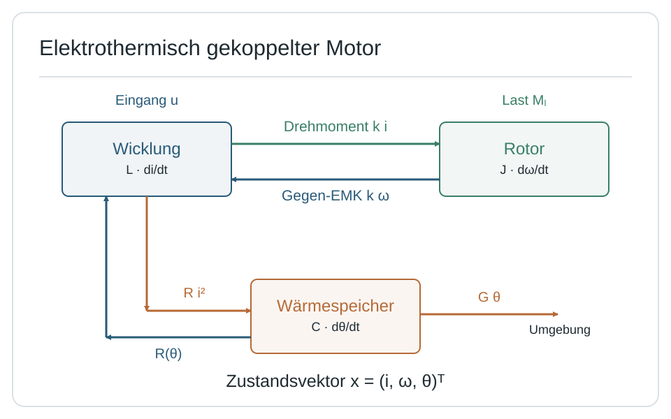

# M12-L2 – Gekoppelte Modelle und Zustandsraum {#L2}

**Kursbereich:** M12 – Bachelor: Modellierung und Simulation komplexer Systeme

**Niveau:** Bachelor · Wahlbereich

**Vorwissen:** [Modellgrenzen](M12-L1.md), [Matrizen](M2-L2.md), [Rückkopplung](M6-L3.md).

**Lernziel:** Aus Energie- und Kraftbilanzen ein nichtlineares Zustandsraummodell entwickeln und dessen lokale Linearisierung bestimmen.

## Drei gekoppelte Speichergleichungen {#S1}

Die elektrische Masche enthält die Gegen-EMK $k\omega$, den temperaturabhängigen Spannungsabfall $R(\theta)i$ und die Induktivität. Auf den Rotor wirken das elektromagnetische Drehmoment $ki$, die Reibung $b\omega$ und das vorgegebene Lastmoment $M_L$. In konsistenten SI-Einheiten hat die ideale elektromechanische Kopplung denselben Zahlenwert $k$ für beide Beziehungen ($\mathrm{V\,s/rad}$ bzw. Nm/A). Das lässt sich aus verlustfreier Wandlung $k\omega i=ki\omega$ begründen.

$$
L\dot i=u-R(\theta)i-k\omega,
$$

$$
J\dot\omega=ki-b\omega-M_L,
$$

$$
C\dot\theta=R(\theta)i^2-G\theta,\qquad R(\theta)=R_0(1+\alpha\theta).
$$

Die Wärme entsteht in der Wicklung; die Reibungswärme ist entsprechend [M12-L1](M12-L1.md) ein externer Abfluss. Das Modell gilt nur in einem Temperaturbereich mit positivem und annähernd linear beschreibbarem Widerstand. Es setzt ein konstantes Magnetfeld, eine konstante Umgebungstemperatur und eine ideale Spannungsquelle voraus.

{alt="Gekoppeltes Motormodell mit Gegen-EMK, Drehmoment, Verlustwärme und temperaturabhängigem Widerstand."}

Durch Multiplikation der ersten Gleichung mit $i$, der zweiten mit $\omega$ und Addition mit der thermischen Gleichung folgt die Energiebilanz aus L1. Die Gegen-EMK und das Nutzmoment tauschen Leistung aus, der ohmsche Verlust wird zu Wärme. Diese Identität ist ein unabhängiger Invariantentest für die spätere Rechnung.

## Nichtlinearer Zustandsraum und Arbeitspunkt {#S2}

Mit $x=(i,\omega,\theta)^\mathsf T$ und $v=(u,M_L)^\mathsf T$ ergibt sich $\dot x=f(x,v)$; ein Ausgang $y=g(x,v)$ kann etwa die Drehzahl sein. Die Produkte $\theta i$ und $i^2$ machen das Modell nichtlinear. Superposition gilt daher nicht für beliebige Betriebszustände.

Ein stationärer Zustand $x_*$ erfüllt $f(x_*,v_*)=0$. Für konstanten Eingang folgt bei $b>0$

$$
\omega_*=(ki_*-M_L)/b,\qquad G\theta_*=R(\theta_*)i_*^2.
$$

Die elektrische Gleichung schließt das System. Ist $\alpha=0$, entkoppelt die Temperatur rückwirkungsfrei und die stationären Werte lassen sich direkt bestimmen:

$$
i_*=\frac{u+kM_L/b}{R_0+k^2/b},\qquad \theta_*=R_0i_*^2/G.
$$

Mit $u=24$ V, $M_L=0{,}5$ Nm, $R_0=2$ Ω, $k=0{,}2$, $b=0{,}02$ und $G=2$ W/K ergeben sich $i_*=7{,}25$ A, $\omega_*=47{,}5$ rad/s und $\theta_*=52{,}5625$ K. Die Eingangsleistung 174 W zerfällt in 23,75 W Lastleistung, 45,125 W Reibungsleistung und 105,125 W Wärmeabgabe. Das Modell mit $\alpha\ne0$ führt zu anderen Arbeitspunkten.

## Linearisierung für kleine Abweichungen {#S3}

Für einen festen Arbeitspunkt gilt näherungsweise $\delta\dot x=A\delta x+B\delta v$, mit den Ableitungen von $f$ an diesem Punkt. Schreibe $R_*=R(\theta_*)$, $R'=R_0\alpha$. Dann

$$
A=\begin{pmatrix}
-R_*/L & -k/L & -R'i_*/L\\
k/J & -b/J & 0\\
2R_*i_*/C & 0 & (R'i_*^2-G)/C
\end{pmatrix},\qquad
B=\begin{pmatrix}1/L&0\\0&-1/J\\0&0\end{pmatrix}.
$$

Für reine Drehzahlmessung ist $y=\omega$ und $\delta y=(0,1,0)\delta x$. Eigenwerte von $A$ geben Auskunft über lokale Dynamik; negative Realteile aller Eigenwerte implizieren lokale asymptotische Stabilität eines glatten autonomen Modells am Arbeitspunkt. Die Aussage ist nicht automatisch global und gilt nicht unverändert am Schaltzeitpunkt eines hybriden Systems.

## Zeitskalen und Kopplungswahl {#S4}

Mit $L=0{,}1$ H, $J=0{,}02$ kg m² und $C=40$ J/K erhält man als ungekoppelte Richtwerte $L/R_0=0{,}05$ s, $J/b=1$ s und $C/G=20$ s. Die tatsächlichen Moden sind gekoppelt. Ein thermisches Langzeitmodell könnte die schnellen Zustände durch algebraische stationäre Beziehungen ersetzen, sofern Last und Versorgung langsam genug variieren und Anlaufströme nicht interessieren. Dann entsteht je nach Formulierung ein reduziertes oder differential-algebraisches Modell. Für den Anlauf ist diese Reduktion ungeeignet; die Induktivität erzwingt einen stetigen Strom bei endlicher Spannung.

## Übungen mit Lösungen {#S5}

1. Welchen Anfangsanstieg hat der Strom bei $u=24$ V, $i=\omega=0$ und $L=0{,}1$ H?  
   **Lösung** $\dot i=240$ A/s.
2. Bestimme $R$ bei $R_0=2$ Ω, $\alpha=0{,}004$ K⁻¹ und $\theta=50$ K.  
   **Lösung** 2,4 Ω.
3. Wie wirkt eine steigende Temperatur bei positivem Strom unmittelbar auf die Stromableitung?  
   **Lösung** Die partielle Ableitung $-R'i/L$ ist negativ; langfristig ändern sich auch Drehzahl und Gegen-EMK.

**Weiterführend:** [Numerische Integration](M12-L3.md), [Fallstudie](M12-L5.md)

## Quellen {#S6}

- [Modelica Standard Library 4.0.0 – DCMachines](https://doc.modelica.org/Modelica%204.0.0/Resources/helpDymola/Modelica_Electrical_Machines_BasicMachines_DCMachines.html) · DC_PermanentMagnet, Information und Parameters: Ankerwiderstand, Induktivität, temperaturabhängige Verluste und Modellgrenzen; Version 4.0.0. · Zuletzt abgerufen: 2026-11-25
- [Modelica – Beispiel Motorkühlung](https://doc.modelica.org/Modelica%204.0.0/Resources/helpWSM/Modelica/Modelica.Electrical.Machines.Examples.DCMachines.DCPM_Cooling.html) · Information: Gleichstrommotor mit Kühlkreislauf und thermischen Kapazitäten; Modellbeispiel. · Zuletzt abgerufen: 2026-11-25
