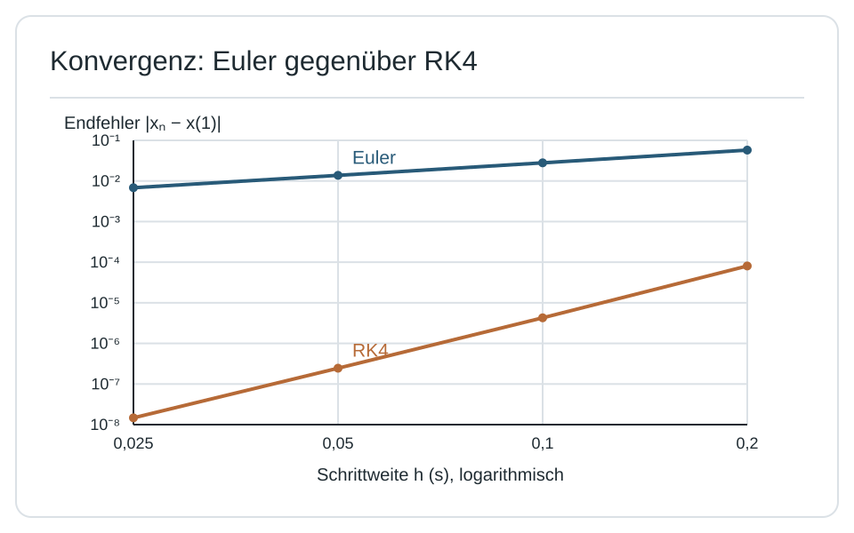

# M12-L3 – Numerische Integration und Konvergenz {#L3}

**Kursbereich:** M12 – Bachelor: Modellierung und Simulation komplexer Systeme

**Niveau:** Bachelor · Wahlbereich

**Vorwissen:** [Differentialgleichungen](M2-L3.md), [Rechenexperimente](M2-L7.md), [Zustandsraum](M12-L2.md).

**Lernziel:** Euler und klassisches RK4 implementieren, Fehlerordnungen experimentell bestimmen und numerische Stabilität von physikalischer Stabilität unterscheiden.

## Diskretisierung eines Anfangswertproblems {#S1}

Gesucht ist die Lösung von $\dot x=f(t,x)$ mit $x(t_0)=x_0$. Bei Schrittweite $h>0$ setzt man $t_n=t_0+nh$ und berechnet Näherungen $x_n$. Das explizite Euler-Verfahren nutzt die Steigung am Anfang:

$$
x_{n+1}=x_n+h f(t_n,x_n).
$$

Es entsteht aus der Taylor-Entwicklung erster Ordnung. Für hinreichend glatte Lösungen und stabile Fehlerfortpflanzung ist der lokale Schrittfehler $O(h^2)$, der globale Fehler bei festem Endzeitpunkt $O(h)$. Die Formel gilt für Vektoren ebenso wie für Skalare. Ein Schritt ist nicht notwendigerweise eine reale Abtastung; er kann lediglich der numerischen Integration dienen.

## Klassisches Runge-Kutta-Verfahren vierter Ordnung {#S2}

Die vier Steigungen sind

$$
\begin{aligned}
k_1&=f(t_n,x_n),\\
k_2&=f(t_n+h/2,x_n+hk_1/2),\\
k_3&=f(t_n+h/2,x_n+hk_2/2),\\
k_4&=f(t_n+h,x_n+hk_3).
\end{aligned}
$$

$$
x_{n+1}=x_n+\frac h6(k_1+2k_2+2k_3+k_4).
$$

Bei hinreichender Glätte und geeigneter Stabilität erhält man einen globalen Fehler $O(h^4)$ bei vier Funktionsauswertungen je Schritt. Sprünge in Eingängen oder Modellgleichungen müssen separat behandelt werden; sonst kann die erwartete Ordnung verloren gehen. Ereignisse sind Thema von [M12-L4](M12-L4.md).

## Referenzexperiment: exponentieller Abfall {#S3}

Für $\dot x=-2x$ und $x(0)=1$ gilt exakt $x(t)=e^{-2t}$. Wir vergleichen den absoluten Endfehler bei $t=1$ s. Die beobachtete Ordnung für zwei Schrittweiten $h$ und $h/2$ lautet $p=\log_2(e_h/e_{h/2})$, sofern die Fehler nicht null sind. Der folgende Code benötigt nur die Python-Standardbibliothek.

```python
from math import exp, log2

def integrate(h, rk):
    x = 1.0
    for _ in range(round(1/h)):
        k1 = -2*x
        if rk:
            k2 = -2*(x+h*k1/2)
            k3 = -2*(x+h*k2/2)
            k4 = -2*(x+h*k3)
            x += h*(k1+2*k2+2*k3+k4)/6
        else:
            x += h*k1
    return abs(x-exp(-2))

last = None
for h in (.2, .1, .05, .025):
    err = [integrate(h, rk) for rk in (False, True)]
    order = [] if last is None else [log2(a/b) for a,b in zip(last,err)]
    print(h, err, order)
    last = err
```

| $h$ (s) | Euler-Endfehler | RK4-Endfehler |
| ---: | ---: | ---: |
| 0,2 | 5,75753 · 10⁻² | 8,07314 · 10⁻⁵ |
| 0,1 | 2,79611 · 10⁻² | 4,26519 · 10⁻⁶ |
| 0,05 | 1,37586 · 10⁻² | 2,45185 · 10⁻⁷ |
| 0,025 | 6,82313 · 10⁻³ | 1,46976 · 10⁻⁸ |

{alt="Berechnete Endfehler von Euler und RK4 in doppelt logarithmischer Darstellung."}

Die letzte Halbierung liefert für Euler etwa 1,01 und RK4 etwa 4,06 als beobachtete Ordnung. Die theoretischen Werte 1 und 4 gelten asymptotisch; bei größeren Schritten können die Verhältnisse abweichen. Bei sehr kleinen Schritten können Rundungsfehler dominieren.

## Stabilitätsgrenzen und steife Systeme {#S4}

Für das Testproblem $\dot x=\lambda x$ mit reellem $\lambda<0$ liefert Euler den Verstärkungsfaktor $1+h\lambda$. Abklingen erfordert $|1+h\lambda|<1$, also $0<h<2/|\lambda|$. Bei $\lambda=-2$ s⁻¹ und $h=1{,}1$ s ergibt sich $-1{,}2$: Vorzeichenwechsel und wachsender Betrag, obwohl die exakte Lösung stets positiv abnimmt. RK4 hat den Faktor $1+z+z^2/2+z^3/6+z^4/24$ für $z=h\lambda$; auf der negativen reellen Achse reicht sein Stabilitätsintervall ungefähr bis $z=-2{,}785$.

Bei stark unterschiedlichen Zeitskalen kann ein explizites Verfahren sehr kleine Schritte benötigen, obwohl nur langsame Resultate interessieren. Dies ist eine typische Situation für steife Probleme. Implizite Verfahren wie rückwärts Euler oder BDF und adaptive Schrittweitensteuerung sind dann mögliche Alternativen. Ein adaptiver Löser kontrolliert eine numerische Fehlerschätzung mit absoluten und relativen Toleranzen; er prüft nicht, ob die physikalischen Parameter stimmen. Bei unterschiedlich skalierten Zuständen sind komponentenweise Toleranzen sinnvoll.

## Übungen mit Lösungen {#S5}

1. Euler mit $\lambda=-10$ s⁻¹ und $h=0{,}25$ s: stabil?  
   **Lösung** Nein, Verstärkungsfaktor $-1{,}5$.
2. Ein RK4-Ergebnis hat bei halbierter Schrittweite einen Fehler um Faktor 16 kleiner. Welche Ordnung zeigt dies?  
   **Lösung** $\log_2(16)=4$.
3. Warum ist ein Ergebnis bei zwei fast identischen Schrittweiten noch kein physikalischer Nachweis?  
   **Lösung** Es spricht für numerische Konsistenz, sagt allein aber nichts über Modellannahmen, Parameter oder Messdaten.

**Weiterführend:** [Hybride Modelle](M12-L4.md), [Modellvalidierung](M12-L5.md)

## Quellen {#S6}

- [Persson/Franco/Sweeney Blanco – Programming for Mathematical Applications, Chapter 14](https://persson.berkeley.edu/Programming_for_Mathematical_Applications/content/Differential_Equations/Chapter_Intro.html) · Kapitel 14, Einleitung: Anfangswertprobleme, Euler und RK4; weiterführende Übersicht, Unterkapitel 14.1 nicht abgerufen. · Zuletzt abgerufen: 2026-11-25
- [SciPy – solve_ivp: Methoden und Toleranzen](https://docs.scipy.org/doc/scipy/reference/generated/scipy.integrate.solve_ivp.html) · Funktionsbeschreibung solve_ivp: numerische Lösung eines Anfangswertproblems. · Zuletzt abgerufen: 2026-11-25
