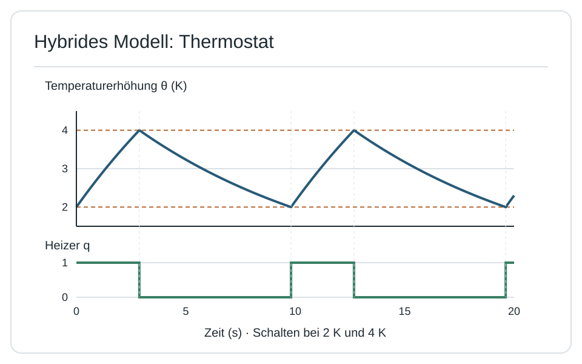

# M12-L4 – Diskrete Ereignisse und hybride Modelle {#L4}

**Kursbereich:** M12 – Bachelor: Modellierung und Simulation komplexer Systeme

**Niveau:** Bachelor · Wahlbereich

**Vorwissen:** [Automaten](M3-L6.md), [Temperaturregelung](M6-L3.md), [Numerische Integration](M12-L3.md).

**Lernziel:** Kontinuierliche Zustände und diskrete Modi eines Systems verbinden und den Fehler zeitdiskreter Schalterkennung bestimmen.

## Kontinuierliche Dynamik und diskrete Logik {#S1}

Ein hybrides Modell kombiniert reellwertige Zustände $x(t)$ und diskrete Modi $q\in Q$. Zwischen Ereignissen gilt $\dot x=f_q(t,x)$; ein Übergang wird durch eine Bedingung (Guard) ausgelöst. Beim Übergang können der Modus und, sofern die Physik es rechtfertigt, Zustände verändert werden. Ein Reset $x^+=r(x^-)$ ist zum Beispiel bei einem idealisierten Stoß mit sprunghafter Geschwindigkeit sinnvoll. Bei endlicher Heizleistung kann die Temperatur dagegen nicht springen.

Ein Zeitereignis hat eine bekannte Uhrzeit, etwa ein fest geplanter Lastsprung. Bei einem Zustandsereignis wird eine Schwelle erst während der Integration erreicht. Ein diskret abgetasteter Regler entscheidet dagegen bestimmungsgemäß nur an Abtastzeitpunkten. Diese drei Fälle dürfen bei der Implementierung nicht vermischt werden.

## Beispiel: Thermostat mit Hysterese {#S2}

Ein Heizer mit Leistung $P=10$ W versorgt eine konzentrierte thermische Masse $C=10$ J/K. Der Leitwert zur Umgebung ist $G=1$ W/K. Die Temperaturerhöhung $\theta=T-T_a$ folgt

$$
C\dot\theta=qP-G\theta,\qquad q\in\{0,1\}.
$$

Bei $\theta\le2$ K wird die Heizung eingeschaltet, bei $\theta\ge4$ K ausgeschaltet. Dazwischen bleibt der vorherige Modus erhalten. Anfangs gelten $\theta=2$ K und $q=1$. Die Hysterese verhindert bei ideal glatten Signalen sofortiges Hin- und Herschalten an einer einzigen Schwelle. Reale Sensoren können trotzdem Filterung oder zusätzliche Mindestschaltzeiten erfordern.

Für konstanten Modus ergibt sich mit $\tau=C/G=10$ s und $\theta_\infty=qP/G$ die exakte Lösung

$$
\theta(t)=\theta_\infty+(\theta_0-\theta_\infty)e^{-t/\tau}.
$$

Die Dauer der Heizphase von 2 nach 4 K ist $10\ln(8/6)=2{,}87682$ s, die Kühlphase von 4 nach 2 K dauert $10\ln(4/2)=6{,}93147$ s. Die Periode ist 9,80829 s. Der Heizanteil beträgt rund 29,33 %, die mittlere Heizleistung etwa 2,93 W. Da der Zustand nach einer ganzen Periode identisch ist, ist die mittlere Wärmeabgabe gleich der mittleren Heizleistung.

{alt="Temperaturverlauf und Schaltzustand eines idealen Thermostats mit Hysterese."}

## Schrittweise versus ereignisgenaue Schaltung {#S3}

Selbst eine exakte Integration innerhalb eines Schritts erkennt das Schwellenereignis zu spät, wenn nur am Schrittende geprüft wird. Die folgende Gegenprobe berechnet den ersten Ausschaltzeitpunkt; der Temperaturverlauf zwischen Abtastungen ist dabei analytisch exakt.

```python
from math import exp, log, ceil
exact = 10*log(8/6)
for h in (1.0, .5, .25, .1):
    n = ceil(exact/h)
    t = n*h
    theta = 10-8*exp(-t/10)
    print(h, t, theta, t-exact)
```

| Prüfraster (s) | Erstes Abschalten (s) | Temperatur beim Abschalten (K) |
| ---: | ---: | ---: |
| 1,00 | 3,00 | 4,07345 |
| 0,50 | 3,00 | 4,07345 |
| 0,25 | 3,00 | 4,07345 |
| 0,10 | 2,90 | 4,01389 |

Bei einem idealen kontinuierlichen Thermostat muss die Nullstelle von $g(\theta)=\theta-4$ im Heizmodus gefunden werden. Für allgemeine Modelle kann man die Nullstelle der kontinuierlichen Näherung durch Interpolation bzw. Bisektion lokalisieren. Am Ereignis wird bis zur Schwelle integriert, der Modus gewechselt und der verbleibende Zeitschritt im neuen Modus berechnet. Für den Kühlmodus ist $g(\theta)=\theta-2$ mit fallender Kreuzungsrichtung relevant. Löser, die nur auf Vorzeichenwechsel pro Schritt schauen, können mehrere Kreuzungen innerhalb desselben Schritts übersehen; ein geeignetes maximales Schrittintervall und Ereignislogik sind notwendig.

## Robuste Moduslogik {#S4}

Ein Algorithmus benötigt einen eindeutigen Anfangsmodus sowie eine konsistente Behandlung gleichzeitig eintretender Ereignisse. Beim Thermostat ist der Zustand stetig, nur $q$ springt. Bei bekannten Zeitereignissen wird der Integrationsabschnitt exakt an der vorgegebenen Zeit geteilt. In [M12-L5](M12-L5.md) werden Last- und Spannungssprünge auf diese Weise behandelt; innerhalb jedes Abschnitts bleibt die rechte Seite glatt. Eine immer feinere Schrittweite ist kein Ersatz für eine sauber formulierte Ereignislogik.

## Übungen mit Lösungen {#S5}

1. Bei $\theta=3$ K: Was ist der Modus?  
   **Lösung** Ohne den vorherigen Modus ist das nicht bestimmt; die Hysterese besitzt diskretes Gedächtnis.
2. Wie ändert sich die Kühlzeit bei verdoppelter Wärmekapazität?  
   **Lösung** Bei unverändertem Leitwert verdoppelt sie sich auf 13,86294 s.
3. Welche Zustände des Motors aus M12-L2 springen bei einem endlichen Spannungssprung?  
   **Lösung** Keine der drei Speichergrößen; ihre Ableitungen können sich ändern. Ein algebraischer Ausgang kann unmittelbar springen.

**Weiterführend:** [Parameter, Sensitivität und Modellvalidierung](M12-L5.md)

## Quellen {#S6}

- [Modelica by Example – Discrete Behavior](https://mbe.modelica.university/behavior/discrete/) · Kapiteleinleitung Discrete Behavior: diskretes Verhalten gegenüber kontinuierlichen Modellen. · Zuletzt abgerufen: 2026-11-25
- [Modelica 3.6 – Equations and Events](https://specification.modelica.org/maint/3.6/equations.html) · Kapitel 8, §8.3.5: When-Gleichungen; Teilaspekt. · Zuletzt abgerufen: 2026-11-25
- [SciPy – solve_ivp: Ereignisfunktionen](https://docs.scipy.org/doc/scipy/reference/generated/scipy.integrate.solve_ivp.html) · Parameter events, terminal und direction: Ereigniserkennung und Abbruch; Teilaspekt. · Zuletzt abgerufen: 2026-11-25
