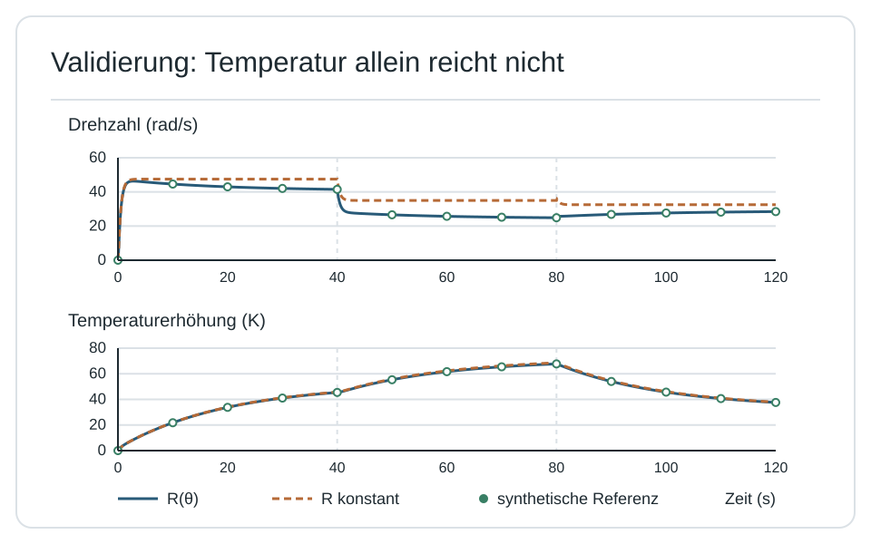

# M12-L5 – Parameter, Sensitivität und Modellvalidierung {#L5}

**Kursbereich:** M12 – Bachelor: Modellierung und Simulation komplexer Systeme

**Niveau:** Bachelor · Wahlbereich

**Vorwissen:** [Gekoppeltes Modell](M12-L2.md), [Integration](M12-L3.md), [Ereignisse](M12-L4.md), [Messunsicherheit](M6-L2.md).

**Lernziel:** Ein elektrothermisches Mehrkomponentenmodell mit zwei Schrittweiten verifizieren, zwei Modellvarianten gegen synthetische Referenzdaten vergleichen und die Parametersensitivität quantifizieren.

## Fragestellung und Prüfkriterien {#S1}

Wir fragen, ob der temperaturabhängige Wicklungswiderstand notwendig ist, um Drehzahl und Temperatur eines idealisierten Antriebs über 120 s vorherzusagen. Die Gleichungen stammen aus [M12-L2](M12-L2.md). Anfangswerte sind $i=\omega=\theta=0$, Umgebungstemperatur 20 °C. Es handelt sich um ein reines Simulationsbeispiel ohne reale Maschine oder Messwerte. Die Parameter sind didaktische Modellwerte, keine Auslegungs- oder Betriebsfreigabe.

| Parameter | Wert | Einheit |
| --- | ---: | --- |
| $R_0$ | 2 | Ω |
| $L$ | 0,1 | H |
| $J$ | 0,02 | kg m² |
| $b$ | 0,02 | Nm s/rad |
| $k$ | 0,2 | Nm/A (SI-konsistente Gegen-EMK-Konstante) |
| $C$ | 40 | J/K |
| $G$ | 2 | W/K |
| $\alpha$ | 0,004 | K⁻¹ |

| Zeitabschnitt (s) | Spannung (V) | Lastmoment (Nm) |
| --- | ---: | ---: |
| 0 bis 40 | 24 | 0,5 |
| 40 bis 80 | 24 | 1,0 |
| 80 bis 120 | 18 | 0,5 |

Die Eingangssprünge werden als Abschnittsgrenzen behandelt. Die drei Zustände bleiben stetig. Als synthetische Referenz dient die Lösung desselben nichtlinearen Modells mit einem anderen Integrationsverfahren (DOP853, strenge Toleranzen). Damit lässt sich Rechen- und Modellvergleich üben; da die Referenz aus einem Modell und nicht aus Messungen stammt, ist das keine empirische Validierung. Für die Übung werden vor dem Vergleich Grenzwerte von 0,2 rad/s für den Drehzahl-RMSE und 1 K für den Temperatur-RMSE angesetzt. Für die numerische Rechnung fordern wir bei Halbierung der Schrittweite am Endpunkt höchstens 0,001 A, 0,001 rad/s und 0,001 K Differenz sowie einen maximalen Bilanzrest unter 0,01 J. Diese Toleranzen sind nur auf diese Übung bezogen.

## Reproduzierbare Berechnung {#S2}

Der zusätzliche Zustand $E_B$ integriert die Nettogrenzleistung $ui-M_L\omega-b\omega^2-G\theta$. Er beeinflusst die anderen drei Gleichungen nicht. So wird der Bilanzrest $Li^2/2+J\omega^2/2+C\theta-E_B$ an jedem Rechenpunkt erfasst (Anfangsenergie null). Der Code nutzt Python, NumPy und SciPy. Beide Schrittweiten teilen die Abschnittsgrenzen und die Referenzzeiten genau.

```python
import numpy as np
from scipy.integrate import solve_ivp

# Zustand: i [A], omega [rad/s], theta [K], Nettoenergie [J].
R0, L, J, b, k, C = 2., .1, .02, .02, .2, 40.
segments = [(0, 40, 24., .5), (40, 80, 24., 1.), (80, 120, 18., .5)]

def rhs(x, u, load, alpha, G):
    i, w, th, E = x
    R = R0*(1+alpha*th)
    return np.array([(u-R*i-k*w)/L,
                     (k*i-b*w-load)/J,
                     (R*i*i-G*th)/C,
                     u*i-load*w-b*w*w-G*th])

def rk4(h, alpha=.004, G=2.):
    x = np.zeros(4)
    out = [x.copy()]
    for a, z, u, load in segments:
        f = lambda x: rhs(x, u, load, alpha, G)
        for n in range(round((z-a)/h)):
            q1 = f(x); q2 = f(x+h*q1/2)
            q3 = f(x+h*q2/2); q4 = f(x+h*q3)
            x = x+h*(q1+2*q2+2*q3+q4)/6
            out.append(x.copy())
    return np.array(out)

def reference():
    x = np.zeros(4)
    rows = [x.copy()]
    for a,z,u,load in segments:
        sol = solve_ivp(lambda t,x: rhs(x,u,load,.004,2.),
                        (a,z), x, method='DOP853', rtol=1e-11,
                        atol=1e-12, t_eval=np.arange(a+10,z+1,10))
        assert sol.success
        rows.extend(sol.y.T)
        x = sol.y[:,-1]
    return np.array(rows)

def balance(x):
    return .5*L*x[:,0]**2+.5*J*x[:,1]**2+C*x[:,2]-x[:,3]

if __name__ == '__main__':
    ref = reference()
    for t,r in zip(range(0,121,10),ref): print(t,*[round(v,6) for v in r[:3]])
    for h in [.02,.01]:
        for alpha,G in [(.004,2.),(0,2.),(.004,1.8),(.004,2.2)]:
            x=rk4(h,alpha,G); y=x[::round(10/h)]
            print(h,alpha,G,'end',x[-1,:3], 'rmse',np.sqrt(np.mean((y[:,:3]-ref[:,:3])**2,axis=0)), 'max energy residual',max(abs(balance(x))), 'peak temp',max(x[:,2]))
```

## Referenzwerte und Verifikation {#S3}

| Zeit (s) | Strom (A) | Drehzahl (rad/s) | Temperaturerhöhung (K) |
| ---: | ---: | ---: | ---: |
| 0 | 0,000 | 0,000 | 0,000 |
| 10 | 6,938 | 44,590 | 21,761 |
| 20 | 6,786 | 42,979 | 33,776 |
| 30 | 6,697 | 42,041 | 41,040 |
| 40 | 6,644 | 41,486 | 45,426 |
| 50 | 7,648 | 26,595 | 55,337 |
| 60 | 7,564 | 25,709 | 61,648 |
| 70 | 7,515 | 25,186 | 65,439 |
| 80 | 7,485 | 24,875 | 67,715 |
| 90 | 5,194 | 26,838 | 53,995 |
| 100 | 5,272 | 27,652 | 45,672 |
| 110 | 5,319 | 28,156 | 40,640 |
| 120 | 5,349 | 28,465 | 37,597 |

Die Tabelle ist für die Darstellung gerundet; im Code erfolgen die Vergleiche mit ungerundeten Referenzwerten. Für das nichtlineare Modell liefert RK4 folgende Kennwerte:

| Schrittweite (s) | Enddrehzahl (rad/s) | Endtemperaturerhöhung (K) | Max. Bilanzrest (J) |
| ---: | ---: | ---: | ---: |
| 0,02 | 28,46533816 | 37,59736237 | 0,0056041 |
| 0,01 | 28,46533835 | 37,59736046 | 0,0003080 |

Auch der Endstrom unterscheidet sich nur um etwa 2 · 10⁻⁸ A. Die Kriterien sind erfüllt. Die Energieprüfung ist ergänzend, nicht hinreichend: Auch ein falsches Widerstandsmodell kann Energie erhalten. Die kleinen Differenzen am Endpunkt könnten Fehler im Verlauf verdecken, deshalb werden zusätzlich Referenzwerte alle 10 s geprüft und die maximale Bilanzabweichung über alle Schritte betrachtet.

## Modellvergleich und Sensitivität {#S4}

Der quadratische mittlere Fehler (RMSE) für eine Ausgangsgröße $y$ mit $N=13$ Referenzzeitpunkten ist

$$
\operatorname{RMSE}(y)=\sqrt{\frac1N\sum_{j=1}^N(y_j-y_{\mathrm{ref},j})^2}.
$$

Verglichen werden das vollständige Modell, eine Vereinfachung mit konstantem Widerstand ($\alpha=0$) und zwei Varianten des Wärmeleitwerts. Alle verwenden $h=0{,}01$ s und denselben Eingangsverlauf.

| Variante | Drehzahl-RMSE (rad/s) | Temperatur-RMSE (K) | Maximale Temperaturerhöhung (K, Rechengitter) |
| --- | ---: | ---: | ---: |
| Vollständiges Modell | 0,00000020 | 0,00000148 | 67,715 |
| Konstantes $R$ | 6,45331 | 0,47226 | 68,584 |
| $G=1{,}8$ W/K | 0,51530 | 4,51427 | 73,950 |
| $G=2{,}2$ W/K | 0,44917 | 3,83290 | 62,367 |

{alt="Synthetische Motorreferenz und Vorhersagen mit konstantem und temperaturabhängigem Wicklungswiderstand."}

Das Modell mit konstantem Widerstand erreicht die Temperaturvorgabe, verfehlt die Drehzahlvorgabe aber deutlich. Eine gute Vorhersage für eine einzelne Ausgangsgröße reicht nicht aus. Es hat bei 120 s eine Drehzahl von 32,5 rad/s statt 28,465 rad/s. Die maximale Wicklungstemperatur liegt im vollständigen Modell bei etwa 87,7 °C (20 °C Umgebung plus Temperaturerhöhung). Die Maximalwerte werden auf dem Rechengitter bestimmt und sind keine exakt lokalisierten Extremwerte.

Für die Sensitivität relativ zum Leitwert $G$ kann ein zentrierter Differenzenquotient benutzt werden. Für die maximale Temperaturerhöhung ergibt sich aus den beiden Varianten näherungsweise

$$
\frac{\partial\theta_\mathrm{max}}{\partial G}\approx\frac{62{,}367-73{,}950}{2{,}2-1{,}8}=-28{,}96\,\frac{\mathrm K^2}{\mathrm W}.
$$

Die normierte Sensitivität am Nennwert ist näherungsweise $(-28{,}96)\cdot2/67{,}715=-0{,}855$. Die Streuung ist eine lokale Ein-Parameter-Untersuchung, keine Wahrscheinlichkeitsverteilung und kein Vorhersageintervall für ein reales System. Die ±10 % sind eine gewählte Variation, keine gemessene Unsicherheit. Nichtlinearität zeigt sich daran, dass beide Temperaturänderungen nicht exakt symmetrisch sind.

## Verifikation, Kalibrierung und empirische Validierung {#S5}

Verifikation prüft, ob die Modellgleichungen richtig umgesetzt und ausreichend genau gelöst werden. Kalibrierung schätzt unbekannte Modellparameter anhand von Daten. Empirische Validierung prüft die Eignung des Modells für seinen Anwendungszweck anhand geeigneter realer Referenzdaten, möglichst unabhängig von den zur Anpassung verwendeten Daten. Eine reale Untersuchung würde Spannungs-, Strom-, Drehzahl- und Temperaturmessungen samt Messunsicherheit, dokumentiertem Lastprofil und separaten Kalibrierungs- und Prüfläufen erfordern. Die Sensorposition und die Bedeutung einer einzigen Wicklungstemperatur müssten geklärt werden. Wäre nur die Temperatur bekannt, wäre der Fehler des konstanten Widerstandsmodells womöglich nicht sichtbar. Entsprechend muss die Wahl der Messgrößen zur eigentlichen Entscheidungsfrage passen.

## Übungen mit Lösungen {#S6}

1. Warum sind die beiden Varianten der Temperaturberechnung nicht durch eine weitere Schrittweitenhalbierung gleichzumachen?  
   **Lösung** Die Abweichung durch geändertes $G$ ist ein Parameter- bzw. Modellunterschied, kein Diskretisierungsfehler.
2. Um wie viele Kelvin liegt das Temperaturmaximum bei $G=1{,}8$ statt 2 W/K höher?  
   **Lösung** Etwa 6,235 K.
3. Ist das konstante Widerstandsmodell für einen reinen Temperatur-RMSE unter 1 K in diesem Beispiel akzeptabel?  
   **Lösung** Ja, im synthetischen Referenzfall für dieses eine Kriterium. Die Drehzahl und andere Betriebsprofile sind damit nicht freigegeben.
4. Entwirf einen zusätzlichen Referenzlauf.  
   **Lösung** Beispielsweise ein unabhängiger Lastverlauf mit mehreren Temperaturmesspunkten und gemessener Drehzahl; vorab eigene Fehlergrenzen passend zum Verwendungszweck definieren, Parameter nicht am Prüflauf nachstellen.

**Weiterführend:** [Studienweg](pages/studienweg.md)

## Quellen {#S7}

- [NASA – NASA-STD-7009B, Standard for Models and Simulations (PDF)](https://standards.nasa.gov/sites/default/files/standards/NASA/B/1/NASA-STD-7009B-Final-3-5-2024.pdf) · Definitions, Domain of Verification und Empirical Validation; § 4.2.5.2–4.2.6: empirische Validierung und Referenzdaten. · Zuletzt abgerufen: 2026-11-25
- [NASA – NASA-STD-7009B, Standard for Models and Simulations](https://standards.nasa.gov/node/263) · Document Scope: Glaubwürdigkeit, Modelllebenszyklus und Akzeptanzkriterien; nur Normübersicht, kein Volltextnachweis. · Zuletzt abgerufen: 2026-11-25
- [SciPy – solve_ivp](https://docs.scipy.org/doc/scipy/reference/generated/scipy.integrate.solve_ivp.html) · Funktionsbeschreibung solve_ivp und Parameter method, rtol, atol: numerische Integration und Vergleich von Lösungsverfahren. · Zuletzt abgerufen: 2026-11-25
