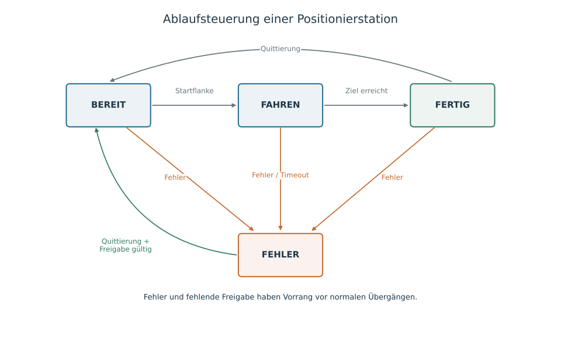

# M13-L1 – Automatisierungsstrukturen und Ablaufsteuerung {#L1}

**Kursbereich:** M13 – Bachelor: Automatisierung, Regelung und Robotik

**Niveau:** Bachelor · Wahlbereich

**Vorwissen:** [Endliche Automaten](M3-L6.md), [Regelkreise](M6-L4.md), [Hybride Modelle](M12-L4.md).

**Lernziel:** Eine Automatisierungsaufgabe in diskrete Betriebszustände, kontinuierliche Regelkreise und überprüfbare Übergangsbedingungen zerlegen.

## Ebenen einer automatisierten Anlage {#S1}

Eine industrielle Anlage soll nicht nur eine physikalische Größe stabilisieren. Sie muss auch entscheiden, wann ein Teilprozess freigegeben wird, welcher Sollwert gilt und wie mit einem Fehler umgegangen wird. Ein automatisierter Positionierantrieb besteht beispielsweise aus einem Wegsensor, einem Antriebsregler, einem Motor mit Leistungselektronik und einer übergeordneten Ablaufsteuerung. Der Regler erzeugt aus Soll- und Istposition eine Stellgröße; die Ablaufsteuerung bestimmt, wann der Regler überhaupt eine Bewegung anfordern darf. Eine Bedienoberfläche visualisiert Betriebszustand, Aufträge und Diagnosen. Sie muss nicht im schnellen Regelkreis liegen.

| Ebene | Beispielaufgabe | Typisches Signal im Lehrmodell |
| --- | --- | --- |
| Feldebene | Messen und Stellen | Winkel, Drehzahl, Moment |
| Regelung | Abweichung begrenzen | Sollwert, Stellmoment |
| Ablauf | Schritte und Freigaben bestimmen | Zustand, Start, Fertig |
| Überwachung | Protokoll und Bedienung | Fehlercode, Ereigniszeit |

Die Zeitraster dieser Aufgaben können verschieden sein. Im Beispiel wird der Achsregler alle 5 ms aufgerufen, der Ablauf alle 20 ms, die Anzeige alle 200 ms. Diese Zeiten sind reine Entwurfsannahmen; keine Produkteigenschaften. Ein schneller Sensor hilft wenig, wenn ein veralteter Wert unbemerkt an den Regler weitergegeben wird.

## Ablaufsteuerung einer Positionierstation {#S2}

{alt="Vier Betriebszustände mit normalen Übergängen und einem priorisierten Fehlerpfad."}

Die Station beginnt in BEREIT. Mit gültiger Freigabe und einer neuen Startflanke wechselt sie nach FAHREN; der Zielwinkel wird bei der Auftragsannahme gespeichert. Nach Erreichen des Toleranzfensters (Positions- und Geschwindigkeitsschwelle) geht sie in FERTIG. Die Quittierung führt nach BEREIT. Ein Fehler oder fehlende Freigabe hat Vorrang vor normalen Übergängen. In FAHREN wird zusätzlich eine Zeitüberschreitung überwacht. Der Fehlerzustand ist verriegelt: Eine Fehlerquittierung ist erst bei wieder gültiger Freigabe und verschwundener Fehlerursache möglich. Die neue Startflanke muss separat erfolgen.

| Zustand | Aktion im abstrakten Modell | Normaler Übergang |
| --- | --- | --- |
| BEREIT | Kein Fahrauftrag | Startflanke → FAHREN |
| FAHREN | Zieltrajektorie ausgeben | Ziel erreicht → FERTIG |
| FERTIG | Position halten | Quittierflanke → BEREIT |
| FEHLER | Fahrauftrag gesperrt | Freigabe gültig, Ursache behoben, Quittierflanke → BEREIT |

Dies ist ein **funktionales Lehrmodell**, keine Sicherheitssteuerung. Das Sperren eines Fahrauftrags garantiert weder Stillstand noch das Halten einer vertikalen Last. Für eine reale Anlage müssen Risiken, Bremsweg, gespeicherte Energie und geeignete unabhängige Sicherheitsfunktionen gesondert berücksichtigt werden.

## Zyklische Ausführung und Priorität {#S3}

Bei einer vereinfachten zyklischen Steuerung werden Eingangsdaten zu Beginn eines Zyklus übernommen, Logik ausgewertet und Ausgangsdaten aktualisiert. Ein zwischen zwei Abtastungen kurz auftretender Impuls kann unerkannt bleiben. Eingangsfilter, gepufferte Ereignisse oder flankenerfassende Hardware sind mögliche Gegenmaßnahmen; sie verändern selbst die Zeitbedingungen. Die Ablaufsprache SFC nach IEC 61131-3 bietet Schritte und Transitionen zur Strukturierung; unser Python-Beispiel bildet nur einen deterministischen Automaten ab, keine normkonforme SPS-Laufzeit.

```python
# Zeitueberschreitung und Flanken werden vom aufrufenden Zeitmodell geliefert.
def step(s, ready=True, fault=False, timeout=False,
         start=False, done=False, ack=False):
    if fault or not ready or (s == 'FAHREN' and timeout):
        return 'FEHLER'
    if s == 'FEHLER':
        return 'BEREIT' if ack else s
    if s == 'BEREIT' and start:
        return 'FAHREN'
    if s == 'FAHREN' and done:
        return 'FERTIG'
    if s == 'FERTIG' and ack:
        return 'BEREIT'
    return s

s = step('BEREIT', start=True)
assert s == 'FAHREN'
assert step(s, done=True, fault=True) == 'FEHLER'
assert step(s, timeout=True) == 'FEHLER'
assert step('FEHLER', ack=True, ready=False) == 'FEHLER'
assert step('FEHLER', start=True) == 'FEHLER'
assert step('FEHLER', ack=True, start=True) == 'BEREIT'
assert step(step(s, done=True), ack=True) == 'BEREIT'
```

Der gleichzeitige Fehler und das Fertigsignal sind bewusst getestet. Die Reihenfolge der Bedingungen ist ein Teil der Spezifikation. Für einen zyklischen Aufruf muss der Aufrufer Flanken mit gespeichertem vorherigem Eingang bilden, z. B. $s_k\land\neg s_{k-1}$. Wenn Start dauerhaft anliegt, entsteht dadurch kein zweiter Auftrag beim Quittieren. Eine Zeitüberwachung zählt ab Eintritt in FAHREN; der Zähler wird nicht bei jeder erneuten Ausgabe dieses Zustands zurückgesetzt.

## Zeitbudget und Testentwurf {#S4}

Bei einem Zyklus von 20 ms und einem am Eingang stabil anliegenden Ereignis kann allein die Wartezeit bis zur nächsten Abtastung nahezu 20 ms betragen. Hinzu kommen Filterung, Ausführung, Busübertragung und Aktualisierung des Ausgangs. Bei einem angenommenen Filter von 3 ms, einem Logikbudget von 4 ms und einem Ausgangstransport von 5 ms ergibt sich ein vereinfachter oberer Reaktionswert von 32 ms, sofern kein Zyklus ausfällt. Für einen Achstakt von 5 ms darf dieser langsame Ablauf nicht als unmittelbarer Drehzahlregelkreis missverstanden werden.

Ein Testplan enthält Normalfälle, Grenzfälle und zeitliche Fehler: Doppelklick, gehaltene Starttaste, verlorene Rückmeldung, Fehler gleichzeitig mit Zielerreichung, Quittierung ohne Freigabe. Ein Beobachtungspunkt muss zwischen physikalischem Stillstand und logischer Zustandsmeldung unterscheiden.

## Übungen mit Lösungen {#S5}

1. Eine Taste ist zwischen zwei Abtastungen 8 ms lang aktiv, der Zyklus dauert 20 ms. Ist Erkennung garantiert?  
   **Lösung** Nein. Der Impuls kann vollständig zwischen Abtastungen liegen.
2. Bei FAHREN sind `done` und `timeout` gleichzeitig wahr. Welcher Zustand folgt?  
   **Lösung** FEHLER, weil die Überwachung Vorrang hat.
3. Ein Sensor ist nach Kommunikationsverlust eingefroren und zeigt den Zielwinkel. Welche weitere Prüfung ist nötig?  
   **Lösung** Qualität und Alter der Messung sowie Geschwindigkeit; ein alter Positionswert ist keine gültige Fertigmeldung.

**Weiterführend:** [Digitale Regelung und Begrenzung](M13-L2.md)

## Quellen {#S6}

- [PLCopen – Status der IEC 61131-3 und SFC](https://www.plcopen.org/standards/logic/iec-61131-3/status-iec-61131-3-standard/) · Abschnitt The 4th Edition: SPS-Sprachen ST, LD, FBD und SFC-Struktur; öffentliche Übersicht, kein Normvolltext. · Zuletzt abgerufen: 2026-11-25
- [PLCopen – Einführungen und Downloads zur Ablaufsprache](https://www.plcopen.org/downloads/) · Downloads: SFC-Text (DE/EN) und Einführung in SFC (DE); nur Verzeichnis, Dateien nicht geprüft. · Zuletzt abgerufen: 2026-11-25
