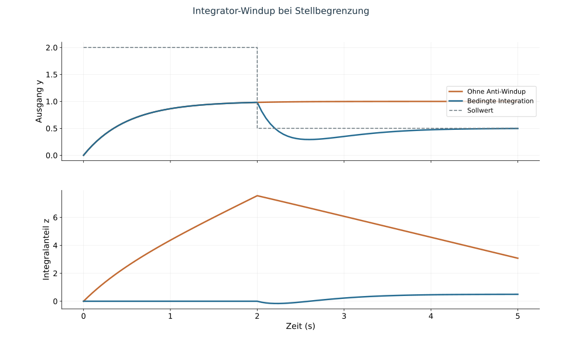

# M13-L2 – Digitale Regelung und Begrenzung {#L2}

**Kursbereich:** M13 – Bachelor: Automatisierung, Regelung und Robotik

**Niveau:** Bachelor · Wahlbereich

**Vorwissen:** [z-Transformation](M5-L4.md), [Abtastung](M5-L5.md), [Stabilität und Reglereinstieg](M6-L5.md).

**Lernziel:** Einen zeitdiskreten PI-Regler entwickeln und die Auswirkungen einer Stellbegrenzung mit und ohne Integratorbegrenzung quantitativ beurteilen.

## Vom kontinuierlichen zum abgetasteten Modell {#S1}

Ein digitaler Regler liest den Messwert zu diskreten Zeiten $t_k=kT_s$. Zwischen den Updates bleibt sein Stellwert im einfachsten Fall konstant (Zero-Order Hold). Die Verzögerung und der Frequenzgang dieses Halteglieds gehören zur Regelstrecke. Eine zu lange Abtastzeit kann einen ursprünglich stabilen Entwurf verschlechtern; eine kurze Zeit allein garantiert jedoch keine Stabilität, wenn Rechen- und Kommunikationsverzögerungen hinzukommen.

Wir verwenden eine normierte Strecke erster Ordnung mit Zeitkonstante $\tau=0{,}5$ s:

$$
\tau\dot y+y=u,\qquad |u|\le1.
$$

Die Zustandslösung für konstant gehaltenes $u_k$ liefert die exakte diskrete Gleichung

$$
y_{k+1}=ay_k+(1-a)u_k,\qquad a=e^{-T_s/\tau}.
$$

Bei $T_s=0{,}05$ s ist $a\approx0{,}90484$. Ein Euler-Schritt ergäbe $a=0{,}9$ und wäre eine Näherung. Die exakte Abtastform trennt hier den Regelungseffekt von Integrationsfehlern.

## PI-Regler und Windup {#S2}

Wir speichern den Integralanteil $z_k$ direkt in Einheiten der Stellgröße. Der Sollwert ist $r_k$, der Fehler $e_k=r_k-y_k$. Mit $K_P=1{,}5$, $K_I=3\,\mathrm{s}^{-1}$ gilt

$$
v_k=K_Pe_k+z_k,\qquad u_k=\operatorname{clip}(v_k,-1,1),\qquad z_{k+1}=z_k+T_sK_Ie_k.
$$

Wenn der Sollwert 2 ist, die Strecke aber nur Werte bis 1 erreichen kann, bleibt der Fehler positiv. Ohne Begrenzung des Integralanteils wächst $z_k$ weiter. Bei einem später wieder erreichbaren Sollwert wird die Stellgröße dadurch oft noch längere Zeit am Anschlag gehalten. Dieses Verhalten heißt Integrator-Windup.

Bei bedingter Integration wird $z_k$ nur dann fortgeschrieben, wenn die Abweichung die Sättigung nicht weiter verstärkt. Im oberen Anschlag wird bei positivem Fehler nicht integriert, im unteren Anschlag bei negativem Fehler nicht. Eine alternative Rückrechnung ergänzt die Integratorgleichung um $T_sK_b(u_k-v_k)$; der Gewinn $K_b$ hat die Einheit 1/s. Er ist wie andere Reglerparameter zu prüfen, nicht beliebig groß zu wählen.

{alt="Sollwertwechsel bei zwei Sekunden: bedingte Integration verkürzt die Erholung nach Stellbegrenzung; Integrator und Ausgang beider Regler sind dargestellt."}

## Stabilität ohne Sättigung {#S3}

Für konstanten Sollwert betrachtet man Abweichungen vom Gleichgewicht. Ist die Stellgröße nicht begrenzt und die bedingte Integration inaktiv, ist das lineare Zustandsmodell

$$
\begin{bmatrix}\delta y_{k+1}\\\delta z_{k+1}\end{bmatrix}=
\begin{bmatrix}a-(1-a)K_P&1-a\\-T_sK_I&1\end{bmatrix}
\begin{bmatrix}\delta y_k\\\delta z_k\end{bmatrix}.
$$

Die Eigenwerte bei 50 ms liegen gerundet bei 0,881 ± 0,011 i (beide Beträge kleiner als 1). Das gilt lokal um einen nicht gesättigten Arbeitspunkt; es beweist keine globale Stabilität des geschalteten Systems. Entwurfsvarianten müssen auch bei Lastwechseln, Stellgrenzen und Messfehlern getestet werden.

## Numerisches Experiment {#S4}

Der Sollwert liegt zunächst bei 2 und wechselt nach 2 s auf 0,5. Anfangswerte sind $y=z=0$. Der folgende Python-Code verwendet die exakte Streckenlösung.

```python
import math

def pi(T=0.05, aw=True):
    y=z=0.0
    a=math.exp(-T/0.5)
    out=[]
    for k in range(round(5/T)+1):
        t=k*T
        r=2.0 if t<2 else .5
        e=r-y
        v=1.5*e+z
        u=max(-1.,min(1.,v))
        out.append((t,r,y,u,z))
        if not aw or not ((v>1 and e>0) or (v<-1 and e<0)):
            z+=T*3*e
        y=a*y+(1-a)*u
    return out

for T in (0.05, 0.025):
    for aw in (False, True):
        d = pi(T, aw)
        assert all(abs(v[3]) <= 1 for v in d)
        print(T, aw, d[round(2/T)], d[-1])
```

| Abtastzeit | Bedingte Integration | Integralanteil bei 2 s | Ausgang bei 5 s |
| ---: | --- | ---: | ---: |
| 50 ms | nein | 7,54738 | 0,99995 |
| 50 ms | ja | 0 | 0,49692 |
| 25 ms | nein | 7,50965 | 0,99995 |
| 25 ms | ja | 0 | 0,49617 |

Bei 50 ms gelangt die Variante mit bedingter Integration erstmals bei 2,20 s innerhalb von 0,025 des neuen Sollwerts. Das ist nicht mit einer dauerhaften Einschwingzeit gleichzusetzen. Die Variante ohne Begrenzung erreicht das Band bis zum Ende bei 5 s überhaupt nicht. Die Wiederholung bei halbierter Abtastzeit bestätigt das qualitative Verhalten, während die Zahlen leicht variieren. Der Regler kann das physikalisch unmögliche erste Ziel auch mit Anti-Windup nicht erreichen; er erholt sich lediglich nach der Rückkehr in den zulässigen Bereich.

Bei realen Systemen können neben der Amplitude auch Stellgeschwindigkeit, Strom, Temperatur und Spannung begrenzt sein. Wenn die tatsächlich wirksame Stellgröße nachgeschaltete Grenzen hat, muss die Anti-Windup-Logik diese kennen. In einem Kaskadenregler kann beispielsweise der äußere Positionsregler ein Drehzahlziel anfordern, das der innere Kreis nicht liefern kann.

## Übungen mit Lösungen {#S5}

1. Bei $y=0$, $r=2$, $z=0$ beträgt $v=3$. Was wird bei bedingter Integration gespeichert?  
   **Lösung** $u=1$ und $z_{k+1}=0$, da der Fehler positiv ist und der obere Anschlag erreicht wurde.
2. Bei $v=1{,}2$ und negativem Fehler wird die Integration gesperrt?  
   **Lösung** Nein, ein negativer Beitrag kann den Integrator aus der oberen Sättigung zurückführen.
3. Warum ist ein Eigenwertbetrag unter eins nicht für alle Betriebsfälle ausreichend?  
   **Lösung** Die Matrix beschreibt den ungesättigten linearen Fall. Schaltlogik, Verzögerung und andere Grenzen ändern die Dynamik.

**Weiterführend:** [Robotik-Kinematik und Koordinatensysteme](M13-L3.md)

## Quellen {#S6}

- [MathWorks – Discrete PID Controller und Anti-Windup](https://www.mathworks.com/help/simulink/slref/discretepidcontroller.html) · Beispiel Anti-Windup Control Using PID Controller Block: Begrenzung und Integrator-Windup. · Zuletzt abgerufen: 2026-11-25
- [MathWorks – PI Controller: Clamping und Back-calculation](https://www.mathworks.com/help/mcb/ref/picontroller.html) · Abschnitt Description: diskrete PI/PID-Reglerstruktur. · Zuletzt abgerufen: 2026-11-25
