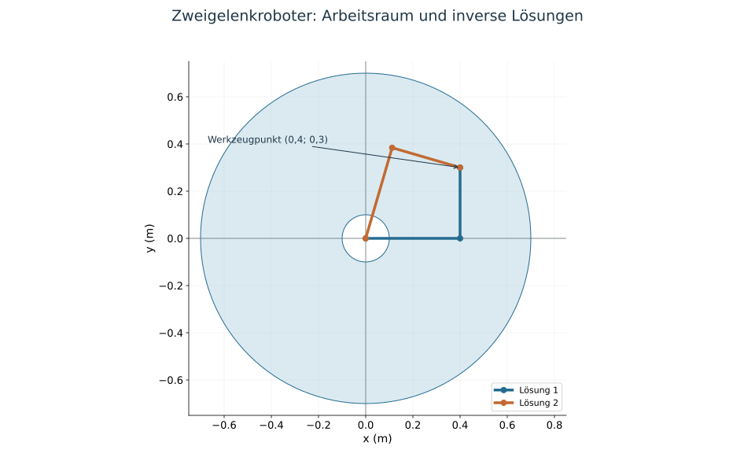

# M13-L3 – Robotik-Kinematik und Koordinatensysteme {#L3}

**Kursbereich:** M13 – Bachelor: Automatisierung, Regelung und Robotik

**Niveau:** Bachelor · Wahlbereich

**Vorwissen:** [Vektoren und lineare Gleichungssysteme](M2-L2.md), [Differentialgleichungen](M2-L3.md).

**Lernziel:** Die Position und Geschwindigkeit eines ebenen Roboters aus Gelenkwinkeln ermitteln, inverse Lösungen unterscheiden und Singularitäten erkennen.

## Gelenkraum und Arbeitsraum {#S1}

Ein Gelenkroboter kann dieselbe Position seines Werkzeugpunkts mit verschiedenen Gelenkstellungen erreichen. Der Gelenkraum beschreibt die unabhängigen Antriebskoordinaten. Der Arbeitsraum bezeichnet die erreichbaren Positionen (bei allgemeinen Robotern auch Orientierungen). Wir beschränken uns auf einen ebenen Roboter mit zwei idealen Drehgelenken und starren Gliedern von $l_1=0{,}4$ m und $l_2=0{,}3$ m. Die Achsen stehen senkrecht zur Ebene. Winkel werden positiv gegen den Uhrzeigersinn und in den Formeln im Bogenmaß angegeben. $q_2$ ist relativ zum ersten Glied definiert; die absolute Orientierung des zweiten Glieds ist $q_1+q_2$.

{alt="Kreisring des idealen Arbeitsraums und zwei Gelenkstellungen für denselben Werkzeugpunkt bei x gleich 0,4 und y gleich 0,3 Metern."}

Die Rotation einer ebenen Koordinate folgt aus

$$
R(q)=\begin{bmatrix}\cos q&-\sin q\\\sin q&\cos q\end{bmatrix}.
$$

Die direkte Kinematik ist die Summe der beiden rotierten Gliedvektoren:

$$
x=l_1\cos q_1+l_2\cos(q_1+q_2),\qquad
y=l_1\sin q_1+l_2\sin(q_1+q_2).
$$

Ohne Gelenkgrenzen oder Kollisionen ist der geometrische Arbeitsraum ein Kreisring mit Radien $|l_1-l_2|=0{,}1$ m und $l_1+l_2=0{,}7$ m. Ein realer Roboter erreicht durch mechanische Anschläge, Hindernisse und Selbstkollisionen nicht jede Position in diesem idealen Bereich.

## Inverse Kinematik {#S2}

Für eine gewünschte Position $(x,y)$ gilt nach dem Kosinussatz

$$
c_2=\frac{x^2+y^2-l_1^2-l_2^2}{2l_1l_2},\quad
q_2=\operatorname{atan2}(\pm\sqrt{1-c_2^2},c_2).
$$

Ist $|c_2|>1$, gibt es keine reelle Lösung. Bei kleinen numerischen Überschreitungen durch Rundung kann man nach einer Toleranzprüfung auf das Intervall $[-1,1]$ begrenzen. Ein grundsätzlich unerreichbarer Punkt darf dagegen nicht stillschweigend auf den Arbeitsraum verschoben werden. Für jede der beiden möglichen Vorzeichenvarianten bestimmt man

$$
q_1=\operatorname{atan2}(y,x)-\operatorname{atan2}(l_2\sin q_2,l_1+l_2\cos q_2).
$$

Mit $x=0{,}4$ m und $y=0{,}3$ m ist $c_2=0$. Eine Lösung ist $q_1=0$, $q_2=\pi/2$. Die andere ist $q_1=2\operatorname{atan2}(0{,}3,0{,}4)\approx1{,}287$ rad und $q_2=-\pi/2$. Beide führen zum selben Werkzeugpunkt, aber zu unterschiedlichen Orientierungen und Gelenkstellungen. Im kontinuierlichen Pfad wird eine zulässige Lösungsfamilie ausgewählt und möglichst stetig weiterverfolgt.

## Differentielle Kinematik und Singularität {#S3}

Die Zeitableitung des Positionsvektors ergibt $\dot p=J(q)\dot q$. Die Jacobi-Matrix enthält die Ableitungen nach den Gelenkwinkeln:

$$
J=\begin{bmatrix}
-l_1\sin q_1-l_2\sin(q_1+q_2)&-l_2\sin(q_1+q_2)\\
l_1\cos q_1+l_2\cos(q_1+q_2)&l_2\cos(q_1+q_2)
\end{bmatrix}.
$$

Ihre Determinante ist $l_1l_2\sin q_2$. Bei gestrecktem oder vollständig gefaltetem Arm ist die Matrix singulär. In diesen Stellungen kann der Werkzeugpunkt nicht beliebig in zwei unabhängige kartesische Richtungen bewegt werden. Nahe der Singularität können moderate Werkzeuggeschwindigkeiten sehr große Gelenkgeschwindigkeiten erfordern. Ein praktischer Pfadplaner prüft daher neben Erreichbarkeit auch die Kondition der Abbildung, Gelenkgrenzen und die benötigte Dynamik.

Am Punkt $q=(0,\pi/2)$ erhält man $J=\begin{bmatrix}-0{,}3&-0{,}3\\0{,}4&0\end{bmatrix}$. Für $\dot p=(0{,}03,0{,}04)$ m/s folgt $\dot q_1=0{,}1$ rad/s und $\dot q_2=-0{,}2$ rad/s. Auch die statische Kraftabbildung ist relevant: Aus der Gleichheit virtueller Leistung $F^T\dot p=M^T\dot q$ folgt $M=J^TF$, sofern keine weiteren Lasten berücksichtigt werden. Bei $F=(10,0)$ N ergeben sich an diesem Punkt $M=(-3,-3)$ Nm für die entsprechende Werkzeugkraft.

## Rechenexperiment {#S4}

```python
from math import sin, cos, atan2, sqrt, pi, hypot
l1, l2 = .4, .3

def forward(q1, q2):
    return (l1*cos(q1)+l2*cos(q1+q2),
            l1*sin(q1)+l2*sin(q1+q2))

def inverse(x, y):
    c = (x*x+y*y-l1*l1-l2*l2)/(2*l1*l2)
    if abs(c) > 1+1e-12:
        raise ValueError('ausserhalb des Arbeitsraums')
    c = min(1.,max(-1.,c))
    sols = []
    for sign in (1,-1):
        q2 = atan2(sign*sqrt(1-c*c),c)
        q1 = atan2(y,x)-atan2(l2*sin(q2),l1+l2*cos(q2))
        sols.append((q1,q2))
    return sols

for x,y in ((.4,.3),(.5,.1),(.7,0),(.1,0)):
    for q1,q2 in inverse(x,y):
        X,Y = forward(q1,q2)
        assert hypot(X-x,Y-y) < 1e-10
        print(x,y,q1,q2)
try:
    inverse(.8,0)
except ValueError:
    pass
else:
    raise AssertionError('unerreichbarer Punkt akzeptiert')
```

Die Prüfung setzt die invers berechneten Winkel wieder in die direkte Kinematik ein. Sie erkennt auch einen Punkt außerhalb des Kreisrings. An dessen Grenzen können die beiden Lösungen bis auf Winkelperiodizität zusammenfallen. Ein bestandener geometrischer Test ist noch kein Nachweis, dass eine Achsensteuerung die Trajektorie realisieren kann.

## Übungen mit Lösungen {#S5}

1. Ist $(0,0)$ erreichbar?  
   **Lösung** Nein, der minimale Radius beträgt 0,1 m.
2. Berechne $p$ bei $q_1=\pi/2$, $q_2=0$.  
   **Lösung** $(0,0{,}7)$ m. Die Stellung ist singulär.
3. Kann eine kartesische Gerade ohne Prüfung der Zwischenpunkte gefahren werden, wenn beide Endpunkte erreichbar sind?  
   **Lösung** Nein. Die Gerade kann durch den inneren nicht erreichbaren Bereich oder durch Hindernisse führen. Auch Gelenkgrenzen und Geschwindigkeiten müssen geprüft werden.

**Weiterführend:** [Trajektorien und Achsregelung](M13-L4.md)

## Quellen {#S6}

- [Lynch und Park – Modern Robotics, Kapitel 5: Velocity Kinematics and Statics](https://modernrobotics.northwestern.edu/chapters/chapter5/) · Kapitel 5: Geschwindigkeitskinematik; Videoübersicht, Videos nicht geprüft. · Zuletzt abgerufen: 2026-11-25
- [Lynch und Park – Modern Robotics, Kapitel 6: Inverse Kinematics](https://modernrobotics.northwestern.edu/chapters/chapter6/) · Kapitel 6: inverse Kinematik; Videoübersicht, Videos nicht geprüft. · Zuletzt abgerufen: 2026-11-25
