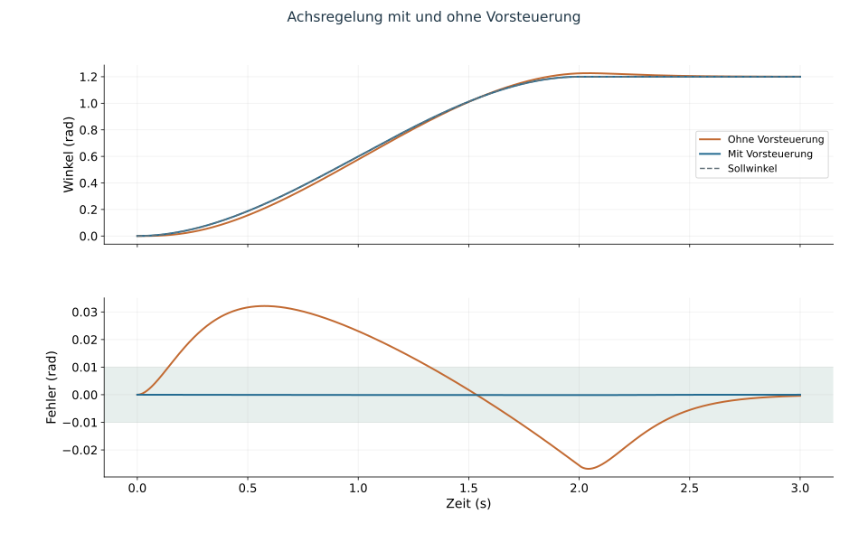

# M13-L4 – Trajektorien und Achsregelung {#L4}

**Kursbereich:** M13 – Bachelor: Automatisierung, Regelung und Robotik

**Niveau:** Bachelor · Wahlbereich

**Vorwissen:** [Motorarbeitspunkt](M9-L1.md), [Gekoppelte Modelle](M12-L2.md), [Robotik-Kinematik](M13-L3.md).

**Lernziel:** Eine zeitparametrierte Gelenkbewegung entwerfen, die Achsdynamik berücksichtigen und die erreichbare Positionsgenauigkeit mit einer Simulation überprüfen.

## Pfad und Trajektorie {#S1}

Ein Pfad gibt die geometrische Folge von Konfigurationen an. Eine Trajektorie legt zusätzlich fest, wann sie erreicht werden. Im Gelenkraum kann der Pfad als $q(s)=q_A+s(q_B-q_A)$ mit $0\le s\le1$ vorgegeben werden. Eine gerade Gelenkraumverbindung ergibt im kartesischen Raum im Allgemeinen keine Gerade. Soll das Werkzeug geradlinig fahren, muss der kartesische Pfad in Gelenkkoordinaten übersetzt und auf Singularitäten geprüft werden (siehe [M13-L3](M13-L3.md)).

Für eine einzelne Achse mit Anfangswinkel null und Zielwinkel $Q=1{,}2$ rad verwenden wir $T=2$ s und die normierte Zeit $s=t/T$. Die kubische Zeitfunktion lautet

$$
q_r=Q(3s^2-2s^3),\quad
\dot q_r=\frac{Q}{T}(6s-6s^2),\quad
\ddot q_r=\frac{Q}{T^2}(6-12s).
$$

Außerhalb des Bewegungsintervalls halten wir die jeweiligen Endpositionen mit Geschwindigkeit und Beschleunigung null. An beiden Enden ist die Geschwindigkeit stetig; die Beschleunigung besitzt Sprünge. Eine quintische Funktion $10s^3-15s^4+6s^5$ könnte auch die Beschleunigung an den Enden stetig auf null führen. Die Spitzenwerte sind für die kubische Bewegung $1{,}5Q/T=0{,}9$ rad/s und $6Q/T^2=1{,}8$ rad/s². Für Grenzen $v_\max$ und $a_\max$ muss daher $T\ge1{,}5|Q|/v_\max$ und $T\ge\sqrt{6|Q|/a_\max}$ gelten. Diese Prüfung betrifft den Sollverlauf; das tatsächliche System muss separat geprüft werden.

## Achsmodell, Vorsteuerung und Rückkopplung {#S2}

Wir verwenden eine ideale rotatorische Achse mit $J=0{,}2$ kg m² und $b=0{,}1$ Nm s/rad. Die elektrische Dynamik wird in einem idealen inneren Momentenregler zusammengefasst. Die Modellgleichungen sind

$$
\dot q=\omega,\qquad J\dot\omega=M-b\omega.
$$

Ein PD-Positionsregler vergleicht Winkel und Geschwindigkeit mit dem Sollverlauf. Mit Vorsteuerung gilt

$$
M_v=J\ddot q_r+b\dot q_r+K_P(q_r-q)+K_D(\dot q_r-\omega),
\qquad M=\operatorname{clip}(M_v,-2,2)\,\mathrm{Nm}.
$$

Die Sättigungsgrenzen sind als Zahlenwerte in Nm zu verstehen; $K_P=8$ Nm/rad und $K_D=2{,}4$ Nm s/rad. Die Vorsteuerung liefert das zur idealen Sollbewegung benötigte Moment. Die Rückkopplung korrigiert Modellabweichungen. Ohne Vorsteuerung muss die Rückkopplung erst einen Fehler sehen, bevor ein Moment entsteht. Bei exaktem kontinuierlichem Modell, keiner Sättigung und sofortiger Rückkopplung beträgt die Fehlergleichung $J\ddot e+(b+K_D)\dot e+K_Pe=0$. Die Pole sind $-6{,}25\pm0{,}968i$ 1/s; beide Realteile sind negativ. Die Aussage gilt nicht unmittelbar für verzögerte digitale Rückkopplung.

## Reproduzierbare Achssimulation {#S3}

Für konstantes Moment innerhalb eines Abtastschritts wird die mechanische Differentialgleichung exakt integriert. Mit $a=e^{-bT_s/J}$ und $\omega_\infty=M/b$ folgt

$$
\begin{aligned}
q_{k+1}&=q_k+\omega_\infty T_s+(\omega_k-\omega_\infty)(1-a)J/b,\\
\omega_{k+1}&=\omega_\infty+(\omega_k-\omega_\infty)a.
\end{aligned}
$$

Der Code enthält bereits eine optionale Messverzögerung in ganzen Abtastschritten, die in der nächsten Lektion gebraucht wird. Bei fehlender Vorgeschichte wird der Anfangszustand verwendet. Ein Wechsel der Abtastzeit verändert die physikalische Dauer einer Verzögerung in Schritten.

```python
import math

def axis(Ts=.005, ff=True, delay=0):
    J,b,Kp,Kd=0.2,.1,8.,2.4
    q=w=0.
    data=[]
    for k in range(round(3/Ts)+1):
        t=k*Ts
        s=min(t/2,1.)
        r=1.2*(3*s*s-2*s**3)
        vr=1.2*(6*s-6*s*s)/2
        ar=1.2*(6-12*s)/4 if t<2 else 0.
        m=J*ar+b*vr if ff else 0.
        j=max(0,len(data)-delay)
        qm,wm=(q,w) if delay==0 or not data else data[min(j,len(data)-1)][2:4]
        raw=m+Kp*(r-qm)+Kd*(vr-wm)
        u=max(-2.,min(2.,raw))
        data.append((t,r,q,w,u,raw))
        # Exact solution under constant torque over one sample.
        a=math.exp(-b*Ts/J)
        w_inf=u/b
        q+=w_inf*Ts+(w-w_inf)*(1-a)*J/b
        w=w_inf+(w-w_inf)*a
    return data

def stats(data):
    return max(abs(x[1]-x[2]) for x in data),abs(data[-1][1]-data[-1][2]),max(abs(x[3]) for x in data),max(abs(x[4]) for x in data)

for Ts in (.005,.0025):
    for ff in (False,True):
        d=axis(Ts,ff)
        assert all(abs(row[4])<=2 for row in d)
        print(Ts,ff,stats(d))
```

{alt="Kubische Solltrajektorie, Winkelfehler der Achse mit und ohne Vorsteuerung und die Grenzen von plus und minus 0,01 rad."}

## Ergebnis und Bewertung {#S4}

| Takt | Vorsteuerung | Max. Winkelfehler (rad) | Max. Geschwindigkeit (rad/s) | Max. Moment (Nm) |
| ---: | --- | ---: | ---: | ---: |
| 5 ms | nein | 0,032146 | 0,93532 | 0,35808 |
| 5 ms | ja | 0,000150 | 0,90006 | 0,36000 |
| 2,5 ms | nein | 0,032130 | 0,93527 | 0,35712 |
| 2,5 ms | ja | 0,000075 | 0,90003 | 0,36000 |

Die Auswertung umfasst die Fahrt bis 2 s und eine Haltephase bis 3 s. Für das idealisierte Lehrmodell setzen wir zulässige Modellgrenzen von 0,01 rad maximalem Winkelfehler, 1 rad/s tatsächlicher Geschwindigkeit und 2 Nm Moment. Mit Vorsteuerung werden alle drei Ziele im simulierten Zeitraster erfüllt, ohne Vorsteuerung wird das Fehlerziel verfehlt. Bei halbiertem Abtastschritt fällt der Restfehler mit Vorsteuerung etwa auf die Hälfte. Die mechanische Zustandsintegration ist exakt pro Schritt, die digitale Stellgröße bleibt aber zwischen den Abtastungen konstant. Die Halbierung ersetzt keine globale Konvergenz- oder Stabilitätsanalyse.

Ein reales Robotergelenk kann Spiel, elastische Verformung, trockene Reibung, Gravitation und mechanische Kopplung mit anderen Achsen aufweisen. Die Drehmomentvorsteuerung wäre dann aus einem vollständigen Mehrkörpermodell zu bestimmen. Ein Zielwert von 0,01 rad entspricht an einem Hebel von 0,4 m ungefähr 4 mm tangentialem Positionsfehler für kleine Winkel; eine echte kartesische Toleranz müsste aus der gesamten Gelenkkonfiguration bestimmt werden.

## Übungen mit Lösungen {#S5}

1. Welche Mindestdauer ergibt sich bei $Q=1{,}2$ rad und $v_\max=0{,}6$ rad/s?  
   **Lösung** $T\ge3$ s aus der Geschwindigkeitsgrenze. Die Beschleunigungsgrenze muss zusätzlich geprüft werden.
2. Welche ideale Vorsteuerung benötigt eine Achse bei $\dot q_r=0{,}9$ rad/s und $\ddot q_r=0$?  
   **Lösung** $b\dot q_r=0{,}09$ Nm.
3. Warum ist eine Vorsteuerung ohne Rückkopplung bei Modellfehlern problematisch?  
   **Lösung** Eine falsche Masse oder Reibung erzeugt einen Bewegungsfehler, den eine reine Vorsteuerung nicht aus der Messung korrigiert.

**Weiterführend:** [Industrielle Kommunikation und Systemintegration](M13-L5.md)

## Quellen {#S6}

- [Lynch und Park – Modern Robotics, Kapitel 9: Trajectory Generation](https://modernrobotics.northwestern.edu/chapters/chapter9/) · Kapitel 9: Trajektorienplanung; Videoübersicht, Videos nicht geprüft. · Zuletzt abgerufen: 2026-11-25
- [Lynch/Park – Modern Robotics, Chapter 11: Robot Control](https://modernrobotics.northwestern.edu/chapters/chapter11/) · Abschnittsübersicht 11.3–11.4: Bewegungsregelung mit Geschwindigkeits- und Drehmomenteingängen; Videos nicht geprüft. · Zuletzt abgerufen: 2026-11-25
