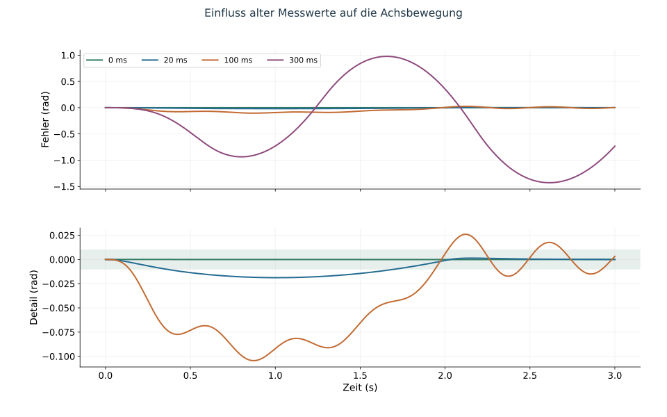

# M13-L5 – Industrielle Kommunikation und Systemintegration {#L5}

**Kursbereich:** M13 – Bachelor: Automatisierung, Regelung und Robotik

**Niveau:** Bachelor · Wahlbereich

**Vorwissen:** [Abtastung und digitale Filter](M5-L5.md), [Ablaufsteuerung](M13-L1.md), [Achsregelung](M13-L4.md).

**Lernziel:** Messdaten, Stellgrößen und Auftragsinformationen über geeignete Schnittstellen austauschen, Latenz und Datenalter unterscheiden und eine integrierte Roboterachsensimulation bewerten.

## Kommunikation als Bestandteil der Dynamik {#S1}

Der Schwerpunkt dieser Wahllektion ist die zeitliche Integration elektrotechnischer Mess- und Stellketten. Ein digitales Prozesswort ist eine codierte Mess- oder Stellgröße; für die folgenden Modelle genügen Abtastzeit, Nutzdatenumfang, Zeitstempel und Gültigkeit. Eine nachrichtentechnische Modulations- oder Kanalcodierungsvorlesung ist nicht erforderlich.

Ein Kommunikationssystem verbindet Sensor, Regler, Aktor und übergeordnete Steuerung. Die Übertragung von Prozesswerten ist nicht nur eine Frage der Bitrate: Zeitpunkt und Gültigkeit eines Werts beeinflussen die Regelung. Die Zeit zwischen Erfassung und Verarbeitung heißt hier Datenalter $A=t_\mathrm{use}-t_\mathrm{capture}$ (bei gemeinsamem Zeitbezug). Die Übertragungslatenz ist nur ein Teil davon. Schwankende Verzögerungen werden als Jitter bezeichnet; ein wiederkehrender Datenstrom kann hohe Bandbreite und trotzdem unzureichende zeitliche Garantien besitzen.

| Datenart | Beispiel | Entwurfsbedarf |
| --- | --- | --- |
| Zyklische Prozessdaten | Position, Drehzahl | Bekannte Aktualisierungszeit, Gültigkeit und Datenalter |
| Ereignisse | Fehlermeldung, Ziel erreicht | Reihenfolge, Quittierung oder Wiederherstellung |
| Auftragsdaten | Ziel, Bewegungsdauer, Auftrags-ID | Eindeutige Zuordnung, keine doppelte Ausführung |
| Diagnose | Verlauf, Temperatur, Statistik | Auswertung ohne Blockierung des Achstakts |

Zyklisch und ereignisgetrieben beschreiben die zeitliche Organisation, nicht automatisch das verwendete Netzwerk. Publish/Subscribe beschreibt eine Kommunikationsbeziehung: Ein veröffentlichter Datensatz kann von mehreren Empfängern konsumiert werden, ohne dass für jede einzelne Nachricht eine direkte Anfrage gestellt wird. OPC UA PubSub ist beispielsweise in Teil 14 der OPC-UA-Spezifikation beschrieben. Echtzeitfähigkeit folgt jedoch nicht allein aus dem Namen eines Protokolls; Transport, Topologie, Zeitplanung und Endsysteme müssen die benötigten Grenzen erfüllen.

## Schnittstellenvertrag im Lehrsystem {#S2}

Die Achse aus M13-L4 erhält von der Ablaufsteuerung einen Auftrag mit `command_id`, `q_target_rad` und `duration_s`. Das Zeitmodell der Achse erzeugt die Solltrajektorie lokal. Der Sensor liefert `q_rad`, `omega_rad_s`, `sample_time_s`, `seq` und `valid`. Die Reglerausgabe ist `torque_Nm`; eine Statusmeldung enthält `command_id`, `state`, `in_position` und `fault_code`. Klare Einheiten verhindern beispielsweise die Verwechslung von Grad mit Radiant. Der Empfänger prüft Wertebereich, Zeitbezug, fortlaufende Sequenznummer (unter Berücksichtigung möglicher Überläufe) und Gültigkeit; eine gültige, aber alte Messung ist unzureichend.

Für das Lehrmodell verwenden wir folgende Annahmen: Achstakt 5 ms, Ablaufzyklus 20 ms, Positionsziel 1,2 rad in 2 s. Die angenommene Frischegrenze für den Achsregler beträgt 10 ms. Eine Zielmeldung gilt erst nach 2 s Fahrt und bei $|q-Q|\le0{,}01$ rad sowie $|\omega|\le0{,}02$ rad/s. Bleibt sie bis 3 s aus, setzt die Ablaufsteuerung einen Timeout. Bei ungültigen oder zu alten Daten wird im Modell ein Fehler gemeldet und ein neuer Fahrauftrag gesperrt. Wie eine reale Achse bei Kommunikationsverlust sicher stillgesetzt wird, darf aus diesem abstrakten Statuswechsel nicht abgeleitet werden.

## Verzögerungsexperiment und Systemtest {#S3}

Wir lassen den Regler absichtlich alte Messdaten verwenden. Dies ist eine **Fehlerinjektion ohne wirksame Frischeüberwachung** und soll zeigen, warum diese Überwachung nötig ist. Der Zeitstempel der Solltrajektorie bleibt aktuell, nur Winkel und Geschwindigkeit werden verzögert. Eine Verzögerung um $d$ Schritte entspricht $dT_s$. Wir verwenden dieselbe ideale Achse wie in [M13-L4](M13-L4.md): keine neue mechanische Parametrierung, keine Paketverluste und kein zufälliger Jitter.

```python
import math

def axis(Ts=.005, ff=True, delay=0):
    J,b,Kp,Kd=0.2,.1,8.,2.4
    q=w=0.
    data=[]
    for k in range(round(3/Ts)+1):
        t=k*Ts
        s=min(t/2,1.)
        r=1.2*(3*s*s-2*s**3)
        vr=1.2*(6*s-6*s*s)/2
        ar=1.2*(6-12*s)/4 if t<2 else 0.
        m=J*ar+b*vr if ff else 0.
        j=max(0,len(data)-delay)
        qm,wm=(q,w) if delay==0 or not data else data[min(j,len(data)-1)][2:4]
        raw=m+Kp*(r-qm)+Kd*(vr-wm)
        u=max(-2.,min(2.,raw))
        data.append((t,r,q,w,u,raw))
        # Exact solution under constant torque over one sample.
        a=math.exp(-b*Ts/J)
        w_inf=u/b
        q+=w_inf*Ts+(w-w_inf)*(1-a)*J/b
        w=w_inf+(w-w_inf)*a
    return data

def stats(data):
    return max(abs(x[1]-x[2]) for x in data),abs(data[-1][1]-data[-1][2]),max(abs(x[3]) for x in data),max(abs(x[4]) for x in data)

for D in (0,4,20,60):
    d=axis(delay=D)
    print(D,stats(d))
    end=d[-1]
    print('Ziel am Ende:',abs(end[2]-1.2)<=.01 and abs(end[3])<=.02)

def freshness(now, stamp, valid):
    return valid and 0 <= now-stamp <= .010+1e-12

assert freshness(1.010,1.,True)
assert not freshness(1.020,1.,True)
assert not freshness(1.,1.,False)
assert not freshness(1.,1.001,True)
```

{alt="Simulierte Winkelfehler für vier feste Messverzögerungen, mit einem Detailfenster für die kleinen Abweichungen."}

| Messverzögerung | Max. Winkelfehler (rad) | Max. Geschwindigkeit (rad/s) | Max. Moment (Nm) | Fehlerziel 0,01 rad |
| ---: | ---: | ---: | ---: | --- |
| 0 ms | 0,000150 | 0,90006 | 0,36000 | erfüllt |
| 20 ms | 0,018813 | 0,90082 | 0,44480 | verfehlt |
| 100 ms | 0,104466 | 1,04054 | 0,82793 | verfehlt |
| 300 ms | 1,429460 | 4,71180 | 2,00000 | verfehlt |

Alle vier Varianten verwenden dieselbe Begrenzung auf 2 Nm. Bei 300 ms wächst die Abweichung während des Beobachtungsfensters so stark, dass die Stellgrenze erreicht wird. Das ist ein Nachweis unzulässigen Verhaltens im untersuchten Szenario, kein mathematischer Beweis asymptotischer Instabilität. Schon die 20-ms-Verzögerung reicht im idealen Modell aus, um das Pfadfehlerziel zu verfehlen. Mit aktiver Frischeprüfung wären 20, 100 und 300 ms nicht als gültige Messdaten zu behandeln. Ob 10 ms eine für alle Störungen ausreichende Grenze ist, bleibt gesondert zu untersuchen.

## Integration, Zeitbudget und Abnahme {#S4}

Für einen Achstakt von 5 ms sei ein Zeitbudget aus maximal 1,0 ms Messwerterfassung, 0,7 ms Übertragung, 0,8 ms Rechenzeit und 0,5 ms Stelltransport gegeben. Das ergibt 3,0 ms und lässt 2,0 ms Reserve im Takt. Eine solche Summe ist nur dann eine obere Grenze, wenn die Einzelwerte tatsächlich Worst-Case-Grenzen sind und sich nicht zusätzliche Wartezeiten, Queueing oder Uhrfehler ergeben. Bei unabhängig getakteten Systemen kann bis zu einem weiteren Zyklus Wartezeit auftreten. Die Frischegrenze ist deshalb kein Ersatz für eine Laufzeitanalyse.

Das Modulprojekt besteht aus drei miteinander verbundenen Prüfebenen: der diskreten Ablaufsteuerung (M13-L1), der lokal geregelten Achse (M13-L4) und dem validierten Messdatenvertrag. Die vorangehenden Tests weisen die jeweiligen Eigenschaften komponentenweise nach, nicht einen realen SPS- oder Feldbusbetrieb. Für eine vollständige Abnahme sind zusätzlich folgende Integrationstests vorzusehen:

| Teststimulus | Erwartetes Verhalten |
| --- | --- |
| Gültiger Start, frische Daten | FAHREN; Trajektorie genau einmal erzeugen |
| Position erreicht, Drehzahl zu groß | Keine Fertigmeldung |
| Wiederholung gleicher Auftrags-ID | Kein zweiter Auftrag |
| Datenalter oberhalb Frischegrenze | Fehlermeldung; keine Fertigmeldung aus altem Wert |
| Fehler gleichzeitig mit Zielerreichung | FEHLER hat Vorrang |
| Fehler behoben, neue Quittierflanke | BEREIT; neue Startflanke erforderlich |

Eine zentrale Entwurfsentscheidung ist, schnelle Regelkreise möglichst lokal auszuführen und übergeordnete Befehle in einem langsameren Takt zu übertragen. Dadurch werden zeitkritische Abhängigkeiten reduziert. Der tatsächliche Vorteil muss im jeweiligen System gemessen oder durch eine belastbare Worst-Case-Analyse gezeigt werden. Ein Schnittstellenmodell mit künstlichen Verzögerungen erlaubt die Prüfung noch vor dem Aufbau eines physischen Systems.

## Übungen mit Lösungen {#S5}

1. Eine Messung wurde bei 0,100 s erzeugt und um 0,114 s benutzt. Wie alt ist sie?  
   **Lösung** 14 ms; für die 10-ms-Frischegrenze im Lehrsystem ist sie nicht akzeptabel.
2. Ein zyklischer Datenstrom enthält 40 Nutzbytes alle 5 ms. Welche reine Nutzdatenrate ergibt sich?  
   **Lösung** $40\cdot8/0{,}005=64\,000$ bit/s. Rahmen, Protokollheader und sonstiger Netzverkehr sind nicht eingerechnet.
3. Warum genügt eine `in_position`-Boolesche Variable nicht als Abnahmeinformation?  
   **Lösung** Sie braucht Gültigkeit, Zeitbezug, Auftragsbezug und eine definierte Grundlage aus Winkel- und Geschwindigkeitsschwelle.

**Weiterführend:** [Studienweg](pages/studienweg.md#S3) und [Modellvalidierung](M12-L5.md).

## Quellen {#S6}

- [OPC Foundation – OPC UA Part 14: PubSub](https://reference.opcfoundation.org/specs/OPC-10000-14/4) · Teil 14, §4: PubSub-Übersicht und Middleware-Abstraktion; Teilaspekt. · Zuletzt abgerufen: 2026-11-25
- [PLCopen – IEC 61131-3](https://www.plcopen.org/standards/logic/iec-61131-3/status-iec-61131-3-standard/) · Abschnitt The 4th Edition: Konfiguration und Kommunikation von Steuerungen; öffentliche Übersicht. · Zuletzt abgerufen: 2026-11-25
