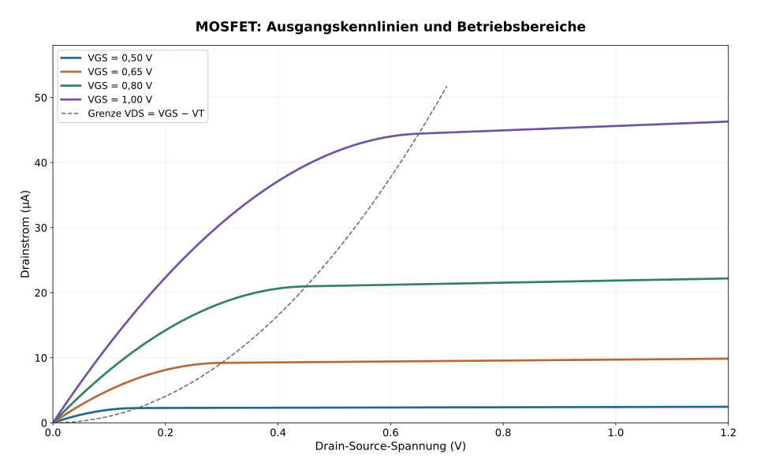

# M14-L1 – MOSFET-Modelle für den Schaltungsentwurf {#L1}

**Kursbereich:** M14 – Bachelor: Mikroelektronische Schaltungen und Systeme

**Niveau:** Bachelor · Wahlbereich

**Vorwissen:** [Transistoren](M3-L3.md), [Halbleiter](M3-L1.md), [Netzwerkanalyse](M1-L3.md).

**Lernziel:** Ein MOSFET-Großsignalmodell auswerten, die Betriebsbereiche bestimmen und daraus ein lokales Kleinsignalmodell bilden.

## Der MOSFET als steuerbarer Kanal {#S1}

In einer integrierten Schaltung steuert das Gate über ein elektrisches Feld die Leitfähigkeit eines Kanals zwischen Source und Drain. Beim n-Kanal-Anreicherungs-MOSFET wird bei hinreichend positiver Gate-Source-Spannung ein leitender Elektronenkanal aufgebaut. Die ideal isolierte Gate-Elektrode nimmt stationär keinen Strom auf; beim Umladen ihrer Kapazitäten fließt dennoch Strom. Ein p-Kanal-Transistor arbeitet mit umgekehrten Polaritäten; wir rechnen für ihn mit positiven Beträgen $V_{SG}$, $V_{SD}$ und $|V_{Tp}|$.

Der vierte Anschluss ist der Bulk beziehungsweise Body. Im einfachen Modell wird er mit der Source verbunden. Bei anderer Bulk-Spannung verändert der Body-Effekt die Schwellenspannung; außerdem bilden die Übergänge zum Substrat pn-Dioden. Ein Transistor lässt sich deshalb nicht in jeder Schaltung beliebig wie ein idealer bidirektionaler Schalter verwenden.

## Großsignalmodell {#S2}

Für einen langen n-Kanal verwenden wir $V_{DS}\ge0$, $V_T=0{,}35$ V und $\beta=\mu_n C_{ox}W/L=200$ µA/V². Die Übersteuerung lautet $q=V_{GS}-V_T$. Im idealisierten Modell gilt

$$
I_D=\begin{cases}
0 & q\le0\\
\beta(q V_{DS}-V_{DS}^2/2) & 0<V_{DS}<q,\ q>0\\
\beta q^2/2 & V_{DS}\ge q,\ q>0.
\end{cases}
$$

Im linearen (Trioden-)Bereich folgt bei sehr kleinem $V_{DS}$ näherungsweise $R_{DS}=1/(\beta q)$. An der Grenze $V_{DS}=q$ stimmen beide Gleichungen überein. In Sättigung ist der Kanal am Drain-Ende abgeschnürt; das bedeutet nicht, dass der Strom null ist. Integrierte Verstärker nutzen diesen Bereich gerade wegen des relativ geringen Einflusses der Drainspannung auf den Strom.

Als einfache Erweiterung multiplizieren wir den Strom in den leitenden Bereichen mit $(1+\lambda V_{DS})$, hier $\lambda=0{,}08$ V$^{-1}$. Das ist ein glattes didaktisches Modell für die Ausgangsleitfähigkeit, kein vollständiges kompaktes Prozessmodell.

{alt="nMOS-Ausgangskennlinien für vier Gatespannungen, mit gestrichelter Grenze zwischen Triodenbereich und Sättigung."}

## Arbeitspunkt und Kleinsignal {#S3}

Für $V_{GS}=0{,}8$ V und $V_{DS}=0{,}6$ V beträgt $q=0{,}45$ V; der Transistor liegt in Sättigung. Ohne Korrektur liefert er 20,25 µA, mit Korrektur 21,222 µA. Bei konstanter Bulk-Spannung und kleinen Änderungen um diesen Arbeitspunkt gilt

$$
\delta i_d\approx g_m\delta v_{gs}+g_{ds}\delta v_{ds},\quad
g_m=\beta q(1+\lambda V_{DS}),\quad g_{ds}=\lambda\beta q^2/2.
$$

Daraus folgen $g_m=94{,}32$ µS, $g_{ds}=1{,}62$ µS und $r_o=1/g_{ds}\approx617$ kΩ. $g_m$ ist keine dimensionslose Verstärkung, sondern eine Transkonduktanz. Die Spannungsverstärkung entsteht erst mit einem Ausgangswiderstand beziehungsweise einer Last.

Beispiel: Eine 1,2-V-Versorgung und ein Drainwiderstand von 20 kΩ ergeben bei festem $V_{GS}=0{,}8$ V in Sättigung die Lastgerade $V_{DS}=1{,}2-R_D I_D$. Einsetzen des erweiterten Modells liefert $V_{DS}=(1{,}2-0{,}405)/(1+0{,}0324)\approx0{,}770$ V. Die nachträgliche Bereichsprüfung $0{,}770>0{,}45$ bestätigt die angenommene Formel. Ohne diese Prüfung könnte eine formal korrekte Gleichung eine physikalisch unpassende Lösung liefern.

## Modellwahl und Grenzen {#S4}

Das quadratische Gesetz setzt unter anderem einen hinreichend langen Kanal und konstante effektive Beweglichkeit voraus. Subthreshold-Strom, Geschwindigkeitssättigung, Temperatur, Bauteilstreuung, Gate- und Übergangskapazitäten sind nicht enthalten. Bei realen CMOS-Prozessen werden deshalb prozessspezifische Modelle (etwa BSIM) und eine Symbolbibliothek mit Layoutregeln verwendet. Für einen ersten Funktionsentwurf genügt das vereinfachte Modell; eine Aussage zu Fertigungsausbeute, absoluter Geschwindigkeit oder zulässigen Betriebsspannungen folgt daraus nicht.

Ein Rechentest vergleicht die analytischen Ableitungen mit zentralen Differenzen:

```python
beta, vt, lam = 200., .35, .08

def ids(vg, vd):
    q = max(vg-vt, 0.)
    return beta*(q*vd-vd**2/2 if vd<q else q*q/2)*(1+lam*vd)

h = 1e-5
vg, vd = .8, .6
gm = (ids(vg+h,vd)-ids(vg-h,vd))/(2*h)
gds = (ids(vg,vd+h)-ids(vg,vd-h))/(2*h)
assert abs(gm-94.32)<1e-6 and abs(gds-1.62)<1e-6
print(ids(vg,vd), gm, gds)
```

Die Stromwerte sind in µA; die Ableitungen sind damit in µS. Die Übereinstimmung der Ableitungen kontrolliert die Implementierung, nicht die Übereinstimmung mit Silizium.

## Übungen mit Lösungen {#S5}

1. Bestimme den Bereich für $V_{GS}=0{,}55$ V und $V_{DS}=0{,}1$ V.  
   **Lösung** $q=0{,}20$ V, Triodenbereich; ohne Ausgangskorrektur $I_D=200(0{,}02-0{,}005)=3$ µA.
2. Wie ändert sich $\beta$ bei doppeltem $W$ und unverändertem $L$?  
   **Lösung** Es verdoppelt sich; die Gate-Kapazität wächst im einfachen Flächenmodell ebenfalls. Mehr Strom kostet Chipfläche und Umladeenergie.
3. Ist ein niedriger $R_{DS}$ automatisch günstig für einen hochohmigen Verstärkerausgang?  
   **Lösung** Nein. Das Schaltermodell gilt nahe $V_{DS}=0$; im Verstärkerbetrieb ist häufig ein hoher Ausgangswiderstand in Sättigung erwünscht.

**Weiterführend:** [CMOS-Inverter und statische Logik](M14-L2.md)

## Quellen {#S6}

- [MIT OCW 6.012 – Vorlesungen 10–12: MOSFET-Modelle](https://ocw.mit.edu/courses/6-012-microelectronic-devices-and-circuits-fall-2009/pages/lecture-notes/) · Vorlesungen 10–12: MOSFET-Betriebsbereiche und Drainstrommodelle; nur Vorlesungsverzeichnis. · Zuletzt abgerufen: 2026-11-25
