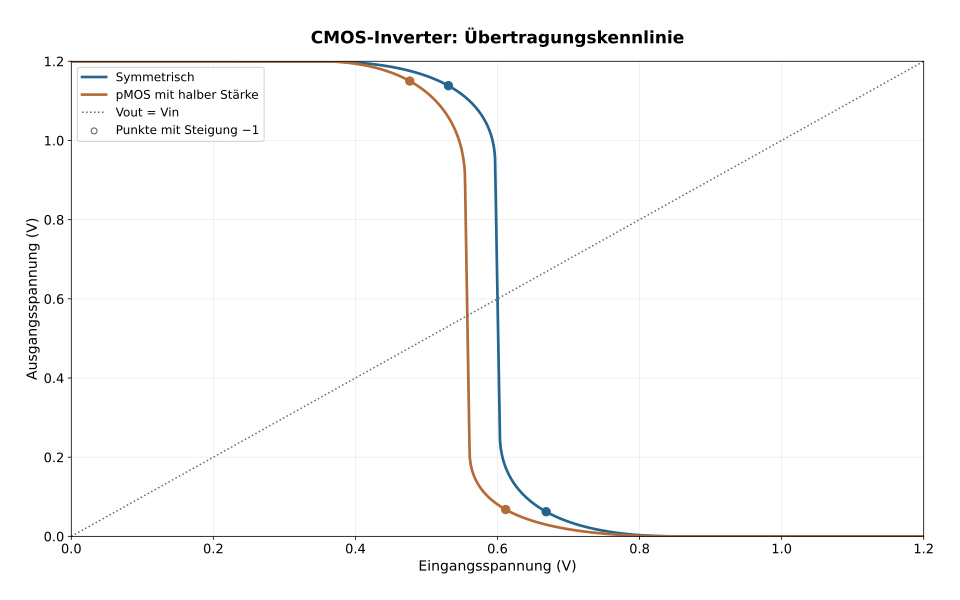

# M14-L2 – CMOS-Inverter und statische Logik {#L2}

**Kursbereich:** M14 – Bachelor: Mikroelektronische Schaltungen und Systeme

**Niveau:** Bachelor · Wahlbereich

**Vorwissen:** [Boolesche Logik](M3-L5.md), [MOSFET-Modelle](M14-L1.md).

**Lernziel:** Die statische Übertragungskennlinie eines CMOS-Inverters bestimmen und Schaltschwelle, Störabstände und Gatternetzwerke erklären.

## Komplementäre Pull-up- und Pull-down-Netze {#S1}

Ein CMOS-Inverter besitzt einen pMOS zwischen $V_{DD}$ und Ausgang sowie einen nMOS zwischen Ausgang und Masse. Die Gates liegen gemeinsam am Eingang. Bei niedrigem Eingang leitet der pMOS, der nMOS sperrt; der Ausgang wird auf die Versorgung geladen. Bei hohem Eingang vertauschen sich die Rollen. Das Gate eines Folgegatters belastet den Ausgang im idealen statischen Modell nicht durch einen Gleichstrom.

Die logische Inversion ist nicht mit einer linearen Verstärkung gleichzusetzen. Zwischen beiden Zuständen können beide Transistoren leiten. In diesem Bereich hängt der Ausgang von der Strombilanz ab. Bei realen Transistoren verbleiben auch außerhalb des Übergangs Leckströme.

## Übertragungskennlinie und Schaltschwelle {#S2}

Wir verwenden $V_{DD}=1{,}2$ V, $V_{Tn}=|V_{Tp}|=0{,}35$ V und $\beta_n=\beta_p=200$ µA/V². Die Kennlinie entsteht durch Lösung von

$$
I_n(V_{in},V_{out})=I_p(V_{DD}-V_{in},V_{DD}-V_{out}).
$$

Der pMOS-Strom wird als positiver Betrag in Richtung Ausgang definiert. Am Schnittpunkt $V_{out}=V_{in}=V_M$ befinden sich beide Transistoren bei positiven Übersteuerungen in Sättigung. Ohne Ausgangsleitfähigkeit lässt sich die Gleichung nach $V_M$ auflösen:

$$
V_M=\frac{\sqrt{\beta_p}(V_{DD}-|V_{Tp}|)+\sqrt{\beta_n}V_{Tn}}{\sqrt{\beta_p}+\sqrt{\beta_n}}.
$$

Im symmetrischen Modell folgt $V_M=0{,}6$ V. Bei halbiertem $\beta_p$ wandert der Übergang zu niedrigeren Eingangsspannungen ($V_M\approx0{,}557$ V ohne Korrektur). Die Stärke eines Transistors ergibt sich nicht allein aus der geometrischen Breite: pMOS und nMOS haben in vielen Prozessen unterschiedliche Beweglichkeiten.

{alt="Statische Ausgangsspannung beider Inverter über der Eingangsspannung mit markierten Steigungsgrenzen und Diagonale."}

## Störabstände {#S3}

Die Punkte $V_{IL}$ und $V_{IH}$ werden auf der fallenden Kennlinie dort bestimmt, wo die Steigung $dV_{out}/dV_{in}=-1$ beträgt. Für kompatible identische Inverter setzen wir konservativ $V_{OH}=V_{out}(V_{IL})$ und $V_{OL}=V_{out}(V_{IH})$. Die statischen Störabstände lauten

$$
NM_L=V_{IL}-V_{OL},\qquad NM_H=V_{OH}-V_{IH}.
$$

Mit dem erweiterten MOS-Modell aus L1 ($\lambda=0{,}08$/V) ergeben sich näherungsweise folgende Werte. Die konservativen Ausgangspegel sind keine idealen Versorgungsschienen.

| Modell | $V_{IL}$ | $V_{IH}$ | $V_{OL}$ | $V_{OH}$ | $NM_L$ | $NM_H$ |
| --- | ---: | ---: | ---: | ---: | ---: | ---: | ---: |
| symmetrisch | 0,531 V | 0,669 V | 0,062 V | 1,138 V | 0,469 V | 0,469 V |
| schwächerer pMOS | 0,477 V | 0,612 V | 0,067 V | 1,150 V | 0,409 V | 0,538 V |

Statische Störabstände betrachten Gleichspannungsabweichungen, nicht kurze Störimpulse, Kopplung oder Timing. Ein kleinerer niedriger Störabstand kann durch den größeren hohen Störabstand nicht automatisch kompensiert werden.

## Vom Inverter zum NAND und NOR {#S4}

Für ein NAND mit zwei Eingängen schalten zwei nMOS in Serie und zwei pMOS parallel. Nur wenn beide Eingänge hoch sind, besteht ein leitender Pfad zur Masse. Für ein NOR sind zwei nMOS parallel und zwei pMOS in Serie. Die komplementären Netze realisieren die De-Morgan-Beziehungen; ein AND lässt sich durch NAND und Inverter erzeugen.

| A | B | NAND | NOR |
| ---: | ---: | ---: | ---: |
| 0 | 0 | 1 | 1 |
| 0 | 1 | 1 | 0 |
| 1 | 0 | 1 | 0 |
| 1 | 1 | 0 | 0 |

In einer realen Zelle kann die Reihenschaltung den Strom begrenzen und damit die Verzögerung erhöhen. Zwischenknoten besitzen eigene Kapazitäten und Spannungen, sodass ein einfaches Addieren konstanter Kanalwiderstände nur eine Näherung ist. Gatterbibliotheken charakterisieren daher je Eingang und Flankenrichtung mehrere Last- und Flankenbedingungen. Eine Wahrheitstabelle allein reicht nicht zur Taktplanung.

## Übungen mit Lösungen {#S5}

1. Warum erzeugt eine Verdopplung beider $\beta$-Werte im symmetrischen Modell keine veränderte statische Kennlinie?  
   **Lösung** Beide Ströme skalieren gleich. Ihre Gleichheitsbedingung bleibt unverändert; dynamische Ströme und Kapazitäten können sich ändern.
2. Ein empfangendes Gatter garantiert Low bis 0,45 V. Ein Treiber garantiert Low höchstens 0,12 V. Welcher niedrige Störabstand ist verfügbar?  
   **Lösung** 0,33 V. Die Grenzen müssen zur verbundenen Logikfamilie und zum betrachteten Betriebsbereich passen.
3. Warum ist eine Ausgangsspannung von 0,6 V kein gültiger Logikpegel im symmetrischen Modell?  
   **Lösung** Sie liegt zwischen $V_{IL}$ und $V_{IH}$; es gibt keine garantierte logische Interpretation. Beide Transistoren können leiten.

**Weiterführend:** [Dynamik und Leistungsbedarf integrierter Schaltungen](M14-L3.md)

## Quellen {#S6}

- [MIT OCW 6.012 – Vorlesungen 14–15: Inverter und CMOS](https://ocw.mit.edu/courses/6-012-microelectronic-devices-and-circuits-fall-2009/pages/lecture-notes/) · Vorlesungen 14–15: CMOS-Inverter und Schaltvorgänge; nur Vorlesungsverzeichnis. · Zuletzt abgerufen: 2026-11-25
- [Computation Structures – CMOS, statisches Verhalten](https://computationstructures.org/notes/cmos/notes.html) · Kapitel 6: CMOS-NAND- und NOR-Schaltungen; Teilaspekt. · Zuletzt abgerufen: 2026-11-25
