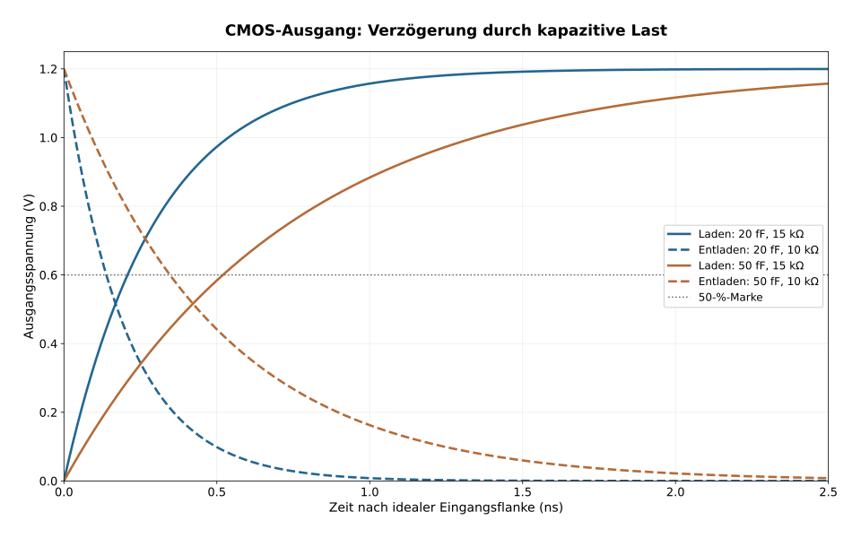

# M14-L3 – Dynamik und Leistungsbedarf integrierter Schaltungen {#L3}

**Kursbereich:** M14 – Bachelor: Mikroelektronische Schaltungen und Systeme

**Niveau:** Bachelor · Wahlbereich

**Vorwissen:** [RC-Übergänge](M1-L5.md), [CMOS-Logik](M14-L2.md).

**Lernziel:** Kapazitive Verzögerungen sowie dynamische, statische und Kurzschlussleistungsanteile einer CMOS-Schaltung unterscheiden und abschätzen.

## Umladen eines Ausgangsknotens {#S1}

Das statische Ersatzbild wird um die Lastkapazität $C_L$ ergänzt. Sie enthält die Eingangskapazitäten nachfolgender Gatter, Übergangskapazitäten und Leitungsanteile. Bei schneller Eingangsschaltung nähern wir die leitenden Transistoren zunächst durch getrennte Widerstände $R_p$ und $R_n$ an. Für den Ladevorgang aus null und den Entladevorgang aus $V_{DD}$ gilt

$$
V_{out,\uparrow}(t)=V_{DD}(1-e^{-t/(R_p C_L)}),\qquad
V_{out,\downarrow}(t)=V_{DD}e^{-t/(R_n C_L)}.
$$

Die Zeitverzögerung zwischen der 50-%-Marke der idealen Eingangsflanke und der 50-%-Marke des Ausgangs ist in dieser Näherung $t_{pLH}=\ln(2)R_p C_L$ beziehungsweise $t_{pHL}=\ln(2)R_n C_L$. Die Anstiegszeit von 10 auf 90 % beträgt $\ln(9)R_p C_L$. Eine Verzögerung ist also nicht identisch mit einer Flankenzeit.

Beispiel: $C_L=20$ fF, $R_n=10$ kΩ und $R_p=15$ kΩ. Dann sind $\tau_n=0{,}2$ ns und $\tau_p=0{,}3$ ns; $t_{pHL}=0{,}139$ ns und $t_{pLH}=0{,}208$ ns. Die längere 10–90-%-Anstiegszeit beträgt 0,659 ns. Verdoppelt sich die Kapazität bei unveränderten Widerständen, verdoppeln sich diese Zeiten.

{alt="RC-Lade- und Entladekurven für 20 und 50 fF mit 50-Prozent-Marke und unterschiedlichen Kanalwiderständen."}

## Energiebilanz eines vollständigen Ladezyklus {#S2}

Die Versorgung liefert beim Laden von 0 auf $V_{DD}$ die Energie

$$
E_{Quelle}=\int V_{DD}i(t)dt=C_L V_{DD}^2,
$$

wovon $C_L V_{DD}^2/2$ im elektrischen Feld des Kondensators gespeichert wird. Die andere Hälfte wird im Ladepfad in Wärme umgewandelt. Beim Entladen dissipiert der Entladepfad die gespeicherte Hälfte. Über einen vollständigen Hub ist die Nettoänderung der gespeicherten Energie null. Der Energiebedarf pro 0–1–0-Zyklus beträgt $C_L V_{DD}^2$, unabhängig vom gewählten konstanten Widerstand, sofern das vollständige Laden und Entladen erreicht wird und keine Energierückgewinnung stattfindet.

Bei 1,2 V und 20 fF sind das 28,8 fJ je Zyklus. Ein periodisches Signal mit 100 MHz hat genau einen Ladevorgang pro Periode: Die mittlere ideale kapazitive Leistung beträgt 2,88 µW. Bei 0,8 V und derselben Last wären es 1,28 µW. Die niedrigere Spannung kann jedoch die Transistorströme und damit die Schaltgeschwindigkeit stark reduzieren.

## Aktivitätsfaktor und weitere Leistungsanteile {#S3}

Bei einem synchronen System bezeichne $\alpha_i$ die mittlere Anzahl der 0–1-Übergänge am Knoten $i$ pro Taktperiode. Mit dieser eindeutigen Konvention gilt bei vollständigen Hüben

$$
P_{dyn}=V_{DD}^2 f_{clk}\sum_i\alpha_i C_i.
$$

Zählt man beide Flanken statt nur der Ladeflanken, ist bei gleichen Anzahlen ein Faktor 1/2 nötig. Glitches können die Aktivität über die durch die reine Funktionslogik erwartete Zahl hinaus erhöhen.

Beispiel: 1000 Knoten zu je 20 fF, $\alpha=0{,}1$, $f=100$ MHz und 1,2 V: $P_{dyn}=288$ µW. Daneben entstehen Kurzschlussströme bei überlappender Leitung von pMOS und nMOS während endlicher Flanken sowie statischer Verbrauch durch Leckströme. Ein idealer statischer CMOS-Gatterzustand ist deshalb nicht mit einem realen verlustfreien Chip gleichzusetzen.

## Last, Leitungen und Entwurfsbudget {#S4}

Ein Gatter treibt beispielsweise eine feste Leitungskapazität von 8 fF und drei gleichartige Eingänge zu je 4 fF. Daraus folgen 20 fF. Werden sechs statt drei Eingänge angeschlossen, beträgt die Last 32 fF; die RC-Verzögerung steigt um den Faktor 1,6. Im tatsächlichen Layout können auch Leitungswiderstand, Kopplung und verteilte Kapazitäten dominieren. Ein langer Leiter ist dann nicht mehr sinnvoll als ein einziger Kondensator modelliert.

Ein einfaches Timing-Budget für eine synchrone Registerkette lautet $T_{clk}\ge t_{CQ}+t_{comb}+t_{setup}+t_{reserve}$. Bei 0,3 ns, 2 ns, 0,2 ns und 0,5 ns benötigt die Kette mindestens 3 ns (höchstens ca. 333 MHz unter den Modellannahmen). Zusätzlich muss eine separate Hold-Prüfung für den kürzesten Pfad erfolgen. Clock-Skew und Jitter dürfen nicht allein durch eine mittlere Verzögerung ersetzt werden.

## Übungen mit Lösungen {#S5}

1. Wie groß ist $t_{pHL}$ bei 50 fF und 10 kΩ?  
   **Lösung** $\tau=0{,}5$ ns; $t_{pHL}=0{,}347$ ns.
2. Wie stark sinkt $P_{dyn}$ bei einer Änderung von 1,2 auf 0,9 V, wenn Aktivität, Kapazität und Frequenz gleich bleiben?  
   **Lösung** Faktor $(0{,}9/1{,}2)^2=0{,}5625$; 43,75 % weniger. Ob die ursprüngliche Frequenz möglich bleibt, ist separat zu prüfen.
3. Warum darf bei unvollständigem Spannungshub $C_L V_{DD}^2 f$ nicht als exaktes Ergebnis verwendet werden?  
   **Lösung** Der tatsächliche Ladungshub ist kleiner und eventuell fließt gleichzeitig Kurzschlussstrom; die Energie muss aus Versorgungsspannung und Versorgungsstrom integriert werden.

**Weiterführend:** [Analoge Grundbausteine auf Chipebene](M14-L4.md)

## Quellen {#S6}

- [MIT OCW 6.012 – Vorlesungen 15–16: Inverter-Schaltverzögerung](https://ocw.mit.edu/courses/6-012-microelectronic-devices-and-circuits-fall-2009/pages/lecture-notes/) · Vorlesungen 15–16 (Übersicht): Schaltverzögerung, Leistungsbedarf und Leckstrom. · Zuletzt abgerufen: 2026-11-25
- [Computation Structures – CMOS, zeitliches Verhalten](https://computationstructures.org/notes/cmos/notes.html) · Kapitel 6 CMOS, Einleitung: parasitäre Kapazitäten, Umschalten und Leistungsbedarf; qualitativer Bezug. · Zuletzt abgerufen: 2026-11-25
