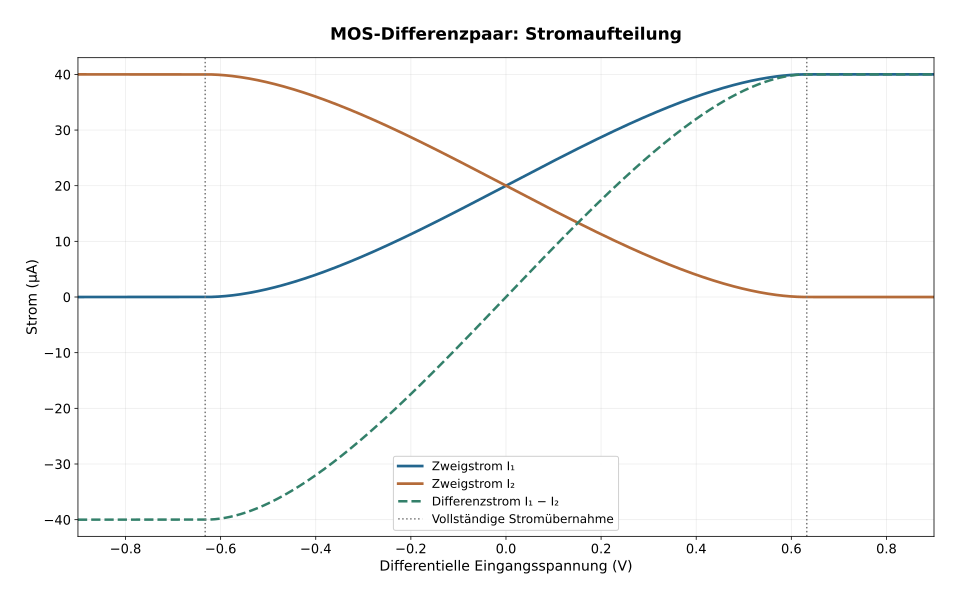

# M14-L4 – Analoge Grundbausteine auf Chipebene {#L4}

**Kursbereich:** M14 – Bachelor: Mikroelektronische Schaltungen und Systeme

**Niveau:** Bachelor · Wahlbereich

**Vorwissen:** [Analoge Signalaufbereitung](M3-L4.md), [MOSFET-Modelle](M14-L1.md).

**Lernziel:** Stromspiegel und Differenzstufe dimensionieren, Arbeitsbereiche prüfen und die Zielkonflikte von Verstärkung, Spannungshub und Stromaufnahme beurteilen.

## Stromspiegel und Arbeitspunktversorgung {#S1}

Ein nMOS-Stromspiegel besteht im einfachsten Fall aus einem Transistor mit verbundenem Gate und Drain und einem zweiten mit demselben Gatepotential. Die Source-Anschlüsse liegen an Masse. Der Referenzstrom stellt die Gate-Source-Spannung ein. Für beide Transistoren in Sättigung gilt ohne Ausgangsleitfähigkeit bei gleicher Schwellenspannung

$$
\frac{I_{out}}{I_{ref}}=\frac{\beta_2}{\beta_1}=\frac{(W/L)_2}{(W/L)_1}.
$$

Bei $I_{ref}=20$ µA und $\beta_1=200$ µA/V² beträgt die Übersteuerung ideal $q=\sqrt{2 I_{ref}/\beta_1}=0{,}447$ V und $V_{GS}=0{,}797$ V. Ein zweiter Transistor mit doppeltem Breiten-Längen-Verhältnis spiegelt ideal 40 µA. Dafür benötigt er mindestens die Drainspannung $q$. Unterhalb dieser Spannung verlässt er die Sättigung; der Strom sinkt. Dieser Mindestspannungsspielraum wird als Compliance bezeichnet.

Mit Ausgangsleitfähigkeit ergibt sich bei bekannter gemeinsamer Gatespannung und gleichen $\lambda$-Werten eine Korrektur des Spiegelverhältnisses:

$$
\frac{I_{out}}{I_{ref}}=\frac{\beta_2}{\beta_1}\frac{1+\lambda V_{DS2}}{1+\lambda V_{DS1}}.
$$

Bei $V_{GS}=0{,}8$ V, $V_{DS1}=0{,}8$ V, $V_{DS2}=0{,}5$ V und $\lambda=0{,}08$/V ist das Verhältnis bei doppelter Breite ca. 1,955 statt 2. Hier wird die Gatespannung vorgegeben und der Referenzstrom folgt aus dem Modell. Kleine Geometrie- und Schwellenspannungsabweichungen machen den Spiegel zusätzlich ungenau. Kaskodierung verbessert den Ausgangswiderstand, benötigt jedoch zusätzlichen Spannungsspielraum.

## Differenzverstärker {#S2}

Zwei gleiche nMOS mit gemeinsamen Source-Anschlüssen teilen einen idealen Schwanzstrom $I_T$ (Tail Current) auf. Die Gate-Spannungen seien $V_{G1}=V_{CM}+v_d/2$ und $V_{G2}=V_{CM}-v_d/2$. Bei $v_d=0$ führt jeder Transistor $I_T/2$. Ein ansteigendes Differenzsignal erhöht den einen und senkt den anderen Zweigstrom; die Summe bleibt gleich. Wir nehmen gleiche Transistoren in Sättigung und zunächst $\lambda=0$ an.

Mit $q$ als Mittelwert der beiden Übersteuerungen erhält man aus der Summe der quadratischen Ströme

$$
I_T=\beta(q^2+v_d^2/4),\qquad q=\sqrt{I_T/\beta-v_d^2/4}.
$$

Solange beide Transistoren leiten und in Sättigung bleiben, folgt

$$
I_1-I_2=\beta v_d\sqrt{I_T/\beta-v_d^2/4}.
$$

Ab $|v_d|=\sqrt{2I_T/\beta}$ erreicht einer der Zweigströme null. Jenseits davon geht der gesamte Strom in den anderen Zweig, sofern dessen Sättigungsbedingung weiter erfüllt ist. Ein Differenzpaar beschränkt große Eingangsdifferenzen, statt sie beliebig linear zu verstärken.

{alt="Idealisierte Zweigströme eines Differenzpaares und ihr Differenzstrom bei 40 µA Gesamtstrom inklusive Stromübernahmegrenzen."}

## Verstärkung und Spannungsspielraum {#S3}

Seien $I_T=40$ µA und $\beta=200$ µA/V² pro Zweig. Am symmetrischen Arbeitspunkt gilt $q=\sqrt{I_T/\beta}=0{,}447$ V und $g_m=\beta q=89{,}44$ µS. Zwei gleiche Drainwiderstände $R_D=10$ kΩ an $V_{DD}=1{,}2$ V liefern je $V_D=1{,}0$ V. Mit $V_{CM}=0{,}95$ V liegt die gemeinsame Source im idealen Modell bei 0,153 V. Die Eingangs-MOSFETs befinden sich bei $v_d=0$ mit $V_{DS}=0{,}847$ V in Sättigung. Eine reale Schwanzstromquelle müsste allerdings bereits bei 0,153 V funktionieren; gerade dies ist in niedrigen Versorgungsspannungen eine Entwurfshürde.

Für das differentielle Ausgangssignal $v_{od}=v_{o1}-v_{o2}$ folgt näherungsweise

$$
A_d=\frac{v_{od}}{v_d}\approx -g_mR_D=-0{,}894.
$$

Ein asymmetrisch abgegriffener Einzelzweig hätte ideal den halben differentiellen Gewinnbetrag. Bei $v_d=50$ mV sind nach der Großsignalformel die Ströme etwa 22,233 µA und 17,767 µA; die Ausgangsdifferenz liegt bei -44,65 mV. Das stimmt nahe mit der Kleinsignalrechnung überein. Die formale Stromverteilung für große $v_d$ garantiert noch nicht, dass beide Drainspannungen im zulässigen Bereich bleiben.

## Schnittstelle zwischen analog und digital {#S4}

Eine Differenzstufe ist der Kern vieler Eingangsverstärker und Komparatoren. Ein präziser linearer Verstärker benötigt genügend Schleifenverstärkung, Bandbreite und geeignete Gegenkopplung. Ein Komparator wird dagegen meist auf schnelle Entscheidung und definierte Ausgangspegel ausgelegt; man kann ihn nicht ohne Prüfung als Operationsverstärker einsetzen.

Aktive Lasten können einen hohen Ausgangswiderstand bei geringerem statischem Spannungsabfall ermöglichen. Höhere Ausgangsimpedanz und Knotenkapazität erzeugen jedoch eine längere Zeitkonstante. Eine größere Transistorfläche kann zufällige Streuung verringern, erhöht aber Kapazitäten. Ein höherer Biasstrom steigert bei gleichem $\beta$ das $g_m$, verbraucht aber mehr Leistung. Für das obige idealisierte Paar werden vom Versorgungsanschluss $1{,}2\cdot40$ µA = 48 µW bezogen (ohne separate Referenzzweige).

## Übungen mit Lösungen {#S5}

1. Wie erhält man im idealen Spiegel aus 20 µA einen Strom von 10 µA?  
   **Lösung** Das Verhältnis $(W/L)_2/(W/L)_1$ beträgt 0,5. Der Ausgang benötigt trotzdem ausreichende Drainspannung.
2. Bestimme den Differenzstrom bei $v_d=0$ und $I_T=40$ µA.  
   **Lösung** Null; beide Zweige führen je 20 µA.
3. Welche differentielle Kleinsignalverstärkung ergäbe sich aus 20 kΩ statt 10 kΩ?  
   **Lösung** Formal -1,789. Der Ruhe-Drainpegel fällt aber auf 0,8 V; Ausgangsspielraum und Sättigungsbedingungen müssen neu geprüft werden.

**Weiterführend:** [Entwurfs- und Simulationsfall](M14-L5.md)

## Quellen {#S6}

- [MIT OCW 6.012 – Vorlesungen 17 und 19–20: Stromspiegel, Differenzverstärker, aktive Lasten](https://ocw.mit.edu/courses/6-012-microelectronic-devices-and-circuits-fall-2009/pages/lecture-notes/) · Vorlesungen 17–21 (Übersicht): analoge Verstärkerstufen und Stromspiegel. · Zuletzt abgerufen: 2026-11-25
