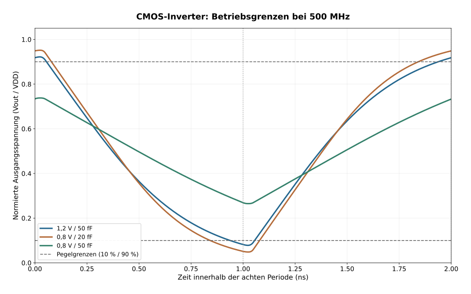

# M14-L5 – Entwurfs- und Simulationsfall {#L5}

**Kursbereich:** M14 – Bachelor: Mikroelektronische Schaltungen und Systeme

**Niveau:** Bachelor · Wahlbereich

**Vorwissen:** [MOSFET](M14-L1.md), [Störabstände](M14-L2.md), [Dynamik](M14-L3.md), [Numerische Integration](M12-L3.md).

**Lernziel:** Einen nichtlinearen Inverter numerisch simulieren und einen geeigneten Betriebsbereich aus Pegeln, Last, Frequenz und Energiebedarf ableiten.

## Entwurfsaufgabe und Modellgrenzen {#S1}

Ein Ausgangstreiber soll einen nachfolgenden digitalen Block ansteuern. Der Entwurf wird mit einem synthetischen CMOS-Modell untersucht, nicht mit einem konkreten Fertigungsprozess. Als freie Entwurfsgrößen stehen Versorgungsspannung, externe Lastkapazität und Eingangsfrequenz zur Verfügung. Beide Transistoren besitzen im Modell $\beta=200$ µA/V², $|V_T|=0{,}35$ V und $\lambda=0{,}08$/V. Wir verwenden das erweiterte Großsignalmodell aus [L1](M14-L1.md), ohne Gate-, Miller- und temperaturabhängige Kapazitäten oder Subthreshold-Ströme. Die Lastkapazität ist konstant.

Die Aufgabe verlangt am Ende jeder halben Eingangsperiode einen Ausgangspegel von höchstens $0{,}1V_{DD}$ beziehungsweise mindestens $0{,}9V_{DD}$. Diese selbst gewählten Kriterien sind strenger als ein bloßer Durchgang durch die Schaltschwelle. Sie sind weder eine Technologievorgabe noch eine vollständige Setup-/Hold-Prüfung. Die Eingangsspannung steigt und fällt jeweils linear innerhalb von 0,05 ns; die beiden Flanken beginnen bei 0 beziehungsweise $T/2$.

## Nichtlineare Differentialgleichung und Energie {#S2}

Am Ausgangsknoten gilt mit positiver Stromrichtung vom pMOS zum Knoten beziehungsweise vom Knoten zum nMOS:

$$
C_L\dot v=I_p(V_{DD}-V_{in},V_{DD}-v)-I_n(V_{in},v).
$$

Die vom Versorgungsanschluss bezogene Energie $E_s$ und die in beiden leitenden Kanälen dissipierte Energie $E_d$ lassen sich gleichzeitig als zwei zusätzliche Zustände integrieren:

$$
\dot E_s=V_{DD}I_p,\qquad \dot E_d=vI_n+(V_{DD}-v)I_p.
$$

Durch Multiplikation der Knotengleichung mit $v$ erhält man unmittelbar $\dot E_s-\dot E_d=C_Lv\dot v$. Für jeden beliebigen Zeitraum gilt somit

$$
\Delta E_s-\Delta E_d=\frac{C_L}{2}(v_{Ende}^2-v_{Start}^2).
$$

Bei einem periodisch eingeschwungenen Zustand verschwindet die rechte Seite. Die Bilanz ist jedoch auch für eine noch nicht eingeschwungene Periode gültig. Da im Modell Strom in µA, Kapazität in fF und Zeit in ns gerechnet wird, ist µA/fF = V/ns und µA·V·ns = fJ. Die mittlere Leistung in fJ/ns entspricht µW. Es wird nur der Versorgungszweig des Inverters bilanziert; der externe Eingangstreiber ist nicht enthalten.

## Reproduzierbare Simulation {#S3}

Wir integrieren mit Runge-Kutta vierter Ordnung aus [M12-L3](M12-L3.md) und prüfen zwei Schrittweiten. Die achte Periode wird ausgewertet, nachdem sieben vollständige Perioden vorangegangen sind. Das ist eine feste Anlaufzeit, kein mathematischer Nachweis des eingeschwungenen Zustands. Der Code benötigt Python und NumPy. Die statische Bisektion `dc` kann separat zur Kontrolle der Gleichgewichtspunkte aus [L2](M14-L2.md) eingesetzt werden.

```python
import numpy as np
from math import sqrt

def ids(vg, vd, beta=200., vt=.35, lam=.08):
    q=max(vg-vt,0.)
    d=max(vd,0.)
    return beta*(q*d-d*d/2 if d<q else q*q/2)*(1+lam*d)

def currents(vin,vout,vdd,bn=200,bp=200):
    return ids(vin,vout,bn),ids(vdd-vin,vdd-vout,bp)

def dc(vin,vdd,bp=200):
    lo,hi=0.,vdd
    for _ in range(65):
        m=(lo+hi)/2
        n,p=currents(vin,m,vdd,bp=bp)
        if p>n: lo=m
        else: hi=m
    return (lo+hi)/2

def simulate(vdd=1.2,c=20.,f=100.,step=.002):
    period=1000/f # ns
    ramp=.05 # ns
    n=max(1,round(period/step)); n=2*((n+1)//2)
    h=period/n
    def vin(t):
        x=t%period
        if x<ramp: return vdd*x/ramp
        if x<period/2: return vdd
        if x<period/2+ramp: return vdd*(1-(x-period/2)/ramp)
        return 0.
    def rhs(t,z):
        v=z[0]; i,j=currents(vin(t),v,vdd)
        return np.array([(j-i)/c,vdd*j,v*i+(vdd-v)*j])
    z=np.array([vdd,0.,0.]); trace=[]
    for k in range(8*n+1):
        t=k*h
        if k>=7*n: trace.append((t-7*period,vin(t),*z))
        if k==8*n: break
        a=rhs(t,z); b=rhs(t+h/2,z+h*a/2); d=rhs(t+h/2,z+h*b/2); e=rhs(t+h,z+h*d)
        z+=h*(a+2*b+2*d+e)/6
    x=np.array(trace); es=x[-1,3]-x[0,3]; ed=x[-1,4]-x[0,4]; de=c/2*(x[-1,2]**2-x[0,2]**2)
    assert abs(es-ed-de)<1e-4 and np.min(x[:,2])>=-1e-7 and np.max(x[:,2])<=vdd+1e-7
    return x, (x[n//2,2],x[-1,2],es,es/period,abs(es-ed-de))

cases = [(1.2,20,100), (1.2,50,100), (1.2,50,500),
         (.8,20,100), (.8,20,500), (1.2,20,1000),
         (.8,50,500), (1.2,50,1000)]
for vdd,c,f in cases:
    x,r=simulate(vdd,c,f)
    _,fine=simulate(vdd,c,f,step=.001)
    assert max(abs(np.array(r[:4])-fine[:4]))<1e-4
    valid = r[0]<=.1*vdd and r[1]>=.9*vdd
    print(vdd,c,f,*(round(v,5) for v in r[:4]),valid)

```

Die Ergebnisse sind auf zwei bis fünf Nachkommastellen gerundet. $V_L$ und $V_H$ werden genau vor dem Beginn der jeweils nächsten Eingangsflanke bewertet. $E_s$ ist die Energie in der achten Periode, $P_s$ deren mittlere Eingangsleistung am Versorgungspin.

| $V_{DD}$ (V) | $C_L$ (fF) | $f$ (MHz) | $V_L$ (V) | $V_H$ (V) | $E_s$ (fJ) | $P_s$ (µW) | Pegeltest |
| ---: | ---: | ---: | ---: | ---: | ---: | ---: | --- |
| 1,2 | 20 | 100 | 0,00000 | 1,20000 | 28,80 | 2,88 | erfüllt |
| 1,2 | 50 | 100 | 0,00000 | 1,20000 | 72,00 | 7,20 | erfüllt |
| 1,2 | 50 | 500 | 0,09818 | 1,10182 | 60,84 | 30,42 | erfüllt |
| 0,8 | 20 | 100 | 0,00000 | 0,80000 | 12,80 | 1,28 | erfüllt |
| 0,8 | 20 | 500 | 0,04097 | 0,75903 | 11,56 | 5,78 | erfüllt |
| 1,2 | 20 | 1000 | 0,05723 | 1,14277 | 26,42 | 26,42 | erfüllt |
| 0,8 | 50 | 500 | 0,21528 | 0,58642 | 15,11 | 7,55 | nicht erfüllt |
| 1,2 | 50 | 1000 | 0,30717 | 0,89290 | 36,68 | 36,68 | nicht erfüllt |

{alt="Ausgangsspannungsverläufe bei 500 MHz für 1,2 V und 50 fF sowie 0,8 V und 20 beziehungsweise 50 fF, auf die Versorgung normiert, mit Pegelgrenzen."}

## Interpretation und Entwurfsentscheidung {#S4}

Bei 100 MHz erreichen sowohl die 0,8-V- als auch die 1,2-V-Variante mit 20 fF nahezu den vollständigen Spannungshub. Ihr Leistungsverhältnis ist daher annähernd $0{,}8^2/1{,}2^2=0{,}444$. Bei höherer Frequenz oder größerer Last wird die verfügbare Lade- und Entladezeit zur entscheidenden Größe. Der 0,8-V-Fall mit 50 fF bei 500 MHz ist zwar leistungsarm gegenüber der entsprechenden 1,2-V-Variante, erfüllt aber die Pegelanforderung nicht. Die geringere Energie pro Periode ist hier zum Teil Folge unvollständiger Umladung, kein gleichwertiger Effizienzgewinn.

Für die beispielhafte Vorgabe 500 MHz und 50 fF ist unter den getesteten Betriebspunkten 1,2 V die funktionsfähige Wahl. Bei 0,8 V müsste für diese Frequenz die Last verringert oder die effektive Treiberfähigkeit erhöht werden. Eine weitere Möglichkeit wäre, die Frequenz abzusenken. Die acht Fälle begrenzen keine exakte Maximalfrequenz; dazu wäre eine feinere Parametersuche samt Reserve erforderlich.

Die Wiederholung mit etwa 1 ps statt 2 ps verändert die ersten vier Ergebnisgrößen in ihren jeweiligen Einheiten um weniger als $10^{-4}$. Die Bilanzabweichung liegt in beiden Rechnungen unter $10^{-4}$ fJ. Für die beiden nicht erfüllten Fälle liegt die Differenz zwischen Anfangs- und Endspannung der achten Periode unter 1 mV; sie ist nicht exakt null. Die Bilanz enthält diese Reständerung. Die gute numerische Übereinstimmung prüft nur das vereinfachte Modell und seine Lösung. Reale Prozessstreuung, Temperatur, parasitäre Kopplung, Eingangstreiber, Versorgungseinbrüche und die tatsächlichen Timing-Bedingungen bleiben unbehandelt. Zur Umsetzung auf einem Chip wären ein prozessbezogenes SPICE-Modell, die Layout-Extraktion und Tests über Prozess-, Spannungs- und Temperaturecken (PVT) nötig.

## Übungen mit Lösungen {#S5}

1. Warum liegt in der dritten Tabellenzeile $E_s$ unter dem idealen Vollhubwert 72 fJ?  
   **Lösung** Der Ausgang durchläuft nur ungefähr 0,098 bis 1,102 V. Der Versorgungsladungshub ist kleiner; zusätzlich ist ein geringer Überlappungsstrom möglich.
2. Bei 0,8 V und 50 fF in 500 MHz: Wie hoch darf der Low-Pegel sein?  
   **Lösung** 0,08 V. Der berechnete Wert 0,21528 V verfehlt das Ziel deutlich. Auch der High-Pegel liegt unter 0,72 V.
3. Mit welchen zwei unabhängigen Prüfungen wird ein Integrationsfehler aufgedeckt?  
   **Lösung** Schrittweitenvergleich und Energieerhaltung; beide prüfen numerische Konsistenz. Ein separates Experiment mit realer Hardware wäre erforderlich, um Modellgültigkeit zu beurteilen.
4. Verdopple im Code die Kapazität auf 40 fF bei 0,8 V und 500 MHz. Was ist zu erwarten?  
   **Lösung** Wegen der geringeren zeitlichen Spannungsänderung verschlechtert sich der Spannungshub; die Pegel müssen aus der neuen Simulation geprüft werden. Eine proportionale Skalierung des gesamten Kurvenverlaufs wäre bei derselben Periode nicht korrekt.

**Weiterführend:** [Digitale Schaltung und analoge Schnittstelle](M3-L7.md); die folgende Vertiefung M15 behandelt eingebettete Systeme.

## Quellen {#S6}

- [MIT OCW 6.012 – Vorlesungen 14–16: CMOS und Schaltverzögerung](https://ocw.mit.edu/courses/6-012-microelectronic-devices-and-circuits-fall-2009/pages/lecture-notes/) · Vorlesungen 14–16: Schaltverzögerung, Verlustleistung und Skalierung; nur Vorlesungsverzeichnis. · Zuletzt abgerufen: 2026-11-25
- [Steve Ward – Computation Structures, Chapter 6: CMOS](https://computationstructures.org/notes/cmos/notes.html) · § 6.1 und § 6.5: kapazitive Schaltvorgänge und Spannungsabhängigkeit der Verlustleistung; kein Nachweis einer SPICE-Simulation. · Zuletzt abgerufen: 2026-11-25
