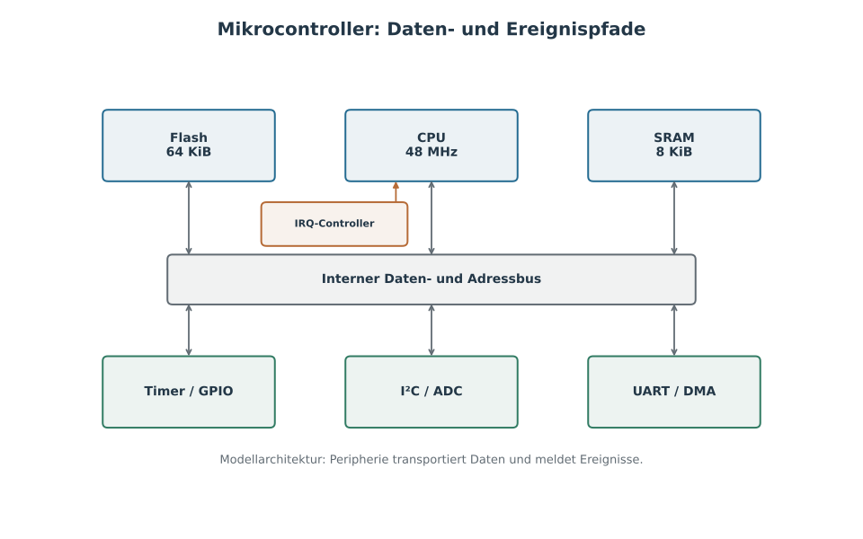

# M15-L1 – Mikrocontroller, Speicher und Peripherie {#L1}

**Kursbereich:** M15 – Bachelor: Eingebettete Systeme

**Niveau:** Bachelor · Wahlbereich

**Vorwissen:** [Digitale Logik](M3-L5.md), [Speicherelemente](M3-L6.md).

**Lernziel:** Eine Mikrocontrollerarchitektur lesen und ein explizites Speicher- und Rechenbudget für einen Sensorknoten aufstellen.

## Vom Programm zum eingebetteten System {#S1}

Ein eingebettetes System ist ein Rechner, dessen Funktion in eine größere technische Aufgabe integriert ist. Ein Mikrocontroller (MCU) vereint Prozessorkern, Programmspeicher, Arbeitsspeicher und Peripherie auf einem Baustein. Ein Sensorgerät muss beispielsweise nicht nur einen Messwert berechnen, sondern innerhalb einer bestimmten Zeit lesen, dessen Gültigkeit prüfen und ihn weitergeben. Das elektrische und das zeitliche Verhalten gehören daher zum Entwurf.

Der Prozessorkern enthält Register, Rechenwerk, Steuerwerk und Programmzähler. Flash hält Instruktionen und konstante Daten auch ohne Versorgung; SRAM enthält veränderliche Daten, Aufrufstapel und Puffer. Die Peripherie übernimmt zeitkritische Aufgaben: Timer zählen autonom, GPIO steuert und liest Pins, ADC digitalisiert analoge Eingänge, serielle Schnittstellen übertragen Daten. Ein Interruptcontroller vermittelt Ereignisse an den Prozessorkern. Direkter Speicherzugriff (DMA) kann Transfers zwischen Peripherie und RAM ohne eine CPU-Instruktion je Byte durchführen. Konfiguration, Synchronisation und Abschlussbehandlung bleiben erforderlich.

{alt="Blockbild einer MCU mit CPU, Flash, SRAM, Bus, Timer, Interruptcontroller und Sensor-/UART-Schnittstellen."}

## Adressraum und Registerzugriff {#S2}

Bei speicherabgebildeter Peripherie (memory-mapped I/O) erscheinen Steuer- und Statusregister im Adressraum der CPU. Ein Lesezugriff auf ein Statusregister ist nicht dasselbe wie ein Lesezugriff auf SRAM: Er kann hardwareabhängige Nebenwirkungen haben. Die Adressbelegung und die erlaubten Schreiboperationen gehören zum Datenblatt, nicht zur Sprache C.

Für ein fiktives 32-Bit-Steuerregister mit Freigabebit 3 gilt die Maske $m=2^3=8$. Bei einem normalen les- und schreibbaren Register setzt `CTRL |= (1u << 3)` das Bit und erhält die übrigen Bits; `CTRL &= ~(1u << 3)` löscht es. Ein Write-one-to-clear-Statusbit hingegen wird durch Schreiben einer Eins quittiert. Ein Read-modify-write kann dort irrtümlich weitere Bits löschen. Bei nebenläufigen Zugriffen ist auch bei einem normalen Register die gesamte Lese-Änderungs-Schreib-Folge nicht atomar.

Ein `volatile`-qualifizierter Registerzugriff teilt dem Compiler in C mit, dass die beobachtbaren Zugriffe nicht einfach entfallen dürfen. Er bietet weder sichere Datenübergabe zwischen Kontexten noch allgemeine Speicherbarrieren. Geräteheader und die vom Hersteller dokumentierten Zugriffsregeln haben Vorrang. Die Adressen einer MCU-Familie sind nicht auf beliebige andere Controller übertragbar.

## Speicherbudget des Sensorknotens {#S3}

Wir planen durchgehend ein fiktives Gerät mit 48 MHz CPU-Takt, 64 KiB Flash und 8 KiB SRAM. Diese Zahlen sind Modellannahmen, kein konkretes Produkt. Ein Datensatz belegt auf der Übertragungsleitung 12 Byte (siehe [M15-L4](M15-L4.md)); er wird im Puffer als genau 12 Byte gespeichert, ohne Struct-Padding. Alle weiteren Speicherposten werden getrennt budgetiert.

| Bereich des SRAM | Bytes |
| --- | ---: |
| Anwendung und Treiber, statische Daten | 2048 |
| Stack einschließlich Interruptverschachtelung (Budget) | 1536 |
| 16 wartende Datensätze | 192 |
| Aktiver Sendepuffer einschließlich Hilfsdaten | 32 |
| Diagnose- und Empfangspuffer | 512 |
| Queue-Zähler und Verwaltungsdaten | 64 |
| Summe | 4384 |

$$M_{frei}=8192-4384=3808\ \mathrm{Byte}.$$

Bei 32 wartenden Datensätzen erhöht sich die Summe um 192 Byte auf 4576 Byte. Das Budget ist keine Messung des tatsächlichen Verbrauchs: Linkerskript, Map-Datei, Alignment, Bibliotheken, Stack-Höchststand und gegebenenfalls DMA-Speicherbereiche sind beim Hardwareentwurf nachzuweisen. Für das Flash setzen wir 36 KiB Programm einschließlich Konstanten an; 28 KiB bleiben für Erweiterungen und gegebenenfalls Boot-/Updatebereiche. Ein initialisiertes globales Objekt kann sowohl Flash (Initialwerte) als auch SRAM (laufzeitveränderliche Kopie) beanspruchen.

## Rechenzeit und Entwurfsentscheidung {#S4}

Für 100 Messungen pro Sekunde bleiben bei 48 MHz ideal 480000 Taktperioden je Messintervall. Benötigt der CPU-Anteil 100 µs, entspricht das 4800 Perioden oder 1 % der verfügbaren Zeit. Die Periodenzahl ist keine Instruktionszahl: Pipeline, Speicherbusse, Flash-Wartezyklen und Mehrzyklusoperationen verändern die Ausführungszeit. Der übrige Zeitraum kann für andere Aufgaben oder Schlafzustände genutzt werden. Schlafen reduziert aber nur dann die mittlere Leistung, wenn die entsprechenden Takt- und Versorgungsdomänen tatsächlich abgeschaltet werden; Aufwachlatenz und Energie müssen berücksichtigt werden.

Eine durchschnittliche Auslastung von 1 % garantiert keine Frist. Wenn ein langer, nicht unterbrechbarer Treiberaufruf gerade vor dem Abtasttermin beginnt, kann die Messung trotz überwiegend freier CPU zu spät starten. In [M15-L2](M15-L2.md) wird daher mit Fristen und maximaler Blockierung gerechnet.

## Übungen mit Lösungen {#S5}

1. Wie viele Byte beanspruchen 64 statt 16 Datensätze zusätzlich?  
   **Lösung:** $48\cdot12=576$ Byte, sofern das Queue-Verwaltungsbudget gleich bleibt.
2. Warum wäre es falsch, die Taktfrequenz unmittelbar als Zahl der ausführbaren C-Zeilen pro Sekunde anzusehen?  
   **Lösung:** Compiler und Architektur übersetzen eine Zeile in unterschiedliche Instruktionsfolgen; deren Laufzeit ist variabel.
3. Ein Statusregister löscht gesetzte Flags beim Schreiben einer Eins. Wie quittiert man ausschließlich Bit 3?  
   **Lösung:** Gemäß hypothetischem Registervertrag nur `1u << 3` schreiben; die übrigen Bits bleiben beim Schreiben null unangetastet. Kein Read-modify-write.
4. Die Map-Datei weist 2600 statt 2048 Byte statischer Daten aus. Reicht das Budget bei 16 Datensätzen?  
   **Lösung:** 4936 Byte insgesamt, 3256 Byte verbleiben. Erst eine Stack- und Laufzeitmessung kann die Annahmen weiter absichern.

## Quellen {#S6}

- [ETH Zürich – Core Courses and Specialisations (Bachelor)](https://ee.ethz.ch/studies/bachelor/bsc-eeit/third-year/core-courses.html) · Core Courses: Embedded Systems, Computers and Networks; curricularer Vergleich, kein Nachweis des konkreten Semesterangebots. · Zuletzt abgerufen: 2026-11-25
- [Arm CMSIS-Core – Device Header File](https://arm-software.github.io/CMSIS_6/main/Core/device_h_pg.html) · Abschnitte Interrupt Number Definition und Device Peripheral Access Layer: Interruptnummern, Registerdefinitionen und Basisadressen; laufende Dokumentationsfassung, nicht fest auf v6.3.0 versioniert. · Zuletzt abgerufen: 2026-11-25
- [University of Texas at Austin – Embedded and Real-Time Operating Systems, Vorlesungsübersicht](https://users.ece.utexas.edu/~valvano/EE445M/lectures.html) · ECE445M, Vorlesungsplan Woche 1: Mikrocontrollerarchitektur und Peripherie; Folien nicht geprüft. · Zuletzt abgerufen: 2026-11-25
