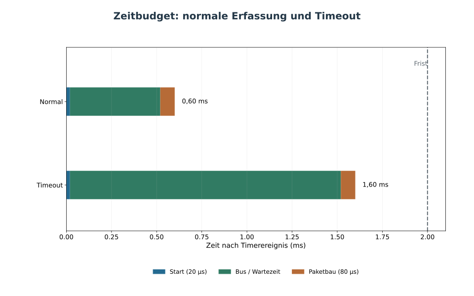

# M15-L2 – Takt, Timer und Interrupts {#L2}

**Kursbereich:** M15 – Bachelor: Eingebettete Systeme

**Niveau:** Bachelor · Wahlbereich

**Vorwissen:** [Mikrocontroller](M15-L1.md), [Zustände und Abtastung](M13-L2.md).

**Lernziel:** Einen periodischen Timer dimensionieren, Abtastjitter einordnen und eine Frist mit konservativen Laufzeitgrenzen prüfen.

## Timer und Zeitbasis {#S1}

Ein Hardwaretimer erhält einen Takt und zählt nach einem konfigurierbaren Schema. Bei einem Aufwärtszähler mit Prescalerregister $PSC$ und Endwertregister $ARR$, die beide nullbasiert gezählt werden, beträgt das Intervall

$$T=\frac{(PSC+1)(ARR+1)}{f_{tim}}.$$

Für einen angenommenen Timertakt von 48 MHz, $PSC=47$ und $ARR=9999$ ergibt sich ein Zählertakt von 1 MHz und ein Ereignis nach 10000 Zählschritten, also alle 10 ms. Der Timertakt kann auf realer Hardware vom CPU-Takt abweichen. Beim Umkonfigurieren sind Pufferregister und Aktualisierungsereignisse zu beachten; die Formel gilt für den eingeschwungenen periodischen Betriebsmodus.

Polling (regelmäßiges Abfragen) erkennt ein Ereignis erst beim nächsten Abfragezeitpunkt. Eine perfekte Pollingperiode von 1 ms ohne Blockierung erzeugt eine Erkennungsverzögerung zwischen null und knapp 1 ms. Ein Interrupt meldet es unabhängig vom Hauptprogramm, jedoch nicht garantiert sofort: Maskierung, höher priorisierte Routinen und Hardwarelatenz verzögern den Beginn.

## Ablauf und Zeitbegriffe {#S2}

Die Freigabezeit $r_k=kT$ bezeichnet das geplante Ereignis, die Startzeit $s_k$ den tatsächlichen Arbeitsbeginn, die Fertigstellungszeit $f_k$ das Ende der Arbeit. Die Reaktionszeit ist $R_k=f_k-r_k$. Eine relative Frist $D$ ist eingehalten, wenn $R_k\le D$. Jitter beschreibt hier Schwankungen des tatsächlichen Beginns relativ zur Sollzeit. Die Periodizität einer Hardwareuhr garantiert nicht die Periodizität eines im Hauptprogramm gelesenen Sensors.

Beim Sensorknoten wird der Timerzeitpunkt als Zeitstempel des Leseauftrags erfasst. Er ist nicht zwingend der physikalische Abtastzeitpunkt im Sensor; dies hängt davon ab, wann der Sensor intern gewandelt hat. Wenn der Sensor selbst periodisch misst, muss bei Bedarf sein Data-ready-Signal oder ein interner Zeitstempel genutzt werden.

{alt="Zeitachse einer Erfassung mit Startphase, Buswartezeit, Verarbeitung, Timeout und 2-ms-Frist."}

## Ein konservatives Zeitbudget {#S3}

Wir benötigen maximal 20 µs CPU-Zeit für die Startphase, eine asynchrone Busaktion von normalerweise 500 µs beziehungsweise eine überwachte Wartezeit bis 1500 µs nach Start, und 80 µs für Abschlussverarbeitung und Paketbau. Im störungsfreien Modell sind es 600 µs, im Fehlerfall 1600 µs. Das Freigabeintervall ist 10 ms, die Erfassungs-/Diagnosefrist 2 ms. Die UART-Übertragung folgt asynchron und hat eine eigene Frist von 150 ms.

Für ein erweitertes Hardwarebudget seien maximal 50 µs Startlatenz und insgesamt 120 µs weitere Verzögerung durch höher priorisierte IRQs oder Freigabesperren während einer Erfassung zugelassen. Dann gilt unter diesen nachzuweisenden Annahmen

$$R_{\mathrm{max}}\le 50+20+1500+80+120=1770\ \mu\mathrm{s}<2000\ \mu\mathrm{s}.$$

Die Grenze enthält keine unabhängige Aussage über Hardware-WCET (Worst-case execution time). Ohne nachgewiesene Laufzeit- und Blockierungsgrenzen ist sie nur ein Entwurfsbudget. Die abschließende Simulation in [M15-L5](M15-L5.md) verwendet die idealen Verzögerungen 600 und 1600 µs; die erweiterten Störzeiten werden nicht simuliert.

## Nebenläufigkeit und Überlauf {#S4}

Interrupt-Service-Routinen (ISR) sollten kurz, zeitlich begrenzt und von blockierenden Operationen frei bleiben. Häufig markieren sie ein Ereignis oder legen ein Element in eine Queue; die Hauptlogik verarbeitet es. Eine lange Interruptsperre verhindert zwar manche Datenrennen, kann aber gerade die Fristen verletzen. Der NVIC bei Cortex-M vermittelt priorisierte Interrupts; Anzahl und Prioritätsbits sind implementierungsabhängig.

Ein 32-Bit-Zähler mit Mikrosekundentakt läuft nach $2^{32}\ \mu\mathrm{s}\approx71{,}58$ Minuten über. In unsigned 32-Bit-Arithmetik liefert die modulare Differenz auch beim einmaligen Überlauf die verstrichene Zeit, solange die tatsächliche Differenz kleiner als die gesamte Zählerperiode ist. Für eine Deadline-Abfrage ist die verstrichene Zeit seit dem Start mit dem Intervall zu vergleichen; ein naiver Vergleich `now >= deadline` versagt am Überlauf.

```python
MASK = 0xffffffff
start = 0xfffffff0
now = 0x00000020
elapsed = (now - start) & MASK
assert elapsed == 48
```

Bei einem Taktfehler von beispielsweise 50 ppm kann ein 1-s-Intervall um etwa 50 µs abweichen; über 1 h ergeben sich etwa 0,18 s. Diese systematische Abweichung verschwindet nicht durch höhere Zählerauflösung.

## Übungen mit Lösungen {#S5}

1. Wähle bei unverändertem 1-MHz-Zählertakt das Register $ARR$ für 5 ms.  
   **Lösung:** 4999.
2. In einem Fehlerfall steigt die zusätzliche Verzögerung von 120 auf 400 µs. Reicht die 2-ms-Frist?  
   **Lösung:** Die obere Schranke wird 2050 µs. Die Einhaltung ist damit nicht mehr belegt, auch wenn einzelne Messungen rechtzeitig enden.
3. Eine serielle Schnittstelle überträgt während die CPU andere Aufgaben ausführt. Ist die Übertragungsdauer CPU-Rechenzeit?  
   **Lösung:** Nein. Nur die Bedienung der Schnittstelle beansprucht CPU-Zeit; die Datenübertragung belegt eine eigene Ressource.
4. Warum erfasst ein Zeitstempel beim Eintreffen der UART-Daten nicht zuverlässig den Messzeitpunkt?  
   **Lösung:** Verarbeitung, Queue-Wartezeit und Übertragung verzögern die Ankunft variabel. Der Messauftrag oder Sensorzeitpunkt muss separat gespeichert werden.

## Quellen {#S6}

- [University of Texas at Austin – Embedded and Real-Time Operating Systems, Vorlesungsübersicht](https://users.ece.utexas.edu/~valvano/EE445M/lectures.html) · ECE445M, Vorlesungsplan Woche 1 und 4: Timer und Zeitverhalten; Folien nicht geprüft. · Zuletzt abgerufen: 2026-11-25
- [Arm CMSIS-Core – Interrupts and Exceptions (NVIC)](https://arm-software.github.io/CMSIS_6/main/Core/group__NVIC__gr.html) · NVIC-API: IRQn, Freigabe und Sperren von Interrupts; Teilaspekt. · Zuletzt abgerufen: 2026-11-25
