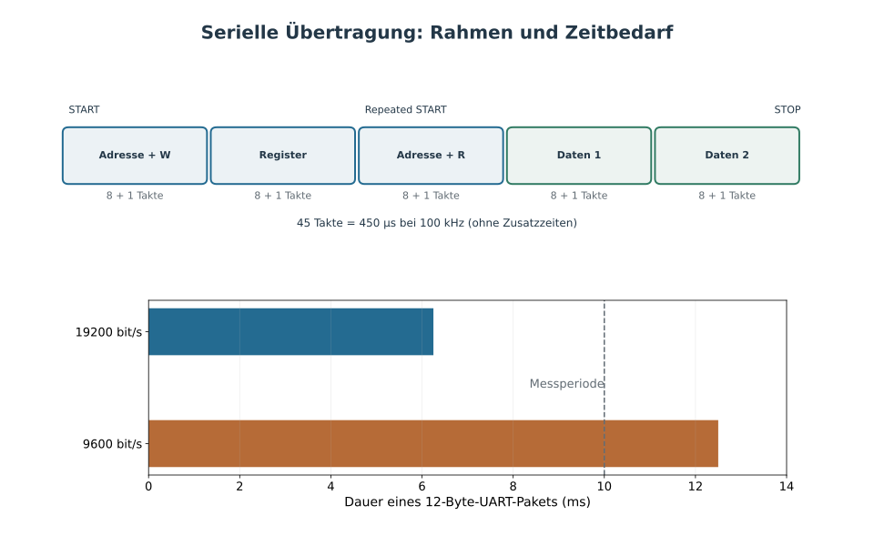

# M15-L3 – Serielle Schnittstellen und Sensoranbindung {#L3}

**Kursbereich:** M15 – Bachelor: Eingebettete Systeme

**Niveau:** Bachelor · Wahlbereich

**Vorwissen:** [Timer und Interrupts](M15-L2.md), [CMOS-Pegel](M14-L2.md).

**Lernziel:** UART, SPI und I²C nach Übertragungsform und Anwendungsgrenzen vergleichen sowie Datenrate und elektrische Anschlussbedingungen berechnen.

## Drei Übertragungsverfahren {#S1}

Bei einer asynchronen UART-Verbindung vereinbaren Sender und Empfänger die Bitrate. Ein Rahmen im Format 8N1 enthält Startbit, acht Datenbits (niederwertigstes Bit zuerst), kein Paritätsbit und ein Stoppbit. Es gibt keinen eigenen Taktleiter. Für bidirektionalen Betrieb sind üblicherweise TX, RX und eine gemeinsame Bezugserde nötig. UART beschreibt den Datenrahmen, nicht automatisch die elektrischen Pegel von RS-232 oder RS-485; dafür sind gegebenenfalls Transceiver erforderlich.

SPI ist taktsynchron. Ein Controller erzeugt SCK; getrennte Datenleitungen erlauben in der üblichen Vierleiteranordnung gleichzeitiges Senden und Empfangen. Chip-Select wählt ein Ziel. Taktpolarität CPOL und Taktphase CPHA legen Ruhelage beziehungsweise Abtastflanke fest. Beide Geräte müssen nach Datenblatt denselben Modus verwenden. SPI hat keinen generellen Busstandard für Adressen, Quittierung oder Rahmenlänge auf Geräteebene; diese Regeln hängen vom Sensor ab.

Bei konventionellem I²C teilen sich mehrere Geräte SDA (Daten) und SCL (Takt), typischerweise mit Open-Drain-Ausgängen und Pull-ups. Die Adresse wählt das Ziel. Pro acht Bits folgt ein Quittierungsbit. Das Taktsignal kann bei unterstütztem Clock Stretching durch ein Ziel verzögert werden. Ein START beziehungsweise STOP wird durch einen SDA-Pegelwechsel bei hohem SCL gekennzeichnet. Adresskonflikte, Buslast, Pull-up-Widerstände und mögliche konkurrierende Controller sind zu prüfen.

| Eigenschaft | UART | SPI | I²C |
| --- | --- | --- | --- |
| Taktleiter | keiner | SCK | SCL |
| Adressierung | nicht im UART | meist Chip-Select | im Busprotokoll |
| Datenrichtung | meist TX/RX | meist getrennte Leitungen | gemeinsame SDA |
| Typische lokale Aufgabe | Diagnose, Datenstrom | schneller ADC, Flash | mehrere Sensoren |

## Beispiel: Register eines I²C-Sensors lesen {#S2}

Ein fiktiver Sensor verwendet eine 7-Bit-Adresse `0x48` und ein 8-Bit-Register `0x10` für zwei Messdatenbytes. Die Adressbytes auf dem Bus lauten `0x90` beim Schreiben und `0x91` beim Lesen. Softwarebibliotheken verlangen unterschiedlich entweder die unverschobene Adresse oder ein bereits verschobenes Adressbyte. Beides darf nicht vermischt werden.

Die Transaktion besteht aus START, Adresse+W, Registerbyte, Repeated START, Adresse+R, erstem Datenbyte (Controller quittiert mit ACK), zweitem Datenbyte (Controller mit NACK) und STOP. Jedes der fünf Bytes einschließlich Adressbytes benötigt neun Taktschritte einschließlich ACK/NACK. Minimum bei 100 kHz:

$$t_{bus}=\frac{5\cdot9}{100000}=450\ \mu\mathrm{s}.$$

Mit modellierten 50 µs für START-/STOP-/Busfreizeiten und Treiberübergänge budgetieren wir 500 µs ohne Stretching. Bei 100 Messungen/s sind das 5 % der Buszeit. Bei 400 kHz wären es ideal 112,5 µs für die 45 Takte; die 50 µs Zusatzbudget müssen unabhängig überprüft werden. Die Unterstützung der höheren Rate folgt nicht allein aus der Rechnung.

{alt="I²C-Lesetransaktion mit fünf Neun-Bit-Gruppen sowie Vergleich der UART-Sendedauer bei 9600 und 19200 bit/s."}

## Elektrische Grenze des I²C-Busses {#S3}

Für ein RC-Pull-up-Modell mit Buskapazität $C_b$ und Widerstand $R_p$ gilt beim Loslassen der Leitung $v(t)=V_{DD}(1-e^{-t/(R_pC_b)})$. Die Anstiegszeit zwischen 30 und 70 % ist

$$t_r=R_p C_b\ln\frac{0{,}7}{0{,}3}\approx0{,}8473R_pC_b.$$

Bei 3,3 V, 100 pF und 4,7 kΩ ergibt sich rund 398 ns. Das liegt unter der 1000-ns-Grenze für Standard-mode, aber über 300 ns für Fast-mode. Mit 3,3 kΩ ergeben sich rund 280 ns. Wenn das Gerät bei $V_{OL}=0{,}4$ V mindestens 3 mA sicher ableiten kann, folgt aus dem Strombudget $R_{min}=(3{,}3-0{,}4)/0{,}003\approx967\ \Omega$. Für Fast-mode folgt bei 100 pF $R_{max}\approx3541\ \Omega$. Die 3,3-kΩ-Wahl liegt in diesem Intervall, hat aber begrenzte Reserve gegenüber Kapazitäts- und Widerstandstoleranz. Dies ersetzt keine Prüfung der Bauteildaten und realen Flanken.

## UART-Durchsatz und SPI-Vergleich {#S4}

Ein 12-Byte-Paket mit 8N1 belegt 120 Bitzeiten. Bei 19200 bit/s dauert seine Übertragung 6,25 ms, bei 9600 bit/s 12,5 ms. 100 Pakete/s erfordern mindestens 12000 bit/s ohne Pausen. Auslastung bei 19200: 62,5 %; bei 9600: 125 %. Keine Puffertiefe hebt eine dauerhaft zu geringe Datenrate auf.

Ein hypothetischer SPI-Sensor, der mit einem Kommandobyte und zwei folgenden Datenbytes arbeitet, benötigt bei 1 MHz mindestens 24 µs plus Chip-Select- und Treiberzeiten. Das ist schneller als das I²C-Beispiel, belegt allerdings zusätzliche Pins und verwendet einen gerätespezifischen Rahmen. Ein Busvergleich muss neben dem Durchsatz auch Sensorwandlungszeit, elektrische Topologie, Energie und Störfestigkeit betrachten.

## Übungen mit Lösungen {#S5}

1. Wie viele 8N1-Nutzbytes pro Sekunde transportiert 19200 bit/s theoretisch?  
   **Lösung:** 1920 Byte/s. Darin müssen Anwendungs-Header und Prüfsummen mitgezählt werden.
2. Die Buskapazität steigt auf 200 pF. Wie lang ist die Anstiegszeit bei 3,3 kΩ?  
   **Lösung:** Rund 559 ns; für Fast-mode im Modell zu lang.
3. Ein SPI-Controller sendet mit Modus 0, der Sensor erwartet Modus 3. Reicht gleiche Frequenz?  
   **Lösung:** Nein. Die Taktflanken und Ruhelage entsprechen nicht der vereinbarten Schnittstelle.
4. Warum quittiert der I²C-Controller beim letzten gelesenen Byte mit NACK?  
   **Lösung:** Er signalisiert dem sendenden Ziel das Ende des Lesevorgangs, bevor er STOP erzeugt.

## Quellen {#S6}

- [NXP – UM10204, I²C-bus specification, Rev. 7.0, §§ 3.1, 6, 7.2](https://www.nxp.com/docs/en/user-guide/UM10204.pdf) · UM10204, Rev. 7.0, S. 9, §3.1.4–3.1.5: Start-/Stop-Bedingungen und Byteformat; Teilaspekt. · Zuletzt abgerufen: 2026-11-25
- [Microchip – SPI Timing, CPOL und CPHA](https://onlinedocs.microchip.com/oxy/GUID-6F1B86DC-C230-43D1-A405-0CC2E7EDF7EE-en-US-2/GUID-EAC2D943-F395-4D47-98C8-4EEBC798BFA2.html) · AVR151, §1.4, Tabelle 1-3: SPI-Modi und Taktflanken. · Zuletzt abgerufen: 2026-11-25
- [Microchip – USART Overview, asynchroner Betrieb und 8N1](https://onlinedocs.microchip.com/oxy/GUID-D5344754-46CE-40D6-918B-245670AF7E39-en-US-6/GUID-0DB53D39-B94A-4512-95BD-D6BA10D41F83.html) · §2 Overview: asynchroner 8N1-Rahmen und Baudrate; gerätespezifisches Handbuch separat prüfen. · Zuletzt abgerufen: 2026-11-25
