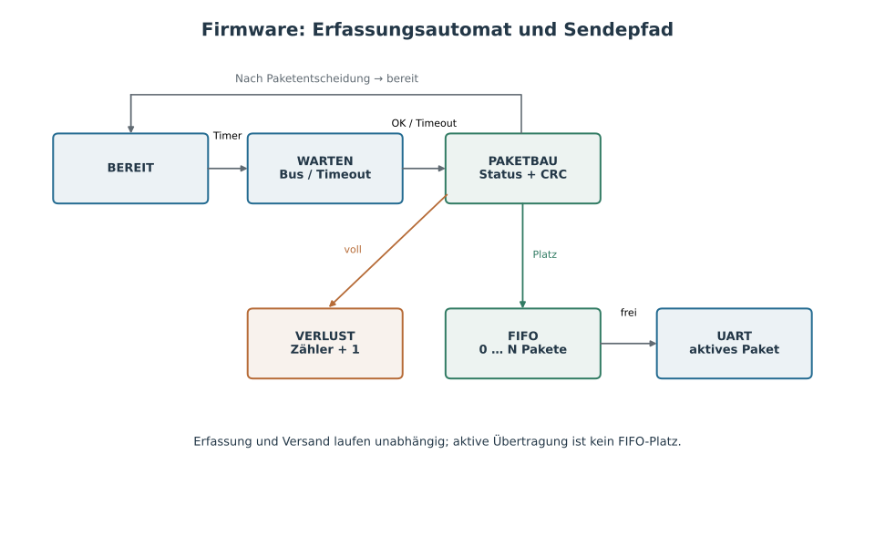

# M15-L4 – Eingebettete Software als Zustandsautomat {#L4}

**Kursbereich:** M15 – Bachelor: Eingebettete Systeme

**Niveau:** Bachelor · Wahlbereich

**Vorwissen:** [Digitale Speicher](M3-L6.md), [Schnittstellen](M15-L3.md).

**Lernziel:** Eine nichtblockierende Messlogik mit Timeout, Datenformat und begrenztem FIFO definieren.

## Die Firmware als Koordination unabhängiger Aufgaben {#S1}

Eine eingebettete Firmware verbindet Hardwaretreiber, Anwendungsentscheidungen und den Datentransport. Werden diese Funktionen in einer einzigen blockierenden Schleife vermischt, hängt die Messperiode von der Sendedauer und von Fehlern am Bus ab. Eine klare Trennung erlaubt, während der laufenden UART-Übertragung den nächsten Messauftrag unabhängig zu beginnen.

Der Treiber kennt Register, Buszugriffe und Hardwaremeldungen. Die Anwendungslogik verarbeitet Zustände, Grenzwerte und Fehler. Eine Sendekomponente verwaltet die Warteschlange. Die drei Komponenten kommunizieren über definierte Ereignisse und Datenobjekte. Der Automat wird bei einem eintreffenden Ereignis fortgeschaltet, nicht durch dauerhaftes Warten in einer Schleife.

| Zustand | Ereignis | Aktion und Folgezustand |
| --- | --- | --- |
| Bereit | Timer | Sequenz und Zeit erfassen, Lesen starten → Warten |
| Warten | Bus erfolgreich | Messwert übernehmen → Paketbau |
| Warten | Busfehler oder Timeout | Fehlerstatus setzen, ungültigen Messwert markieren → Paketbau |
| Paketbau | Queue hat Platz | Paket anhängen → Bereit |
| Paketbau | Queue voll | Neues Paket verwerfen, Verlustzähler erhöhen → Bereit |
| Warten | neuer Timer (Überlauf) | verpassten Auftrag zählen, laufenden Auftrag nicht überschreiben |

{alt="Erfassungsautomat mit Timeout-Pfad und begrenzter Sendewarteschlange, getrennt vom UART-Sendepuffer."}

Der erfolgreiche Abschluss und der Timeout müssen denselben Auftrag eindeutig identifizieren. Beim Abbruch wird der Treiber zurückgesetzt oder in einen definierten Fehlerzustand versetzt; verspätete Abschlussmeldungen für den abgebrochenen Auftrag dürfen keinen zweiten Datensatz erzeugen. Eine reale I²C-Buswiederherstellung ist geräteabhängig. In der Fallstudie wird ein Timeout abstrakt als abgeschlossenes fehlerhaftes Lesen modelliert; kein elektrischer Bus-Recovery-Algorithmus wird behauptet.

## Ringpuffer und Überlast {#S2}

Ein FIFO gibt Elemente in Einfügereihenfolge aus. Ein Ringpuffer mit $N$ physischen Plätzen speichert hier zusätzlich die Belegung $n$, sodass alle $N$ Plätze nutzbar sind. Schreibindex $w$ und Leseindex $r$ werden nach jedem erfolgreichen Zugriff modulo $N$ weitergeschaltet. Invarianten sind $0\le n\le N$ sowie $w=(r+n)\bmod N$. Beim Senden wird ein vollständiger Datensatz aus der Queue in den getrennten aktiven Sendepuffer übernommen. Dieser aktive Datensatz zählt nicht zur Queue-Belegung.

```python
class Ring:
    def __init__(self, size):
        assert size > 0
        self.buf = [None]*size
        self.r = self.w = self.n = 0
    def push(self, x):
        if self.n == len(self.buf):
            return False
        self.buf[self.w] = x
        self.w = (self.w+1) % len(self.buf)
        self.n += 1
        return True
    def pop(self):
        if not self.n:
            return None
        x = self.buf[self.r]
        self.r = (self.r+1) % len(self.buf)
        self.n -= 1
        return x
q = Ring(3)
assert q.push(1) and q.push(2) and q.push(3)
assert not q.push(4) and q.pop() == 1
assert q.push(4)
assert [q.pop(), q.pop(), q.pop(), q.pop()] == [2,3,4,None]
```

Dieser Code ist sequenziell. In realer Firmware müssen ISR und Hauptprogramm konsistent auf Indizes und Belegung zugreifen; eine geeignete kurze kritische Sektion oder ein nachgewiesenes Single-Producer-Single-Consumer-Verfahren ist nötig. `volatile` allein reicht nicht. Wird ein DMA-Transfer gestartet, darf die Quelle bis zum bestätigten Transferabschluss nicht überschrieben werden.

## Ein explizites Datenformat {#S3}

Ein Paket hat unabhängig vom Compiler exakt zwölf Byte; mehrbyteige Zahlen werden little-endian serialisiert. Der Sequenzzähler wird bei jedem geplanten Auftrag erhöht, auch wenn das Paket später verworfen wird. Ein Fehler am Sensor ist eine gültige Diagnoseinformation, kein numerischer Messwert.

| Byteoffset | Inhalt | Format |
| --- | --- | --- |
| 0–1 | Synchronwort | `AA 55` |
| 2–3 | Sequenz | unsigned 16 Bit |
| 4–7 | Auftragszeit | unsigned 32 Bit, µs |
| 8–9 | Rohwert | unsigned 16 Bit; `FFFF` bei Fehler |
| 10 | Status | 0 gültig, 1 Timeout |
| 11 | CRC-8 | Polynom 0x07, Init 0, MSB zuerst, XOR-out 0 |

Die CRC wird über die ersten elf Byte einschließlich Synchronwort berechnet. Bei den ASCII-Bytes `123456789` liefert diese Variante `F4`. Die CRC ist eine Fehlererkennung, keine kryptographische Authentifizierung und keine Garantie gegen alle Mehrbitfehler. Das Synchronwort kann auch innerhalb eines Nutzdatenfeldes vorkommen. Ein Empfänger muss bei verlorener Ausrichtung Kandidaten für die Paketgrenze suchen, Länge und CRC prüfen und bei Ablehnung weitersuchen; der Sequenzzähler unterstützt die Plausibilitätskontrolle. Vergleiche über den Zählerüberlauf werden modular durchgeführt.

## Welche Fehler müssen unterschieden werden? {#S4}

Bei $f_s$ Messaufträgen/s und $B$ Byte pro Rahmen beträgt die mittlere Erzeugungsrate $\lambda=B f_s$. Ein 120-ms-Übertragungsstillstand kann bei 100 Hz ungefähr zwölf neu fertiggestellte Pakete erzeugen. Abhängig von der Phase und einer schon belegten Queue sind es möglicherweise mehr wartende Elemente. Die Kapazitätsgrenze muss deshalb für die vorgesehene Belastung geprüft werden, nicht nur für die mittlere Datenrate.

Drei Diagnosen werden getrennt geführt: Timeout des Sensors (Paket mit Status 1), Queue-Überlauf (Paketverlust, lokaler Zähler), Übertragungsfehler (empfangsseitige CRC-/Sequenzprüfung). Ein realer Empfänger sieht verworfene Pakete erst bei einer späteren Sequenzlücke; das Ende eines Datenstroms kann zusätzliche lokale Diagnose erfordern. Die Fallstudie erfasst alle Verluste an der Quelle und simuliert keine Bitfehler auf der Leitung.

## Übungen mit Lösungen {#S5}

1. Warum darf ein Timeout nicht als Messwert null gesendet werden?  
   **Lösung:** Null kann ein gültiger physikalischer Messwert sein. Status und Wert müssen unterschiedliche Semantik haben.
2. Bei $N=16$, $r=14$ und $n=5$: Wo steht der Schreibindex?  
   **Lösung:** $(14+5)\bmod16=3$.
3. Warum reicht das Synchronwort nicht für eine robuste Rahmensuche?  
   **Lösung:** Die zwei Bytes können zufällig in Nutzdaten erscheinen; Länge, CRC und Sequenzkontrolle sind zusätzliche Kriterien, aber kein absoluter Eindeutigkeitsbeweis.
4. Warum ist ein voller Puffer nicht automatisch ein Sensorfehler?  
   **Lösung:** Der Sensor kann einwandfrei liefern, während die Transportrate oder ein blockierter Ausgang die Queue überlastet.

## Quellen {#S6}

- [University of Texas at Austin – Embedded and Real-Time Operating Systems, Vorlesungsübersicht](https://users.ece.utexas.edu/~valvano/EE445M/lectures.html) · Frühjahr 2026, Wochen 1 und 3: modulare Software, Thread-Zustände und Synchronisation; ergänzender Kontext, kein direkter Beleg für Zustandsautomaten. · Zuletzt abgerufen: 2026-11-25
- [ETH Zürich – Core Courses and Specialisations (Bachelor)](https://ee.ethz.ch/studies/bachelor/bsc-eeit/third-year/core-courses.html) · Core Courses: Embedded Systems, Computers and Networks; curricularer Vergleich, kein Nachweis des konkreten Semesterangebots. · Zuletzt abgerufen: 2026-11-25
