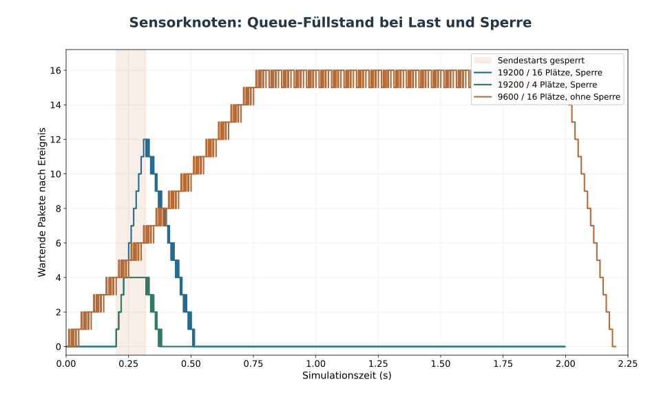

# M15-L5 – Fallstudie Sensorknoten {#L5}

**Kursbereich:** M15 – Bachelor: Eingebettete Systeme

**Niveau:** Bachelor · Wahlbereich

**Vorwissen:** [M15-L1](M15-L1.md), [M15-L2](M15-L2.md), [M15-L3](M15-L3.md), [M15-L4](M15-L4.md).

**Lernziel:** Messaufträge, Puffer, Fehlerpakete, Zeitstempel und Transportfristen in einem reproduzierbaren Ereignismodell überprüfen.

## Aufgabenstellung und Kriterien {#S1}

Der Sensorknoten soll während 2 s periodisch 200 Leseaufträge bei 100 Hz starten. Er verfügt über 8 KiB SRAM (Budget aus [M15-L1](M15-L1.md)) und sendet zwölf Byte je Auftrag. Der Normalpfad benötigt 600 µs vom Timer bis zum fertigen Paket; jeder Auftrag mit Sequenznummer $s\bmod37=17$ erzeugt stattdessen nach 1600 µs ein Timeoutpaket. Aufträge werden von 0 bis 199 gezählt. Es gibt damit fünf gezielt eingebrachte Sensorfehler. Der Test verlangt keine verlorenen Pakete, keine Überschreitung der 2-ms-Erfassungsfrist und kein Paket, dessen Übertragung später als 150 ms nach dem planmäßigen Timerzeitpunkt endet. Fehlerpakete gelten als erfolgreich übertragene Diagnosen, nicht als gültige Messwerte.

Zwei UART-Raten (9600 und 19200 bit/s, 8N1), verschiedene FIFO-Kapazitäten und eine künstliche Sendeunterbrechung werden verglichen. Die Unterbrechung blockiert neue Sendestarts von 200 bis unter 320 ms; bereits laufende Pakete enden normal. Sie repräsentiert beispielsweise eine abstrahierte Flusskontrollsperre zwischen Paketen. Die Erfassung läuft weiter. Nach dem letzten Messauftrag darf der Puffer vollständig leerlaufen. Dieser Drain ist nötig, damit noch wartende Pakete nicht fälschlich als Verlust gezählt werden.

## Reproduzierbare Ereignissimulation {#S2}

Die simulierte Zeit ist ganzzahlig in Mikrosekunden. Die Ereigniswarteschlange sortiert nach Zeitstempel und bei Gleichstand nach Ereignistyp: Sendeabschluss, Aufhebung der Sperre, dann Erfassungsabschluss. Die FIFO-Belegung wird für jedes Anhängen vor einem möglichen sofortigen Sendestart als Spitzenwert erfasst; ein Paket im Sender selbst beansprucht einen eigenen Speicherplatz. Die CPU-Zeiten, das Eintreffen der Busereignisse und das UART-Modell sind deterministische Annahmen, keine Messungen an Hardware. In der Simulation ersetzt `deque` den in M15-L4 gezeigten Ring; Kapazitätsgrenze und FIFO-Semantik bleiben gleich.

```python
import heapq, struct
from collections import deque

def crc8(data):
    crc=0
    for b in data:
        crc ^= b
        for _ in range(8):
            crc=((crc<<1)^0x07)&255 if crc&128 else (crc<<1)&255
    return crc

def packet(seq, t):
    fault=seq%37==17
    adc=0xffff if fault else 1000+seq%200
    data=struct.pack('<2sHIHB',b'\xaa\x55',seq,t,adc,int(fault))
    return data+bytes([crc8(data)])

def simulate(baud, capacity, pause=False, n=200):
    duration=120_000_000//baud # us, exact for selected baud
    assert duration*baud==120_000_000
    events=[]; q=deque(); done=[]; dropped=[]; trace=[]; peak=0; busy=False
    for seq in range(n):
        t=seq*10000
        data=packet(seq,t)
        ready=t+(1600 if data[10] else 600)
        heapq.heappush(events,(ready,2,seq,data))
    if pause: heapq.heappush(events,(320000,1,-1,b''))
    while events:
        t,kind,s,data=heapq.heappop(events)
        if kind==0: # UART completed
            busy=False; done.append((s,t-s*10000,data))
        elif kind==2:
            if len(q)==capacity: dropped.append(s)
            else: q.append((s,data));peak=max(peak,len(q))
        if not busy and q and not (pause and 200000<=t<320000):
            s,data=q.popleft();busy=True
            heapq.heappush(events,(t+duration,0,s,data))
        trace.append((t,len(q)))
    assert len(done)+len(dropped)==n
    assert [s for s,_,_ in done]==sorted(s for s,_,_ in done)
    assert all(crc8(data[:-1])==data[-1] for _,_,data in done)
    assert peak<=capacity
    return dict(sent=len(done),drop=len(dropped),peak=peak,late=sum(delay>150000 for _,delay,_ in done),max_delay=max(delay for _,delay,_ in done),fault=sum(data[10] for _,_,data in done),last=max(s*10000+delay for s,delay,_ in done),trace=trace)
if __name__=='__main__':
    print('CRC',hex(crc8(b'123456789')),packet(0,0).hex())
    for c in [(19200,16,False),(19200,16,True),(19200,4,True),(9600,16,False),(9600,32,True)]:
        print(c,{k:v for k,v in simulate(*c).items() if k!='trace'})
```

Die Sendedauer wird aus den 120 Bitzeiten berechnet; die gewählten Raten teilen 120 Millionen ohne Rest. Andere Bitraten würden eine feinere oder rationale Zeitdarstellung erfordern. Zur Zeitmessung wird die Differenz zum Auftragszeitpunkt genutzt, nicht zur Fertigstellung des Pakets. Der Code prüft die Sequenzreihenfolge, CRC und Erhaltung der Anzahl erzeugter Datensätze. CRC-Prüfung am unveränderten Paket ist ein Konsistenztest, kein Test einer realen Funk- oder Kabelstrecke.

## Ergebnisse {#S3}

| Bit/s | FIFO-Plätze | Sperre | Gesendet | Verworfen | Peak (Plätze) | Zu spät (gesendet) | Max. Verzögerung (ms) | Fehlerpakete gesendet |
| ---: | ---: | --- | ---: | ---: | ---: | ---: | ---: | ---: |
| 19200 | 16 | nein | 200 | 0 | 1 | 0 | 7,85 | 5 |
| 19200 | 16 | ja | 200 | 0 | 12 | 0 | 126,25 | 5 |
| 19200 | 4 | ja | 192 | 8 | 4 | 0 | 126,25 | 5 |
| 9600 | 16 | nein | 176 | 24 | 16 | 121 | 213,10 | 4 |
| 9600 | 32 | ja | 182 | 18 | 32 | 166 | 412,50 | 4 |

Alle Leseaufträge werden im Modell spätestens nach 1600 µs als Datensatz oder Fehlerdiagnose fertig, womit die Erfassungsfrist eingehalten wird. Bei 16 Plätzen und 19200 bit/s erfüllt der Sensorknoten auch unter der definierten Sperre alle Transportkriterien. Die 12 Plätze Spitzenbelegung lassen vier zusätzliche Queue-Plätze frei. Der Versand des letzten Pakets endet bei dieser Konfiguration nach 1,99685 s. Ein 4-Platz-Puffer spart zwar 144 Byte, verwirft aber acht Pakete. Keine verspäteten gesendeten Pakete bedeutet hier nicht, dass der gesamte Test erfolgreich war.

{alt="Zeitlicher Füllstand der Warteschlange für drei Kombinationen aus UART-Rate, Kapazität und Sendeunterbrechung."}

## Auslegung und Nachweisgrenzen {#S4}

Die Datenrate ist bei 9600 bit/s auf 80 Pakete/s begrenzt; das Erzeugungsintervall bleibt 100 Pakete/s. Im stationären Modell entsteht deshalb pro Sekunde ein Rückstand von 20 Paketen, solange keine Daten verworfen werden. Größere Puffer verzögern den ersten Überlauf, verlängern jedoch unter Umständen zugleich die maximale Transportzeit. Bei 19200 bit/s stehen 160 Pakete/s zur Verfügung, also 60 Pakete/s Reserve. Bei zwölf wartenden Paketen lässt sich ein Abbau in ungefähr $12/60=0{,}2$ s abschätzen. Die exakte Entwicklung hängt von Ereignisphase, bestehendem Sender und Freigabezeiten ab.

Für die 16-Platz-Ausführung gilt das SRAM-Budget 4384 Byte; 3808 Byte bleiben unverteilt. Die CPU-Anteile der Leseaufträge werden mit $200\cdot100\ \mu\mathrm{s}=20$ ms in 2 s budgetiert (1 %). UART-Bedienung, weitere Interrupts, RTOS, Bus-Recovery und tatsächliche Stack-Spitzen sind nicht separat simuliert. Daher ist das Budget keine gemessene Worst-case-Ausführungszeit. Bei realer Inbetriebnahme wären Timer-/IRQ-Latenzen mit Logikanalysator oder Tracing, Stack-Höchststand und Map-Datei, Busfehler, wiederholte Unterbrechungen, Empfangsparser und Zählerüberlauf zu testen. Auch die zeitliche Genauigkeit des eigentlichen Sensorwandlers ist separat zu prüfen.

## Übungen mit Lösungen {#S5}

1. Für 50 Hz bei 9600 bit/s und 12 Byte: Reicht die mittlere Baudrate ohne Sperren?  
   **Lösung:** 6000 bit/s, entsprechend 62,5 % der nominellen Datenrate. Fristen müssen zusätzlich einzeln geprüft werden.
2. Welche Konfiguration besteht die definierten Kriterien selbst bei der einmaligen 120-ms-Sperre?  
   **Lösung:** 19200 bit/s mit 16 FIFO-Plätzen. 200 Datensätze gesendet, keine Verluste oder Fristverletzungen.
3. Warum findet die 9600-bit/s-Variante mit 32 Plätzen und Sperre trotz mehr Puffer 166 verspätete Pakete?  
   **Lösung:** Sie hat dauerhaft zu wenig Durchsatz; die größere Queue erlaubt mehr alte Pakete zu behalten, die Sperre erhöht den Rückstand zusätzlich.
4. Ändere `capacity` im Sperrfall bei 19200 auf 12 und 11.  
   **Lösung:** Bei 12 werden alle 200 gesendet; bei 11 fehlt ein Paket. Die Grenze gilt genau für die hier definierten Ereignisphasen; 12 wäre ohne Reserve.

**Weiterführend:** M16 vertieft die physikalische Messkette und digitale Messsignalverarbeitung. Der vorliegende Sensorknoten behandelt Rohwerttransport, noch keine Sensorkalibrierung.

## Quellen {#S6}

- [University of Texas at Austin – Embedded and Real-Time Operating Systems, Vorlesungsübersicht](https://users.ece.utexas.edu/~valvano/EE445M/lectures.html) · ECE445M, Vorlesungsplan Woche 9: Sensorauswertung und Eingangszeitmessung; Folien nicht geprüft. · Zuletzt abgerufen: 2026-11-25
- [ETH Zürich – Core Courses and Specialisations (Bachelor)](https://ee.ethz.ch/studies/bachelor/bsc-eeit/third-year/core-courses.html) · Core Courses: Embedded Systems, Computers and Networks; curricularer Vergleich, kein Nachweis des konkreten Semesterangebots. · Zuletzt abgerufen: 2026-11-25
- [NXP – UM10204, I²C-bus specification, Rev. 7.0, §§ 3.1, 6, 7.2](https://www.nxp.com/docs/en/user-guide/UM10204.pdf) · UM10204, Rev. 7.0, S. 9, §3.1.4–3.1.5: Start-/Stop-Bedingungen und Byteformat; Teilaspekt. · Zuletzt abgerufen: 2026-11-25
- [Microchip – USART Overview, asynchroner Betrieb und 8N1](https://onlinedocs.microchip.com/oxy/GUID-D5344754-46CE-40D6-918B-245670AF7E39-en-US-6/GUID-0DB53D39-B94A-4512-95BD-D6BA10D41F83.html) · §2 Overview: asynchroner 8N1-Rahmen und Baudrate; gerätespezifisches Handbuch separat prüfen. · Zuletzt abgerufen: 2026-11-25
