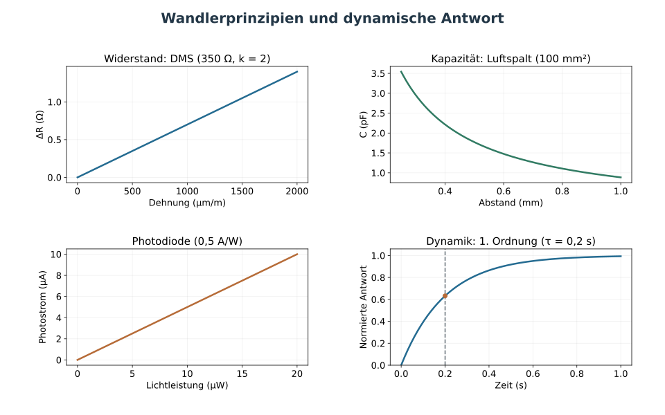

# M16-L1 – Wandlerprinzipien und Sensormodelle {#L1}

**Kursbereich:** M16 – Bachelor: Sensorsysteme und Messsignalverarbeitung

**Niveau:** Bachelor · Wahlbereich

**Vorwissen:** [M3-L4](M3-L4.md), [M6-L1](M6-L1.md).

**Lernziel:** Resistive, kapazitive und optische Wandler anhand ihrer Kennlinie, Empfindlichkeit und Störgrößen auswählen.

## Von der Messgröße zum elektrischen Signal {#S1}

Ein Sensor wandelt eine physikalische Größe in eine auswertbare elektrische Größe um. Die Messgröße $x$ ist nicht mit dem gemeldeten Zahlenwert identisch. Dazwischen liegen physikalische Kopplung, Wandler, Ausleseschaltung, Abtastung, Kalibrierung und Verarbeitung. Ein Wandler für Dehnung liefert beispielsweise zunächst eine Widerstandsänderung, kein digitales Ergebnis in Längeneinheiten. Eine Messkette muss sowohl den Einfluss der gewünschten Größe als auch den Einfluss störender Größen beschreiben.

Ein statisches Sensormodell lautet $y=f(x,z)+e$, wobei $z$ eine Störgröße (z. B. Temperatur) und $e$ ein Fehlerterm ist. Um einen Arbeitspunkt gilt näherungsweise

$$\Delta y\approx S_x\Delta x+S_z\Delta z,\qquad S_x=\frac{\partial f}{\partial x}.$$

Empfindlichkeit ist die lokale Steigung mit Einheit, Auflösung die kleinste unterscheidbare Änderung unter angegebenen Bedingungen. Beides sagt für sich noch nichts über den systematischen Messfehler. Eine Abweichung beim Rückweg der Kennlinie heißt Hysterese; Drift beschreibt die Veränderung bei unveränderter Messgröße im Zeitverlauf.

{alt="Kennlinien von DMS, Plattenkondensator und Photodiode sowie einer normierten Sprungantwort erster Ordnung."}

## Drei Wandlerprinzipien {#S2}

Ein metallischer Dehnungsmessstreifen (DMS) ändert seinen Widerstand durch mechanische Deformation. Für kleine Dehnung $\varepsilon=\Delta l/l$ gilt $\Delta R/R_0=k\varepsilon$, mit dimensionslosem K-Faktor $k$. Ein DMS mit $R_0=350\ \Omega$ und $k=2$ liefert bei $1000\ \mu\mathrm{m}/\mathrm{m}=10^{-3}$ eine Änderung von $0{,}7\ \Omega$. Der Widerstand ist erheblich größer als die interessierende Änderung; deshalb wird in [M16-L2](M16-L2.md) eine Brücke verwendet. Die Temperatur kann ebenfalls Widerstand und mechanische Dehnung beeinflussen.

Ein idealer Plattenkondensator mit Fläche $A$ und Abstand $d$ besitzt $C=\epsilon_0\epsilon_r A/d$. Für eine Luftspaltmessung mit $A=100\ \mathrm{mm^2}$, $d=0{,}5$ mm ergibt sich $C\approx1{,}77$ pF. Wird der Abstand um 10 % kleiner, wächst die Kapazität um 11,1 %. Die Empfindlichkeit $-\epsilon_0\epsilon_r A/d^2$ verändert sich mit dem Abstand. Streukapazitäten von Leitungen, Feuchtigkeit und Randfelder sind bei solch kleinen Kapazitäten wesentlich. Eine Ausleseschaltung kann Kapazität in Ladezeit, Frequenz oder Spannung umwandeln.

Eine Photodiode liefert bei gegebener Wellenlänge im linearen Bereich näherungsweise $I_{ph}=\mathcal R_\lambda P_{opt}$. Bei $\mathcal R_\lambda=0{,}5\ \mathrm{A/W}$ und $10\ \mu\mathrm W$ entstehen 5 µA. Ein invertierender Transimpedanzverstärker mit $R_f=100$ kΩ erzeugt relativ zum Bezugspotential ideal $-0{,}5$ V für die gewählte Stromrichtung. Dunkelstrom, Umgebungslicht und Wellenlänge verändern das Ergebnis; die Rückkopplungskapazität und Diodenkapazität beeinflussen Bandbreite und Stabilität. Photostrom ist nicht ohne geometrisches und optisches Modell eine Entfernungsmessung.

## Dynamische Kennlinie {#S3}

Auch bei perfekter statischer Kalibrierung kann eine zeitabhängige Messgröße verzögert erscheinen. Ein thermisch träger Sensor lässt sich zunächst als Verzögerung erster Ordnung modellieren:

$$\tau\dot y+y=Sx,\qquad H(s)=\frac{S}{1+s\tau}.$$

Bei einem Sprung aus dem Gleichgewicht erreicht die normierte Antwort nach einer Zeitkonstante 63,2 % des Endwertes, nach etwa drei Zeitkonstanten 95 %. Für $\tau=0{,}2$ s beträgt die Grenzfrequenz $1/(2\pi\tau)=0{,}80$ Hz. Höhere digitale Abtastfrequenz kann diese physikalische Verzögerung nicht aufheben. Die idealisierte Gleichung ist nicht für jeden Sensor gültig; mechanische Resonanzen können Modelle höherer Ordnung erforderlich machen.

## Auswahlentscheidung für eine Messaufgabe {#S4}

| Aufgabe | Kandidat | Wesentliche Grenze |
| --- | --- | --- |
| Lokale Dehnung eines Balkens | DMS | Klebung, Temperatur, Kraftpfad |
| Kleiner Weg ohne mechanischen Kontakt | Kapazitiver Abstandssensor | Streufeld, Verschmutzung, Geometrie |
| Lichtleistung oder optische Unterbrechung | Photodiode | Umgebungslicht, Spektrum, Sättigung |

Für die weitere Modellkette wählen wir die lokale Zugdehnung von 0 bis 2000 µm/m an einem idealisiert gleichmäßig gedehnten Bauteil. Wir verwenden den DMS mit 350 Ω und K-Faktor 2. Eine Kraftangabe wäre erst mit einem mechanischen Modell (Geometrie, Elastizitätsmodul, Lastpfad) zulässig. Das digitale Ergebnis wird daher in µm/m angegeben. Ziel ist später die Trennung statischer Messabweichung und dynamischer Verzögerung bei 100 Hz Abtastrate, nicht der Nachweis eines realen Messgeräts.

## Übungen mit Lösungen {#S5}

1. Ein 350-Ω-DMS mit $k=2$ wird um 500 µm/m gedehnt. Wie groß ist $\Delta R$?  
   **Lösung:** $350\cdot2\cdot500\cdot10^{-6}=0{,}35\ \Omega$.
2. Der Abstand eines idealen Plattenkondensators verdoppelt sich. Was geschieht bei unveränderter Fläche?  
   **Lösung:** Die Kapazität halbiert sich; der Betrag der lokalen Empfindlichkeit sinkt auf ein Viertel.
3. Bei $0{,}4$ A/W und 20 µW optischer Leistung: Welcher ideale Photostrom entsteht?  
   **Lösung:** 8 µA; Dunkelstrom und Verstärkerfehler sind nicht enthalten.
4. Ein Sensor benötigt 0,6 s bis ungefähr 95 % des Sprungs. Schätze $\tau$.  
   **Lösung:** etwa 0,2 s für ein Modell erster Ordnung. Ein schnellerer ADC verändert diese Zeitkonstante nicht.

## Quellen {#S6}

- [TU Delft OpenCourseWare – Measurement Science: Sensors](https://ocw.tudelft.nl/course-lectures/sensors/) · Week 2, Sensors: Übersicht resistiver, kapazitiver und induktiver Wandler; Video nicht geprüft. · Zuletzt abgerufen: 2026-11-25
- [NI – Measuring Strain with Strain Gages](https://www.ni.com/en/shop/data-acquisition/sensor-fundamentals/measuring-strain-with-strain-gages.html) · Abschnitt Signal Conditioning for Strain Gages: Brückenspeisung, Offset, Verstärkung und Filterung. · Zuletzt abgerufen: 2026-11-25
