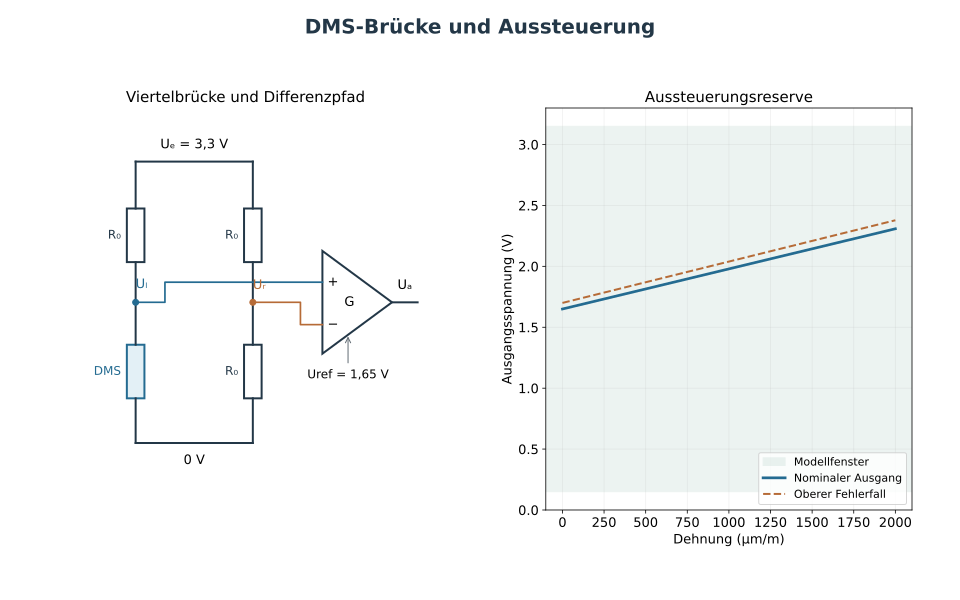

# M16-L2 – Brückenschaltung, Verstärkung und Störungen {#L2}

**Kursbereich:** M16 – Bachelor: Sensorsysteme und Messsignalverarbeitung

**Niveau:** Bachelor · Wahlbereich

**Vorwissen:** [M16-L1](M16-L1.md), [M3-L4](M3-L4.md).

**Lernziel:** Brückenspannung, Verstärkung, Offset und Aussteuerungsreserven einer analogen Messkette bestimmen.

## Differenzmessung an der Wheatstone-Brücke {#S1}

Vier Widerstände bilden zwei Spannungsteiler mit gemeinsamer Speisung $U_E=3{,}3$ V. Links liegt oben $R_0$ und unten der aktive DMS $R_0(1+\delta)$; rechts sind beide Widerstände $R_0$. Die Verstärkereingänge belasten die Brücke im idealen Modell nicht. Mit $\delta=k\varepsilon$ folgt

$$U_L=U_E\frac{1+\delta}{2+\delta},\qquad U_R=\frac{U_E}{2},$$

$$U_d=U_L-U_R=U_E\frac{\delta}{2(2+\delta)}\approx\frac{U_E}{4}k\varepsilon.$$

Die Näherung setzt $|\delta|\ll1$ voraus. Bei 2000 µm/m und $k=2$ ergibt die exakte Gleichung $3{,}2934$ mV, die lineare 3,3000 mV. Der Brückenfehler der Näherung beträgt hier ungefähr 0,2 % des Signals. Das Vorzeichen hängt bewusst von Brückenarm und Eingangszuordnung ab.

{alt="Viertelbrücke mit aktivem unteren linken Widerstand und Differenzverstärker; nominelle Ausgangskennlinie und zulässiges Modellfenster."}

## Verstärkung und Aussteuerung {#S2}

Ein Instrumentenverstärker bildet ideal $U_A=U_{ref}+G U_d$. Mit $G=200$ und $U_{ref}=1{,}65$ V erhält man bei maximaler Zugdehnung 2,309 V. Die nominelle Empfindlichkeit am Ausgang beträgt 0,330 mV je µm/m. Die kleine Brückenänderung wird damit gut nutzbar, ohne die 3,3-V-ADC-Grenze auszureizen. Der Referenzeingang dient der Verschiebung der Ausgangslage, nicht automatisch als fehlerfreie Spannungsquelle. Der Versuch arbeitet nominell im Bereich zwischen null und 2000 µm/m. Negative Dehnung erzeugt ein Signal unterhalb des Bezugspunktes und muss bei Bedarf separat freigegeben werden.

Reale Verstärker erlauben nicht zwangsläufig den gesamten Bereich zwischen den Versorgungsschienen. Für das Lehrmodell nehmen wir ein zulässiges Ausgangsfenster 0,15 bis 3,15 V an, maximalen gesamten Ausgangsoffset 50 mV und maximalen positiven Verstärkungsfehler 3 %. Im ungünstigen oberen Lastfall ergibt sich $1{,}65+0{,}05+206\cdot0{,}0032934=2{,}3784$ V; Reserve bis 3,15 V etwa 0,772 V. Am unteren Ende bleiben mindestens 1,60 V. Die Gleichtaktbedingung ist zusätzlich zu prüfen: $U_{cm}=(U_L+U_R)/2$ liegt zwischen 1,650 und 1,652 V. Zulässige Eingangs-Gleichtaktspannung kann bei einem realen Typ von Verstärkung und Ausgangsspannung abhängen. Ein gültiger Ausgangspegel beweist daher allein keine Linearität der Schaltung.

## Störkopplung und Rauschbudget {#S3}

Gleichtaktunterdrückung (CMRR) bezeichnet das Verhältnis von Differenzverstärkung zu Gleichtaktverstärkung. Für $\mathrm{CMRR}_{dB}=80$ entspricht eine Änderung von 0,1 V am Gleichtakteingang ideal einer eingangsbezogenen Differenz von $0{,}1/10^4=10$ µV und nach Verstärkung 2 mV. Das entspricht etwa 6,1 µm/m. Der Wert gilt nur bei der spezifizierten Frequenz und Betriebsbedingung, denn CMRR nimmt häufig mit Frequenz ab. Leitungsimpedanzen und asymmetrische Filter können zusätzlichen Gleichtakt-Differenz-Übergang erzeugen. Eine verdrillte Differenzleitung, passende Schirmung, ein symmetrischer Filter und kurze Verbindungen können Störungen reduzieren. Ein digitales Mittelwertfilter ersetzt keine analoge Störunterdrückung vor dem ADC.

Ein Eingangs-Offset von 50 µV würde am Ausgang ideal eine Verschiebung um 10 mV erzeugen. Bei der Umrechnung entspricht das rund 30,3 µm/m. Nullpunktkalibrierung kann einen konstanten Offset erfassen, nicht automatisch dessen Temperaturdrift. Für unkorrelierte Rauschanteile mit Standardabweichungen $\sigma_i$ gilt $\sigma_{ges}=\sqrt{\sum_i\sigma_i^2}$. Periodische Einstreuung, korrelierte Drift und Sättigung dürfen nicht ohne Prüfung auf dieselbe Weise bilanziert werden.

## Energie und Speisung {#S4}

Im unbelasteten Brückenfall fließen je Zweig $3{,}3/700=4{,}71$ mA. Der aktive 350-Ω-Widerstand setzt ca. 7,78 mW in Wärme um; die gesamte Brücke benötigt ca. 31,1 mW. Eigenerwärmung kann den Messwert verschieben. Eine kleinere Speisespannung halbiert bei entsprechender Änderung des Spannungswertes die Empfindlichkeit und reduziert die Verlustleistung quadratisch. Ratiometrischer Betrieb nutzt dieselbe Speisung als ADC-Bezug: eine gemeinsame Skalierung von Brückenspannung und ADC-Referenz kann sich im Code aufheben, sofern Verstärkung, Ausgangsreferenz und weitere Fehlerquellen dazu passen. Für das Folgebeispiel gilt eine konstante gemeinsame 3,3-V-Referenz.

## Übungen mit Lösungen {#S5}

1. Berechne die lineare Brückenspannung bei 500 µm/m.  
   **Lösung:** $3{,}3\cdot2\cdot500\cdot10^{-6}/4=0{,}825$ mV.
2. Bei $G=400$ und 2000 µm/m: Liegt der ideale Ausgang im Modellfenster?  
   **Lösung:** $1{,}65+400\cdot0{,}0032934=2{,}9674$ V. Ja, allerdings bleiben nur rund 183 mV Reserve vor zusätzlichen Fehlern.
3. Wie groß ist die eingangsbezogene Differenzstörung bei 60 dB CMRR und 50 mV Gleichtaktänderung?  
   **Lösung:** 50 µV, bei $G=200$ entsprechend 10 mV am Ausgang.
4. Die Brückenspeisung wird auf 1,65 V reduziert. Wie ändert sich die Verlustleistung nominell?  
   **Lösung:** auf ein Viertel (7,78 mW für die gesamte Brücke); die Brückenempfindlichkeit halbiert sich.

## Quellen {#S6}

- [NI – Measuring Strain with Strain Gages](https://www.ni.com/en/shop/data-acquisition/sensor-fundamentals/measuring-strain-with-strain-gages.html) · Abschnitt Signal Conditioning for Strain Gages: Brückenspeisung, Offset, Verstärkung und Filterung. · Zuletzt abgerufen: 2026-11-25
- [Analog Devices – How to Stay Out of Deep Water when Designing with Bridge Sensors](https://www.analog.com/en/resources/analog-dialogue/articles/how-to-stay-out-of-deep-water.html) · Einleitung: Differenzsignal einer Messbrücke, Gleichtaktspannung und Offset. · Zuletzt abgerufen: 2026-11-25
