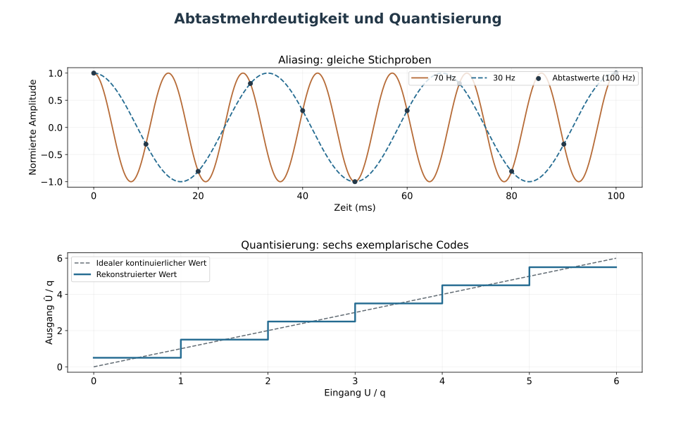

# M16-L3 – Abtastung, Quantisierung und Wandlerfehler {#L3}

**Kursbereich:** M16 – Bachelor: Sensorsysteme und Messsignalverarbeitung

**Niveau:** Bachelor · Wahlbereich

**Vorwissen:** [M5-L1](M5-L1.md), [M16-L2](M16-L2.md).

**Lernziel:** ADC-Auflösung und Fehlerbudget bestimmen sowie Aliasfrequenzen und Anforderungen an den analogen Vorfilter berechnen.

## Abtastung und Frequenzmehrdeutigkeit {#S1}

Ein ADC erfasst ein zeitkontinuierliches Signal an diskreten Zeitpunkten $t_n=nT_s$ mit $T_s=1/f_s$. Für bandbegrenzte Signale ist die ideale Rekonstruktion aus gleichmäßigen Abtastwerten möglich, wenn $f_s>2f_{max}$ gilt. Das mathematische Modell setzt auch einen idealen Rekonstruktionsfilter und keine Quantisierung voraus. In der Praxis muss ein analoges Anti-Aliasing-Filter unerwünschte Spektralanteile ausreichend vor dem Abtasten unterdrücken. Bei $f_s=100$ Hz ist die Nyquist-Frequenz 50 Hz; eine Störung mit 70 Hz erscheint als 30 Hz, weil

$$\cos(2\pi\cdot70 n/100)=\cos(2\pi\cdot30 n/100).$$

Nach der Digitalisierung sind diese zwei Cosinussignale anhand der Abtastwerte allein ununterscheidbar. Der Fehler ist nicht durch Erhöhen der digitalen Bitzahl zu beheben. Bei realen Signalen ist die gefaltete Frequenz $f_a=|f-mf_s|$ mit passendem ganzzahligen $m$ im Bereich 0 bis $f_s/2$ zu wählen; die Phasenbeziehung hängt u. a. vom Vorzeichen vor dem Betrag ab.

{alt="70-Hz- und 30-Hz-Cosinus mit gemeinsamen Abtastwerten; idealisierte Quantisierungskennlinie mit Mittelpunktsrekonstruktion."}

## ADC-Kennlinie und Quantisierungsrauschen {#S2}

Wir verwenden als fortlaufendes Lehrmodell einen unipolaren idealen 12-Bit-ADC mit 3,3 V Vollbereich, $2^{12}=4096$ Codes und Quantisierungsweite $q=3{,}3/4096=0{,}80566$ mV. Für $0\le U<3{,}3$ V bildet er $c=\lfloor U/q\rfloor$; oberhalb und unterhalb des Messbereichs wird der Code begrenzt. Der rekonstruierte Spannungswert ist $\hat U=(c+1/2)q$. Ohne Übersteuerung liegt $\hat U-U$ zwischen $-q/2$ und $q/2$ (Randwertkonvention). Mit dieser Definition sind die Bereichsgrenzen nicht zugleich die rekonstruierten Spannungswerte der äußersten Codes.

Relativ zur nominellen Empfindlichkeit 0,330 mV/(µm/m) entspricht ein LSB ca. 2,44 µm/m. Wird der Quantisierungsfehler als gleichverteilt und unabhängig vom Eingang modelliert, ergibt sich

$$\sigma_q=\frac{q}{\sqrt{12}}=0{,}233\ \mathrm{mV}.$$

Diese Näherung ist bei genügend wechselndem Eingang oder Dither sinnvoll, aber nicht bei jedem konstanten Signal: Ohne Rauschen kann der Fehler über alle Abtastwerte gleich bleiben. Für einen voll ausgesteuerten idealen Sinus folgt aus effektivem Signalwert $V_{FS}/(2\sqrt2)$ und Quantisierungsrauschen die bekannte Relation $\mathrm{SNR}_{dB}\approx6{,}02N+1{,}76$. Bei zwölf Bit sind es etwa 74 dB unter genau diesen Modellannahmen. Ein kleineres Eingangssignal nutzt den Dynamikbereich weniger aus. ENOB (effective number of bits) wird bei einem Sinustest aus SINAD, also einschließlich Verzerrungen, bestimmt und darf nicht mit der reinen nominalen Auflösung verwechselt werden.

## Erweiterte Fehlerquellen {#S3}

Ein ADC kann Offsetfehler, Verstärkungsfehler, differentielle Nichtlinearität (abweichende Codebreiten) und integrale Nichtlinearität (abweichender Kennlinienverlauf) aufweisen. Eine Kalibriergerade kann nur affine Abweichungen vollständig kompensieren. Die Referenzspannung beeinflusst den Maßstab; Eingangsimpedanz und die Ladezeit eines Sample-and-Hold können zusätzliche Settling-Fehler verursachen. Bei kleinem Zeitjitter $\Delta t$ ist die Spannungsabweichung näherungsweise $\dot U(t)\Delta t$. Steile Flanken oder hohe Frequenzen erhöhen damit das zeitbedingte Fehlerbudget.

Im späteren Versuch setzen wir zusätzlich ein unabhängiges analoges Ausgangsrauschen mit $\sigma_A=2$ mV an. Das quadratische Budget ergibt $\sqrt{2^2+0{,}233^2}=2{,}014$ mV am ADC bzw. ca. 6,10 µm/m bezogen auf die nominelle Empfindlichkeit. Hier dominiert nicht die Quantisierung, sondern das analoge Rauschen. Mehr nominale Bits allein verbessern die tatsächliche Genauigkeit daher kaum. Die Berechnung setzt voraus, dass kein Clipping auftritt.

## Dimensionierung des Anti-Aliasing-Pfads {#S4}

Bei Nutzsignal bis 5 Hz und einer 70-Hz-Störung betrachten wir zwei gepufferte identische RC-Tiefpässe mit jeweils 10 Hz Grenzfrequenz. Die Gesamtamplitude ist $|H(f)|=1/(1+(f/10)^2)$. Bei 5 Hz bleiben 80 % der Amplitude (etwa −1,94 dB); bei 70 Hz bleiben 2 % (etwa −34 dB). Aus einer 100-mV-Störung werden also noch 2 mV bei 70 Hz, die nach Abtastung bei 30 Hz erscheinen können. Die 5-Hz-Nutzamplitude wird ebenfalls messbar verändert. Ein anderes Filter oder eine höhere Abtastrate kann erforderlich sein, wenn diese Abweichungen nicht tolerierbar sind. Das Filter ist ein Entwurfsbeispiel, nicht im vereinfachten dynamischen Versuch von M16-L5 enthalten. Eine reale Spezifikation umfasst alle relevanten Störbänder, Phasengang und Settling.

## Übungen mit Lösungen {#S5}

1. Welches Alias entsteht aus einem Cosinus mit 123 Hz bei 100 Hz Abtastrate?  
   **Lösung:** 23 Hz.
2. Wie groß ist $q$ bei 16 Bit und 3,3 V Vollbereich?  
   **Lösung:** 50,35 µV; das analoge 2-mV-Rauschen bleibt unverändert.
3. Welcher Code ergibt sich bei genau 1,65 V im idealen 12-Bit-Modell?  
   **Lösung:** 2048, rekonstruierter Wert etwa 1,650403 V.
4. Die analoge Störung ist 0,2 V bei 70 Hz. Welche Amplitude erreicht nach den zwei 10-Hz-RC-Stufen den ADC?  
   **Lösung:** 4 mV; sie kann im digitalen Signal als 30-Hz-Anteil auftreten.

## Quellen {#S6}

- [Analog Devices / Walt Kester – MT-001, Quantization Noise and SNR](https://www.analog.com/media/en/training-seminars/tutorials/MT-001.pdf) · Rev. A, S. 1, Quantization Noise Model: idealer ADC und Quantisierungsfehler; Voraussetzungen des SNR-Modells. · Zuletzt abgerufen: 2026-11-25
- [TU Delft OpenCourseWare – Measurement Science: Sensors](https://ocw.tudelft.nl/course-lectures/sensors/) · Woche 2, Sensors: Wandlung und Sensortypen; nur ergänzender Kontext, kein Beleg für ADC-Quantisierung. Dafür MT-001 und MT-002 heranziehen. · Zuletzt abgerufen: 2026-11-25
- [Analog Devices / Walt Kester – MT-002, What the Nyquist Criterion Means to Your Sampled Data System Design](https://www.analog.com/media/en/training-seminars/tutorials/MT-002.pdf) · Rev. A, S. 1, Abb. 1: Abtastung, analoger Vorfilter und digitale Signalverarbeitung. · Zuletzt abgerufen: 2026-11-25
