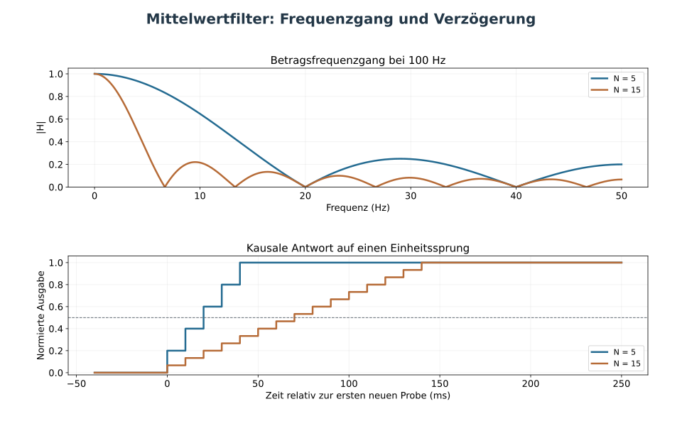

# M16-L4 – Filtern und Schätzen bei verrauschten Daten {#L4}

**Kursbereich:** M16 – Bachelor: Sensorsysteme und Messsignalverarbeitung

**Niveau:** Bachelor · Wahlbereich

**Vorwissen:** [M5-L4](M5-L4.md), [M16-L3](M16-L3.md).

**Lernziel:** Rauschunterdrückung, Frequenzgang und Zeitverzögerung eines kausalen Filters gemeinsam dimensionieren.

## Zufallsschwankung und systematischer Fehler {#S1}

Ein Sensor liefert mehrere Beobachtungen $x[n]=s[n]+e[n]$. Wenn das wahre Signal innerhalb eines Messfensters konstant ist und der additive Fehler unabhängig, mittelwertfrei und mit Varianz $\sigma^2$ verteilt ist, ist der arithmetische Mittelwert ein unverzerrter Schätzer des konstanten Signals. Seine Varianz beträgt $\sigma^2/N$. Ein konstanter Offset $b$ bleibt jedoch unverändert erhalten. Ein verrauschtes Signal mit geringem Mittelwertfehler kann präziser auswertbar sein als ein glattes, aber falsch kalibriertes Signal.

Für korrelierte Fehler mit Autokovarianz $\gamma[k]$ gilt allgemeiner

$$\mathrm{Var}(\bar e)=\frac{1}{N^2}\left(N\gamma[0]+2\sum_{k=1}^{N-1}(N-k)\gamma[k]\right).$$

Langsam variierende Fehler oder periodische Störungen folgen deshalb nicht zwingend der $1/\sqrt N$-Regel der Standardabweichung.

## Gleitender Mittelwert als FIR-Filter {#S2}

Ein kausaler gleitender Mittelwert über $N$ Abtastwerte lautet

$$y[n]=\frac1N\sum_{k=0}^{N-1}x[n-k].$$

Er hat eine endliche Impulsantwort $h[k]=1/N$ für $0\le k<N$, sonst null. Im stationären Betrieb kann er effizient mit der laufenden Summe $s[n]=s[n-1]+x[n]-x[n-N]$ berechnet werden. Dazu müssen der älteste Wert und die Summe gespeichert werden. Bei Integer-Arithmetik muss der Akkumulator das maximale $N$-Fache des Codes tragen; bei 15 Werten aus einem 12-Bit-ADC sind das 61425, ohne weitere signed/Offset-Arithmetik passend für 16 Bit unsigned. Initialwerte vor Messbeginn sind als Annahme zu behandeln; wir geben erst nach $N$ realen Messwerten ein gültiges Filterergebnis aus.

Die Übertragungsfunktion für $\omega=2\pi f/f_s$ folgt aus der geometrischen Reihe:

$$H(e^{j\omega})=e^{-j\omega(N-1)/2}\frac{\sin(N\omega/2)}{N\sin(\omega/2)}.$$

An der Stelle $\omega=0$ ist der Grenzwert eins. Bei 100 Hz und $N=5$ liegt die erste Nullstelle bei 20 Hz, bei $N=15$ bei 6,67 Hz. Die Gruppenlaufzeit beträgt bei beiden Filtern $(N-1)/(2f_s)$, außerhalb von Nullstellen und Phasensprüngen, also 20 bzw. 70 ms. Diese Aussage beschreibt die Filterzeit, nicht zusätzlich Rechenzeit oder Kommunikationsverzögerung. Ein idealer positiver Sprung erscheint nach $N$ neuen Werten vollständig im Ergebnis; der Übergang beginnt sofort mit dem ersten neuen Wert, die halbe Höhe wird für ungerades $N$ nach $(N-1)/2$ Intervallen erreicht.

{alt="Frequenzgang und normierte Sprungantwort kausaler gleitender Mittelwerte mit 5 und 15 Abtastwerten bei 100 Hz."}

## Rekursiver Tiefpass {#S3}

Eine speichersparende Alternative ist der exponentielle Mittelwert $y[n]=\alpha x[n]+(1-\alpha)y[n-1]$ mit $0<\alpha\le1$. Bei $0<\alpha<1$ hat das Filter einen Pol bei $z=1-\alpha$ und eine unendlich lange, abklingende Impulsantwort. Für $\alpha=1-e^{-T_s/\tau}$ entspricht die Abklingrate eines idealen Tiefpasses erster Ordnung mit Zeitkonstante $\tau$. Das rekursive Filter ist nicht linearphasig. Bei konstantem Signal und unabhängigem weißem Rauschen hat der eingeschwungene Ausgang die Varianz $\sigma^2\alpha/(2-\alpha)$. Der Anfangswert beeinflusst das Ergebnis während des Einschwingens. Bei fehlenden Messwerten ist zu entscheiden, ob das Zeitintervall angepasst, der Zustand weitergeführt oder die Ausgabe als ungültig markiert wird.

## Filterentscheidung für die Messkette {#S4}

Bei $\sigma=6{,}1$ µm/m und 100 Hz erwarten wir ideal 2,73 µm/m für $N=5$ und 1,58 µm/m für $N=15$. Wenn die halbe Höhe eines Sprungs innerhalb von 30 ms erkannt werden muss, erscheint $N=5$ plausibel; $N=15$ überschreitet bereits im idealen Filtermodell das Budget. Bei langsamen statischen Messungen kann ein längeres Fenster dagegen sinnvoll sein. Die Fallstudie in [M16-L5](M16-L5.md) berechnet sowohl das tatsächliche Rauschen eines Datensatzes als auch den Detektionszeitpunkt. Ein Vergleich benötigt identische Rohdaten und eine vorher definierte Metrik. Für Filterwahl in einer Regelung müssen zusätzlich Phasenreserve und die gesamte Schleifenlatenz betrachtet werden.

## Übungen mit Lösungen {#S5}

1. Wie groß ist die erwartete Standardabweichung bei $\sigma=12$ µm/m und 9 unabhängigen Messwerten?  
   **Lösung:** 4 µm/m. Ein konstanter Offset bleibt bestehen.
2. Welche Gruppenlaufzeit entsteht bei $N=11$ und 200 Hz?  
   **Lösung:** 25 ms.
3. Wie viel beträgt der Ausgang eines Filters $N=5$ beim ersten neuen Wert eines Sprungs von 500 auf 1500 µm/m?  
   **Lösung:** $(4\cdot500+1500)/5=700$ µm/m; beim dritten neuen Wert 1100 µm/m.
4. Für $T_s=10$ ms und $\tau=50$ ms: Bestimme $\alpha$.  
   **Lösung:** $1-e^{-0{,}2}\approx0{,}1813$. Der Startwert ist zu dokumentieren.

## Quellen {#S6}

- [Steven W. Smith – The Scientist and Engineer’s Guide to DSP, Kapitel 15](https://www.dspguide.com/ch15.htm) · Kapitel 15, Einleitung: gleitender Mittelwert und Grenzen der Frequenzselektion. · Zuletzt abgerufen: 2026-11-25
- [Analog Devices / Walt Kester – MT-002, What the Nyquist Criterion Means to Your Sampled Data System Design](https://www.analog.com/media/en/training-seminars/tutorials/MT-002.pdf) · Rev. A, S. 1, Abb. 1: Abtastung, analoger Vorfilter und digitale Signalverarbeitung. · Zuletzt abgerufen: 2026-11-25
