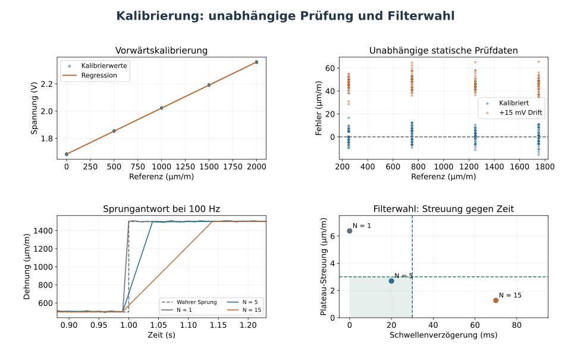

# M16-L5 – Fallstudie Kalibrierung und Qualitätsnachweis {#L5}

**Kursbereich:** M16 – Bachelor: Sensorsysteme und Messsignalverarbeitung

**Niveau:** Bachelor · Wahlbereich

**Vorwissen:** [M16-L1](M16-L1.md), [M16-L2](M16-L2.md), [M16-L3](M16-L3.md), [M16-L4](M16-L4.md).

**Lernziel:** Eine vollständige synthetische Messkette kalibrieren und mit unabhängigen Prüfpunkten, Rauschen und Sprungverzögerung bewerten.

## Modell und Prüfplan {#S1}

Die Messkette soll eine Zugdehnung zwischen 0 und 2000 µm/m erfassen. Die nominelle Kennlinie und Quantisierung stammen aus den vorherigen Lektionen. Die simulierte reale Vorwärtskennlinie enthält die exakte Brücke, 2,5 % Verstärkungsabweichung, 35 mV Ausgangsoffset und unabhängiges normalverteiltes Ausgangsrauschen mit Standardabweichung 2 mV. Der ideale ADC hat zwölf Bit und 3,3 V Vollbereich. Die simulierte Referenzdehnung ist exakt; für ein späteres realitätsnäheres Unsicherheitsbudget setzen wir separat eine unabhängige Standardunsicherheit von 2 µm/m für die Referenz an. Die Daten sind vollständig synthetisch und keine Messung.

Die Kalibrierung nutzt je zwölf unabhängige Werte bei 0, 500, 1000, 1500 und 2000 µm/m. Eine getrennte statische Prüfung verwendet je 40 Werte bei 250, 750, 1250 und 1750 µm/m. Danach prüfen wir zusätzlich 15 mV veränderten Ausgangsoffset auf denselben Dehnungsstufen. Das Modell soll im nominalen Kalibrierzustand über diese Prüfpunkte einen RMSE von höchstens 8 µm/m und eine maximal beobachtete absolute Abweichung von höchstens 25 µm/m erreichen. Für einen idealen Sprung bei 100 Hz soll ein Filter die Standardabweichung auf dem Plateau unter 3 µm/m senken und die halbe Sprunghöhe spätestens nach 30 ms überschreiten. Das sind didaktische Kriterien, keine Norm oder statistisch abgesicherten Grenzwerte. Der Sprungversuch verzichtet bewusst auf mechanische Trägheit und analoge Filterung, damit der digitale Anteil sichtbar wird.

## Schätzung und inverse Kennlinie {#S2}

Bei bekannter Referenz $x_i$ und beobachteter Spannung $y_i$ schätzen wir mit kleinsten Quadraten das Vorwärtsmodell $y=a+bx$. Minimiert wird $\sum_i(y_i-a-bx_i)^2$, woraus

$$\hat b=\frac{\sum_i(x_i-\bar x)(y_i-\bar y)}{\sum_i(x_i-\bar x)^2},\qquad\hat a=\bar y-\hat b\bar x$$

folgen. Bei einer neuen Messspannung erhält man die inverse Schätzung $\hat x=(y-\hat a)/\hat b$. Das Verfahren setzt eine hinreichend genaue Referenz und in diesem Bereich eine ausreichende lineare Modellgüte voraus. Bei bedeutsamen Referenzfehlern oder ausgeprägter Nichtlinearität wären andere Modelle oder Unsicherheitsverfahren nötig. Die Prüfdaten bleiben von der Schätzung getrennt: Ein kleines Trainingsresiduum allein beweist keine verlässliche neue Messung.

Die Beispielrechnung ist mit Python und NumPy reproduzierbar; die Zufallsreihenfolge wird über einen festen Seed festgelegt. Neben Auswertung der unabhängigen Fälle prüft der Code Residuenbedingungen, fehlendes Clipping, Mittelwertfilter und das Aliasing-Beispiel. `np.polyfit` gibt Steigung vor Achsenabschnitt zurück.

```python
import numpy as np
rng = np.random.default_rng(1601)
q = 3.3 / 4096

def voltage(e, drift=0):
    d = 2 * np.asarray(e) * 1e-6
    bridge = 3.3 * d / (2 * (2 + d))
    return 1.65 + .035 + 200 * 1.025 * bridge + drift

def sample(e, drift=0):
    v = voltage(e, drift) + rng.normal(0, .002, np.shape(e))
    code = np.clip(np.floor(v / q), 0, 4095).astype(int)
    assert np.all((v >= 0) & (v < 3.3))
    return (code + .5) * q

x = np.repeat(np.arange(0, 2001, 500), 12)
y = sample(x)
b, a = np.polyfit(x, y, 1)
r = y - (a + b*x)
assert abs(r.sum()) < 1e-10 and abs(r@x) < 1e-7
levels = np.arange(250, 2000, 500)
z = np.repeat(levels, 40)
v = sample(z)
v_drift = sample(z, .015)
nominal = (v-1.65)/.00033
cal = (v-a)/b
cal_drift = (v_drift-a)/b

def stats(estimate):
    e = estimate-z
    return np.mean(e), np.sqrt(np.mean(e**2)), np.max(np.abs(e))

print('fit', a, b, 'sV', np.sqrt(r@r/(len(x)-2)))
for name, est in [('nominal',nominal),('cal',cal),('drift',cal_drift)]:
    print(name,stats(est))
for level in levels:
    errors=(cal-z)[z==level]
    print(level, errors.mean(), errors.std(ddof=1))
# independent verification data: pooled scatter and observed max mean error
s=np.sqrt(sum(np.var((cal-z)[z==k],ddof=1)*39 for k in levels)/156)
print('pooled',s,'u',np.hypot(s,2))
# dynamic trial: input step at sample 100, 100 Hz
n=np.arange(300); truth=np.where(n<100,500,1500)
raw=(sample(truth)-a)/b
filters={}
for N in (1,5,15):
    out=np.full(len(raw),np.nan); out[N-1:]=np.convolve(raw,np.ones(N)/N,'valid')
    filters[N]=out
    cross=np.flatnonzero((n>=100)&(out>=1000))[0]-100
    print(N, np.std(out[130:280],ddof=1), cross*10)
    assert abs(out[-1]-np.mean(raw[-N:])) < 1e-9
assert np.allclose(np.cos(2*np.pi*70*n/100), np.cos(2*np.pi*30*n/100))
```

## Statischer Qualitätsnachweis und Drift {#S3}

Die Regression ergibt $\hat a=1{,}6843213$ V, $\hat b=0{,}0003381104$ V/(µm/m) und eine Residualstandardabweichung von 2,130 mV (58 Freiheitsgrade). Die exakte Sensorbrücke ist leicht nichtlinear; die Gerade approximiert sie über den festgelegten Bereich. Die unabhängigen Prüfresultate lauten:

| Verfahren / Zustand | Mittelwertfehler (µm/m) | RMSE (µm/m) | Größter absoluter Fehler (µm/m) |
| --- | ---: | ---: | ---: |
| Nominale Kennlinie, ohne Kalibrierung | 129,30 | 130,13 | 157,96 |
| Kalibriergerade | 0,70 | 6,00 | 16,64 |
| Alte Kalibriergerade nach +15 mV Offsetdrift | 46,35 | 46,81 | 65,49 |

Die kalibrierte Kette besteht die nominalen statischen Modellkriterien. Die ungeänderte Kalibriergerade versagt nach Offsetdrift: Erwartet werden schon ohne Rauschen etwa $0{,}015/\hat b=44{,}36$ µm/m zusätzlicher Bias. Eine neue Nullpunktmessung könnte bei reinem Offset helfen; wenn Steigung oder Hysterese ebenfalls variieren, genügt sie nicht.

| Prüfdehnung (µm/m) | Mittlere Abweichung (µm/m) | Standardabweichung (µm/m) |
| ---: | ---: | ---: |
| 250 | 0,50 | 5,75 |
| 750 | 1,97 | 6,19 |
| 1250 | 0,64 | 4,94 |
| 1750 | −0,28 | 6,89 |

Die gepoolte Intra-Stufen-Standardabweichung beträgt 5,98 µm/m. Für eine einzelne neue stationäre Beobachtung ergibt die quadratische Kombination mit der angenommenen unabhängigen Referenzunsicherheit $u_{teil}=\sqrt{5{,}98^2+2^2}=6{,}31$ µm/m. Das ist ausdrücklich nur ein Teilbudget: Regressionsparameter, Restnichtlinearität, Temperatur, Referenzkorrelation, Langzeitstabilität und echte mechanische Referenz sind in einem vollständigen Unsicherheitsnachweis separat zu berücksichtigen. Der maximale beobachtete Gruppenmittelwertfehler von 1,97 µm/m ist kein garantierter Fehlergrenzwert. Die Quantisierung und das simulierte analoge Rauschen stecken bereits in der beobachteten Streuung; sie nicht noch einmal addieren. Eine pauschale Verdoppelung des Teilbudgets ist kein zertifizierter 95-%-Bereich.

{alt="Kalibrierkennlinie, unabhängige Fehler im Normal- und Driftfall und Sprungantwort der drei Fenster."}

## Dynamischer Test und Freigabe {#S4}

Die Dehnung springt bei 1,00 s (Sample 100) von 500 auf 1500 µm/m. Aus denselben Rohdaten werden die drei Varianten gebildet. Die Standardabweichung wird auf den Plateau-Samples 130 bis 279 berechnet. Zeitpunkt der halben Höhe ist die erste Probe ab Sample 100 mit geschätzter Dehnung mindestens 1000 µm/m.

| Mittelwertfenster | Plateau-Streuung (µm/m) | Verzögerung der Schwellenüberschreitung | Modellkriterium |
| ---: | ---: | ---: | --- |
| 1 | 6,37 | 0 ms | Rauschen zu hoch |
| 5 | 2,70 | 20 ms | erfüllt |
| 15 | 1,27 | 70 ms | zu langsam |

Wir wählen $N=5$ für diesen Prüfplan. Der Rauschmesswert weicht bei endlicher Stichprobe von der idealen $1/\sqrt{N}$-Erwartung ab; aufeinanderfolgende Mittelwerte sind korreliert. Der Zeitwert gilt relativ zur ersten neuen Probe. Bei einem realen asynchronen Sprung kommt bis zu ungefähr einer Abtastperiode hinzu, außerdem Sensor-, Analogfilter-, Verarbeitungs- und Transportzeit. Die 30-ms-Anforderung für eine reale Gesamtkette ist damit nicht nachgewiesen. Für reale Freigabe wären Referenzrückführung, auf- und absteigende Lastreihen, Temperaturtests, Störfestigkeit, mechanische Kopplung, Clipping/Fehlerflags und dokumentierte dynamische Referenzmessungen notwendig. In Verbindung mit [M15-L5](M15-L5.md) sind Filterzustand, Messzeitpunkt und Gültigkeitsstatus beim Datentransport zu erhalten.

## Übungen mit Lösungen {#S5}

1. Ein neuer Messwert beträgt 2,0 V. Wie groß ist die kalibrierte Dehnung?  
   **Lösung:** $(2{,}0-1{,}6843213)/0{,}0003381104\approx934$ µm/m; nur im kalibrierten Bereich interpretieren.
2. Warum werden die Referenzstufen 250, 750, 1250 und 1750 nicht zur Anpassung verwendet?  
   **Lösung:** Sie ermöglichen eine unabhängige Prüfung der Interpolation, ohne dass sich die Gerade auf diese Fehler einstellen kann.
3. Was passiert bei 15 mV Offsetdrift mit dem gleitenden Mittelwert?  
   **Lösung:** Der Mittelwert reduziert Zufallsstreuung, der konstante Driftfehler bleibt ungefähr 44 µm/m.
4. Welches Fenster ist bei einer idealen digitalen Frist von 30 ms und Plateau-Streuung kleiner 3 µm/m geeignet?  
   **Lösung:** Nur $N=5$ erfüllt beide Kriterien in diesem Datensatz; reale Gesamtlatenz und statistische Wiederholbarkeit sind offen.

**Weiterführend:** M17 behandelt Nachrichtensysteme und die Übertragbarkeit digitalisierter Information.

## Quellen {#S6}

- [NIST/SEMATECH – Data analysis and model validation](https://www.itl.nist.gov/div898/handbook/mpc/section3/mpc365.htm) · §2.3.6.5: Kalibrierdaten und Modellvalidierung. · Zuletzt abgerufen: 2026-11-25
- [NIST/SEMATECH – Calibration of future measurements](https://www.itl.nist.gov/div898/handbook/mpc/section3/mpc366.htm) · §2.3.6.6: Korrektur neuer Messwerte durch inverse Kalibrierkurve. · Zuletzt abgerufen: 2026-11-25
- [NIST/SEMATECH – Uncertainty for linear calibration using check standards](https://itl.nist.gov/div898/handbook/mpc/section3/mpc3672.htm) · §2.3.6.7.2: Unsicherheit aus Kontrollstandardmessungen. · Zuletzt abgerufen: 2026-11-25
- [Steven W. Smith – The Scientist and Engineer’s Guide to DSP, Kapitel 15](https://www.dspguide.com/ch15.htm) · Kapitel 15, Moving Average Filters: weiterführender Literaturhinweis zum Mittelwertfilter und Rauschunterdrückung; konkrete Prüfdaten sind synthetisch. · Zuletzt abgerufen: 2026-11-25
