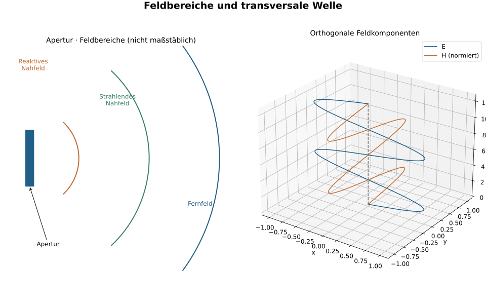

# M17-L1 – Strahlung, Nahfeld und Fernfeld {#L1}

**Kursbereich:** M17 – Bachelor: Antennen

**Niveau:** Bachelor · Wahlbereich

**Vorwissen:** [M4-L1](M4-L1.md), [M1-L6](M1-L6.md).

**Lernziel:** Feldbereiche unterscheiden, Fernfeldgrößen berechnen und lineare Polarisation beschreiben.

## Von der Leitung zum offenen Raum {#S1}

Eine Leitung führt elektromagnetische Energie entlang ihrer Geometrie. Eine Antenne koppelt einen Teil der Leistung in frei propagierende elektromagnetische Wellen ein. Beim Empfang läuft die Kopplung in umgekehrter Richtung. Zeitveränderliche Ladungen und Ströme bestimmen die Felder; eine statische Ladungsverteilung allein erzeugt keine kontinuierliche Abstrahlung. Das statische Feld, gespeicherte reaktive Energie und abgestrahlte Energie sind verschiedene Aspekte desselben Feldmodells.

Für eine harmonische Welle im homogenen Vakuum gelten $c=1/\sqrt{\mu_0\epsilon_0}$, $\lambda=c/f$ und $k=2\pi/\lambda$. Für die Ausbreitung in positiver z-Richtung können wir mit Effektivwert-Zeigern schreiben

$$\underline{\mathbf E}=E_0e^{-jkz}\mathbf e_x,\qquad \underline{\mathbf H}=\frac{E_0}{Z_0}e^{-jkz}\mathbf e_y.$$

$Z_0\approx377\,\Omega$ ist die Freiraumwellenimpedanz, nicht die Eingangsimpedanz der Antenne. Die zeitlich gemittelte Leistungsflussdichte ist $\langle\mathbf S\rangle=\operatorname{Re}(\underline{\mathbf E}\times\underline{\mathbf H}^{*})$, hier $E_0^2/Z_0$ in W/m². Bei Spitzenwert-Zeigern wäre zusätzlich der Faktor 1/2 erforderlich.

## Abstandsbereiche {#S2}

Die Felder eines kleinen harmonischen elektrischen Dipols enthalten Terme, deren Beträge mit $1/r^3$, $1/r^2$ und $1/r$ abfallen. Erst in großer Entfernung dominiert der Strahlungsterm $1/r$. Für elektrisch große Aperturen ist die Variation der Laufwege über die Apertur entscheidend. Der Fraunhofer-Richtwert lautet

$$r_F\approx\frac{2D^2}{\lambda}.$$

$D$ ist die größte relevante Abmessung. Der Ausdruck folgt näherungsweise aus der quadratischen Wegdifferenz $\Delta r\approx D^2/(8r)$; bei $r_F$ beträgt die maximale zugehörige Phasenabweichung gegenüber dem Aperturmittelpunkt etwa $\pi/8$. Er ist keine universelle scharfe Grenze: Zusätzlich müssen Abstand und Wellenlänge sowie Abstand und Antennengröße sinnvoll getrennt sein. Ein verbreiteter Richtwert für die innere Fresnel-Grenze elektrisch großer Antennen ist $0{,}62\sqrt{D^3/\lambda}$. Für kleine Dipole sind andere Kriterien angemessen. Im reaktiven Nahfeld ist das Verhältnis E/H nicht generell $Z_0$; auch im strahlenden Nahfeld kann die Winkelverteilung noch vom Abstand abhängen.

{alt="Links schematische Feldbereiche um eine Apertur, rechts orthogonale E- und H-Felder einer ebenen Welle."}

## Polarisation und Kugelwelle {#S3}

Die Polarisation beschreibt die zeitliche Bahn des elektrischen Feldvektors an einem festen Ort. Gleichphasige orthogonale Komponenten ergeben lineare Polarisation; gleiche Beträge und 90° Phasenversatz ergeben zirkulare Polarisation. Sonst entsteht im allgemeinen Fall eine Ellipse. Bei zirkularer Polarisation muss die Betrachtungsrichtung für den Drehsinn festgelegt werden.

Im Fernfeld breitet sich Leistung näherungsweise radial aus. Bei isotroper Abstrahlung gilt $S=P_\mathrm{rad}/(4\pi r^2)$. Eine gerichtete Quelle ändert die Winkelverteilung, nicht die Gesamtleistung. Für ein festes Winkelintervall sinkt die Flussdichte quadratisch mit dem Abstand, während die Feldamplitude näherungsweise mit $1/r$ fällt. Reflexionen oder Hindernisse können diese Beziehung lokal verändern.

## Rechenbeispiel und Modellgrenze {#S4}

Bei 2,4 GHz ist $\lambda=0{,}1249$ m. Eine Apertur von 0,8 m hat $r_F\approx10{,}25$ m und eine geschätzte innere Fresnel-Grenze von 1,26 m. Bei 1 km ist die Entfernung für diese idealisierte Geometrie deutlich größer als beide. Eine isotrope Quelle mit 0,01 W Strahlungsleistung erzeugt dort $S\approx7{,}96\cdot10^{-10}$ W/m² und $E_\mathrm{eff}\approx0{,}548$ mV/m. Diese Rechnung stellt weder eine Messung noch eine Aussage zu Expositionsgrenzwerten dar. Bei 0,5 m wäre ein einfaches Fernfeldmodell für diese Apertur dagegen ungeeignet.

## Übungen mit Lösungen {#S5}

1. Welche Wellenlänge ergibt sich bei 900 MHz? **Lösung:** rund 0,333 m.
2. Verdopple D bei unveränderter Frequenz. **Lösung:** Der Fraunhofer-Richtwert vervierfacht sich.
3. Was passiert mit dem isotropen Leistungsfluss bei dreifachem Abstand? **Lösung:** Er fällt auf 1/9, die Feldamplitude auf 1/3.
4. Wie groß ist H bei 1 V/m effektiv im ebenen Freiraumfeld? **Lösung:** $1/377\approx2{,}65$ mA/m.

## Quellen {#S6}

- [Eastern Mediterranean University – EENG463 Antenna Theory](https://opencourses.emu.edu.tr/course/view.php?id=395) · Overview of Electromagnetics und Fundamental Parameters of Antennas: Strahlung und Feldgrößen. Kursübersicht, PDF nicht geprüft. · Zuletzt abgerufen: 2026-11-25
- [Steven W. Ellingson – Electromagnetics, Volume 2 (2020, VT Publishing, PDF)](https://vtechworks.lib.vt.edu/bitstream/handle/10919/93253/Electromagnetics_Vol2_screen-reader-friendly.pdf) · § 9.4–9.7 und § 10.7: Strahlungs- und Fernfeldgrundlagen; kein vollständiger Nachweis aller Nahfeldgrenzen. · Zuletzt abgerufen: 2026-11-25
