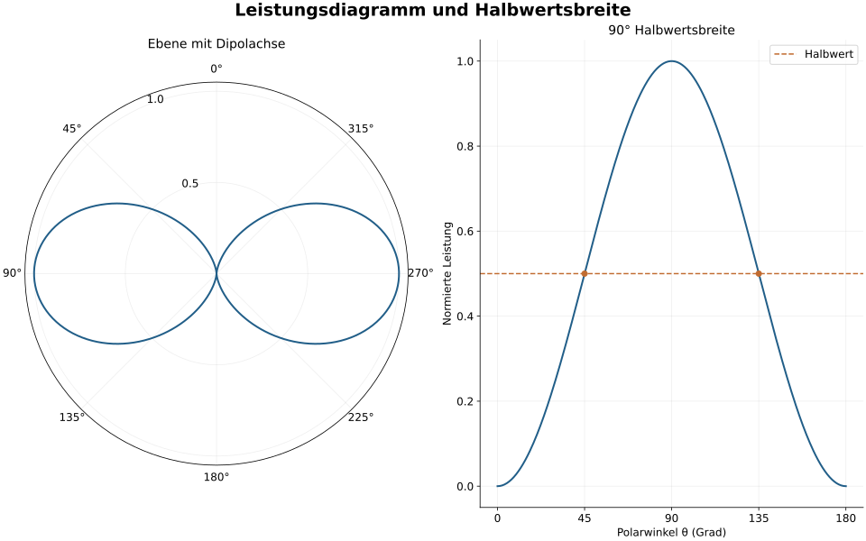

# M17-L2 – Antennenparameter und Richtdiagramme {#L2}

**Kursbereich:** M17 – Bachelor: Antennen

**Niveau:** Bachelor · Wahlbereich

**Vorwissen:** [M17-L1](M17-L1.md), [M2-L3](M2-L3.md).

**Lernziel:** Ein Richtdiagramm integrieren, Gewinn und Richtwirkung unterscheiden und dBi korrekt verwenden.

## Richtungsabhängige Leistungsabgabe {#S1}

Im Fernfeld ist die Strahlungsintensität $U(\theta,\phi)=r^2 S_r$ in W/sr. Die Integration über den Raumwinkel liefert die abgestrahlte Leistung:

$$P_\mathrm{rad}=\int_0^{2\pi}\int_0^\pi U(\theta,\phi)\sin\theta\,d\theta\,d\phi.$$

$\theta$ ist der Polarwinkel gegenüber der z-Achse, $\phi$ der Azimut. Das Gewicht $\sin\theta$ darf nicht fehlen, weil ein Winkelrechteck in Polnähe weniger Raumwinkel abdeckt als am Äquator. Für ein normiertes Leistungsdiagramm $F=U/U_\mathrm{max}$ ist der Strahlraumwinkel $\Omega_A=\int F\,d\Omega$. Die maximale Richtwirkung ist $D_0=4\pi/\Omega_A$. Richtwirkung ist dimensionslos; sie vergleicht die Intensität einer Richtung mit dem räumlichen Mittel bei gleicher Strahlungsleistung.

## Gewinn, Effizienz und Bezugsleistung {#S2}

Wir unterscheiden die am Antennenanschluss angenommene Leistung $P_a$ von der tatsächlich abgestrahlten Leistung. Mit Strahlungswirkungsgrad $\eta=P_\mathrm{rad}/P_a$ gilt

$$G(\theta,\phi)=\eta D(\theta,\phi),\qquad G_\mathrm{dBi}=10\log_{10}G.$$

Der realisierte Gewinn berücksichtigt zusätzlich die Fehlanpassung am definierten Eingang; diese darf in einem Linkbudget nicht ein zweites Mal abgezogen werden. Zuleitungsverluste werden getrennt geführt, sofern der Bezugsort des Datenblattgewinns nicht schon vor der Leitung liegt. dBi referenziert einen idealen isotropen Strahler. dBd bezieht sich auf den idealen Halbwellendipol in seiner Hauptrichtung (rund 2,15 dBi). Ein passives System erzeugt keine zusätzliche Energie: Sein gerichteter Gewinn entsteht durch Umverteilung.

## Diagramm lesen {#S3}

Der elektrisch kurze z-orientierte Dipol hat $F(\theta)=\sin^2\theta$. Das Maximum liegt bei $90^\circ$, Nullstellen entlang der Achse. Der Schnitt in einer Ebene mit der Dipolachse bildet zwei gegenüberliegende Keulen; der Azimutschnitt bei $\theta=90^\circ$ ist kreisförmig. Der 3D-Körper ist kein Kugelstrahler. Die Halbwertspunkte einer Hauptkeule liegen bei $45^\circ$ und $135^\circ$, die Halbwertsbreite beträgt 90°. In dB sind die Halbwertspunkte bei rund −3,01 dB. Ein Feldamplitudenverhältnis von 0,5 entspricht dagegen −6,02 dB.

{alt="Normiertes Dipol-Leistungsdiagramm in Polar- und kartesischer Darstellung mit Halbwertspunkten."}

Bei einer gerichteten Antenne sind zudem Nebenkeulen, Nullstellen und das Vor-Rück-Verhältnis relevant. Eine einzige Halbwertsbreite ersetzt kein dreidimensionales Diagramm und eine schmale Keule in nur einer Ebene garantiert keine hohe Richtwirkung.

## Integration und Zahlenbeispiel {#S4}

Für den kurzen Dipol ergibt sich analytisch

$$\Omega_A=2\pi\int_0^\pi\sin^3\theta\,d\theta=\frac{8\pi}{3},\qquad D_0=\frac32.$$

Die Richtwirkung ist damit 1,76 dBi. Bei $\eta=0{,}8$ beträgt der maximale Gewinn $1{,}2$ beziehungsweise 0,79 dBi. Werden 5 W angenommen, sind 4 W abgestrahlt und 1 W dissipiert. Die maximale Strahlungsintensität beträgt $4\cdot1{,}5/(4\pi)=0{,}4775$ W/sr. Für einen Empfänger in 100 m Abstand ergibt sich in dieser Richtung $47{,}75\,\mu$W/m². Zur eigenen numerischen Kontrolle integriere das normierte Dipolmuster mit dem Raumwinkelgewicht bei 90, 180 und 360 gleich großen Polarwinkelintervallen (Mittelpunkte); prüfe die Annäherung an die analytische Richtwirkung 1,5. Der Wirkungsgrad ist ein gewählter Modellparameter und kein typischer Messwert für beliebige kurze Dipole.

## Übungen mit Lösungen {#S5}

1. Was sind 10 dBi als lineares Verhältnis? **Lösung:** 10.
2. $D_0=4$, $\eta=0{,}5$. **Lösung:** $G_0=2$, etwa 3,01 dBi.
3. Warum wird ein Azimutschnitt eines vertikalen Dipols als omnidirektional bezeichnet? **Lösung:** Er ist bei festem Polarwinkel azimutunabhängig, nicht in allen Raumrichtungen gleich.
4. Ein Diagramm hat Halbwertspunkte bei 20° und 50°. **Lösung:** 30° Halbwertsbreite in diesem Schnitt.

## Quellen {#S6}

- [Eastern Mediterranean University – EENG463 Antenna Theory](https://opencourses.emu.edu.tr/course/view.php?id=395) · Fundamental Parameters of Antennas-1: Richtdiagramm, Gewinn und Polarisation. Kursübersicht, PDF nicht geprüft. · Zuletzt abgerufen: 2026-11-25
- [Steven W. Ellingson – Electromagnetics, Volume 2 (2020, VT Publishing, PDF)](https://vtechworks.lib.vt.edu/bitstream/handle/10919/93253/Electromagnetics_Vol2_screen-reader-friendly.pdf) · § 10.5, § 10.7–10.8, S. 173–182: Strahlungswirkungsgrad, Richtwirkung, Gewinn und Richtdiagramm. · Zuletzt abgerufen: 2026-11-25
