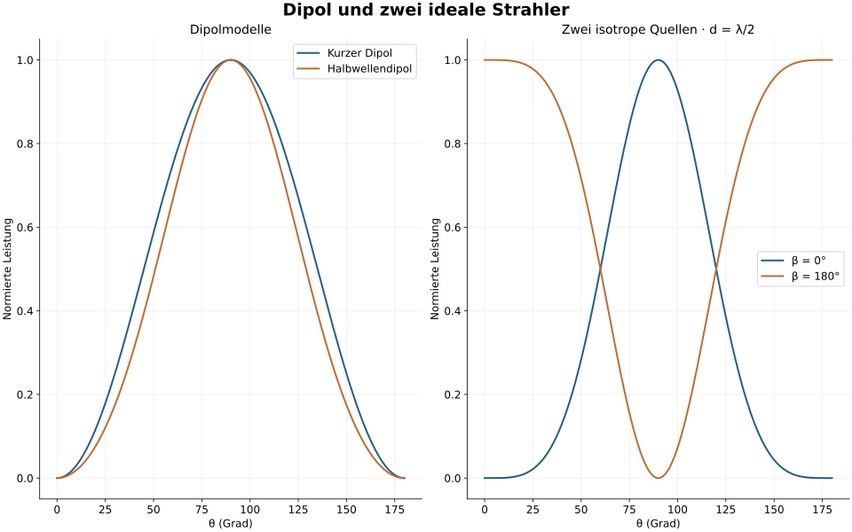

# M17-L3 – Dipol, Apertur und Anordnung {#L3}

**Kursbereich:** M17 – Bachelor: Antennen

**Niveau:** Bachelor · Wahlbereich

**Vorwissen:** [M17-L2](M17-L2.md), [M1-L6](M1-L6.md).

**Lernziel:** Ideale Antennentypen vergleichen und den Arrayfaktor zweier Strahler herleiten.

## Dipolmodelle {#S1}

Beim idealen kurzen (Hertzschen) Dipol wird ein räumlich konstanter Strom auf einer sehr kleinen Länge angenommen. Sein Fernfeldbetrag ist proportional zu $\sin\theta$. Ein physischer dünner kurzer mittengespeister Draht hat dagegen näherungsweise dreieckige Stromverteilung; insbesondere sein Strahlungswiderstand ist deshalb nicht mit dem des Hertzschen Stromelements gleichzusetzen.

Beim dünnen Halbwellendipol nutzen wir eine näherungsweise sinusförmige Stromverteilung. Die normierte Fernfeldamplitude wird dann durch

$$A(\theta)=\frac{\cos[(\pi/2)\cos\theta]}{\sin\theta}$$

beschrieben, mit Grenzwert null an beiden Polen. Der normierte Leistungswert ist $|A|^2$. Der ideale dünne Halbwellendipol hat ungefähr $D_0=1{,}64$ (2,15 dBi). Seine physische Resonanzlänge hängt von Drahtdurchmesser und Umgebung ab. Eine geometrisch exakt halbe Wellenlänge ist nicht generell bereits rein reell angepasst.

## Apertur und effektive Fläche {#S2}

Die effektive Empfangsfläche einer reziproken Antenne bei konjugierter Anpassung und passender Polarisation ist

$$A_e=\frac{\lambda^2 G}{4\pi}.$$

Sie ist eine Leistungs-Kopplungsgröße, kein unmittelbares Maß der geometrischen Silhouette. Für eine große Apertur der Fläche $A_\mathrm{geom}$ schreiben wir häufig $A_e=\eta_a A_\mathrm{geom}$ mit Aperturwirkungsgrad $\eta_a$. Diese Beziehung ist für typische Aperturantennen nützlich, aber nicht als geometrische Begrenzung für jeden Drahtstrahler zu interpretieren. Eine größere wirksame Fläche erlaubt bei gleicher Frequenz größeren Gewinn; die Hauptkeule verengt sich bei üblicher Aperturbeleuchtung. Die tatsächliche Feldverteilung beeinflusst auch Nebenkeulen und Wirkungsgrad.

## Zwei Elemente und Phasenlage {#S3}

Zwei gleich starke ideale isotrope Modellquellen liegen auf der z-Achse bei $z=\pm d/2$. Mit zusätzlicher Speisephase $\beta$ am positiven Element verwenden wir die Fernfeldkonvention

$$AF(\theta)=1+e^{j(kd\cos\theta+\beta)},\quad F_n=\frac{|AF|^2}{4}=\cos^2\left(\frac{kd\cos\theta+\beta}{2}\right).$$

Die gemeinsame räumliche Phase wurde weggelassen. $F_n$ ist auf den theoretischen Spitzenwert der Summe normiert; nicht jede beliebige Kombination aus d und $\beta$ erreicht ihn im sichtbaren Winkelbereich. Für $d=\lambda/2$, $\beta=0$ liegt das Maximum quer zur Achse bei 90°, die Nullstellen an den Polen. Mit $\beta=\pi$ liegt das Maximum an den Polen und die Nullstelle quer zur Achse. Das Modell setzt vorgegebene Ströme, keine gegenseitige Kopplung und identische Elementdiagramme voraus. Reale Dipole können eine durch den Arrayfaktor gewünschte Richtung aufgrund ihrer eigenen Nullstelle dennoch nicht sinnvoll bedienen.

{alt="Normierte Dipol- und Array-Leistungsdiagramme für zwei isotrope Quellen bei d gleich halber Wellenlänge und zwei Phasenlagen."}

## Rechenbeispiel und Entwurfsgrenzen {#S4}

Bei 2,4 GHz ist ein halber idealisierter Wellenlängenabstand rund 6,25 cm. Für $\beta=0$ und $\theta=60^\circ$ gilt $kd\cos\theta=\pi/2$; daraus folgt $F_n=0{,}5$. Für ein gleichphasiges Zweierarray mit $d=\lambda/2$ ergibt die Integration des normierten Leistungsdiagramms $\Omega_A=2\pi$ und damit $D_0=2$ (3,01 dBi). Das ist nicht 6 dBi, obwohl die Feldsumme im Maximum gegenüber einem einzelnen gleich stark erregten Element doppelt und die lokale Leistungsdichte vierfach ist: Die Gesamtleistung ist unter der gewählten idealen Geometrie doppelt.

Bei einer Fläche von 0,1 m² und $\eta_a=0{,}6$ ergibt sich bei 2,4 GHz $G\approx48{,}3$, also etwa 16,84 dBi. Dieser vereinfachte Aperturwert ersetzt keine elektromagnetische Simulation und keine Messung von Impedanz oder Diagramm. Größere Abstände in Arrays können weitere gleich starke Maxima erzeugen; reale Speisenetze verursachen Verluste und Phasenfehler.

## Übungen mit Lösungen {#S5}

1. Bei 2,4 GHz: Bestimme die idealisierte Halbwellenlänge. **Lösung:** etwa 6,25 cm.
2. $d=\lambda/2$, $\beta=0$, $\theta=90^\circ$. **Lösung:** $F_n=1$.
3. Gleiche Geometrie, $\beta=\pi$, $\theta=90^\circ$. **Lösung:** $F_n=0$.
4. Warum sind 6 dB höhere lokale Leistung nicht automatisch 6 dBi Richtwirkung? **Lösung:** Auch die gesamte abgestrahlte Leistung und deren Winkelverteilung müssen berücksichtigt werden.

## Quellen {#S6}

- [Eastern Mediterranean University – EENG463 Antenna Theory](https://opencourses.emu.edu.tr/course/view.php?id=395) · Linear Wire Antennas, Linear Arrays und Aperture Antennas: Dipole, Gruppen und Aperturen. Kursübersicht, PDF nicht geprüft. · Zuletzt abgerufen: 2026-11-25
- [Steven W. Ellingson – Electromagnetics, Volume 2 (2020, VT Publishing, PDF)](https://vtechworks.lib.vt.edu/bitstream/handle/10919/93253/Electromagnetics_Vol2_screen-reader-friendly.pdf) · § 9.5, § 9.7 und § 10.13: Dipolstrahlung und effektive Apertur; Arrayfaktor nicht durch diesen Beleg abgesichert. · Zuletzt abgerufen: 2026-11-25
