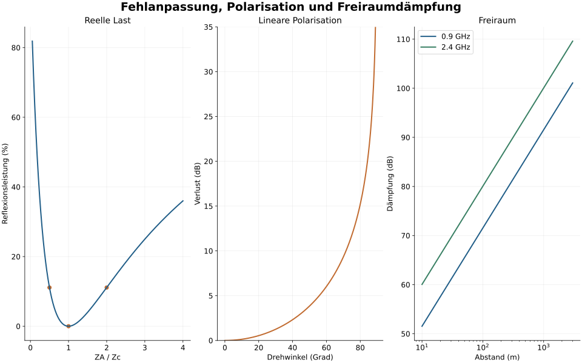

# M17-L4 – Anpassung und Ausbreitung {#L4}

**Kursbereich:** M17 – Bachelor: Antennen

**Niveau:** Bachelor · Wahlbereich

**Vorwissen:** [M17-L2](M17-L2.md), [M1-L6](M1-L6.md), [M4-L1](M4-L1.md).

**Lernziel:** Reflexion, Polarisationsverluste und Freiraumdämpfung getrennt berechnen.

## Anschluss und Reflexion {#S1}

Eine Antenne hat am Speisepunkt eine komplexe Eingangsimpedanz $Z_A=R_A+jX_A$. Auf einer verlustfreien Leitung mit reeller Bezugsimpedanz $Z_c$ ergibt sich

$$\Gamma=\frac{Z_A-Z_c}{Z_A+Z_c},\quad P_a=P_+(1-|\Gamma|^2).$$

$P_+$ bezeichnet die am Bezugspunkt hinlaufende Leistung. Das Stehwellenverhältnis ist $SWR=(1+|\Gamma|)/(1-|\Gamma|)$ und der positive Rückflussdämpfungswert $RL=-20\log_{10}|\Gamma|$. In einer Messung wird dagegen $S_{11}$ häufig als negativer dB-Wert dargestellt. Für $Z_A=100\,\Omega$ und $Z_c=50\,\Omega$ folgt $\Gamma=1/3$, SWR 2, RL 9,54 dB. 11,11 % der hinlaufenden Leistung werden reflektiert, die Fehlanpassungsdämpfung beträgt $-10\log_{10}(8/9)=0{,}512$ dB. Eine gut angepasste Antenne kann trotzdem ineffizient sein: Ein Abschlusswiderstand kann perfekt angepasst sein und wandelt die Leistung überwiegend in Wärme um.

## Empfang und Polarisation {#S2}

Bei passender Polarisation und konjugierter Lastanpassung entsteht aus der einfallenden Flussdichte $S$ die verfügbare Empfangsleistung $P_r=S A_e$. Für zwei linear polarisierte Antennen mit Drehwinkel $\psi$ ihrer Polarisationsrichtungen (bei gleicher Ausbreitungsachse) kommt der Leistungsfaktor $p=\cos^2\psi$ hinzu. Dieser Faktor betrifft die Feldprojektion, nicht automatisch das geometrische Richtdiagramm. Bei 45° beträgt die Einbuße 3,01 dB, bei 60° 6,02 dB. Bei 90° entsteht im Idealmodell eine Nullstelle; reale Antennen und Mehrwegeausbreitung können eine endliche Kopplung verursachen.

## Friis-Gleichung {#S3}

Kombinieren wir $S=P_tG_t/(4\pi r^2)$ und $A_e=\lambda^2G_r/(4\pi)$, folgt im Freiraum

$$P_r=P_t G_t G_r\left(\frac{\lambda}{4\pi r}\right)^2.$$

Hier ist $P_t$ die angenommene Sendeleistung und $P_r$ die verfügbare Empfangsleistung bei passender Polarisation. Die sogenannte Freiraumdämpfung ist $L_\mathrm{FS}=20\log_{10}(4\pi r/\lambda)$ in dB. Mit Entfernung in km und Frequenz in MHz gilt näherungsweise $L_\mathrm{FS}=32{,}45+20\log_{10}r_\mathrm{km}+20\log_{10}f_\mathrm{MHz}$. Bei 2,4 GHz und 1 km ergeben sich 100,05 dB. Bei doppelter Entfernung steigen die Verluste um 6,02 dB. Doppelte Frequenz erhöht die isotrope Freiraumdämpfung ebenfalls um 6,02 dB; bei konstanten physischen Empfangsaperturen kann sich gleichzeitig der Gewinn ändern. Der Vergleich muss also seine festen Größen benennen.

{alt="Reflektierter Leistungsanteil für reelle Lasten, Polarisationseinbuße und Freiraumdämpfung bei zwei Frequenzen."}

## Terrestrische Ausbreitung und Fresnel-Zone {#S4}

Für die erste Fresnel-Zone gilt näherungsweise $r_1=\sqrt{\lambda d_1d_2/(d_1+d_2)}$. Bei jeweils 500 m Teilstrecke und 2,4 GHz ist der Radius 5,59 m. Auch bei geometrischer Sicht können Hindernisse innerhalb dieser Zone die Empfangsleistung beeinflussen. Die Fresnel-Zone ist von der Fresnel-Nahfeldregion einer einzelnen Antenne zu unterscheiden. Bodenreflexion, Vegetation, Gebäude, Erdkrümmung und atmosphärische Refraktion ändern die tatsächliche Übertragung. Freiraumdämpfung ist deshalb eine Referenz, kein Garant für eine bestimmte Feldstärke oder Verfügbarkeit. Ein Mehrwegekanal kann sowohl konstruktive als auch destruktive Überlagerung erzeugen. Eine pauschale Zusatzdämpfung ist nur ein Sensitivitätsszenario, kein physikalisch begründeter Mehrwegekanal.

## Übungen mit Lösungen {#S5}

1. $Z_A=25\,\Omega$, $Z_c=50\,\Omega$. **Lösung:** $\Gamma=-1/3$, SWR 2, 11,11 % Reflexionsleistung.
2. Welche Dämpfung entsteht bei 30° Polarisationsoffset? **Lösung:** $-10\log_{10}(0{,}75)=1{,}25$ dB.
3. Verzehnfache r bei unveränderter Frequenz. **Lösung:** +20 dB Freiraumdämpfung.
4. Ist eine freie Sichtlinie ausreichend für das Friis-Modell? **Lösung:** Nein, Mehrwegeeffekte und Hindernisse in der Fresnel-Zone können die Rechnung verändern.

## Quellen {#S6}

- [Eastern Mediterranean University – EENG463 Antenna Theory](https://opencourses.emu.edu.tr/course/view.php?id=395) · Fundamental Parameters of Antennas-1/-2: Eingangsimpedanz, effektive Apertur und Friis-Gleichung. Kursübersicht, PDF nicht geprüft. · Zuletzt abgerufen: 2026-11-25
- [ITU-R P.525-5 – Calculation of free-space attenuation (11/2024)](https://www.itu.int/rec/R-REC-P.525-5-202411-I/en) · ITU-R P.525-5 (11/2024), Anhang §2.3, S. 3, Gl. (5)–(6): Freiraumdämpfung; PDF-Text geprüft, Seitenansicht nicht abrufbar. · Zuletzt abgerufen: 2026-11-25
