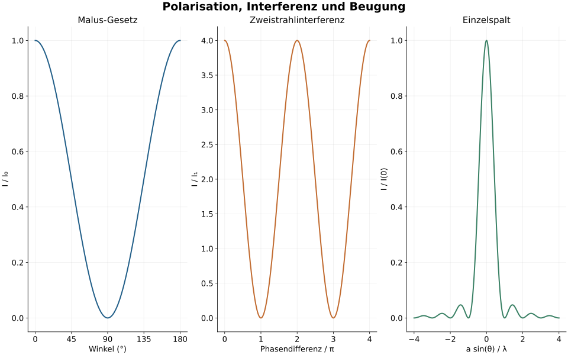

# M18-L1 – Licht als elektromagnetische Welle {#L1}

**Kursbereich:** M18 – Bachelor: Grundlagen der Photonik

**Niveau:** Bachelor · Wahlbereich

**Vorwissen:** [M4-L1](M4-L1.md), [M17-L1](M17-L1.md).

**Lernziel:** Wellenlänge, Polarisation und die Folgen kohärenter Überlagerung quantitativ bestimmen.

## Vom elektromagnetischen Feld zur Optik {#S1}

Photonik behandelt die Erzeugung, Führung, Verarbeitung und Detektion von Licht. Auch in der Optik gelten die Maxwell-Gleichungen. Die höheren Frequenzen und kleinen Wellenlängen gegenüber der Funktechnik ändern die relevanten Baugrößen, nicht die grundlegende Physik. Ein Feld in einem transparenten, isotropen, nichtmagnetischen Medium kann als ebene Welle modelliert werden:

$$E(z,t)=E_0\cos(\omega t-kz+\varphi),\qquad k=\frac{2\pi n}{\lambda_0},\qquad \lambda_0=\frac{c}{f}.$$

Die Frequenz bleibt beim Übergang zwischen ruhenden Medien gleich; Wellenlänge und Phasengeschwindigkeit ändern sich: $\lambda=\lambda_0/n$, $v_\mathrm{ph}=c/n$. Der Brechungsindex hängt im Allgemeinen von der Frequenz ab. Für das zeitlich gemittelte Intensitätsmaß gilt bei reellem Brechungsindex und Spitzenwert $E_0$ näherungsweise $I=n\epsilon_0 c E_0^2/2$ in W/m². Ein optischer Detektor erfasst typischerweise gemittelte Leistung, nicht das einzelne Schwingen des Feldes.

## Polarisation und Interferenz {#S2}

Die elektrische Feldrichtung zweier orthogonaler Komponenten und ihre Phasendifferenz bestimmen die Polarisation. Für linear polarisiertes Licht hinter einem idealen Polarisator mit Drehwinkel $\theta$ folgt aus der Projektion der Feldamplitude das Malus-Gesetz:

$$I=I_0\cos^2\theta.$$

Überlagert man zwei gleichfrequente Wellen gleicher Polarisation, addieren sich zunächst die komplexen Feldamplituden. Für zeitlich stabile relative Phase gilt

$$I=I_1+I_2+2\sqrt{I_1 I_2}\cos\Delta\varphi.$$

Eine Weglängendifferenz $\Delta s$ im selben Medium erzeugt $\Delta\varphi=2\pi n\Delta s/\lambda_0$ (zusätzliche Reflexionsphasen gegebenenfalls separat erfassen). Bei gleicher Einzelintensität $I_1=I_2$ variiert die lokale Intensität zwischen null und $4I_1$. Das Maximum bedeutet keine Energieerzeugung: Bei einem Interferometer verteilt sich Leistung zwischen den Ausgängen bzw. räumlichen Interferenzordnungen. Bei unabhängig fluktuierenden Phasen verschwindet der Interferenzterm im langen Zeitmittel. Kohärenz bezeichnet die Korrelation der Felder, nicht bloß gleiche Farbe.

## Beugung und Auflösung {#S3}

Eine endliche Apertur führt auch ohne geometrische Ablenkung zu einer Winkelverteilung. Bei gleichmäßiger kohärenter Beleuchtung eines Spalts der Breite $a$ erhält man im Fraunhofer-Bereich durch Integration der Phasen über die Öffnung:

$$\frac{I(\theta)}{I(0)}=\left(\frac{\sin u}{u}\right)^2,\qquad u=\frac{\pi a\sin\theta}{\lambda},$$

mit Grenzwert eins bei $u=0$. Das erste Minimum liegt bei $a\sin\theta=\lambda$ (sofern erreichbar). Die geometrische Optik vernachlässigt diese Verbreiterung. Eine kleinere Öffnung vergrößert die Winkelbreite. Bei einer Kreisapertur ist die entsprechende erste Nullstelle näherungsweise bei $1{,}22\lambda/a$, wobei $a$ dann den Durchmesser bezeichnet.

{alt="Malus-Gesetz, Zweistrahlinterferenz bei gleicher Intensität und Beugung am Einzelspalt."}

## Rechenbeispiel und Modellgrenze {#S4}

Bei $\lambda_0=633$ nm ist $f\approx474$ THz. In einem Medium mit $n=1{,}5$ beträgt die Wellenlänge 422 nm; die Frequenz ändert sich nicht. Bei einem Spalt von 50 µm in Luft liegt das erste Minimum bei rund 0,725°. In 2 m Entfernung entspricht das rund 25,3 mm seitlichem Abstand. Der Fresnel-Parameter $a^2/(\lambda L)\approx0{,}002$ ist hier klein, sodass die Fernfeldnäherung vernünftig ist. Bei einer relativen Phasenänderung von $\pi$ wechselt ein idealer Interferenzort von maximaler zu minimaler Intensität.

## Übungen mit Lösungen {#S5}

1. Ein Polarisator steht 60° zur Eingangsrichtung. **Lösung:** 25 % der Eingangsintensität.
2. Zwei kohärente Wellen haben Einzelintensitäten 1 und 4 W/m². **Lösung:** Maximum 9, Minimum 1 W/m².
3. Welche Wegänderung in Luft erzeugt bei 633 nm eine Phase von $\pi$? **Lösung:** 316,5 nm (einfacher Durchgang).
4. Verdopple die Spaltbreite. **Lösung:** Der erste Beugungswinkel halbiert sich näherungsweise für kleine Winkel.

## Quellen {#S6}

- [MIT OpenCourseWare – Optics (2.71), Lecture Slides](https://ocw.mit.edu/courses/2-71-optics-spring-2009/pages/lecture-slides/) · Sitzungen 12 und 14: Wellengleichung, elektromagnetische Energie und Polarisation; nur Vorlesungsverzeichnis. · Zuletzt abgerufen: 2026-11-25
- [MIT OpenCourseWare – 6.974 Fundamentals of Photonics, Lecture Notes](https://ocw.mit.edu/courses/6-974-fundamentals-of-photonics-quantum-electronics-spring-2006/pages/lecture-notes/) · Vorlesungsübersicht 2–12: Maxwell-Gleichungen, elektromagnetische Wellen und Optik; PDF nicht geprüft. · Zuletzt abgerufen: 2026-11-25
