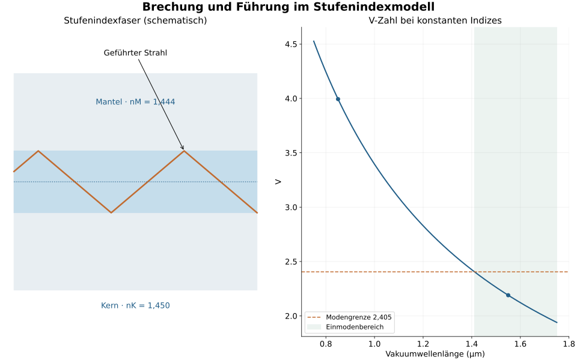

# M18-L2 – Optische Grenzflächen und Wellenleiter {#L2}

**Kursbereich:** M18 – Bachelor: Grundlagen der Photonik

**Niveau:** Bachelor · Wahlbereich

**Vorwissen:** [M18-L1](M18-L1.md), [M4-L1](M4-L1.md).

**Lernziel:** Reflexionsverluste, numerische Apertur und den Einmodenbereich einer idealisierten Faser berechnen.

## Brechung und Reflexion {#S1}

An einer ebenen Grenzfläche bleiben Frequenz und tangentiale Komponente des Wellenvektors erhalten. Mit Winkeln zur Flächennormalen folgt das Snelliussche Gesetz:

$$n_1\sin\theta_1=n_2\sin\theta_2.$$

Bei senkrechtem Einfall auf eine verlustfreie Grenzfläche zweier nichtmagnetischer Medien gelten für die Leistungsanteile

$$R=\left(\frac{n_1-n_2}{n_1+n_2}\right)^2,\qquad T=1-R.$$

Der Vorzeichenwechsel des reflektierten Feldes bei $n_2>n_1$ bedeutet eine Phasendrehung um $\pi$. Bei schrägem Einfall sind die Fresnel-Koeffizienten für s- und p-Polarisation verschieden. Reflexion geht nicht mit Wärmeverlust gleich; sie kann Leistung in einen unerwünschten Pfad umlenken oder Rückkopplung hervorrufen. Für eine einzelne unbeschichtete Glas-Luft-Grenze mit $n=1{,}5$ gehen 4 % der Leistung in die Rückreflexion; die Durchgangsdämpfung beträgt $-10\log_{10}(0{,}96)=0{,}177$ dB. Mehrere kohärente Reflexionen erfordern eine Feldrechnung statt reiner Leistungsprodukte.

## Totalreflexion und numerische Apertur {#S2}

Ist $n_1>n_2$, existiert für Winkel oberhalb $\theta_c=\arcsin(n_2/n_1)$ keine propagierende gebrochene ebene Welle. Das evaneszente Feld im dünneren Medium weist senkrecht zur idealen Grenzfläche keine gemittelte Nettoleistung auf, kann aber mit einem benachbarten Medium wechselwirken. Eine Stufenindexfaser besitzt einen Kern $n_\mathrm{K}$ und einen Mantel $n_\mathrm{M}<n_\mathrm{K}$. Für meridionale Strahlen folgt im Strahlenmodell der Akzeptanzkegel aus Brechung an der Stirnfläche und dem Grenzwinkel an der Kern-Mantel-Grenze:

$$n_0\sin\theta_\mathrm{max}=\mathrm{NA}=\sqrt{n_\mathrm{K}^2-n_\mathrm{M}^2}.$$

NA ist dimensionslos. Der Kegel ist keine Garantie dafür, dass ein gegebener Strahl effizient in eine bestimmte geführte Mode einkoppelt: Feldprofil, Position, Winkel und Polarisation beeinflussen die Überlappung.

## Wellenleiter als Modensystem {#S3}

In der Wellenbeschreibung sind Moden zulässige transversale Feldverteilungen mit longitudinalem Faktor $e^{-j\beta z}$. Für verlustfrei geführte Moden einer idealen Stufenindexfaser gilt $n_\mathrm{M}k_0<\beta<n_\mathrm{K}k_0$ mit $k_0=2\pi/\lambda_0$. Die normierte Frequenz lautet

$$V=\frac{2\pi a}{\lambda_0}\,\mathrm{NA},$$

wobei $a$ den Kernradius bezeichnet. Für die schwach führende kreisförmige Stufenindexfaser liegt die Grenze zum Auftreten höherer räumlicher Moden bei $V\approx2{,}405$. Unterhalb dieser Grenze bleibt die Grundmode mit ihren Polarisationszuständen. Die Mode ist nicht vollständig im Kern eingeschlossen; Biegung, Störungen und Kopplung verändern die Führung. Bei großen V gilt für die Zahl geführter Moden einschließlich Polarisation näherungsweise $V^2/2$, nicht im Übergangsbereich.

{alt="Strahlenführung im Faserkern und normierte Frequenz V in Abhängigkeit von der Vakuumwellenlänge."}

## Rechenbeispiel und Modellgrenze {#S4}

Mit $n_\mathrm{K}=1{,}450$, $n_\mathrm{M}=1{,}444$ und $a=4{,}1$ µm ergeben sich $\mathrm{NA}\approx0{,}1318$, $\theta_c\approx84{,}79°$ und in Luft ein Akzeptanzhalbwinkel von 7,57°. Bei 1550 nm beträgt V etwa 2,19; bei 850 nm etwa 3,99. Der modellierte Cutoff liegt bei rund 1411 nm. Das Beispiel verwendet konstante Indizes und die schwach führende Näherung; reale Hersteller-Cutoffs berücksichtigen unter anderem die Kabelgeometrie.

## Übungen mit Lösungen {#S5}

1. Senkrechter Übergang von 1,0 auf 1,5: **Lösung:** 4 % reflektiert.
2. Kann beim Übergang von Luft in Glas Totalreflexion auftreten? **Lösung:** Nein, nur von größerem zu kleinerem Index.
3. Welche Wirkung hat ein doppelt so großer Kernradius bei gleicher NA und Wellenlänge? **Lösung:** V verdoppelt sich.
4. Warum ist die Einmodenfaser nicht frei von Dispersion? **Lösung:** Die Gruppenlaufzeit der Grundmode kann von der Wellenlänge abhängen.

## Quellen {#S6}

- [MIT OpenCourseWare – Optics (2.71), Lecture Slides](https://ocw.mit.edu/courses/2-71-optics-spring-2009/pages/lecture-slides/) · Sitzung 2: Reflexion, Brechung und Wellenleiter; nur Vorlesungsverzeichnis. · Zuletzt abgerufen: 2026-11-25
- [MIT OpenCourseWare – 6.974 Fundamentals of Photonics, Lecture Notes](https://ocw.mit.edu/courses/6-974-fundamentals-of-photonics-quantum-electronics-spring-2006/pages/lecture-notes/) · Vorlesungsübersicht 2–12: optische Grenzflächen, Wellenleiter und Fasern; PDF nicht geprüft. · Zuletzt abgerufen: 2026-11-25
- [FOA Reference Guide – Optical Fiber](https://www.thefoa.org/tech/ref/basic/fiber.html) · Abschnitt Optical Fiber: Kern, Mantel, Totalreflexion und numerische Apertur; physikalische Grundlagen. · Zuletzt abgerufen: 2026-11-25
