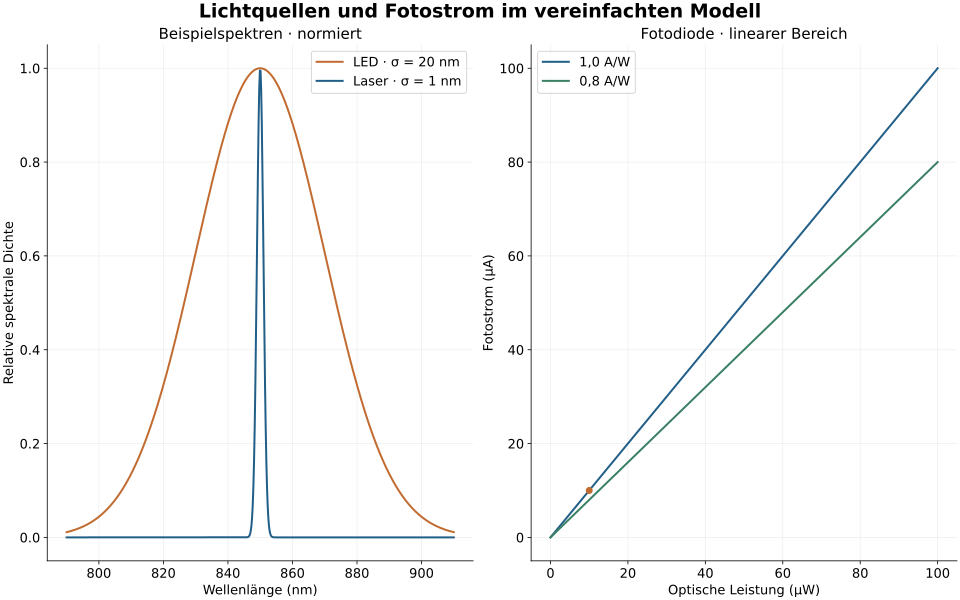

# M18-L3 – Lichtquellen und optische Detektoren {#L3}

**Kursbereich:** M18 – Bachelor: Grundlagen der Photonik

**Niveau:** Bachelor · Wahlbereich

**Vorwissen:** [M3-L1](M3-L1.md), [M3-L2](M3-L2.md), [M18-L1](M18-L1.md).

**Lernziel:** Optische Quellen unterscheiden und die Umwandlung optischer Leistung in Fotostrom berechnen.

## Photonen und Halbleiterübergänge {#S1}

Ein Photon besitzt die Energie

$$E_\gamma=hf=\frac{hc}{\lambda_0}.$$

Mit $h=6{,}62607015\cdot10^{-34}$ Js und $c=299792458$ m/s erhält man als Rechenhilfe $E_\gamma[\mathrm{eV}]\approx1240/\lambda_0[\mathrm{nm}]$. Bei einer LED rekombinieren injizierte Elektronen und Löcher unter spontaner Emission; ein Teil der elektrischen Energie wird zu Licht. Material, Temperatur und Stromdichte beeinflussen die spektrale Verteilung und Effizienz. Die Bandlücke gibt eine Energieskala vor, nicht die exakte monochromatische Emissionswellenlänge.

## LED und Laserprinzip {#S2}

Beim Laser ist stimulierte Emission maßgeblich. Optische Rückkopplung, etwa durch zwei Resonatorspiegel oder ein Gitter, wählt Moden. An der Schwelle gleicht die Kleinsignalverstärkung die Verluste gerade aus. Oberhalb der Schwelle begrenzt die Verstärkungssättigung den stationären Feldaufbau. Für ein vereinfachtes Fabry-Pérot-Modell mit Intensitätsreflexionsgraden $R_1,R_2$, Länge $l$, interner Verlustkonstante $\alpha_i$ und modaler Verstärkung $g$ gilt an der Schwelle

$$R_1R_2\,e^{2(g-\alpha_i)l}=1,\qquad g_\mathrm{th}=\alpha_i+\frac{1}{2l}\ln\frac{1}{R_1 R_2}.$$

Die LED ist oft kostengünstig, breitbandiger und einfacher zu betreiben. Laser können eine schmalere spektrale Breite und höhere gerichtete Ausgangsleistung bieten. Das verbessert die Kopplung in kleine Moden und kann chromatische Dispersion verringern; die konkreten Eigenschaften hängen aber vom Bauteil ab. Laserlicht ist auch im unsichtbaren Infrarot gefährlich; das Modell ist keine Anleitung zum Betrieb offener Laserquellen.

## Lichtempfang mit der Fotodiode {#S3}

Absorbierte Photonen können Ladungsträger erzeugen, die im elektrischen Feld getrennt und gesammelt werden. Sei $\eta$ die externe Quanteneffizienz (gesammelte Ladungsträgerpaare je einfallendem Photon ohne interne Verstärkung). Der Photonenfluss ist $\Phi=P/E_\gamma$, daraus folgt

$$I_\mathrm{ph}=q\eta\Phi=\mathcal R P,\qquad \mathcal R=\frac{\eta q\lambda_0}{hc}.$$

Die Responsivität $\mathcal R$ hat die Einheit A/W und ist wellenlängenabhängig. Eine PIN-Fotodiode wird in Empfängern oft in Sperrrichtung betrieben. Eine Avalanche-Fotodiode besitzt interne Multiplikation, die zusätzliches Rauschen verursachen kann. Dunkelstrom, kapazitive Bandbreite, thermisches Rauschen und Sättigung begrenzen die Messung. Der Transimpedanzverstärker überführt Strom in Spannung; idealisiert $V_\mathrm{out}=-R_f I_\mathrm{ph}$. Für einseitige äquivalente Rauschbandbreite B ist die Schrotrauschvarianz bei idealer PIN näherungsweise $\sigma_i^2=2q(I_\mathrm{ph}+I_\mathrm{dark})B$; Verstärkerrauschen ist separat zu ergänzen.

{alt="Normierte idealisierte LED- und Laserspektren sowie Fotostrom über Empfangsleistung."}

## Rechenbeispiel und Modellgrenze {#S4}

Bei 1550 nm und $\eta=0{,}8$ beträgt die Responsivität etwa 1,00 A/W. Bei −20 dBm, entsprechend 10 µW, entstehen etwa 10 µA Fotostrom. Mit einem idealen 10-kΩ-Transimpedanzwiderstand entspricht dies −0,10 V. Für B=100 MHz und vernachlässigbaren Dunkelstrom ergibt sich rund 17,9 nA RMS Schrotrauschen; das ist keine vollständige Empfängerempfindlichkeit. Ein gewöhnlicher Siliziumdetektor ist bei 1550 nm wegen seiner Bandlücke nicht geeignet; geeignete InGaAs-Detektoren sind ein Beispiel.

Mit $R_1=R_2=0{,}3$, $l=300$ µm und $\alpha_i=1000$ m⁻¹ ergibt das Resonatormodell $g_\mathrm{th}\approx5013$ m⁻¹. Der Wert bezeichnet modale Verstärkung, nicht unmittelbar einen Schwellenstrom.

## Übungen mit Lösungen {#S5}

1. Photonenergie bei 850 nm? **Lösung:** rund 1,46 eV.
2. Eine Fotodiode mit 0,8 A/W empfängt 25 µW. **Lösung:** 20 µA Fotostrom.
3. Verdopple die Rauschbandbreite bei sonst gleichem Strom. **Lösung:** Die Schrotrausch-Standardabweichung steigt um $\sqrt2$.
4. Warum liefert ein schmaleres Laserspektrum nicht automatisch eine höhere Empfängerempfindlichkeit? **Lösung:** Rauschleistung, Modulationsformat, Detektor und Verstärkerelektronik bleiben weitere Einflussgrößen.

## Quellen {#S6}

- [MIT OpenCourseWare – 6.974 Fundamentals of Photonics, Lecture Notes](https://ocw.mit.edu/courses/6-974-fundamentals-of-photonics-quantum-electronics-spring-2006/pages/lecture-notes/) · Vorlesungsübersicht 20–26: Licht-Materie-Wechselwirkung, Absorption, Verstärkung und Laser; Teilaspekt, PDF nicht geprüft. · Zuletzt abgerufen: 2026-11-25
- [MIT OpenCourseWare – Modern Optics Project Laboratory](https://ocw.mit.edu/courses/6-161-modern-optics-project-laboratory-fall-2005/) · Labs > Laser Safety Requirements: nur Sicherheitskontext, kein Beleg für Photodetektorphysik; dafür Hamamatsu-Fachquelle heranziehen. · Zuletzt abgerufen: 2026-11-25
- [Hamamatsu Photonics – The WITS$ guide to selecting a photodetector](https://hub.hamamatsu.com/us/en/technical-notes/detector-selection/the-wits-guide-to-selecting-a-photodetector.html) · Selection based on wavelength, Gl. 1: Quanteneffizienz und spektrale Responsivität; Selection based on intensity: Rauschen und Bandbreite. · Zuletzt abgerufen: 2026-11-25
