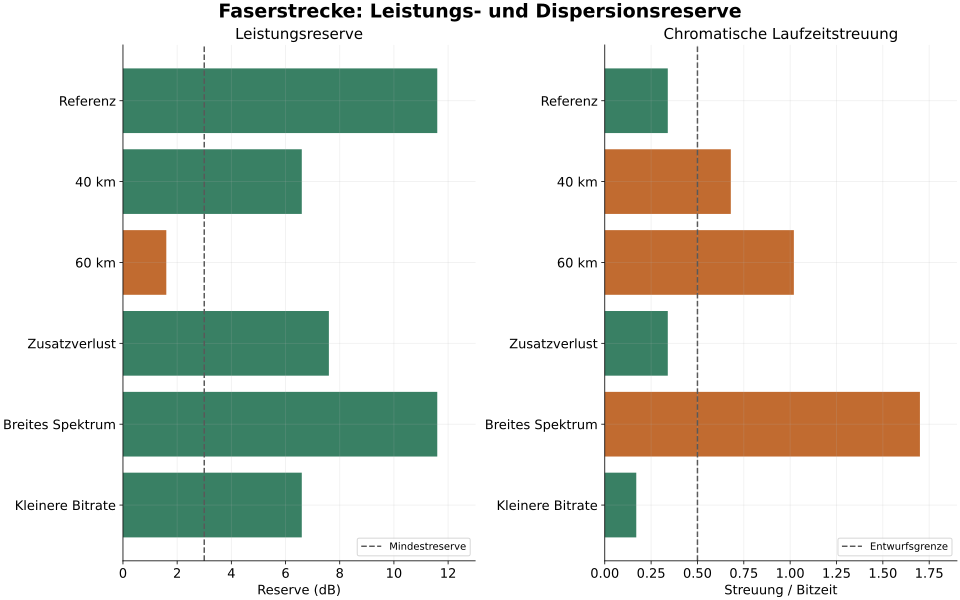

# M18-L4 – Modellfall Faserstrecke oder optischer Sensor {#L4}

**Kursbereich:** M18 – Bachelor: Grundlagen der Photonik

**Niveau:** Bachelor · Wahlbereich

**Vorwissen:** [M18-L1](M18-L1.md), [M18-L2](M18-L2.md), [M18-L3](M18-L3.md).

**Lernziel:** Eine optische Verbindung mit zwei unabhängigen Entwurfskriterien auslegen und ihre Modellgrenzen dokumentieren.

## Ausgangsfrage und Modellgrenze {#S1}

Als optionaler Modellfall optischer Messsignalübertragung soll eine optische Verbindung bei 1550 nm mit einer idealisierten Einmodenfaser zwei elektronische Stationen verbinden. Wir prüfen, welche Kombinationen von Streckenlänge und spektraler Breite innerhalb zweier frei festgelegter Entwurfsgrenzen liegen. Die Eingabewerte sind synthetische Rechenannahmen, keine Spezifikationen eines konkreten Produkts. Das Modell erfasst mittlere optische Leistung und chromatische Laufzeitstreuung, aber keine tatsächliche Bitfehlerrate.

| Größe | Modellwert |
| --- | ---: |
| Eingekoppelte mittlere Sendeleistung vor erster Steckverbindung | −2 dBm |
| Mindestempfangsleistung | −20 dBm |
| Geforderte Leistungsreserve | 3 dB |
| Steckverbinder | 2 × 0,5 dB |
| Spleiße | 4 × 0,1 dB |
| Faserdämpfung | 0,25 dB/km |
| Chromatischer Dispersionsparameter | 17 ps/(nm·km) |
| RMS-Spektralbreite | 0,1 nm |
| Binäre Datenrate | 10 Gbit/s |
| Erlaubte RMS-Laufzeitstreuung relativ zur Bitzeit | 0,50 |

Die Empfängergrenze wird zur Isolierung der Effekte auch bei geänderter Rate konstant angenommen. Praktisch muss ein Datenblatt die Empfindlichkeit für Format, Rate, BER, Temperatur und weitere Betriebsbedingungen angeben. Die vier Spleiße bleiben in allen Varianten konstant. Eine separate Einkoppeldämpfung ist nicht anzusetzen, weil die Sendeleistung schon an der definierten optischen Referenzebene vorliegt.

## Zwei unabhängige Entwurfskriterien {#S2}

Die Verlustsumme $A=1{,}4+0{,}25L+A_\mathrm{extra}$ (dB) führt zu $P_R=P_T-A$ (dBm). Die Leistungsreserve $m=P_R-P_\mathrm{min}$ muss mindestens 3 dB betragen. Für die zweite Prüfung verwenden wir die linearisierte chromatische Laufzeitstreuung $\sigma_\tau=|D|L\sigma_\lambda$. Der Dispersionsparameter $D$ beschreibt die Änderung der Gruppenlaufzeit pro Wellenlängenintervall und Streckenlänge; bei schmalem Spektrum ist das Produkt eine Näherung. Bei binärer Signalübertragung ist $T_b=1/R_b$. Die dimensionslose Kennzahl lautet $f_\tau=|D|L\sigma_\lambda/T_b$. Sie darf in diesem Modell 0,5 nicht übersteigen. Diese bewusst gewählte Entwurfsgrenze ist keine physikalische BER-Schwelle.

Für den Referenzfall mit 20 km: $A=6{,}4$ dB, $P_R=-8{,}4$ dBm und $m=11{,}6$ dB. Die chromatische Streuung beträgt 34 ps und damit 34 % der Bitzeit. Beide Kriterien sind erfüllt. Ohne Zusatzverluste ergibt sich analytisch

$$L_\mathrm{P,max}=\frac{-2-(-20)-3-1{,}4}{0{,}25}=54{,}4\,\mathrm{km},$$

$$L_\mathrm{D,max}=\frac{0{,}5\cdot100}{17\cdot0{,}1}=29{,}41\,\mathrm{km}.$$

Der kleinere Wert begrenzt den betrachteten Entwurf. Mehr Sendeleistung kann das Leistungsbudget verbessern, nicht den hier modellierten Dispersionswert. Eine reale Erhöhung der Leistung ist zudem durch Empfängerübersteuerung, Nichtlinearitäten und Sicherheitsanforderungen begrenzt.

## Reproduzierbares Rechenexperiment {#S3}

Das folgende Python-Programm benötigt keine externen Bibliotheken. Es benutzt dBm für Pegel, dB für Verluste und ps für Laufzeiten. $1/R_b$ in ps entspricht bei Rb in Gbit/s dem Wert $1000/R_b$. Die Prüfungen kontrollieren Differenzen und die Klassifikation der sechs Fälle.

```python
from math import sqrt, isclose
# All optical powers are time-averaged; loss values are didactic.
Ptx=-2; Prmin=-20; reserve=3; alpha=.25; D=17; budget=.5
# name, length km, additional loss dB, linewidth nm, bitrate Gbit/s
cases=[('Referenz',20,0,.1,10),('40 km',40,0,.1,10),('60 km',60,0,.1,10),('Zusatzverlust',20,4,.1,10),('Breites Spektrum',20,0,.5,10),('Kleinere Bitrate',40,0,.1,2.5)]
def case(L,extra,width,Rb):
    loss=2*.5+4*.1+alpha*L+extra
    rx=Ptx-loss
    margin=rx-Prmin
    dt=abs(D)*L*width # ps, RMS if width is RMS
    fraction=dt*Rb/1000
    return rx,margin,dt,fraction,margin>=reserve and fraction<=budget
if __name__=='__main__':
    for name,*args in cases:
        print(name,case(*args))
    assert isclose(case(40,0,.1,10)[0]-case(20,0,.1,10)[0],-5)
    assert isclose(case(20,4,.1,10)[0]-case(20,0,.1,10)[0],-4)
    assert isclose(case(20,0,.5,10)[2]/case(20,0,.1,10)[2],5)
    assert [case(*c[1:])[-1] for c in cases]==[True,False,False,True,False,True]
```

## Ergebnisse und Interpretation {#S4}

| Szenario | Empfang (dBm) | Reserve (dB) | Streuung (ps) | Streuung / Bitzeit | Beide Kriterien |
| --- | ---: | ---: | ---: | ---: | --- |
| Referenz, 20 km | −8,4 | 11,6 | 34 | 0,34 | ja |
| 40 km | −13,4 | 6,6 | 68 | 0,68 | nein |
| 60 km | −18,4 | 1,6 | 102 | 1,02 | nein |
| 20 km, weitere 4 dB Verlust | −12,4 | 7,6 | 34 | 0,34 | ja |
| 20 km, 0,5 nm Spektralbreite | −8,4 | 11,6 | 170 | 1,70 | nein |
| 40 km, 2,5 Gbit/s | −13,4 | 6,6 | 68 | 0,17 | ja |

{alt="Sechs Szenarien mit Leistungsreserve und relativer chromatischer Laufzeitstreuung."}

Die 40-km-Verbindung besitzt ausreichend mittlere Empfangsleistung, überschreitet jedoch das Dispersionskriterium. Die geringere Rate hilft in diesem Modell, weil sie längere Bitzeiten ermöglicht. Die breite Quelle zeigt, dass auch eine kurze Verbindung bei gleicher Leistung stärker dispersionsbegrenzt sein kann. Ein optischer Sensor mit reflektiertem Signal hätte dagegen andere Weg- und Reflexionsverluste (bei koaxialem Hin- und Rückweg beispielsweise die doppelte längenbezogene Dämpfung). Für eine reale Verbindung wären unter anderem reflektierte Leistung, Modulationsspektrum, Empfängerbandbreite, Leistungsgrenzen, Detektorrauschen, Alterung, Temperatur, Polarisation sowie Messunsicherheit zu berücksichtigen. Die Rechenstudie ersetzt keine Messung; niemals in Faserenden oder offene optische Steckverbinder blicken.

## Übungen mit Lösungen {#S5}

1. Bei 40 km und 10 Gbit/s soll die Strecke das Dispersionskriterium erfüllen. Welche maximale RMS-Spektralbreite ist erlaubt? **Lösung:** $50/(17\cdot40)=0{,}0735$ nm.
2. Wie viel zusätzliche Dämpfung verträgt der Referenzfall bis zur geforderten Reserve? **Lösung:** $11{,}6-3=8{,}6$ dB.
3. Wie groß ist die Leistungsreserve bei 30 km und 2 dB Zusatzverlust? **Lösung:** 7,1 dB; die Laufzeitstreuung von 51 ps überschreitet bei 10 Gbit/s dennoch knapp das zweite Kriterium.
4. Plane 40 km bei 0,1 nm. Welche maximale Datenrate ergibt sich aus dem Dispersionskriterium? **Lösung:** $0{,}5\cdot1000/68\approx7{,}35$ Gbit/s; die Leistungsreserve ist ausreichend. Die tatsächlich nutzbare Rate bleibt unbestimmt.

## Quellen {#S6}

- [FOA Reference Guide – Optical Fiber](https://www.thefoa.org/tech/ref/basic/fiber.html) · Abschnitt Optical Fiber: Kern, Mantel, Totalreflexion und numerische Apertur; physikalische Grundlagen. · Zuletzt abgerufen: 2026-11-25
- [The Fiber Optic Association – Fiber Optic Data Links](https://www.thefoa.org/tech/ref/appln/datalink.html) · Abschnitte Datalinks und Analog or Digital?: optische Sender, Empfänger, Dämpfung und Leistungsbudget. · Zuletzt abgerufen: 2026-11-25
- [Hamamatsu Photonics – The WITS$ guide to selecting a photodetector](https://hub.hamamatsu.com/us/en/technical-notes/detector-selection/the-wits-guide-to-selecting-a-photodetector.html) · Selection based on wavelength, Gl. 1: Quanteneffizienz und spektrale Responsivität; Selection based on intensity: Rauschen und Bandbreite. · Zuletzt abgerufen: 2026-11-25
